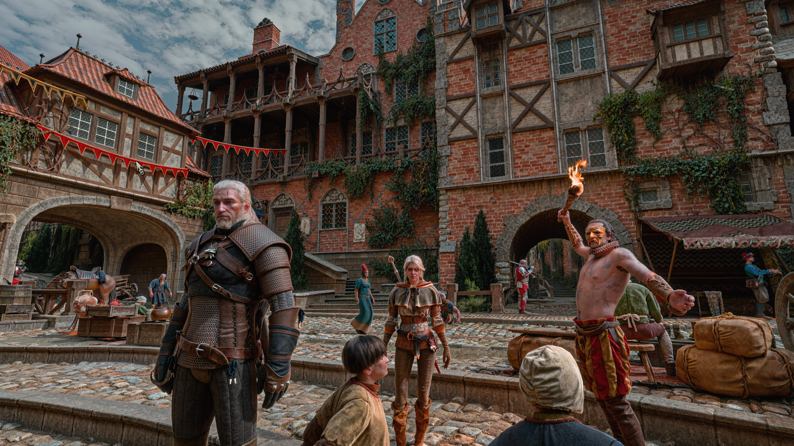
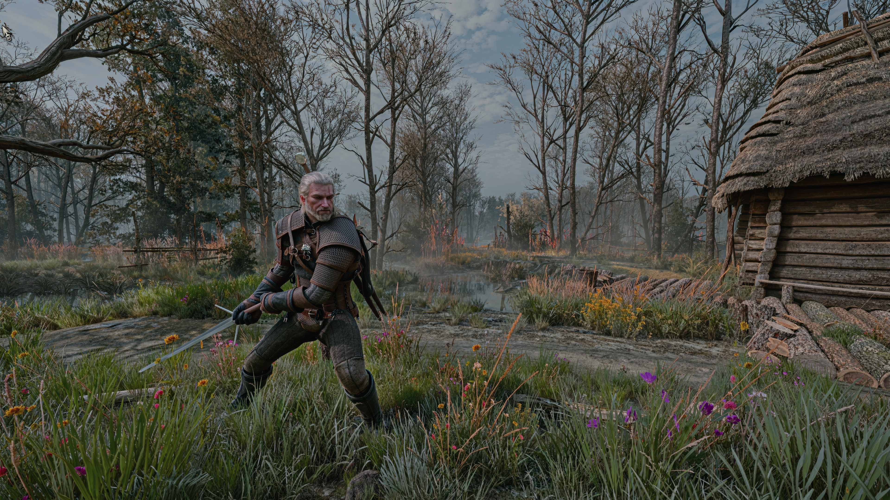
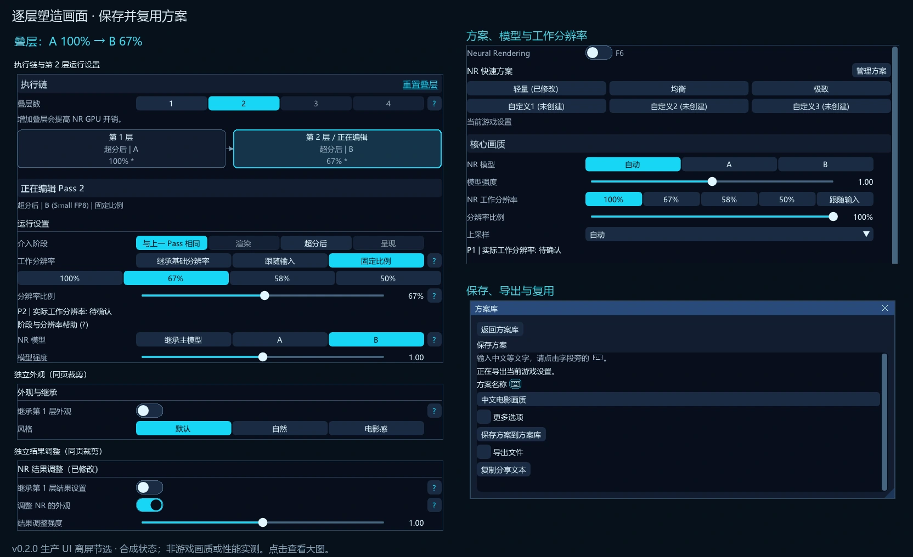
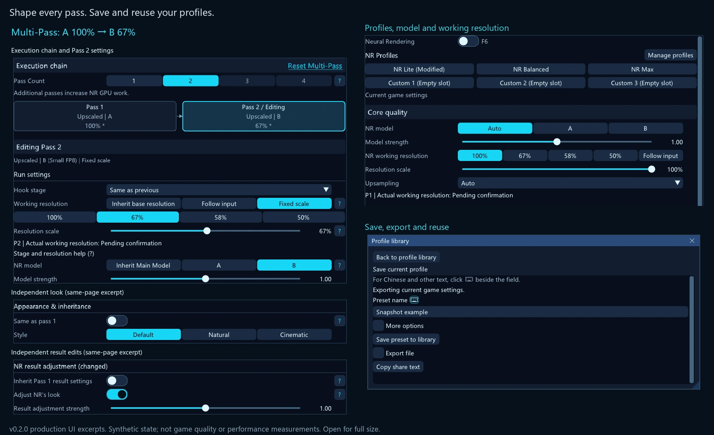

# NR Nexus

**DLSS Neural Rendering Add-on for ReShade**

[简体中文](#简体中文) · [English](#english)

[下载最新正式版 / Download latest stable](https://github.com/williamstosh/RenoDX-DLSSNR-Nexus/releases/latest)

## 简体中文

NR Nexus 通过 [ReShade](https://reshade.me/) 为兼容游戏提供 NVIDIA DLSS Neural Rendering
（DLSSNR）画面增强，基于 [RenoDX](https://github.com/clshortfuse/renodx) 开发。
将最多四层 NR 串成顺序处理链，为每层独立选择模型、调整外观和编辑结果，组合你想要的画面。
插件不执行降噪。

<a id="zh-index"></a>

**快速索引：** [实机画面](#zh-comparisons) · [核心特色](#zh-features) · [菜单界面](#zh-interface) · [下载、安装与使用](#zh-install) · [兼容性](#zh-compatibility) · [问题反馈](#zh-feedback) · [玩家指南](docs/USER_GUIDE.md#zh-start) · [开发者构建](#zh-build) · [来源与许可](#zh-sources)

<a id="zh-comparisons"></a>
### 游戏实机画面对比

下方为完整 NR ON 的 Ultra HDR 图片；兼容的浏览器、系统 HDR 设置和显示器可呈现 HDR，不支持时显示内置 SDR 画面。点击图片进入同场景 OFF／ON 滑块对比；也可 Ctrl／Cmd+点击在新标签页打开。更多场景见[实机对比图库](https://williamstosh.github.io/DLSS5-NR-Nexus/compare/)。

<!-- game-compare:zh:start -->

巫师3 — 诺维格瑞 · 教主广场

[](https://williamstosh.github.io/DLSS5-NR-Nexus/compare/#scene=3-30347b3fdd%2Fscene-35e7d20e1c%2Fbecc86134f6282d0)

巫师3 — 威伦 · 驼背泥沼

[](https://williamstosh.github.io/DLSS5-NR-Nexus/compare/#scene=3-30347b3fdd%2Fscene-4d71462ab3%2F9d0c90e0d157a5f5)

<!-- game-compare:zh:end -->

<a id="zh-features"></a>
### 核心特色

本页介绍 v0.4.0 的功能；特殊组合的兼容性条件见指南。

| 能力 | 玩家用途 |
| --- | --- |
| **设定目标帧率，自动调整 NR 分辨率** | 设置目标输出 FPS 和最低比例，插件在已准备的档位间调整 NR 工作尺寸；目标包含生成帧，无需额外安装帧率程序。[自适应分辨率与支持范围](docs/USER_GUIDE.md#zh-resolution) |
| **区域遮罩，按深度或运动减弱 NR** | 分别调节 NR 应用量、色调和结构，按深度淡出远景，或在快速运动区域减少 NR。画质页与每层叠层共用控件，支持继承或独立设置。[区域遮罩操作](docs/USER_GUIDE.md#zh-region-mask) |
| **最多四层，分别塑造外观和结果** | 在一次 NR 调整之外继续叠加处理，例如自然底层＋电影感第二层。每层分别调模型风格、人物／皮肤及亮暗、颜色、细节和光晕；可共享第 1 层设置，也可独立编辑。增加层数会增加 GPU 工作量，建议从单层开始。[两层实例](docs/USER_GUIDE.md#zh-two-pass-example) · [阶段与 FG 兼容性](#zh-compatibility) |
| **A/B 双模型与逐层选择** | 在兼容且识别为 **310.9.16.0** 的 Runtime 上比较 A（Legacy）和 B（Small FP8），组合 AA、AB、BA、BB，寻找喜欢的细节与风格，而不只做单模型开关。[模型与画质](docs/USER_GUIDE.md#zh-quality) |
| **超分前、超分后，或最终游戏画面** | Render、Upscaled、Present 决定在哪一步增强。支持的 DX11／DX12 链可用 **Render（B）→ 游戏 DLSS SR → Upscaled（A）**，兼顾前后两次处理，也可与原生 DLSS FG/MFG 或 XeFG 并用。[叠层与阶段](docs/USER_GUIDE.md#zh-multipass) |
| **XeFG + Present 条件单层 Backbuffer** | XeFG AUTO 且未启用 UI Composition 时，默认仅对 Backbuffer 执行所选 NR 链，省去额外的 HUDLess 完整链；1／2 Pass 分别执行 1／2 次模型调用。OptiScaler 开启 UI Composition 且 XeFG 消费 HUDLess 时保留双链；插件不修改 OptiScaler 配置。也可在画质页关闭“XeFG 单颜色处理”并重启，手动恢复双链。[选择与回退](docs/USER_GUIDE.md#zh-xefg-colors) |
| **逐层分配工作分辨率** | 例如 **Upscaled Pass 1（100%）→ Pass 2（67%）**，比较第二层降低尺寸后的细节与开销。同一 Render 阶段的双 Pass 也可各用不同尺寸；不改变游戏 DLSS SR 设置。[工作分辨率](docs/USER_GUIDE.md#zh-resolution) |
| **三套官方方案＋三个自定义槽＋共享方案库** | 从轻量、均衡、极致开始，将精心调好的一套或多套配置存入共享方案库；换游戏时导入后即可一键应用复用，省去逐项重调，也能导出分享。[方案管理](docs/USER_GUIDE.md#zh-presets) |
| **看清开销，再做取舍** | F11 常驻监视器显示帧率、NR GPU 和逐层信息；F8 切换精简／详细与趋势。手动 GPU A/B 比较一层尺寸调整前后的成本，帮助找到昂贵的层；画质仍由你在游戏中比较。[监视器与 GPU 对比](docs/USER_GUIDE.md#zh-diagnostics) |

<a id="zh-interface"></a>

### 菜单界面

界面支持 **15 种语言、七套主题**，可跟随 ReShade 语言；详细操作与参数见[玩家指南](docs/USER_GUIDE.md#zh-start)。



*左上：模型与工作分辨率；左下：F11 运行监视器；右侧：叠层与独立外观／结果编辑。v0.2.0 生产 UI 离屏示例，监视器数值为合成数据。*

<a id="zh-install"></a>
### 下载、安装与使用

**v0.4.0**：[Windows x64 插件 ZIP、SHA-256 与 Release Notes](https://github.com/williamstosh/RenoDX-DLSSNR-Nexus/releases/tag/v0.4.0)。在版本页面下载 ZIP 和对应的 `.zip.sha256`。GitHub 的 **Source code** ZIP 是源码，不是安装包。

**需要：** Windows x64、兼容 **ReShade API 18** 的[完整 Add-on 支持版 ReShade](https://reshade.me/)、
合法取得的兼容 NVIDIA **`nvngx_dlssnr.dll`**，以及该 Runtime 支持的显卡和驱动。
安装包不附带 ReShade、NVIDIA Runtime、模型或厂商 SDK；界面、翻译和着色器已编入插件。

推荐新手用第三方工具 **RHI** 准备 ReShade 和 Runtime，再单独安装 Nexus；RHI 由其上游维护。[详细安装／手动安装](docs/USER_GUIDE.md#zh-install)与 [RHI 官方教程](https://github.com/RankFTW/RHI/blob/main/docs/DETAILED_GUIDE.md)可供查阅。完整 Add-on ReShade 与注入工具可能触发反作弊，请仅在允许相关修改的单机环境使用。

1. 下载并打开 [RHI 最新版](https://github.com/RankFTW/RHI/releases/latest)，等待扫描游戏。未找到时点击搜索框旁 **+**，选择实际游戏 EXE，再点 **Add Game**；也可拖入 EXE。
2. 选择游戏，在 **Game Overrides → ReShade Channel** 使用 **Stable**（完整 Add-on 支持），然后安装 **ReShade**。不要选 **No Addons**。
3. 在 **DLSS / Streamline → Neural Rendering** 列选择合适的版本，例如当前社区 **`310.9.16 (20/30/40/50)`**，点 **Deploy DLL** 部署 NR Runtime。RHI 2.8.8 还会尝试部署最新 SR DLL（`nvngx_dlss.dll`），并备份已有文件；希望保留原 SR 版本、或找不到此栏时，按指南使用手动安装。
4. 点游戏标题区或右键菜单中的 **Browse** 打开游戏目录，核对实际 EXE（可能在 `Binaries/Win64` 等子目录）。关闭游戏，备份现有插件及设置。
5. 下载上方 **v0.4.0 ZIP**，将 **`renodx-dlss5.addon64`** 解压到 ReShade 实际加载的 Add-on 目录，通常是 EXE 旁；若 `ReShade.ini` 配置了 `AddonPath`，按该路径部署。保留许可文件。Runtime 可放插件旁或 EXE 旁，插件旁的 DLL 优先。
6. 启动游戏，按 ReShade 已设置的菜单键（通常为 **Home**），在 **Add-ons → NR Nexus** 确认已加载版本，接着按下方快速上手体验。未出现插件时见[安装排查](docs/USER_GUIDE.md#zh-status)。

**避免重复 NR 插件：** RHI 的 **Install Neural Rendering** 会安装 ShortFuse、DLSS5 Tool 等独立 NR 工具，与上面的 **Deploy DLL** 不同。使用 Nexus 时不要额外安装这些工具；已有安装应先按各自流程卸载，并将旧 Lecram／Nexus 副本移出生效的 Add-on 目录。RHI 可备份、更新或恢复它管理的文件；检查 `AddonPath` 与自动更新设置，避免旧副本重新生效。

**升级：** 关闭游戏、备份，按新版说明替换插件。**卸载：** 关闭游戏，移除插件或恢复旧版。
保留无关的 DLSS／FG 文件、ReShade 预设、配置和存档。

#### 常用快捷键

| 按键（默认绑定） | 用途 |
| --- | --- |
| **Home**（通常） | 打开／关闭 ReShade 菜单，在 Add-ons 中进入 NR Nexus。 |
| **F5** | 保存 NR 关／开对比截图；跨阶段链请用 F6 比较最终画面。 |
| **F6** | 开关 Neural Rendering，在同一场景比较画面。 |
| **F8** | 循环监视器的精简、详细、精简＋趋势、详细＋趋势四种显示模式。 |
| **F9**（默认关闭） | 启用后轮换轻量、均衡、极致三套官方方案。 |
| **F10**（默认关闭） | 启用后轮换已保存且可用的自定义方案，跳过空槽或不可用槽。 |
| **F11** | 显示／隐藏运行监视器，游玩时查看帧率与 NR 开销。 |

所有按键均可修改：菜单键在 **ReShade 设置**中调整，其余在 **NR Nexus → 高级 → 快捷键与截图**中调整；F9／F10 还需分别开启方案轮换。可能与游戏或其他工具重键，请按需更改；[详细说明](docs/USER_GUIDE.md#zh-capture)。

#### 5 分钟快速上手

选一个固定场景，先体验方案，再一次改一项。以下按默认按键说明；改过绑定时使用你自己的按键。

1. **开启 NR。** 打开 **NR Nexus → 画质**，开启 **Neural Rendering**，回到游戏看状态和画面；用 **F6** 比较关／开。全新兼容配置默认采用**均衡**，已有设置会保留。没有变化时先看[状态与排查](docs/USER_GUIDE.md#zh-status)。
2. **试三个官方方案。** 画质页顶部六槽中，前三个是官方起点：**轻量**为 Render／B／单层 75%，在游戏放大前处理；**均衡**为 Present／B／单层 67%，处理最终游戏画面；**极致**为 Present／A → B／双层 100%，叠加两种模型，通常更费 GPU。左键切换，在同一场景比较，灰色方案先查看原因；轻量需要兼容的 DLSS SR／DLAA。官方槽也会记住个人修改，想重试原配方时右键选**恢复官方默认**。
3. **调整自己在意的部分。** 回到均衡，在画质页比较**模型 A／B**（需要识别为 **310.9.16.0** 且包含相应模型的 Runtime）；在**介入点（处理位置）**选择超分前 Render、超分后 Upscaled 或最终画面 Present，前两者需要兼容 DLSS SR／DLAA。先试把**工作比例 67% 改为 50%**，比较细节与成本。**风格**改变模型生成的观感；开启**调整 NR 的外观**后可调亮暗、颜色和细节。想体验叠层，可切到极致，打开**叠层**并点击第 1／2 层分别查看模型和外观；每层依次处理前层结果，继承与独立编辑见[两层实例](docs/USER_GUIDE.md#zh-two-pass-example)。
4. **保存个人方案。** 后三个槽是本游戏的自定义槽。左键空槽，选**将当前设置保存为此方案**；之后编辑该选中方案会自动保存。已有内容的槽左键应用，右键可重命名或清空。想跨游戏复用一套或多套精调配置，用**管理方案 → 方案库**保存；换游戏后选中库内方案，点**预览所选方案**，检查差异后点**确认并应用方案**即可。[方案操作](docs/USER_GUIDE.md#zh-presets)
5. **观察性能。** 按 **F11** 显示监视器，用 **F8** 切换视图或趋势，比较切换方案前后的 NR GPU 开销与流畅度。层数越多、工作尺寸越大通常越费 GPU；挑选自己能接受的画质与成本。更细的逐层成本比较见[GPU A/B](docs/USER_GUIDE.md#zh-gpu-ab)，快捷键用途见上表。

<a id="zh-compatibility"></a>
### 兼容性与已知限制

<a id="zh-gpu"></a>
#### 显卡与 Runtime 兼容性

先按显卡选择 NR Runtime，再安装 Nexus。以下为系列级速查，兼容性仍取决于具体 Runtime、驱动、游戏及图形 API。

| 显卡系列 | Runtime 选择 |
| --- | --- |
| **GeForce RTX 50** | 原生 NVIDIA Runtime，属于 [NVIDIA 官方硬件支持范围](https://www.nvidia.com/en-us/geforce/news/dlss-5-3d-guided-neural-rendering/)。 |
| **GeForce RTX 40／30／20** | 可尝试社区兼容 Runtime，优先 DX11／DX12。 |
| **AMD／Intel** | 暂无本项目确认可替换 NVIDIA NR DLL 的方案。 |

[RHI](https://github.com/RankFTW/RHI) 的 [Runtime 清单](https://github.com/RankFTW/RHI/blob/main/dlss_manifest.json)提供 **`310.9.16 (20/30/40/50)`**（2026-11-01 核对）。这是社区兼容版本，不能等同于 NVIDIA 官方支持；其具体来源与支持范围应随上游版本核对。
[openNR](https://github.com/clshortfuse/openNR) 为 RTX 20／30／40 提供兼容代码，是使用自备 NVIDIA DLL 的**源码构建工具**，不分发 NVIDIA DLL；[RTX 30 优化项目](https://github.com/lmxxf/DLSS5-RTX-3080-laptop)目前仅针对 **Preset 2／Small**，不能据此推断完整 A/B、多 Pass、FG 或 Vulkan 支持，其整合包也并非 Nexus 安装包。

只要社区 Runtime 保持 Nexus 所需的 NGX 接口和行为兼容，原则上可沿用现有插件主体；实际仍须确认模型、处理位置和功能组合。上游架构代码与系列标签不是全型号、全游戏验证。本项目已有[限定范围的运行与自动化验证](docs/USER_GUIDE.md#zh-paths)，尚未完成 RTX 20／30／40／50 全系列兼容矩阵；openNR 也未声明其 CUDA／Vulkan 后端兼容。

#### 图形 API 与功能组合

| 使用情况 | 选择时需要了解 |
| --- | --- |
| **DX12／DX11 Bridge** | 提供 Render／Upscaled 及兼容的 Present 路径；逐层阶段与工作分辨率的可选组合见[叠层指南](docs/USER_GUIDE.md#zh-multipass)。 |
| **Vulkan** | 仅 DLSS 输出的 Upscaled 完整尺寸路径；Present 会回退到该位置，不支持混合阶段链或独立工作分辨率。 |
| **DLSS Ray Reconstruction** | 选择 Render 时，NR 在 Upscaled 位置处理 RR 输出。 |
| **Present** | 处理的画面包含游戏 HUD；菜单和地图也可能受到 NR 影响。 |
| **A/B 模型** | B 需要精确识别的 **310.9.16.0** Runtime；不兼容运行时上的已保存 B 选择会回退 A，原选择保留。 |

- 独立工作分辨率仅支持部分 DX11／DX12 组合；同阶段三层以上仍需相同工作尺寸。设置前参阅[叠层指南](docs/USER_GUIDE.md#zh-multipass)。
- 语言显示依赖 ReShade 已加载的字体；缺字处理见[高级设置](docs/USER_GUIDE.md#zh-advanced)。

- 可选／中性深度运动可用于兼容的无 DLSS 游戏；两层不同尺寸需确认 FG 关闭。原生 Pre-FG 两层异尺寸暂不支持，Upscaled → Present 默认关闭，属于受限实验。见[完整兼容表](docs/USER_GUIDE.md#zh-paths)。

各版本变化见 [Release Notes](https://github.com/williamstosh/RenoDX-DLSSNR-Nexus/releases)。

<a id="zh-feedback"></a>
### 问题反馈

[反馈问题](https://github.com/williamstosh/RenoDX-DLSSNR-Nexus/issues)时，请提供游戏／API、显卡／驱动、
插件与 Runtime 版本、处理位置、模型／层数、FG 配置、SDR/HDR 模式及复现步骤。

**我遇到了问题...** 可预览诊断并保存本地 ZIP，截图默认排除。文本／JSON 会自动脱敏；
分享前仍请检查附件中的私人路径、密钥和图像个人信息。诊断包为可选项，本地保存不会上传。

**Upload & copy link** 经单独同意后向第三方上传，持有链接者均可下载。
**准备 GitHub Issue** 打开浏览器草稿，由你检查并提交；附带摘要或报告链接分别征求同意。
详见[诊断与报告](docs/USER_GUIDE.md#zh-diagnostics)。

<a id="zh-build"></a>
### 开发者构建

开发者需准备 Windows x64、Git、PowerShell 7、Visual Studio 2022 C++ 工具
（**含 CMake**）、**MSVC 14.44** 和 **Windows SDK 10.0.26100.0**。
着色器工具链需要该 SDK 的 FXC、DXC 1.9.2602 或更新版本，以及 Slang 2026.14.1
或更新版本。下列初始化命令获取固定版本的 DXC／Slang 并复制 SDK 的 FXC；
下载地址及 SHA-256 固定于 [host/tools.lock.json](host/tools.lock.json)。

```powershell
git clone --branch dev https://github.com/williamstosh/RenoDX-DLSSNR-Nexus.git
cd RenoDX-DLSSNR-Nexus
pwsh ./tools/setup-build-tools.ps1
pwsh ./tools/setup-host.ps1
pwsh ./tools/build.ps1 -ToolRoot .local/shader-tools -Configuration Release
```

产物为 **`build/Release/renodx-dlss5.addon64`**。

软件回归入口为 `pwsh ./tools/run-tests.ps1 -Suite all -SoftwareOnly`。
Vulkan 测试会在 `.local/` 准备固定且校验 SHA-256 的公开头文件；`SoftwareOnly`
只编译该原生 GPU 用例，省略此开关才能运行。软件测试不需要 NGX SDK 库，
显式原生 NGX 用例才需要指定 SDK 库及 Runtime。

开发时可用 `pwsh ./tools/preview-ui.ps1` 离屏查看生产菜单，Python 需 NumPy／Pillow
（可传 `-PythonExecutable <python.exe>`）。直接打开 `artifacts/ui-snapshots/latest/index.html`。
Quick／Full、指定场景及经检查的文档配图更新共用真实 ImGui 捕获，见[快照工作流](docs/UI_SNAPSHOTS.md)。

[host/lock.json](host/lock.json) 固定 RenoDX 宿主及依赖，
[host/renodx-compat.patch](host/renodx-compat.patch) 补齐所需宿主接口。
初始化获取这些公开源码，并将本仓库链接为 `src/addons/dlss5`；
任意上游检出不能直接替代兼容宿主。

构建只从本项目的 `shaders/` 发现着色器输入，新增 Shader 也应放在该目录。
`tmp/`、`build/` 和其他目录中的历史字节码不会参与插件着色器构建。
首次接管或更换输入根时会自动重建该目标的生成 Shader 缓存，同根重配保留增量产物。
完成构建后，可运行 `pwsh ./tests/run-shader-input-tests.ps1` 检查输入隔离、增量更新和旧缓存迁移；无需游戏或 NVIDIA Runtime。
若旧宿主在构建时提示 `CMakeLists.txt` 兼容输入不匹配，可从项目根目录补上新增的构建入口：

```powershell
git -C .local/renodx apply --include=CMakeLists.txt (Resolve-Path host/renodx-compat.patch)
```

自定义宿主位置时替换命令中的 `.local/renodx`；新初始化的宿主已包含该改动。

初始化仅创建新目录，拒绝覆盖。已初始化的检出复用现有宿主／工具，只需重新构建；
也可用 `-ToolRoot <shader-tool-directory>` 指定现有着色器工具。
自定义宿主位置时，向初始化传 `-HostRoot <new-directory>`，向构建传
`-RenodxRoot <same-directory>`。厂商 SDK／Runtime 仍适用各自许可，
Runtime DLL、模型和游戏资源另行获取。

<a id="自动构建与发布"></a>

#### 版本与发布

[version.h](version.h) 定义插件版本，Git Commit 标识源码。`dev.N` 和可选的 `rc.N` 为预发布版本；
安装以[最新正式版](https://github.com/williamstosh/RenoDX-DLSSNR-Nexus/releases/latest)为准；较早正式版与预发布的功能变化统一查阅 [Release Notes](https://github.com/williamstosh/RenoDX-DLSSNR-Nexus/releases)。
[CI](.github/workflows/ci.yml) 构建源码，版本 Tag 触发[发布工作流](.github/workflows/release.yml)。
日常提交和 Actions artifacts 是开发构建。从 v0.2.1 起，Windows ZIP 附带 **NR-Nexus-Guide.html 离线玩家手册**：解压后双击，即可在浏览器阅读完整中英文 README 与指南，无需联网或 Markdown 阅读器。手册内嵌配图，游戏画面采用已审核的 SDR 静态预览；在线交互对比、下载和外部参考链接需要网络。原 README、玩家指南、配图和许可文件仍保留。已发布的 v0.2.0 安装包不变。

<a id="zh-sources"></a>
### 来源、致谢与许可证

NR Nexus 基于 [RenoDX](https://github.com/clshortfuse/renodx)、
Lecram [V8.5 RC10 公开插件源码](https://github.com/Yukikaze20170315/RenoDX-DLSS5-Generic/tree/v8.5dev)
及其贡献者的工作开发。
[导入源码提交](https://github.com/williamstosh/RenoDX-DLSS5-Generic/commit/9bb6c0fec57ecb28c77938f3feb8155433396d93)
及[历史 fork](https://github.com/williamstosh/RenoDX-DLSS5-Generic)保留为来源依据。Nexus 在此基础上继续开发逐层模型／外观／结果、跨阶段链、独立工作分辨率、方案管理与监视器等功能。

感谢 [GITC-Uplift](https://github.com/ghostinthecamera/GITC-Uplift) 作者
**Hussain Abdullah**，其公开的 DLSS NR 模型选择研究为 NR Nexus 的双模型实现提供了技术参考。
详细来源与参考范围见[第三方声明](THIRD_PARTY_NOTICES.md#gitc-uplift-research-and-local-validation-references)。

本项目是非官方独立项目，未获 NVIDIA、RenoDX 作者或 Lecram 背书。
原始 [MIT 许可](LICENSE)、版权及[第三方声明](THIRD_PARTY_NOTICES.md)保留原文；
MIT 许可不改变第三方 SDK、Runtime 或模型的许可条件。

## English

NR Nexus brings NVIDIA DLSS Neural Rendering (DLSSNR) image enhancement to compatible games through
[ReShade](https://reshade.me/), built on [RenoDX](https://github.com/clshortfuse/renodx).
Build a sequential chain of up to four NR passes, with an independent model, look and result editor for each layer.
The add-on performs no denoising.

<a id="en-index"></a>

**Quick index:** [In-game images](#en-comparisons) · [Features](#en-features) · [Interface](#en-interface) · [Download, install and use](#en-install) · [Compatibility](#en-compatibility) · [Feedback](#en-feedback) · [User Guide](docs/USER_GUIDE.md#en-start) · [Developer build](#en-build) · [Origins and license](#en-sources)

<a id="en-comparisons"></a>
### In-game Comparisons

The full NR ON images below use Ultra HDR. Compatible browsers, system HDR settings and displays can present HDR; other environments show the embedded SDR image. Click an image to compare the same scene with the OFF/ON slider; Ctrl/Cmd-click opens it in a new tab. Browse more scenes in the [comparison gallery](https://williamstosh.github.io/DLSS5-NR-Nexus/compare/).

<!-- game-compare:en:start -->

The Witcher 3 — Novigrad · Hierarch Square

[](https://williamstosh.github.io/DLSS5-NR-Nexus/compare/#scene=3-30347b3fdd%2Fscene-35e7d20e1c%2Fbecc86134f6282d0)

The Witcher 3 — Velen · Crookback Bog

[](https://williamstosh.github.io/DLSS5-NR-Nexus/compare/#scene=3-30347b3fdd%2Fscene-4d71462ab3%2F9d0c90e0d157a5f5)

<!-- game-compare:en:end -->

<a id="en-features"></a>
### What makes Nexus different

This page describes the features in v0.4.0. See the guide for compatibility conditions on specific combinations.

| Feature | What you can use it for |
| --- | --- |
| **Set a target FPS and adjust NR resolution automatically** | Set target output FPS and a minimum scale. The add-on adjusts NR working size between prepared levels, including generated frames in the target, without an extra FPS program. [Adaptive resolution and supported paths](docs/USER_GUIDE.md#en-resolution) |
| **Region masks that reduce NR by depth or motion** | Tune NR intensity, tone and structure separately, fade distant areas by depth, or reduce NR in fast-moving regions. Quality and every pass share controls, with inheritance or independent settings. [Region mask controls](docs/USER_GUIDE.md#en-region-mask) |
| **Up to four passes, with separate look and result controls** | Build on one NR adjustment with another, such as a Natural base plus a Cinematic second layer. Tune model styling, characters/skin, brightness, colour, detail and halos per pass, sharing Pass 1 settings or editing independently. More passes add GPU work; start with one. [Two-pass example](docs/USER_GUIDE.md#en-two-pass-example) · [Stage and FG compatibility](#en-compatibility) |
| **Dual models A/B, chosen per pass** | With a compatible runtime identified as **310.9.16.0**, compare A (Legacy) and B (Small FP8) in AA, AB, BA or BB combinations to find preferred detail and styling, beyond a single-model toggle. [Models and quality](docs/USER_GUIDE.md#en-quality) |
| **Before upscaling, after upscaling, or on the final game image** | Render, Upscaled and Present choose where enhancement happens. Supported DX11/DX12 chains can use **Render (B) → game DLSS SR → Upscaled (A)** to combine both stages, alongside native DLSS FG/MFG or XeFG. [Passes and stages](docs/USER_GUIDE.md#en-multipass) |
| **Conditional single-backbuffer default for XeFG + Present** | With XeFG AUTO and UI Composition off, run the selected NR chain on the backbuffer only, avoiding an additional full HUD-less chain: 1/2 Pass makes 1/2 model calls. Enabling UI Composition in OptiScaler retains the dual chain when XeFG consumes HUD-less input; the add-on leaves OptiScaler settings untouched. You can also disable “XeFG single-color processing” in Quality and restart to select the dual chain manually. [Selection and fallback](docs/USER_GUIDE.md#en-xefg-colors) |
| **Allocate working resolution per pass** | Try **Upscaled Pass 1 (100%) → Pass 2 (67%)** to compare the second layer's detail and cost at a smaller size. Two passes within Render can also use separate sizes, without changing game DLSS SR settings. [Working resolution](docs/USER_GUIDE.md#en-resolution) |
| **Three official profiles, three custom slots and a shared library** | Start with Lite, Balanced or Max, then save one or several carefully tuned configurations to the shared library. Import them in another game and apply with one click to reuse your work instead of tuning every setting again; export them to share as well. [Profiles](docs/USER_GUIDE.md#en-presets) |
| **See the cost before choosing** | The F11 monitor shows FPS, NR GPU cost and pass information; F8 cycles compact/detailed views and trends. Manual GPU A/B compares a single pass's cost before and after a size change to identify expensive layers. Compare image quality in gameplay. [Monitor and GPU comparison](docs/USER_GUIDE.md#en-diagnostics) |

<a id="en-interface"></a>

### Interface

The interface offers **15 languages and seven themes**, with automatic ReShade language selection. See the [User Guide](docs/USER_GUIDE.md#en-start) for controls and parameters.



*Top left: model and working resolution; bottom left: F11 runtime monitor; right: Multi-Pass with independent look/result editing. Offscreen excerpts of the v0.2.0 production UI; monitor values are synthetic.*

<a id="en-install"></a>
### Download, install and use

**[Download v0.4.0 (Windows x64 ZIP)](https://github.com/williamstosh/RenoDX-DLSSNR-Nexus/releases/tag/v0.4.0)** · **[View latest stable release](https://github.com/williamstosh/RenoDX-DLSSNR-Nexus/releases/latest)**

This page covers **v0.4.0**. Download the ZIP and matching `.zip.sha256` from the [release page](https://github.com/williamstosh/RenoDX-DLSSNR-Nexus/releases/tag/v0.4.0), which also contains the Release Notes. GitHub's **Source code** ZIP is source, not the add-on installation package.

**Requirements:** Windows x64; [ReShade with full add-on support](https://reshade.me/), compatible with
**ReShade API 18**; a legally obtained compatible NVIDIA **`nvngx_dlssnr.dll`**;
and a GPU and driver supported by that runtime. The package excludes ReShade, NVIDIA runtimes, models and
vendor SDK distributions. The interface, translations and shaders are embedded in the add-on.

For a first installation, use the third-party **RHI** tool to prepare ReShade and the runtime, then install Nexus separately. RHI is maintained by its upstream project. See [detailed/manual installation](docs/USER_GUIDE.md#en-install) or the [official RHI guide](https://github.com/RankFTW/RHI/blob/main/docs/DETAILED_GUIDE.md). Full add-on ReShade and injection tools can trigger anti-cheat; use them only in single-player environments that allow these modifications.

1. Download and open the [latest RHI](https://github.com/RankFTW/RHI/releases/latest), and let it scan your games. If yours is missing, click **+** next to search, select the actual game EXE and click **Add Game**, or drag the EXE onto RHI.
2. Select the game, use **Game Overrides → ReShade Channel → Stable** (full add-on support), then install **ReShade**. Do not choose **No Addons**.
3. Under **DLSS / Streamline → Neural Rendering**, choose a suitable version, such as the current community **`310.9.16 (20/30/40/50)`**, and click **Deploy DLL** to deploy the NR runtime. RHI 2.8.8 also attempts to deploy the latest SR DLL (`nvngx_dlss.dll`), backing up an existing file. To keep the original SR version, or if the column is missing, follow manual installation in the guide.
4. Use **Browse** in the game header or right-click menu to open the game folder. Confirm the actual EXE location, which may be a subfolder such as `Binaries/Win64`. Close the game and back up existing add-ons/settings.
5. Download the **v0.4.0 ZIP** above. Extract **`renodx-dlss5.addon64`** into ReShade's actual add-on directory, normally beside the EXE; follow `AddonPath` if configured in `ReShade.ini`. Keep the licenses. The runtime can sit beside the add-on or the EXE; the add-on-side DLL takes priority.
6. Start the game, use ReShade's configured menu key (usually **Home**) and confirm the loaded version under **Add-ons → NR Nexus**, then follow Quick Start below. If the add-on is missing, see [installation troubleshooting](docs/USER_GUIDE.md#en-status).

**Avoid duplicate NR add-ons:** RHI's **Install Neural Rendering** installs separate tools such as ShortFuse or DLSS5 Tool; it is different from **Deploy DLL** above. Do not install those alongside Nexus. Uninstall existing methods through their own procedures and move older Lecram/Nexus copies out of active add-on directories. RHI can back up, update or restore files it manages; check `AddonPath` and automatic-update settings so old copies do not become active again.

**Upgrade:** close the game, back up and replace the add-on according to the new release's notes.
**Uninstall:** close the game and remove the add-on or restore the previous version.
Keep unrelated DLSS/FG files, ReShade presets, configuration and saves.

#### Quick Controls

| Default key | Use |
| --- | --- |
| **Home** (usually) | Open/close ReShade; find NR Nexus under Add-ons. |
| **F5** | Save NR off/on comparison screenshots; use F6 to compare the final image with mixed-stage chains. |
| **F6** | Toggle Neural Rendering to compare the picture in the same scene. |
| **F8** | Cycle the monitor through Compact, Details, Compact + Trends and Details + Trends. |
| **F9** (off by default) | Once enabled, cycle through the Lite, Balanced and Max official profiles. |
| **F10** (off by default) | Once enabled, cycle through saved, available custom profiles, skipping empty or unavailable slots. |
| **F11** | Show/hide the runtime monitor to watch FPS and NR cost while playing. |

All keys can be changed: adjust the menu key in **ReShade settings**, and the others under **NR Nexus → Advanced → Hotkeys & screenshots**; enable each profile-cycling action there to use F9/F10. Rebind as needed if they conflict with the game or other tools. See [detailed controls](docs/USER_GUIDE.md#en-capture).

#### Quick Start

Spend five minutes in one fixed scene: try profiles, then change one setting at a time. These steps use default keys; use your own bindings if changed.

1. **Enable NR.** Open **NR Nexus → Quality**, enable **Neural Rendering**, then return to gameplay to check status and appearance. Compare off/on with **F6**. A compatible fresh configuration starts with **Balanced**; existing settings remain. If nothing changes, check [status and troubleshooting](docs/USER_GUIDE.md#en-status).
2. **Try the three official profiles.** The first three of the six slots at the top of Quality are official starting points: **Lite** uses Render/B/one pass at 75%, before game upscaling; **Balanced** uses Present/B/one pass at 67% on the final game frame; **Max** uses Present/A → B/two passes at 100%, combining two models and usually costing more GPU time. Left-click to switch and compare the same scene. Read the reason for greyed-out profiles; Lite needs compatible DLSS SR/DLAA. Official slots also retain personal edits; right-click **Restore official defaults** to try the original recipe again.
3. **Tune what matters to you.** Return to Balanced. In Quality, compare **model A/B** with a runtime identified as **310.9.16.0** that contains the corresponding models. Use **Hook point** for Render before upscaling, Upscaled after upscaling or Present on the final image; the first two need compatible DLSS SR/DLAA. Try changing **working scale from 67% to 50%**, comparing detail and cost. **Style** changes the generated look; enable **Adjust NR's look** to tune light, colour and detail. To explore layering, select Max, open **Multi-Pass** and click Pass 1/2 to inspect each model and look. Each pass processes the previous result; see the [two-pass example](docs/USER_GUIDE.md#en-two-pass-example) for inheritance and independent editing.
4. **Save a personal profile.** The last three slots are custom profiles for this game. Left-click an empty slot and choose **Save current settings to this slot**; later edits to the selected profile save automatically. Left-click a populated slot to apply it; right-click to rename or clear it. Save one or several tuned configurations through **Manage profiles → Profile library** for reuse across games. In another game, select a library profile, click **Preview selected preset**, review the differences and click **Confirm and apply preset**. [Profile controls](docs/USER_GUIDE.md#en-presets)
5. **Watch performance.** Press **F11** for the monitor and **F8** to change views or trends. Compare NR GPU cost and smoothness before and after switching profiles. More passes and larger working sizes usually cost more GPU time; choose your preferred balance. See [GPU A/B](docs/USER_GUIDE.md#en-gpu-ab) for closer per-pass comparisons, and the key table above for quick controls.

<a id="en-compatibility"></a>
### Compatibility and known limits

<a id="en-gpu"></a>
#### GPU and runtime compatibility

Choose an NR runtime for your GPU before installing Nexus. This series-level overview still depends on the particular runtime, driver, game and graphics API.

| GPU series | Runtime choice |
| --- | --- |
| **GeForce RTX 50** | Native NVIDIA runtime, within [NVIDIA's official hardware support](https://www.nvidia.com/en-us/geforce/news/dlss-5-3d-guided-neural-rendering/). |
| **GeForce RTX 40/30/20** | Try a community compatibility runtime, preferably on DX11/DX12. |
| **AMD/Intel** | No project-confirmed replacement for the NVIDIA NR DLL. |

[RHI](https://github.com/RankFTW/RHI) lists **`310.9.16 (20/30/40/50)`** in its [runtime manifest](https://github.com/RankFTW/RHI/blob/main/dlss_manifest.json) (checked November 1, 2026). This is a community compatibility build, separate from NVIDIA official support; check its provenance and scope with each upstream version.
[openNR](https://github.com/clshortfuse/openNR) supplies compatibility code for RTX 20/30/40. It is a **source build tool** using a user-supplied NVIDIA DLL and distributes no NVIDIA DLLs. The [RTX 30 optimization project](https://github.com/lmxxf/DLSS5-RTX-3080-laptop) targets only **Preset 2/Small**, which does not establish full A/B, multi-pass, FG or Vulkan support; its integration packages are not Nexus installation packages.

In principle, a community runtime that preserves the NGX interfaces and behavior Nexus needs can use the existing add-on without changes. Check the actual models, stages and combinations. Architecture code and series labels do not establish validation for every GPU and game. This project has [limited runtime and automated validation](docs/USER_GUIDE.md#en-paths), rather than a complete RTX 20/30/40/50 matrix; openNR also makes no CUDA/Vulkan backend compatibility claim.

#### Graphics APIs and feature combinations

| Setup | What to know when choosing |
| --- | --- |
| **DX12/DX11 Bridge** | Offers Render/Upscaled and compatible Present paths. See [Multi-Pass](docs/USER_GUIDE.md#en-multipass) for per-pass stage and working-resolution combinations. |
| **Vulkan** | Only the full-size Upscaled path on DLSS output. Present falls back to it; mixed-stage chains and independent working resolution are unavailable. |
| **DLSS Ray Reconstruction** | When Render is selected, NR processes the RR output at Upscaled. |
| **Present** | Includes the game's HUD; NR can also affect menus and maps. |
| **Models A/B** | B requires the specifically recognized **310.9.16.0** runtime. An incompatible saved B choice falls back to A while retaining the saved choice. |

- Independent working resolution supports selected DX11/DX12 combinations. Three or more passes in one stage still
  require matching working sizes; consult [Multi-Pass](docs/USER_GUIDE.md#en-multipass) before configuring them.
- Language display depends on ReShade's loaded font; see [Advanced](docs/USER_GUIDE.md#en-advanced) for missing glyphs.

- Optional/neutral depth and motion can support compatible games without DLSS. Two differently sized passes require FG off. Native Pre-FG with two differently sized passes is unsupported; Upscaled → Present is a limited experiment, disabled by default. See the [full compatibility table](docs/USER_GUIDE.md#en-paths).

See [Release Notes](https://github.com/williamstosh/RenoDX-DLSSNR-Nexus/releases) for version-specific changes.

<a id="en-feedback"></a>
### Feedback

[Report a problem](https://github.com/williamstosh/RenoDX-DLSSNR-Nexus/issues) with the game/API, GPU/driver,
add-on and runtime versions, processing location, models/pass count, FG setup, SDR/HDR mode and reproduction steps.

**I'm having issues...** previews diagnostics and saves a local ZIP, excluding screenshots by default.
Text/JSON are automatically redacted; review attachments for private paths, secrets and personal image content
before sharing. Diagnostic packages are optional, and local saving does not upload them.

**Upload & copy link** uploads to a third party after separate consent; anyone with the link can download it.
**Prepare GitHub Issue** opens a browser draft for you to review and submit. Including a summary or report link
requires separate consent. See [Diagnostics and reports](docs/USER_GUIDE.md#en-diagnostics).

<a id="en-build"></a>
### Developer build

For developers: use Windows x64, Git, PowerShell 7, Visual Studio 2022's C++
tools **including CMake**, **MSVC 14.44**, and **Windows SDK 10.0.26100.0**.
The shader toolchain needs FXC from that SDK, DXC 1.9.2602 or later and Slang
2026.14.1 or later. The setup command below obtains the pinned DXC/Slang builds
and copies the SDK's FXC; downloads and SHA-256 values are in
[host/tools.lock.json](host/tools.lock.json).

```powershell
git clone --branch dev https://github.com/williamstosh/RenoDX-DLSSNR-Nexus.git
cd RenoDX-DLSSNR-Nexus
pwsh ./tools/setup-build-tools.ps1
pwsh ./tools/setup-host.ps1
pwsh ./tools/build.ps1 -ToolRoot .local/shader-tools -Configuration Release
```

The output is **`build/Release/renodx-dlss5.addon64`**.

Run software regressions with `pwsh ./tools/run-tests.ps1 -Suite all -SoftwareOnly`.
Vulkan tests prepare pinned, SHA-256-checked public headers under `.local/`.
`SoftwareOnly` compiles this native GPU case without running it; omit that switch
to execute it. Software tests need no NGX SDK library; explicit native NGX cases
require the SDK library and runtime paths.

For an offscreen view of the production menu, run `pwsh ./tools/preview-ui.ps1`
with a Python containing NumPy/Pillow (`-PythonExecutable <python.exe>`).
Open `artifacts/ui-snapshots/latest/index.html` locally. Quick/Full previews,
scene selection and checked documentation-image updates share the same ImGui
capture source; see the [snapshot workflow](docs/UI_SNAPSHOTS.md).

[host/lock.json](host/lock.json) pins RenoDX and its dependencies;
[host/renodx-compat.patch](host/renodx-compat.patch) supplies the required host
interfaces. Setup fetches these public sources and links this checkout as
`src/addons/dlss5`; an arbitrary upstream checkout is not a substitute.

Shader discovery is limited to this project's `shaders/` directory; place new
shaders there as well. Historical bytecode under `tmp/`, `build/` or other
directories is excluded from the add-on's shader inputs. Root changes refresh
that target's generated shader cache; repeated configuration preserves incremental outputs.
After building, run
`pwsh ./tests/run-shader-input-tests.ps1` to check input isolation, incremental
updates and old-cache migration; no game or NVIDIA Runtime is required.
If an older host reports a `CMakeLists.txt` compatibility-input mismatch, apply the new build entry from
the project root:

```powershell
git -C .local/renodx apply --include=CMakeLists.txt (Resolve-Path host/renodx-compat.patch)
```

Replace `.local/renodx` for a custom host location. Newly initialized hosts
already include this change.

Setup creates new directories and refuses overwrites. On an initialized
checkout, reuse the prepared host/tools and rerun the build. Existing shader
tools can be supplied with `-ToolRoot <shader-tool-directory>`. For a different
host location, use setup's `-HostRoot <new-directory>` and build's
`-RenodxRoot <same-directory>`. Vendor SDK/runtime terms still apply; runtime
DLLs, models and game assets are obtained separately.

<a id="automated-builds-and-releases"></a>

#### Versions and releases

[version.h](version.h) defines the add-on version; Git commits identify the source.
`dev.N` and optional `rc.N` identify pre-releases. Use the [latest stable release](https://github.com/williamstosh/RenoDX-DLSSNR-Nexus/releases/latest) for installation;
see [Release Notes](https://github.com/williamstosh/RenoDX-DLSSNR-Nexus/releases) for earlier stable and pre-release feature changes.
[CI](.github/workflows/ci.yml) builds the source, and version tags trigger the
[release workflow](.github/workflows/release.yml). Daily commits and Actions artifacts are development builds.
Starting with v0.2.1, Windows ZIPs include an automatically generated **NR-Nexus-Guide.html offline player guide**. Extract it and double-click to read the complete Chinese and English README and User Guide in a browser, without a connection or Markdown reader. Images are embedded, with approved static SDR previews for game scenes; online interactive comparisons, downloads and external references require a connection. The original README, User Guide, images and licenses remain included. The published v0.2.0 package is unchanged.

<a id="en-sources"></a>
### Origins, thanks and license

NR Nexus builds on [RenoDX](https://github.com/clshortfuse/renodx), Lecram's
[V8.5 RC10 public add-on source](https://github.com/Yukikaze20170315/RenoDX-DLSS5-Generic/tree/v8.5dev)
and their contributors. The
[imported source commit](https://github.com/williamstosh/RenoDX-DLSS5-Generic/commit/9bb6c0fec57ecb28c77938f3feb8155433396d93)
and [historical fork](https://github.com/williamstosh/RenoDX-DLSS5-Generic)
remain available for provenance. Nexus continues development on this foundation with per-pass models/look/results, cross-stage chains, independent working resolution, profiles and the monitor.

Thanks to **Hussain Abdullah**, author of
[GITC-Uplift](https://github.com/ghostinthecamera/GITC-Uplift), whose published
DLSS NR model-selection research informed NR Nexus's dual-model implementation.
See the [reference scope and provenance](THIRD_PARTY_NOTICES.md#gitc-uplift-research-and-local-validation-references).

This is an unofficial independent project, without endorsement from NVIDIA,
RenoDX's authors or Lecram. The original [MIT license](LICENSE), copyright and
[third-party notices](THIRD_PARTY_NOTICES.md) are preserved. The MIT license
does not relicense third-party SDKs, runtimes or models.
