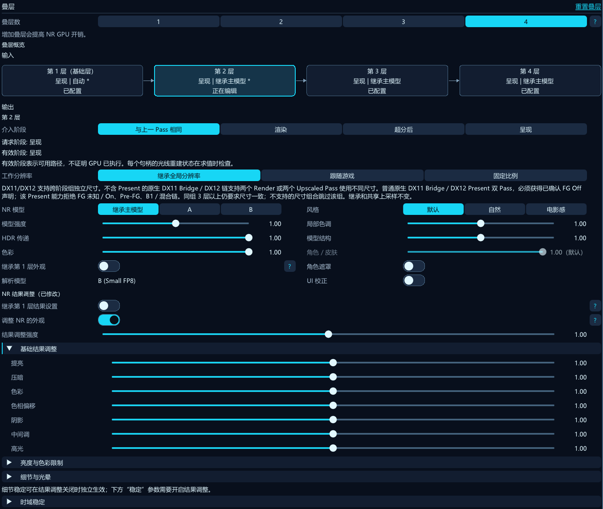
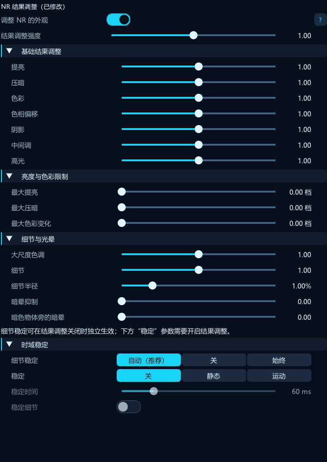
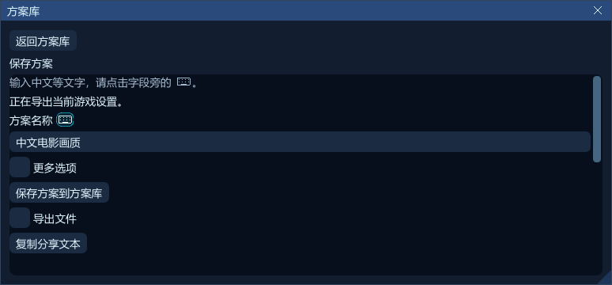
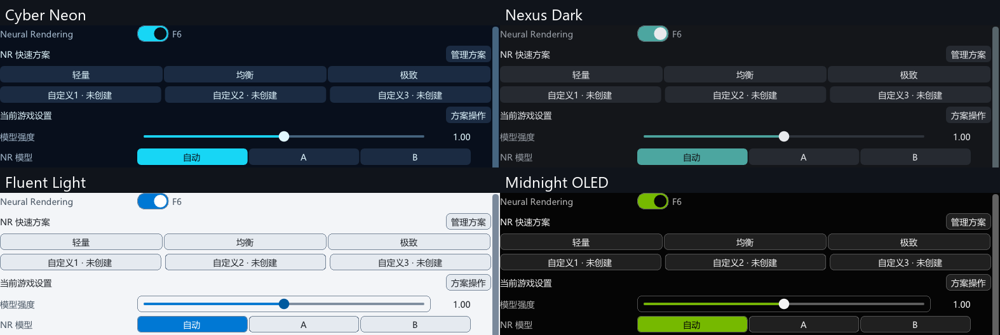
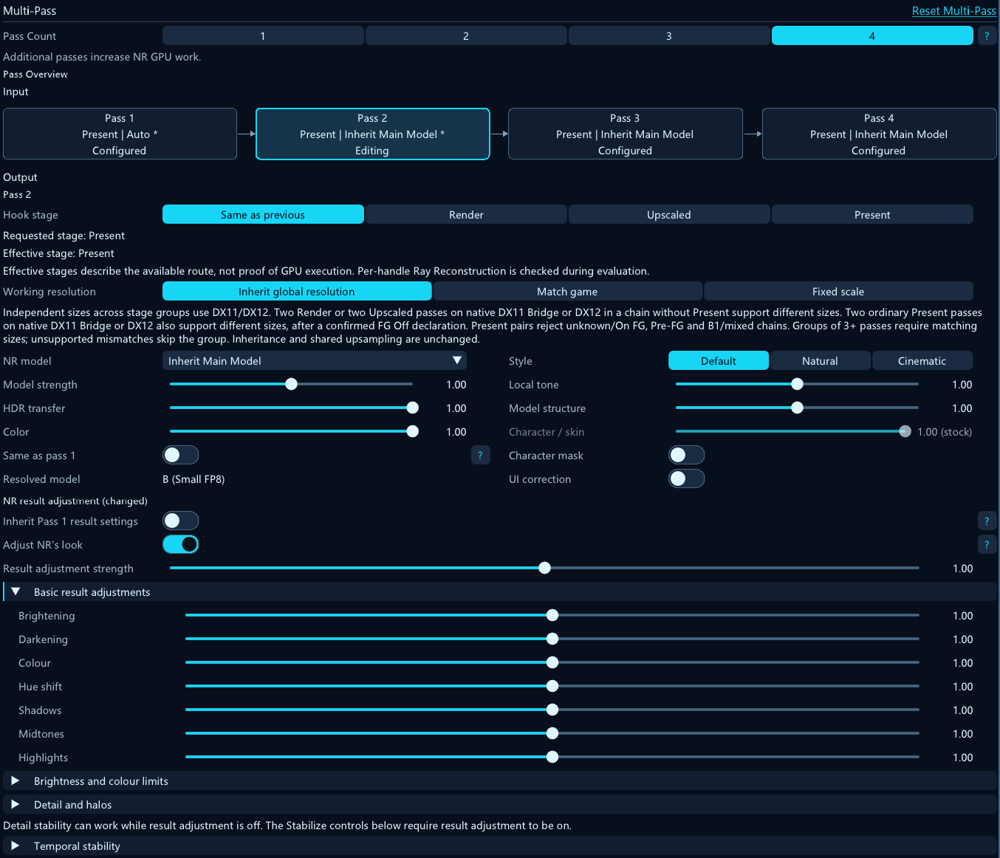
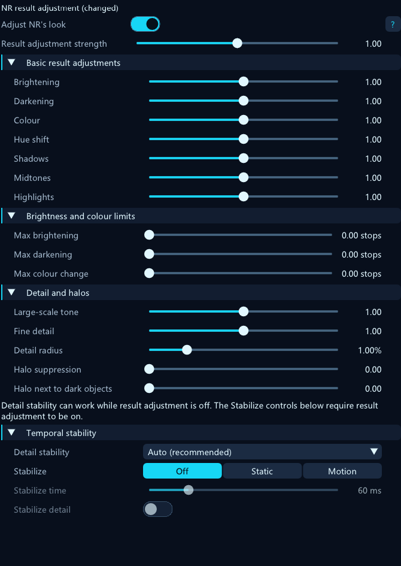
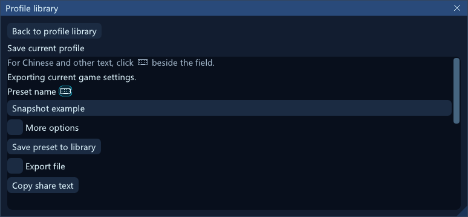
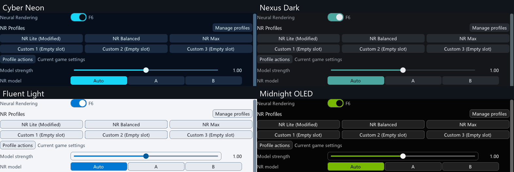

# NR Nexus

**DLSS Neural Rendering Add-on for RenoDX**

[简体中文](#简体中文) · [English](#english)

[**Download / 下载**](https://github.com/williamstosh/RenoDX-DLSSNR-Nexus/releases) · [**User Guide / 玩家指南**](docs/USER_GUIDE.md) · [**Compatibility / 兼容性**](#兼容性与已知限制) · [**GitHub Issues / 问题反馈**](https://github.com/williamstosh/RenoDX-DLSSNR-Nexus/issues)

## 简体中文

NR Nexus 通过 [ReShade](https://reshade.me/) 为兼容游戏提供 NVIDIA DLSS Neural Rendering
（DLSSNR）画面增强，基于 [RenoDX](https://github.com/clshortfuse/renodx) 的改装工具开发。
你可以选择 NR 的处理位置，组合最多四层顺序执行的处理链，并调整各层模型、外观和结果。
插件不执行降噪。

本项目基于 Lecram V8.5 RC10 开放源码独立发展，新增了 NR／FG 协调、Present 恢复策略、
运动纹理共享回退、双模型选择及带隐私预览的问题反馈。0.1.0 还包含逐层独立
结果编辑和四套菜单主题。

| 版本范围 | 可用范围 |
| --- | --- |
| **0.2.0-dev.6 预发布** | 新增原生 DX11 Bridge Render → 游戏 DLSS SR/DLAA → Upscaled，最多四层沿用逐层独立模型、外观及结果配置；另含默认关闭的 DX12 Upscaled→Present 实验（需 `NRExperimentalPresentChain=1`）。混合链每阶段交付须确认 GPU 真正完成，会增加同步成本；DX11 游戏／画质验收与自动化 GPU 测试分开记录。已实现的 Render→Upscaled 可与原生 DLSS FG／XeFG 并用，既有输入所有权及实验门控仍适用。B2 的 Upscaled→Pre-FG 尾组尚未实现，Vulkan 混合链仍停用。见[叠层指南](docs/USER_GUIDE.md#zh-multipass)。 |
| **0.2.0-dev.5 预发布** | 新增可选原生 Unicode 辅助输入、精简预设／方案及逐层独立阶段，并修正发布包的文档配图清单。DX12 Render → 游戏 DLSS SR → Upscaled 已有巫师3 HDR 下 AA／AB／BA／BB 短时实测，广泛画质／长时验收仍未完成。跨阶段 Present、DX11/Vulkan 停用。见[叠层指南](docs/USER_GUIDE.md#zh-multipass)和[方案指南](docs/USER_GUIDE.md#zh-presets)。 |
| **0.1.0** | 本页描述此版本的四页菜单、双模型、逐层独立外观／结果设置与四套主题；验证及剩余限制见[版本说明](docs/releases/v0.1.0.md)。 |
| [上一预发布版：v0.2.0-dev.5](https://github.com/williamstosh/RenoDX-DLSSNR-Nexus/releases/tag/v0.2.0-dev.5) | 新增逐层阶段、辅助输入及修正后的文档配图包。 |

### 核心特色

| 能力 | 玩家用途 |
| --- | --- |
| **最多四层的 NR 顺序处理链** | 前一层的输出送入下一层，在一条链中组合不同模型与外观。层数越多 GPU 工作越多，不保证画质更好。 |
| **逐层独立外观与结果编辑** | 每层分别调整风格、局部色调、结构、角色遮罩及皮肤参数，再塑造输出中的亮度、色彩、阴影／中间调／高光、细节、光晕抑制与时序稳定；自由组合继承设置与已保存的逐层独立外观和结果。 |
| **310.9.16 A/B 双模型** | 对比 A（Legacy）和 B（Small FP8），配置 AA、AB、BA、BB；附加层可独立选模型或继承主模型。 |
| **Render／Upscaled／Present** | 在 DLSS 超分前、DLSS 输出或 ReShade 效果前的最终游戏画面上应用 NR；实际执行取决于 API、资源和 FG 路由。 |
| **NR 协同原生 DLSS FG/MFG 或 XeFG** | 配合已有 FG 后端运行，查看实际观测路径与活动，不把配置倍率当作 FG 已生效的证明。 |
| **输出效果与时序稳定** | 调整亮度／颜色限制、细节、光晕和时序行为；SDR/HDR 兼容策略仍独立可配。 |
| **实时诊断与报告** | 查看 NR 活动、请求／解析模型、资源及可用时的 GPU 时间，准备可选诊断与需用户检查提交的 Issue 草稿。 |
| **15 种界面语言** | Auto 自动跟随 ReShade，也可手动选择。显示取决于 ReShade 已加载的字体，语言清单与缺字回退说明见指南。 |
| **四套界面主题** | Cyber Neon、Nexus Dark、Fluent Light、Midnight OLED 只改变菜单视觉，不影响 NR 图像处理。 |
| **六个 NR Profile Slot（开发中）** | 每游戏三个官方开发候选及三个自定义 Slot，独立保留覆盖值，可捕获／重命名／清空自定义快照、撤销 Slot 操作或恢复当前官方默认值。编辑自动保存，首次升级保留当前配置，保存失败不切换。 |
| **本地共享方案（开发中）** | “管理方案”打开可搜索的方案库主页，提供保存方案／导入方案任务，自定义管理默认折叠。保存与导出选项按需展开，读取成功后才显示预览／应用或存入自定义方案。完整备份另行确认，选导出路径不会立即写入。操作见[方案与方案库指南](docs/USER_GUIDE.md#zh-presets)。 |
| **辅助输入（尚未发布）** | 原位 IME 输入异常时，点击字段标题旁的键盘图标按钮（悬停可查看“辅助输入：打开兼容文本编辑窗口，输入中文等文字。”），或右键可编辑的预设字段、Slot 名称或报告文字并选“辅助输入…”，打开同一个可选的 Windows 原生 Unicode 编辑窗。区域提示中的键盘图形仅作说明，不能点击。“应用”将文字带回表单，“取消”丢弃编辑；保存仍需主动执行。此功能不改变原位输入，原生窗口表现仍需在目标游戏中验证。见[指南](docs/USER_GUIDE.md#zh-presets)。 |

Slot 和预设管理仅在当前开发源码中提供，**0.1.0 稳定包不包含这些功能**。官方 Lite 为
Render／1 层／B／跟随输入，Balanced 为 Upscaled／1 层／A／跟随输入，Max 为
Present／2 层／A+B／100%；三者保存比例均为 1.0，前两者不再叠加一次降分辨率。
其余管理字段继承注册默认值。这些均为开发候选，尚未完成实机画质／性能验收，
Release／Debug 构建及受影响自动化检查已通过，Runtime 兼容门槛仍有效。
Slot 自动保存与共享库文件、ReShade 正常设置分别处理，强退可能丢失待保存的 Slot 编辑；
只读／损坏保护、迁移及 revision 冲突恢复见指南。

模型外观控制 NR 生成什么，结果编辑则塑造每层模型已经返回的改变量。模型选择、外观继承、
结果继承彼此独立，附加层既可沿用第 1 层，也可保留各自保存的编辑。第 1 层选择起始介入点，
后续层可继承或选择合法的后续阶段。工作分辨率和上采样仍全链共享，“独立皮肤”也是全链设置；
结果控件有各自的开关及资源前提。

参数值、依赖、继承和配置示例见[玩家指南](docs/USER_GUIDE.md)。



*候选的生产 ImGui 菜单离屏捕获，状态为合成夹具；本图经过裁切，仅展示界面，
不是游戏画质对比或性能测量。*



*同一候选菜单的离屏界面示例：基础结果调整、亮度与色彩限制、细节与光晕、时域稳定。*



*0.2.0-dev.6 开发预发布源码中的简洁保存任务，更多选项及文件导出按需展开；
本图为合成状态的离屏示例，未执行保存。*



*同一候选菜单的四套主题，主题只影响界面。*

### 下载、安装与使用

**必要前提：** Windows x64；兼容 **ReShade API 18** 的
[完整 Add-on 支持版 ReShade](https://reshade.me/)；合法取得的兼容 NVIDIA
**`nvngx_dlssnr.dll`**；以及 Runtime 支持的显卡、驱动和渲染链路。
双模型须使用精确识别的 **310.9.16.0**，本项目没有已验证的统一最低显卡／驱动清单。

安装包不附带 ReShade、NVIDIA Runtime、模型或厂商 SDK 分发包；UI、翻译和着色器已编入插件。

1. 从 [Releases](https://github.com/williamstosh/RenoDX-DLSSNR-Nexus/releases) 下载
   `NR-Nexus-v<version>-<commit>-windows-x64.zip` **资产**及 `.zip.sha256` 并核对。
   GitHub 的 **Source code** 压缩包不是安装包。
2. 关闭游戏，备份已有插件／设置，将本插件旧副本移出所有生效的 Add-on 搜索目录，
   避免旧 Lecram 构建和 Nexus 同时加载。
3. 将 **`renodx-dlss5.addon64`** 放在游戏 EXE 旁或 ReShade 配置的 `AddonPath`，保留许可文件；
   兼容的 `nvngx_dlssnr.dll` 放在插件旁，该位置没有时再查游戏 EXE 目录。
   不覆盖无关 DLSS／FG 文件、ReShade 预设、配置或存档。
4. 使用已配置的快捷键打开 ReShade，选择 **NR Nexus** 并开启 **Neural Rendering**。
   `Render`／`Upscaled` 需要兼容的 DLSS 求值；普通 `Present` 路径在 Optional／Never
   策略下可使用中性引导资源，但并不因此脱离所有游戏、API 和资源前提。
   具体操作见[首次使用与介入点指南](docs/USER_GUIDE.md)。
5. 核对插件／Runtime 版本及 NR 实际状态，加载不等于已生效。在同一场景对比 Off／On；
   计数器和 `ENGAGED` 不代表画质验收。保留预期的 FG 配置，并查看回退或缺资源提示。

**升级**时关闭游戏、备份并按新版说明替换插件。**卸载**时关闭游戏，移除或恢复旧插件，
保留无关的游戏、ReShade 和 Runtime 文件。

### 兼容性与已知限制

| 路径或功能 | 证据与限制 |
| --- | --- |
| 巫师 3，D3D12／HDR／Present＋XeFG 4× | 定向候选场景覆盖可见 NR／HUD、A/B 与混合链、切换和退出恢复；不是完整跨游戏或 HDR 画质矩阵。 |
| 310.9.16 A/B 模型 | 真实 GPU 推理覆盖 A/B、AB/BA/BB，公开 dev.3 说明区分实机候选与最终构建；不承诺固定性能提升。 |
| 候选菜单与结果编辑器 | 生产 ImGui 交互／布局及定向实机 UI 检查。四主题均有离线 ImGui 验证，实机仅确认 Nexus Dark；全部主题实机切换、重启持久化、受控参数对比和长时验收仍未完成。 |
| 原生 DLSS FG/MFG | 已集成并有定向自动化覆盖，完整实机模式／倍率矩阵尚未验收。 |
| SDR/HDR 恢复 | 独立策略及定向验证，不代表完整游戏内 SDR/HDR 矩阵。 |
| D3D11 运动纹理共享回退 | 定向硬件／WARP 资源检查，不代表全面支持 D3D11 游戏。 |
| Vulkan | 存在源码路径，但 `Present` 尚未实现，会回退到 DLSS 输出处理，广泛游戏验收不足。 |

- **继承共享链路中的 XeFG 高亮瞬闪尚未解决。**
- 使用 DLSS Ray Reconstruction 时，`Render` 保持在 `Upscaled` 路径。
- Present 包含游戏 HUD；资源有效的菜单／地图也可能运行 NR。Optional／Never 的中性引导
  是回退方案，不是重建出的真实游戏深度或运动。
- 其他／未识别 Runtime 禁用 B，已保存的 B 请求执行时回退 A，不改写原选择；
  不能仅凭版本号更高推定兼容。
- 测试、状态提示和截图不证明每帧成功、画质或通用 API／游戏支持。

排查步骤见[玩家指南](docs/USER_GUIDE.md)，版本专属结果见
[Release Notes](https://github.com/williamstosh/RenoDX-DLSSNR-Nexus/releases)。

### 问题反馈与隐私

[反馈问题](https://github.com/williamstosh/RenoDX-DLSSNR-Nexus/issues)时建议提供游戏／API、
显卡／驱动、插件和 Runtime 版本、NR 介入点、模型、层数、FG 配置、SDR/HDR 模式及复现步骤，
诊断包不是必需项。

**我遇到了问题...** 可准备文字、预览所选诊断并保存本地 ZIP，截图默认排除。
文本／JSON 自动脱敏不能保证清除未知密钥、私人路径或图像个人信息，分享前请自行检查附件。
**Upload & copy link** 需要单独同意向第三方上传，持有链接者均可下载；仅本地保存不上传，
用户主动保存的 ZIP 不会自动删除。

**准备 GitHub Issue** 只打开浏览器草稿，不保存 GitHub Token、不自动提交。
附带摘要或报告链接分别需要同意，请在 GitHub 检查后自行提交；预填不完整时可复制完整
Markdown 到空白 Issue。更多说明见[玩家指南](docs/USER_GUIDE.md)。

### 构建

开发者需准备 Windows x64、Git、PowerShell 7、Visual Studio 2022 C++ 工具
（**含 CMake**）、**MSVC 14.44** 和 **Windows SDK 10.0.26100.0**。
着色器工具链需要该 SDK 的 FXC、DXC 1.9.2602 或更新版本，以及 Slang 2026.14.1
或更新版本。下列初始化命令获取固定版本的 DXC／Slang 并复制 SDK 的 FXC；
下载地址及 SHA-256 固定于 [host/tools.lock.json](host/tools.lock.json)。

```powershell
git clone --branch dev https://github.com/williamstosh/RenoDX-DLSSNR-Nexus.git
cd RenoDX-DLSSNR-Nexus
pwsh ./tools/setup-build-tools.ps1
pwsh ./tools/setup-host.ps1
pwsh ./tools/build.ps1 -ToolRoot .local/shader-tools -Configuration Release
```

产物为 **`build/Release/renodx-dlss5.addon64`**。

开发时可用 `pwsh ./tools/preview-ui.ps1` 离屏查看生产菜单，Python 需 NumPy／Pillow
（可传 `-PythonExecutable <python.exe>`）。直接打开 `artifacts/ui-snapshots/latest/index.html`。
Quick／Full、指定场景及经检查的文档配图更新共用真实 ImGui 捕获，见[快照工作流](docs/UI_SNAPSHOTS.md)。

[host/lock.json](host/lock.json) 固定 RenoDX 宿主及依赖，
[host/renodx-compat.patch](host/renodx-compat.patch) 补齐所需宿主接口。
初始化获取这些公开源码，并将本仓库链接为 `src/addons/dlss5`；
任意上游检出不能直接替代兼容宿主。

初始化仅创建新目录，拒绝覆盖。已初始化的检出复用现有宿主／工具，只需重新构建；
也可用 `-ToolRoot <shader-tool-directory>` 指定现有着色器工具。
自定义宿主位置时，向初始化传 `-HostRoot <new-directory>`，向构建传
`-RenodxRoot <same-directory>`。厂商 SDK／Runtime 仍适用各自许可，
Runtime DLL、模型和游戏资源另行获取。

<a id="自动构建与发布"></a>

### 版本与发布

[version.h](version.h) 定义独立 SemVer，Git Commit 用于追溯源码。
日常提交及 Actions artifacts 不等于已发布版本。`dev.N` 和可选的 `rc.N` 属于 **Pre-release**，
稳定版本单独标识，下载及更新详情以
[Releases](https://github.com/williamstosh/RenoDX-DLSSNR-Nexus/releases) 为准。
后续安装包会在插件及现有许可证外包含本 README、`USER_GUIDE.md` 和截图，不改写旧版 ZIP。
[CI](.github/workflows/ci.yml) 构建源码，版本 Tag 触发[发布工作流](.github/workflows/release.yml)。

### 来源、致谢与许可证

NR Nexus 基于 [RenoDX](https://github.com/clshortfuse/renodx)、
Lecram [V8.5 RC10 公开插件源码](https://github.com/Yukikaze20170315/RenoDX-DLSS5-Generic/tree/v8.5dev)
及其贡献者的工作开发。
[导入源码提交](https://github.com/williamstosh/RenoDX-DLSS5-Generic/commit/9bb6c0fec57ecb28c77938f3feb8155433396d93)
及[历史 fork](https://github.com/williamstosh/RenoDX-DLSS5-Generic)保留为来源依据。

感谢 [GITC-Uplift](https://github.com/ghostinthecamera/GITC-Uplift) 作者
**Hussain Abdullah**，其公开的 DLSS NR 模型选择研究为 NR Nexus 的双模型实现提供了技术参考。
详细来源与参考范围见[第三方声明](THIRD_PARTY_NOTICES.md#gitc-uplift-research-and-local-validation-references)。

本项目是非官方独立项目，未获 NVIDIA、RenoDX 作者或 Lecram 背书。
原始 [MIT 许可](LICENSE)、版权及[第三方声明](THIRD_PARTY_NOTICES.md)保留原文；
MIT 许可不改变第三方 SDK、Runtime 或模型的许可条件。

文档组织还参考了 [OptiScaler](https://github.com/optiscaler/OptiScaler)、
[Magpie Experimental](https://github.com/SAOG0721/Magpie) 和
[Veyra](https://github.com/Likely7/Veyra-NRVideo)。

## English

NR Nexus brings NVIDIA DLSS Neural Rendering (DLSSNR) image enhancement into
compatible games through [ReShade](https://reshade.me/), using
[RenoDX](https://github.com/clshortfuse/renodx)'s modding utilities. Choose where
NR runs, build a sequential chain of up to four passes, and tune each layer's
model, appearance and output. The add-on performs no denoising.

This is an independent, unofficial project developed from Lecram V8.5 RC10.
Nexus extends that source with NR/FG coordination, Present restoration
policies, motion-sharing fallback, dual-model selection and privacy-aware
reporting. Version 0.1.0 includes independent per-layer result editing
and four menu themes.

| Version scope | What is available |
| --- | --- |
| **0.2.0-dev.6 pre-release** | Adds native DX11 Bridge Render → game DLSS SR/DLAA → Upscaled, reusing independent per-pass models, looks and results across up to four passes, plus a default-off DX12 Upscaled→Present experiment (`NRExperimentalPresentChain=1`). Each mixed-stage delivery requires proven GPU completion and adds synchronization cost. DX11 game/image-quality acceptance is separate from automated GPU tests. The implemented Render→Upscaled chain can run alongside native DLSS FG/XeFG; existing input-ownership and experimental gates still apply. B2's Upscaled→Pre-FG tail group is not implemented, and mixed Vulkan chains remain disabled. See the [Multi-Pass guide](docs/USER_GUIDE.md#en-multipass). |
| **0.2.0-dev.5 pre-release** | Adds optional native Unicode assisted input, streamlined presets/profiles and independent per-pass stages, and corrects the packaged documentation images. DX12 Render → game DLSS SR → Upscaled has bounded Witcher 3 HDR tests with AA/AB/BA/BB; broader image/long-session acceptance remains open. Cross-stage Present and DX11/Vulkan are disabled. See the [Multi-Pass guide](docs/USER_GUIDE.md#en-multipass) and [profile guide](docs/USER_GUIDE.md#en-presets). |
| **0.1.0** | This README describes the version's four-page menu, dual models, independent per-pass look/result settings and four themes. See the [release notes](docs/releases/v0.1.0.md) for validation and remaining limits. |
| [Previous pre-release: v0.2.0-dev.5](https://github.com/williamstosh/RenoDX-DLSSNR-Nexus/releases/tag/v0.2.0-dev.5) | Adds per-pass stages, assisted input and the corrected documentation image package. |

### What makes Nexus different

| Feature | What you can use it for |
| --- | --- |
| **A sequential NR chain, up to four passes** | Process each layer's output in the next layer, using different models or looks in one chain. More passes cost more GPU time and do not guarantee better quality. |
| **Independent Per-Pass Look & Result Editing** | Give each layer its own style, local tone, structure, character mask and skin steering, then shape its output: brightness, colour, shadows/midtones/highlights, detail, halo suppression and temporal stability. Combine inherited settings with saved independent looks and results. |
| **310.9.16 dual models A/B** | Compare A (Legacy) and B (Small FP8), or configure AA, AB, BA and BB. Each additional pass chooses its own model or inherits the main choice. |
| **Render / Upscaled / Present** | Apply NR before DLSS upscaling, to its output, or to the final game image before ReShade effects. Actual execution depends on API, resources and FG routing. |
| **NR + native DLSS FG/MFG or XeFG** | Coordinate NR with the existing FG backend; inspect the observed path and activity rather than assuming a configured multiplier proves FG is active. |
| **Output shaping and temporal stability** | Adjust brightness/color limits, detail, halos and temporal behavior. SDR/HDR compatibility policies remain independently configurable. |
| **Live diagnostics and reports** | Inspect NR activity, requested/resolved models, resources and GPU time when available; prepare optional diagnostics and a reviewed GitHub Issue draft. |
| **Multilingual interface — 15 languages** | Let Auto follow ReShade or choose a language manually. Display depends on ReShade's loaded font; the guide lists languages and explains missing-glyph fallback. |
| **Four interface themes** | Cyber Neon, Nexus Dark, Fluent Light and Midnight OLED change the menu's appearance, independently of image processing. |
| **Six NR Profile Slots (development)** | Three official development candidates plus three custom Slots for each game. Keep independent overrides, capture/rename/clear custom snapshots, undo profile actions or restore one official Slot. Slot edits save automatically; first upgrade keeps current game settings and a failed save blocks switching. |
| **Local, shareable presets (development)** | Manage profiles opens one searchable Profile library home, with Save current profile and Import profile tasks and custom tools folded away. Save/export options appear on demand; successful reads expose preview/apply or assignment to a custom profile. Full backups require confirmation; choosing an export destination alone does not write. See the [profile and preset guide](docs/USER_GUIDE.md#en-presets). |
| **Assisted input (unreleased)** | When inline IME input is garbled, click the keyboard-icon button beside a field title (hover for “Assisted input: Open the compatibility text editor for Chinese and other text.”), or right-click an editable preset field, Slot name or report text field and choose **Assisted input...**. Both open the same optional native Windows Unicode editor. The icon in the section hint is static and not clickable. **Apply** returns text to the form; **Cancel** discards it, and saving remains explicit. This does not change inline input; native-window behavior still requires validation in the target game. See the [guide](docs/USER_GUIDE.md#en-presets). |

Slots and preset management are available in the current development source;
the **0.1.0 stable package does not include them**. Official Lite (Render, 1 pass, B,
follow input), Balanced (Upscaled, 1 pass, A, follow input), and Max (Present,
2 passes, A+B, 100%) all store scale 1.0; the first two do not add a second
resolution reduction. Other managed fields inherit registered defaults. These
are development candidates, without in-game image-quality/performance validation;
Release/Debug builds and focused automated checks passed. Runtime compatibility gates still apply.
Slot autosave is separate from shared-library files and ReShade's normal settings;
force-closing may lose pending Slot edits. See the guide for read-only/corrupt-file
protection, migration and revision-conflict recovery.

Model-look controls steer what NR generates; result editing reshapes the change
returned by each pass. Model choice, look inheritance and result inheritance are
separate, so additional layers can follow Pass 1 or keep their own saved edits.
Pass 1 selects the initial processing location; later passes can inherit or
select a legal later stage. Working-resolution and upsampling controls remain
shared across the chain, as does Independent skin. Result controls have enable and resource
requirements.

See the [User Guide](docs/USER_GUIDE.md) for values, dependencies, inheritance
and practical examples.



*Candidate menu, captured from the production ImGui interface with synthetic
status. This cropped interface example is not a game-quality comparison or
performance measurement.*



*Basic adjustments, brightness/colour limits, detail/halos and temporal stability
in the same offscreen candidate UI example.*



*The compact save task in the 0.2.0-dev.6 development source; more options and
file export expand when needed. Synthetic offscreen example, with no file saved.*



*Four themes of the same candidate menu; themes change the interface only.*

### Download, install and use

**Requirements:** Windows x64; [ReShade with full add-on support](https://reshade.me/)
compatible with **ReShade API 18**; a legally obtained compatible NVIDIA
**`nvngx_dlssnr.dll`**; and a GPU/driver/rendering chain supported by that runtime.
Dual models require the specifically recognized **310.9.16.0** runtime.
There is no validated universal minimum GPU/driver list.

The ZIP does not include ReShade, NVIDIA runtimes, models or vendor SDK
distributions. UI, translations and shaders are embedded in the add-on.

1. Download the `NR-Nexus-v<version>-<commit>-windows-x64.zip` **asset** and its
   `.zip.sha256` from [Releases](https://github.com/williamstosh/RenoDX-DLSSNR-Nexus/releases).
   Verify the checksum. GitHub's **Source code** archives are not installers.
2. Close the game and back up the existing add-on/settings. Move older copies
   of this add-on outside active add-on search folders; do not load an old
   Lecram build and Nexus together.
3. Put **`renodx-dlss5.addon64`** beside the game EXE or in ReShade's configured
   `AddonPath`, keeping the licenses. Put the compatible `nvngx_dlssnr.dll`
   beside the add-on; if absent there, the add-on checks the game EXE directory.
   Preserve unrelated DLSS/FG files, ReShade presets, configuration and saves.
4. Open ReShade with its configured overlay key, select **NR Nexus** and enable
   **Neural Rendering**. `Render`/`Upscaled` need compatible DLSS evaluations.
   Ordinary `Present` can use neutral guides under Optional/Never;
   this does not make Present independent of all game/API/resource requirements.
   Follow the [first-use and processing-position guide](docs/USER_GUIDE.md).
5. Check the add-on/runtime version and actual NR state. Loading alone is not
   proof of active NR. Compare Off/On in the same scene; counters and `ENGAGED`
   do not establish visual quality. Keep your intended FG setup and read any
   fallback or missing-resource messages.

To **upgrade**, close the game, back up and replace the add-on according to the
new release's notes. To **uninstall**, close the game and remove it or restore
the old file. Do not remove unrelated game, ReShade or runtime files.

### Compatibility and known limits

| Path or feature | Evidence and limits |
| --- | --- |
| The Witcher 3, D3D12 / HDR / Present + XeFG 4× | Focused candidate sessions cover visible NR/HUD behavior, A/B and mixed chains, switching and exit/restoration. This is not a full cross-game or HDR-quality matrix. |
| 310.9.16 A/B models | Real GPU inference covered A/B and AB/BA/BB; the published dev.3 notes describe the candidate/build distinction. No fixed performance gain is promised. |
| Candidate menu and result editors | Production-ImGui interaction/layout tests and focused game UI checks. All four themes have offline ImGui coverage; game checks reached Nexus Dark only. Live switching through all four themes, restart persistence, controlled parameter comparisons and long sessions remain incomplete. |
| Native DLSS FG/MFG | Integrated, with focused automated coverage; the full live mode/multiplier matrix is not validated. |
| SDR/HDR restoration | Independent policies with focused coverage, not a complete in-game SDR/HDR matrix. |
| D3D11 motion-sharing fallback | Targeted hardware/WARP resource checks; not blanket D3D11 game compatibility. |
| Vulkan | A source path exists; `Present` is not implemented and falls back to DLSS output processing. Broad game validation is incomplete. |

- **XeFG highlight flicker remains unresolved** on the inherited shared chain.
- With DLSS Ray Reconstruction, `Render` stays on the `Upscaled` path.
- Present includes the game's HUD. Menus/maps can still receive NR when valid
  resources are available. Optional/Never neutral guides are a fallback, not
  reconstructed game motion or depth.
- B is disabled on other/unidentified runtimes; saved B requests resolve to A
  without rewriting the saved choice. A newer runtime number alone is not a
  compatibility guarantee.
- Tests, activity indicators and screenshots do not establish every-frame
  success, image quality or universal API/game support.

Use the [guide's troubleshooting steps](docs/USER_GUIDE.md) and the selected
[Release Notes](https://github.com/williamstosh/RenoDX-DLSSNR-Nexus/releases).

### Feedback and privacy

[Report a problem](https://github.com/williamstosh/RenoDX-DLSSNR-Nexus/issues)
with the game/API, GPU/driver, add-on and runtime versions, NR position, models,
pass count, FG setup, SDR/HDR mode and reproduction steps. Diagnostics are optional.

**I'm having issues...** can prepare text, preview selected diagnostics and save
a local ZIP. Screenshots are excluded by default. Text/JSON are redacted, but
unknown secrets, private paths or personal image content may remain: review
attachments yourself. **Upload & copy link** needs separate consent to a
third-party upload; anyone with the link can download it. Local saving does not
upload, and user-saved ZIPs are retained.

**Prepare GitHub Issue** opens a browser draft, without storing a GitHub token
or submitting it. Including a summary or report link needs separate consent.
Review and submit on GitHub; if prefill is incomplete, copy the full Markdown
into a blank Issue. More detail is in the [User Guide](docs/USER_GUIDE.md).

### Building

For developers: use Windows x64, Git, PowerShell 7, Visual Studio 2022's C++
tools **including CMake**, **MSVC 14.44**, and **Windows SDK 10.0.26100.0**.
The shader toolchain needs FXC from that SDK, DXC 1.9.2602 or later and Slang
2026.14.1 or later. The setup command below obtains the pinned DXC/Slang builds
and copies the SDK's FXC; downloads and SHA-256 values are in
[host/tools.lock.json](host/tools.lock.json).

```powershell
git clone --branch dev https://github.com/williamstosh/RenoDX-DLSSNR-Nexus.git
cd RenoDX-DLSSNR-Nexus
pwsh ./tools/setup-build-tools.ps1
pwsh ./tools/setup-host.ps1
pwsh ./tools/build.ps1 -ToolRoot .local/shader-tools -Configuration Release
```

The output is **`build/Release/renodx-dlss5.addon64`**.

For an offscreen view of the production menu, run `pwsh ./tools/preview-ui.ps1`
with a Python containing NumPy/Pillow (`-PythonExecutable <python.exe>`).
Open `artifacts/ui-snapshots/latest/index.html` locally. Quick/Full previews,
scene selection and checked documentation-image updates share the same ImGui
capture source; see the [snapshot workflow](docs/UI_SNAPSHOTS.md).

[host/lock.json](host/lock.json) pins RenoDX and its dependencies;
[host/renodx-compat.patch](host/renodx-compat.patch) supplies the required host
interfaces. Setup fetches these public sources and links this checkout as
`src/addons/dlss5`; an arbitrary upstream checkout is not a substitute.

Setup creates new directories and refuses overwrites. On an initialized
checkout, reuse the prepared host/tools and rerun the build. Existing shader
tools can be supplied with `-ToolRoot <shader-tool-directory>`. For a different
host location, use setup's `-HostRoot <new-directory>` and build's
`-RenodxRoot <same-directory>`. Vendor SDK/runtime terms still apply; runtime
DLLs, models and game assets are obtained separately.

<a id="automated-builds-and-releases"></a>

### Versions and releases

[version.h](version.h) defines the independent SemVer; Git commits identify the
source. Daily commits and Actions artifacts are not published releases.
`dev.N` and optional `rc.N` are **Pre-releases**; stable releases are separately
identified. Use [Releases](https://github.com/williamstosh/RenoDX-DLSSNR-Nexus/releases)
for downloads and changes. Future packages include this README, `USER_GUIDE.md`,
screenshots and the existing licenses alongside the add-on; older ZIPs are not
retrofitted. [CI](.github/workflows/ci.yml) builds the source and version tags
trigger the [release workflow](.github/workflows/release.yml).

### Origins, thanks and license

NR Nexus builds on [RenoDX](https://github.com/clshortfuse/renodx), Lecram's
[V8.5 RC10 public add-on source](https://github.com/Yukikaze20170315/RenoDX-DLSS5-Generic/tree/v8.5dev)
and their contributors. The
[imported source commit](https://github.com/williamstosh/RenoDX-DLSS5-Generic/commit/9bb6c0fec57ecb28c77938f3feb8155433396d93)
and [historical fork](https://github.com/williamstosh/RenoDX-DLSS5-Generic)
remain available for provenance.

Thanks to **Hussain Abdullah**, author of
[GITC-Uplift](https://github.com/ghostinthecamera/GITC-Uplift), whose published
DLSS NR model-selection research informed NR Nexus's dual-model implementation.
See the [reference scope and provenance](THIRD_PARTY_NOTICES.md#gitc-uplift-research-and-local-validation-references).

This is an unofficial independent project, without endorsement from NVIDIA,
RenoDX's authors or Lecram. The original [MIT license](LICENSE), copyright and
[third-party notices](THIRD_PARTY_NOTICES.md) are preserved. The MIT license
does not relicense third-party SDKs, runtimes or models.

Documentation organization also draws on [OptiScaler](https://github.com/optiscaler/OptiScaler),
[Magpie Experimental](https://github.com/SAOG0721/Magpie) and
[Veyra](https://github.com/Likely7/Veyra-NRVideo).

---
