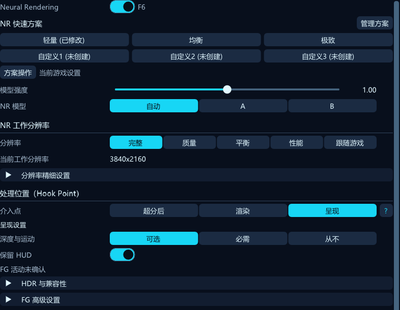
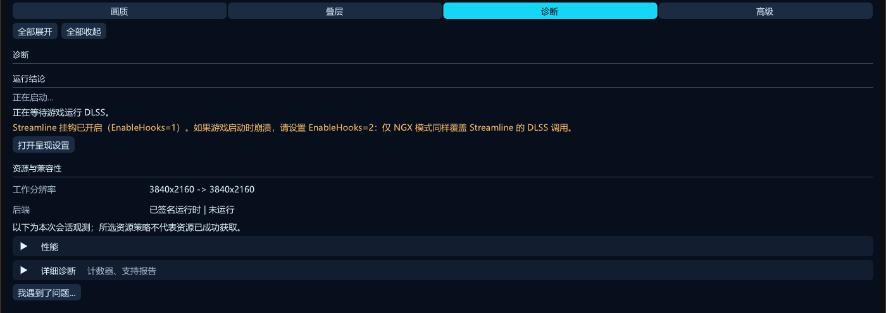
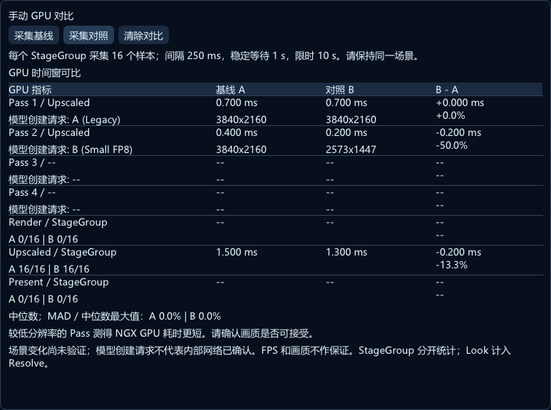
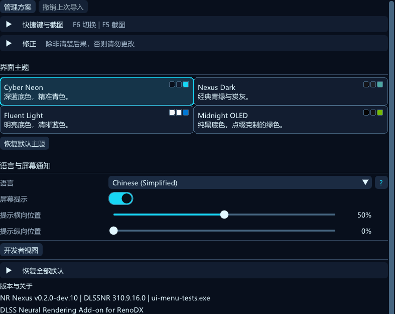
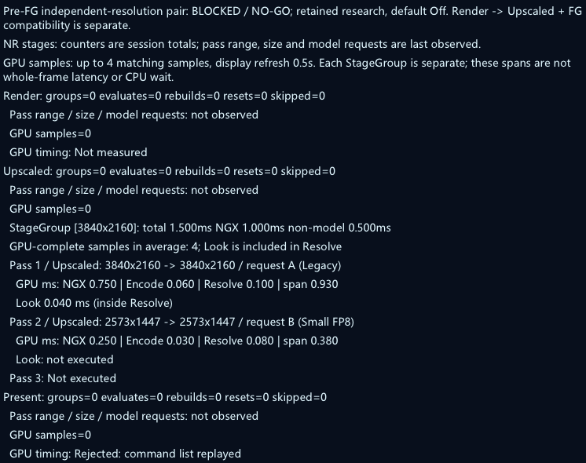
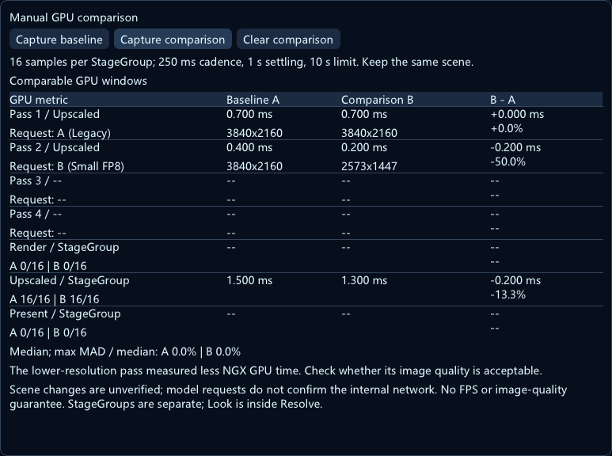

# NR Nexus — User Guide / 用户指南

[简体中文](#简体中文) · [English](#english) · [README](../README.md)

## 简体中文

> **版本范围——当前开发源码 0.2.0-dev.11；最新预发布 0.2.0-dev.8／0.1.0 正式版：** 本指南对应完整 0.1.0 包，包含四页菜单、双模型、逐层独立模型风格与结果设置及四套主题。请在 Releases 页面查看可下载的版本化 ZIP；逐层阶段、NR 快速方案、方案库与辅助输入已包含于 dev.8 预发布包，但未包含于已发布 0.1.0 包；早期预发布包也不含本指南展示的全部功能。跨 StageGroup 独立工作分辨率、原生 DX11 Bridge／DX12 Render／Upscaled 双 Pass 不同工作尺寸，以及满足进程级 FG Off 条件的普通 Present 双 Pass 不同工作尺寸，属于当前 0.2.0-dev.11 开发源码，尚未包含于任何已发布包；逐 Pass GPU 诊断也只在当前开发源码提供，尚未随包发布。

### 目录

- [开始使用](#zh-start)
- [画质：模型、介入点与尺寸](#zh-quality)
- [结果调整与稳定性](#zh-results)
- [叠层](#zh-multipass)
- [诊断与报告](#zh-diagnostics)
- [NR 快速方案与方案库（开发中）](#zh-presets)
- [高级、截图与主题](#zh-advanced)
- [七个实用场景](#zh-scenarios)
- [状态→原因→操作](#zh-status)
- [English contents](#contents) · [返回 README](../README.md)

### 开始使用

打开 ReShade 覆盖层，选择 **NR Nexus**。安装与运行时前提见 [README](../README.md)，本指南从已经安装插件开始，不重复安装步骤。这里的“模型”指 DLSS NR 模型，不是游戏的 DLSS 超分辨率预设，也不会开启帧生成（FG）。

0.1.0 包含**画质、叠层、诊断、高级**四页。顶部摘要反映观测状态，点击可进入诊断。绿色表示观测到了 NR 活动，不代表所有帧、资源或画质均已验证。“全部展开／全部收起”作用于当前视图；修改标记和重置箭头表示保存值偏离默认，不表示运行成功。

**当前开发源码：页面恢复默认按字段归属执行。** 画质页恢复 NR 主开关、基础模型、介入点、分辨率／共享上采样、模型风格与结果设置，包括叠层页共用的第 1 层字段；叠层页只恢复层数与第 2–4 层独立字段，不重置这些第 1 层共用值；高级页恢复兼容性、HDR／深度／运动、快捷键、截图及界面偏好，保留画质、独立层及诊断控件。确认后先保存待处理的 Slot 编辑，再解除当前 Slot 关联；保留全部六槽保存内容及方案库文件，避免将重置值自动写回原槽。全量恢复的范围与保留项见[高级设置](#zh-advanced)。

当前开发源码将“全部展开／全部收起”放在各页内容区右上角，窄窗口使用带悬浮说明的 `+`／`-`。顶部采用结构化字段：先显示当前状态和“运行监视器”入口，再按可用宽度显示输入／输出尺寸、Stage 和 GPU 开销。监视器可与主菜单同时操作，支持拖动、缩放和锁定位置；窄屏使用折叠摘要，详细历史仍在诊断页。请求设置、已有执行证明、过期样本及待确认状态分别呈现，模型创建请求不等于内部网络回读。此更新尚未随安装包发布。

下文默认值针对全新配置；已有保存值或迁移配置可能不同。一般编辑会即时保存。更换模型、层数、介入点或工作尺寸可能重建 Feature，并短暂重建时序历史，比较前应等待场景和历史稳定。

**配图说明：** 所有配图均为当前生产 ImGui 界面离屏合成的状态示例，用来说明布局与控件，不代表实机画质、FPS 或运行时性能测量。中文章节使用简体中文界面截图与中文图注。顶部版本范围同样适用于本节。

本轮更新的画质、叠层、结果、诊断、高级与主题配图使用 **0.2.0-dev.10 开发源码**；仍准确的保存任务区域图继续保留。任何图片中出现的方案及辅助输入控件均属于开发功能，不包含于已发布的 0.1.0 包。

### 画质：模型、介入点与尺寸

*画质页：NR 开关、效果比较、模型、共用工作尺寸与介入点。*

#### 开关与比较

当前开发源码把 **Neural Rendering 主开关**放在画质页最前方、NR 快速方案之前。比较关／开时先用主开关，再选择或编辑方案。方案摘要表示保存状态和个人修改，是否实际执行 NR 请到“诊断”查看。

| 控件 | 默认／选项 | 用途与条件 |
| --- | --- | --- |
| Neural Rendering | **开**；关／开 | 开关 NR，默认快捷键 **F6**。比较 NR 开关请用此项；强度归零是另一种操作。 |
| 模型强度 | **1.00**，**0–2** | 在结果调整之前传给模型；改动重置 NR 历史。大于 1 的响应依赖模型／运行时，尚未验证；2 不代表保证“双倍画质”。 |

**Vulkan 开发源码边界：** 旧执行路径仅在 Upscaled、完整输出尺寸上运行，叠层继承该尺寸。普通界面不再允许新建 Render／Present 或全局工作比例／跟随输入请求，也不提供独立 Pass 工作尺寸；已有值保留，需选择受支持配置后再应用方案。

#### 模型选择

| 选项 | 请求如何解析 |
| --- | --- |
| **Auto／自动**（默认） | 精确识别为 **DLSS NR 310.9.16.0** 时解析为 **B**；其他运行时保留兼容的自动／运行时默认行为，不能一概认为 Auto=A。 |
| **A — Legacy** | 请求预设 1，细节、结构和颜色可能与 B 不同。 |
| **B — Small FP8** | 请求预设 2，仅对已识别的 310.9.16.0 启用；与 A 比较外观及实测 GPU 开销，两者均非所有场景的最佳模型。 |

运行时尚未识别时模型选择不可用。不受支持的已保存 B 请求会回退为 A，保存的请求不被覆盖；更新或未知 DLL 不自动获得双模型兼容资格。旧配置的预设 3 可显示“自定义”，仅为兼容保留，不是菜单中的第四选项；在已识别双模型运行时上解析为 A。

改模型会重建整链 NR Feature 并重置历史。**请求模型、解析模型、运行时网络**含义不同：解析模型只是请求经过兼容规则后的配置，本构建不能回读实际执行网络。

#### 模型风格

这些控件决定模型生成什么，修改会重启时序历史；与后文实时重塑输出的“结果调整”不同。

| 控件 | 默认／范围或选项 | 含义与依赖 |
| --- | --- | --- |
| 风格（Style） | **Default**／Natural／Cinematic | Default 由运行时选择；其他两项显式请求对应风格。名称不是画质等级。 |
| 局部色调（Local tone） | **1**，**0–2** | 模型重塑局部亮度与对比度的强度。 |
| 模型结构 | **1**，**0–2** | 模型合成的结构。人物遮罩与独立皮肤同时开启时，实际传入值上限为 **1**，保存值保留。 |
| 人物／皮肤（Character / skin） | **stock／原始值**；独立皮肤时显示 **1**，可调 **0–1** | 仅人物遮罩开启时有效。0 表示最少皮肤重塑，不是中性中点。 |
| 人物遮罩（Character mask） | **关** | 让运行时识别人，使皮肤参数作用于相关区域；也可能影响其他画面部分。 |
| 独立皮肤（Independent skin） | **开**，全链共用 | 配合人物遮罩，将 stock 皮肤传为 1、实际结构封顶 1。关闭时 stock 皮肤跟随结构；即使开启，结构低于 1 仍可能通过模型本身影响脸部。 |
| UI 修正（UI correction） | **关** | 运行时模型 UI 修正；HUD 被影响时可比较。与 Present 默认开启的“保留 HUD”分开。 |

#### 介入点（Hook Point）

| 选项 | 输入与适用性 |
| --- | --- |
| **Render** | 在 DLSS 放大之前处理游戏颜色，使用渲染尺寸的深度和运动矢量，可能降低成本。使用 Ray Reconstruction 时，因重建前输入仍有噪声，保持兼容的 Upscaled 路径。 |
| **Upscaled**（默认） | 在游戏 DLSS 输出之后、后续游戏处理与 HUD 之前运行。依赖可用的被截获 DLSS 资源。 |
| **Present** | 请求处理游戏后处理与 HUD 完成后的呈现帧，位于 ReShade 效果与覆盖层之前。兼容的 Pre-FG 路径可改为在帧生成前服务 NR；实际路径看诊断。 |

当前开发菜单按 **Render → Upscaled → Present** 显示，默认仍为 Upscaled，已有配置含义不变。

**Present 并非在所有情况下都要求游戏已开启 DLSS。** 普通 Present 的 Optional／Never 可在缺少匹配 DLSS 捕获时使用中性资源，但仍须满足运行时、设备、帧和格式检查。Required 需要匹配深度与运动，缺失即跳过。Upscaled／Render 依赖游戏 DLSS 求值链路。并非所有 API／集成都支持 Present，不支持时可能回退 Upscaled；选中某介入点不等于证明该路径已运行。

#### Present 设置

仅选择 Present 时显示。下述资源策略适用于普通 Present 和原生 FG／XeFG 服务；旧 DLSS-G Pre-FG 路径仍要求并使用 FG 提供的深度与运动，Never 不保证该路径使用中性资源。

| 控件 | 默认／选项或范围 | 用途 |
| --- | --- | --- |
| 深度与运动 | **Optional／可选**；Required／必需；Never／从不 | 可选优先匹配真实资源，缺失用中性数据；必需缺失则跳过；从不忽略捕获资源、始终用中性数据，适合不可靠资源，但可能损失运动稳定性。这是策略，不是可用性探测器。 |
| 保留 HUD | **开** | 请求模型修正已经包含 HUD 的呈现帧，不保证所有 HUD 完全不变。 |
| 帧编码 | **Auto**／SDR／HDR10／scRGB | Auto 根据交换链色彩空间证据判断，只有错误声明时才覆盖。 |
| HDR 纸白 | **0**，**0–1000 nits** | 0 跟随已加载且进行色调映射的 RenoDX HDR Mod 的游戏亮度，否则用 Windows SDR 内容亮度；正数覆盖。 |
| FG 帧处理策略 | **Every frame／每帧**；Game frames／游戏帧 | 普通 Present 下选择处理含生成帧的每次呈现，或仅游戏帧；不会开启 FG。成功的 Pre-FG 优先，回退使用对应路径。 |
| 帧生成检测 | **Auto**；Stable timing／稳定时序；Legacy timing／旧版时序 | Auto 优先读取声明倍率，缺失则稳定时序估计；稳定时序忽略声明；旧版时序用于兼容。 |

每次 Present 都处理时，FG 可能成倍增加整链 NR 次数。“游戏帧”可能减少工作，但生成帧外观可能不一致。成功 Pre-FG 通常先处理源游戏帧再插帧，无须每个生成帧都跑整链；HUD 处理仍可能增加工作。不能据此保证每个显示帧恰有一次模型求值。

#### 共用工作尺寸与上采样

| 预设 | 单轴比例 | 含义 |
| --- | --- | --- |
| **100%**（默认） | **100%** | 完整比例基准尺寸，不会选择 DLAA 或更改游戏 DLSS 设置。 |
| 67% | **67%** | 降低 NR 工作尺寸。 |
| 58% | **58%** | 进一步降低尺寸。 |
| 50% | **50%** | 宽高各半，约为基准像素数四分之一，不保证 GPU 时间也降至四分之一。 |
| Follow input／跟随输入 | 有效 Guide 与参考尺寸逐轴取较小值 | 缺少有效 Guide 时使用先前保存的比例；选择跟随不会改写该比例，也不会更改游戏 DLSS 模式。 |

当前开发源码中，五档、**33–100%** 比例滑条和共享上采样常驻显示；画质页与叠层页第 1 层复用同一套控件，编辑的是同一份基础值。Follow input 时滑条禁用但保留比例，并显示原因；非固定档比例不高亮为某个固定档。预设在下次求值应用，连续拖动可能稳定后才重建；实际尺寸仍受参考与兼容资源契约约束。

比例以**当前有效 Stage** 为基准：Render 为 Color／Motion／Depth 的公共裁切区域（通常为 DLSS 输入），Upscaled 为 DLSS 输出矩形，Present 为有效呈现帧。**Last recorded／最后记录**的参考、请求及模型工作尺寸属于历史数据，不能证明当前编辑已执行；模型未录制或缺少数据时显示不可用，当前设置仍可处于待确认。最近完成的 GPU 样本也不自动证明修改后的配置已生效。Guide 的真实来源与时效无法回读时明确为未知，不能从尺寸或 Hook 选择确认；普通 Present 可能使用全尺寸中性引导，Required 缺少有效引导则拒绝，Pre-FG 另有门控。

| 上采样选项 | NR 低于输出尺寸时的行为 |
| --- | --- |
| **Auto**（默认） | 自动按边缘重建 NR 改变量，保留下层全分辨率细节。 |
| Edge-aware／边缘感知 | 沿图像边缘重建 NR 改变量。 |
| Classic／经典 | 更直接显示 NR 的低分辨率像素，可能块状。 |
| Edge-aware (area input)／边缘感知（区域输入） | NR 前对输入像素平均，之后重建改变量；可能改变模型外观，进入或离开此模式重置 NR 历史。 |

上采样独立于结果调整，工作尺寸与输出一致时无尺寸重建作用。全局工作尺寸仍是默认来源，**上采样全链共用**；当前 0.2.0-dev.11 开发源码支持叠层章节所述的跨 StageGroup 独立尺寸及原生 DX11 Bridge／DX12 Render／Upscaled 双 Pass 不同工作尺寸，属于阶段性支持。降低尺寸可能降低成本，也可能改变细节和稳定性，应观察运动与实际 GPU 测量。

### 结果调整与稳定性

*结果调整：实时外观、亮度与色彩限制、细节、光晕及时域控件。*

**调整 NR 外观（Adjust NR's look）默认关**，重塑模型已经返回的改变量，不改变模型本身。关闭保留参数；下列重塑滑块须开关开启且结果处理可用才生效。改动实时应用，不重启 NR 模型历史，但启用处理仍可能需要资源。

| 分组／控件 | 默认 | 范围 | 含义 |
| --- | --- | --- | --- |
| 结果调整强度 | **1** | **0–2** | 在限制之前缩放 NR 改变量；0 去除改变量，1 保留尺度，2 加倍尺度。 |
| 基础：提亮 | **1** | **0–2** | 保留多少模型提亮。 |
| 基础：压暗 | **1** | **0–2** | 保留多少模型压暗，也包括不需要的暗晕。 |
| 基础：颜色（Colour） | **1** | **0–2** | 模型饱和度改变量；0 保留游戏饱和度。 |
| 基础：色相偏移 | **1** | **0–2** | 模型色调改变量；0 保留游戏色相。 |
| 基础：阴影／中间调／高光 | **各 1** | **各 0–2** | 按原始图像的明暗区域缩放改变量。 |
| 限制：最大提亮／最大压暗 | **各 0** | **各 0–4 档** | 亮度变化的柔性上／下限；**0 表示不限**，不是没有效果。 |
| 限制：最大颜色变化 | **0** | **0–2 档** | 柔性颜色变化限制，**0 表示不限**。 |
| 细节：大范围色调／精细细节 | **各 1** | **各 0–2** | 分别缩放宽广照明与小尺度变化。精细细节重塑输出，模型结构改变模型合成。 |
| 细节半径 | **1%** | **0.25–4%** | 大范围与精细变化的分界，以图像高度为基准；增大可触及更宽光晕。 |
| 光晕抑制 | **0** | **0–1** | 减少亮物体旁的暗晕，保留大范围表面压暗与预期阴影。 |
| 暗物体旁的光晕 | **0** | **0–1** | 减少暗物体较亮一侧的暗裙边，该问题可能随叠层累积。 |

这些调整作用于**模型的变化**，不是普通全局亮度／饱和度调节。1 通常保留该分量尺度，不代表与原游戏图像一致。

| 时序控件 | 默认／范围或选项 | 依赖与用途 |
| --- | --- | --- |
| 细节稳定（Detail stability） | **Auto／自动（推荐）**；Off／关；Always／始终 | 独立于结果调整。Auto 在兼容的放大后路径、有可用游戏运动矢量时过滤；Always 还请求在放大前过滤。仍受资源与兼容检查限制，用于细节爬动、沸腾。 |
| 稳定（Stabilize） | **Off**；Static／静态；Motion／运动 | 要求结果调整开启。时序平均宽广变化，静态适合静止视角，运动需要可用游戏运动矢量来跟随运动；可能延迟照明变化。开启后替代自动细节稳定过滤。 |
| 稳定时间 | **60 ms**，**10–250 ms** | 仅稳定模式启用时可调；越长越稳，响应越慢。 |
| 稳定细节 | **关** | 仅稳定模式启用时可调，也平滑小尺度变化。 |

关闭结果调整**不会关闭细节稳定或共用上采样**。若比较未过滤模型结果，还须关闭细节稳定，并考虑上采样与 HDR／SDR 传递设置。处理不可用时查看界面与 `ReShade.log` 的原因；选中了模式不证明过滤已运行。

### 叠层

*叠层页：顺序处理链、选中层，以及独立的模型、外观和结果继承。*

**叠层数为 1–4，默认 1，包含第 1 层**，顺序如下：

`输入 → 第 1 层 NR + 结果 → 第 2 层 NR + 结果 → … → 输出`

后一层处理前一层结果，不是并行方案。点节点只选择编辑对象，处理链表示配置；当前节点显示编辑中，其他为已配置。星号表示偏离默认，不表示逐层耗时或运行时网络确认。

**开发源码：逐层阶段。** 第 1 层沿用画质页的介入点；第 2–4 层新增**阶段：与上一层相同／Render／Upscaled／Present**，与模型、外观及结果继承分别独立。默认保持旧版单阶段链。阶段必须按 `Render → Upscaled → Present` 前进；倒退请求会停用整链并保留选择。原生 DX12 和原生 DX11 Bridge DLSS SR/DLAA 可以拆分 Render 和 Upscaled 分组，例如 `第 1 层 · Render · A → 游戏 DLSS SR → 第 2 层 · Upscaled · B`。A/B 组合不受阶段限制。Render 的结果作为游戏 SR 的真实输入，Upscaled 读取游戏 SR 输出。DX11 需要 immediate context、共享 Fence 支持及同适配器私有 DX12 设备；混合链每阶段通过有界事件等待确认 GPU 完成，会增加同步成本。Render 交付或游戏 SR 失败时跳过后组并重置 NR 历史。

**当前 0.2.0-dev.11 开发源码：独立工作分辨率（阶段性支持）。** 第 2–4 层默认**继承基础分辨率**（`NRFollowInputRes` 与 `NRResolutionScale`），不是继承上一层比例；也可选择 **Follow input／跟随输入**，或使用本层保存的 **33–100%** 固定比例，默认 **100%**。跟随时使用有效 Guide 与本层 Stage 参考尺寸的逐轴较小值，缺失有效 Guide 时回退保存比例。固定比例同样以本层有效 Stage 为基准，定义见画质页。第 1 层与画质页共用同一套基础控件，不改变游戏 DLSS SR 分辨率。可配置 `Render A 100% → 游戏 DLSS SR → Upscaled B 67%`，也可互换为 Render 67%、Upscaled 100%。返回继承模式会保留本层独立比例；模式与 Stage、Model Preset、Look、Result 分别独立，上采样全链共享，第 2–4 层只显示共享提示。编辑标题集中显示所选 Pass、有效 Stage 与模型请求名称，不代表实际执行确认。

不含 Present 的原生 DX11 Bridge／DX12 链中，同一 Render 或 Upscaled StageGroup 的两个 Pass 支持不同工作尺寸：`Upscaled Pass 1 · A 100% → Pass 2 · B 67%`，也可反向设置为 A 67%、B 100%；Render 双层对应 `Render A 100% → Render B 67% → 游戏 DLSS SR` 及反向比例，不改变游戏 SR 内部渲染尺寸；各层比例仍参考完整 Stage 尺寸。当前 0.2.0-dev.11 开发源码还允许普通原生 DX11 Bridge／DX12 Present 双 Pass 使用不同工作尺寸，前提是已收到成功的进程级公共 FG Off 声明。没有该成功声明时，即使未观测到 FG 活动，仍拒绝该双 Pass 异尺寸组合；该声明作用于进程，不区分各个 viewport。该 Present 能力拒绝 FG 未知／On、Pre-FG 及 B1／混合链，不改变既有 Render／Upscaled 支持。DX11 Present 双 Pass 增加有界 GPU 完成等待及同步成本。新增 DX11 Present 双 Pass 已通过 WARP／硬件定向 GPU 自动化；真实游戏、NVIDIA 网络及性能收益未验收。同组 3 层以上仍要求实际工作尺寸相同；不支持的尺寸组合会明确拒绝该组并由界面说明原因，保留设置供修正，不静默忽略覆盖。同组模式或比例不同但实际尺寸相同不构成冲突。**此为双 Pass 阶段性实现；Upscaled 已通过定向 WARP／硬件 GPU 自动化，Render 双层的 DX12／Bridge 核心已实现，Bridge 本轮三组 HDR 场景及 DX12 本轮八场景／二十阶段均已通过 WARP／硬件 GPU 自动化；真实网络、实机画质及性能收益未验收。**新增独立模式仅限 native DX11/DX12；Vulkan 旧执行器不消费工作尺寸，因此明确拒绝非继承模式（1/2），默认继承（0）保留旧行为。最近观测的真实工作尺寸以诊断为准，配置百分比不证明实际执行或性能改善；既有截图未展示新增控件。

**Render→Upscaled 与 FG 并用。** 上述 DX12／DX11 Bridge 双阶段链可以与原生 DLSS FG 或 XeFG 并用，仍受既有来源、资源、输入所有权及实验门控约束。FG 开启不等于 FG 服务接管 NR 输入。确认两个 Pass 时应核对同一来源的 Render／Upscaled 实际 NR 调用；配置链、模型创建或 FG 开启状态不能单独证明两组已执行。NGX 调用成功、GPU 完成和 FG 消费是不同的证据。

**实验性 Upscaled → Present（B1）。** 默认关闭；可在 INI 的 `[RenoDX.DLSS5]` 下设置 `NRExperimentalPresentChain=1` 试用。仅限原生 DX12 SR/DLAA、严格两个 Pass、FG 关闭且无 FG-owned 输入、每个 Present 窗口一个可识别来源。来源输出须经观测到的完整同格式 `CopyResource` 或零偏移、无 box 的 mip-0 `CopyTextureRegion` 到达当前 backbuffer。前一窗口已提交的复制建立关联；本帧 A 与复制必须在同一 command-list 录制代次、同一 Present 队列，具备实际提交凭据，且无重放或竞争复制。使用其他列表或转换 Shader 的游戏会被拒绝。B 读取游戏后处理／HUD 后的当前 backbuffer，仅执行第 2 Pass 并保持独立历史。凭据不足时跳过 B，不移动到 Upscaled，也不重复 A。本实验已覆盖 GPU 自动化，尚无游戏、NVIDIA 网络或画质验收。

**Upscaled→Pre-FG 尾组（B2）尚未实现。** 该路径需要证明前组 SR/NR 输出与 FG 实际颜色／Guide 输入的来源交接；当前 BLOCKED 仅指这条尾组，不表示 Render→Upscaled 与 FG 不兼容。跨阶段 Render→Present、三阶段链、DX11 跨 Present 与其他阶段的链及 Vulkan 混合链继续停用并说明原因；原有单阶段 Present/FG 行为继续保留。RR 保持安全回退：请求 Render 的层在 RR 完成后于 Upscaled 执行。请求／有效阶段及解析后的模型创建请求不证明内部网络或实际执行成功；诊断显示已观测分组、Evaluate、重置、重建、跳过次数、最后尺寸及有结果的 GPU 计时，DX11 Bridge 另记录完成等待耗时与交付失败。已有关闭 RR／FG 的巫师3 DX12 HDR 场景短时 AA／AB／BA／BB 实测；这些旧样本的条件保持，FG 并用的运行反馈与逐阶段日志确认分别记录，画质与长时验收仍按各自范围判断。Final Present（默认 F5）仍不能提供混合链同帧最终画面对比：开发源码现在立即拒绝该请求，NR 继续按所选阶段处理。截图请求不会新增 Present NR Pass。最终画面已包含前序 NR 阶段的处理结果，无法从中取得未经 NR 的同帧参考。可用“已评估模型缓冲”诊断某一 Pass，但它不是最终画面对比。原有单阶段 Final Present 截图继续可用。既有配图展示此前菜单。

第 1 层与画质页的基础控件、结果设置是同一份值。第 2–4 层即使继承外观，也分别拥有模型强度（**1，0–2**）、HDR 传递（**1，0–1**）及 Color／颜色强度（**1，0–1**）；HDR 传递仍受高级页中的来源条件限制。

| 第 2–4 层控件 | 默认 | 继承内容 |
| --- | --- | --- |
| 阶段（开发源码） | **与上一层相同** | 上一层请求的阶段；与模型、外观和结果独立。 |
| 工作分辨率（开发源码） | **继承基础分辨率**；独立比例 **100%** | 继承基础值（非上一层）／Follow input／固定比例；固定比例 **33–100%**，不受 Stage、模型、外观或结果继承控制。 |
| NR 模型：继承主模型／A／B | **继承主模型** | 主模型选择，包括自动解析与回退；与另外两种继承独立。 |
| 继承第 1 层外观（Same as pass 1） | **开** | 仅模型风格参数：风格、局部色调、模型结构、人物／皮肤、人物遮罩、UI 修正。不继承模型选择、模型强度、HDR 传递、Color 或结果。独立皮肤仍是全链设置。 |
| 继承第 1 层结果设置 | **开** | 结果开关、强度、基础／限制／细节／光晕、稳定设置与细节稳定。关闭后可编辑本层结果；上采样仍全链共用。 |

关闭继承会露出该层**已保存的独立值**，初始为默认，不会自动复制当前第 1 层改动。重新开启继承会保留独立值，之后关闭仍可恢复使用。减少层数保留未启用层的保存设置，但退休其活动 Feature；增加层数时新增层从干净历史开始。关闭结果调整也保留值。

**链式历史默认开**，每层保留各自历史。关闭是诊断模式，第 2–4 层每帧重置，可能闪烁。更换模型或层数重建 Feature；改强度或模型风格重置历史。频繁切换会有历史稳定过程及创建开销；实时结果修改不重启 NR 模型历史。

在支持的双模型运行时，可固定介入点、尺寸、强度，比较 **A、B、AA、AB、BA、BB**。字母按执行顺序排列，AB 即先 A 后 B。比较时明确设置每层模型，避免“继承主模型”随主模型一起改变序列。每次切换后等历史稳定，同时看静止细节和运动。以上仅为例子，**不保证哪组最佳**；加层可能增强效果，也会累积颜色、光晕、时序伪影并增加 GPU 工作。上采样仍共用；当前 0.2.0-dev.11 开发源码支持逐层阶段、跨 StageGroup 工作尺寸覆盖及原生 DX11 Bridge／DX12 Render／Upscaled 双 Pass 不同工作尺寸。

#### 原生 Pre-FG 双 Pass 独立尺寸：研究保留，BLOCKED／NO-GO

该技术开关保留的实验启用值为 `1`。

`NRExperimentalNativePreFgResolution`（INI `[RenoDX.DLSS5]`）在源码与测试中保留，默认关闭。**本轮已结束该研究；不要将开关作为玩家选项启用，也不得视为正式支持。** 原研究范围仅为**单平面原生 DX12 NGX DLSS FG/MFG、纯 Present 阶段、严格两个 Pass**：`A 100% → B 67%` 或 `A 67% → B 100%`。技术边界包括已识别的 FG handle、非零且单调递增的真实 Backbuffer FrameID、首次调用 `MultiFrameIndex=1`、有效真实 Depth／Motion（不能以中性引导替代），以及每个 producer command-list 录制代次精确提交一次；排除 HUDLess、UI、UIAlpha、XeFG、DX11、B1、B2 和最终 Present（Final FG）。这些是原研究的范围与门槛，不代表已验证或支持。

**阻断证据：** `BackbufferFrameID` 的数值 Get 失败；指针 Get 虽成功，但返回对象的身份及真实帧语义未证。MFG replay 行为以及 HUDLess／UI 一致性也未证，因此无法证明真实帧身份和所需的单次提交条件。该原生 Pre-FG 双 Pass 异尺寸路径为 **BLOCKED／NO-GO**；本轮不再继续研究或测试。此结论只针对该实验，不改变已有 **Render → Upscaled 与原生 DLSS FG／XeFG 并用**路径；后者仍受各自既有输入、资源、所有权及实验门控约束。普通 Present 的 FG Off 门控也保持独立。

#### 示例：两层独立风格与结果调整

这是操作示例，不是最佳画质预设；需要上述 0.1.0 界面，B 还要求已识别的 **310.9.16.0** Runtime。

1. 开启 Neural Rendering，固定介入点、工作分辨率和上采样。在**叠层**页把**叠层数**设为 **2**。
2. 选择**第 1 层**节点，明确选择 **A**。尝试**风格：自然**，再调整局部色调或模型结构；在本层结果区开启**调整 NR 的外观**，先改一项输出，例如**高光**。这些就是画质页共用的基础值。
3. 选择**第 2 层**，明确选择 **B**，关闭**继承第 1 层外观**和**继承第 1 层结果设置**。此时显示本层保存的独立值，初始为默认，不会复制第 1 层当前的编辑。
4. 为第 2 层尝试**风格：电影感**，分别调整它的局部色调或结构；开启本层**调整 NR 的外观**，再尝试**细节**或**暗晕抑制**，每次只改一项。角色／皮肤需要本层角色遮罩开启；独立皮肤仍全链共用，并可能限制实际发送给模型的结构值。结果效果要求处理阶段可用，运动稳定还需可用的运动矢量。
5. 想恢复共享时，分别重新开启所需的继承开关；以后关闭仍能继续使用保存的独立值。**继承主模型**是另一项选择，只有希望第 2 层连模型也跟随主模型时才选它。
6. 等待历史稳定，在同一场景比较静止与运动，并查看诊断中 **NR 开销**里的可用 GPU 耗时。固定介入点和尺寸，对比两层与一层；减少层数仍保留第 2 层编辑。NR 开销计量按 Stage 采样，不是单个 Pass 的网络耗时；不可用读数不代表零开销。

模型风格改变生成阶段并重置时序历史，结果编辑实时塑造每层返回的改变量。上采样仍共享；当前 0.2.0-dev.11 开发源码支持逐层阶段、跨 StageGroup 工作尺寸覆盖及原生 DX11 Bridge／DX12 Render／Upscaled 双 Pass 不同工作尺寸。可调项和层数更多不代表画质或性能更好，应在实际游玩场景中比较后选择。

### NR 快速方案与方案库（开发中）

本节对应当前 **0.2.0-dev.11 开发源码**，包括按任务展开的方案库。已发布的 **0.1.0 包不包含六个方案或方案库管理**。以下说明界面操作，不代表下列官方组合已通过实机画质或性能验收。

#### 当前游戏的六个方案

画质页的 **NR 快速方案（NR Profiles）** 提供三个官方方案和三个自定义方案，标题旁为“管理方案”。仅当 NR 配置被确证为空、方案存储被确证为新建且 Balanced 通过当前能力检查时，首次安装才会尝试自动应用 Balanced；已有、未知、不可读、旧版、损坏、显式解绑、身份不匹配或只读状态均保留当前设置。选择已有内容的方案会应用其管理的 NR 设置。点击尚未创建的自定义方案会就地打开创建弹窗：“将当前设置保存为此方案”捕获当前设置并选中该方案；“从官方方案复制”按所选官方方案创建，然后选中并应用。“取消”保留当前设置。若目标已不再为空，请到“管理方案”检查，创建弹窗不会直接覆盖它。

| 官方开发候选 | 介入点 | 层数／请求模型 | 工作尺寸 |
| --- | --- | --- | --- |
| **轻量（NR Lite）** | Render | 1／B | 工作比例 0.67 |
| **均衡（NR Balanced）** | Upscaled | 1／A | 工作比例 0.67 |
| **极致（NR Max）** | Render → Upscaled | 2／先 B 后 A | 两层均为 0.67；Render 使用电影感样式、Mask 开启、Skin 0.75；Upscaled 使用默认样式、Mask 开启、Skin 0.75 |

其余管理字段继承实际注册默认值；Max 两层的样式和遮罩设置各自独立。这些组合用于开始调整，不代表画质排名；模型、API 和资源门槛仍有效，不支持的执行选项会明确拒绝并保留当前设置。Ray Reconstruction 下 Render 沿用既有 Upscaled 行为；A/B 请求与运行时回退仍分别处理。

每个官方方案保存自己的**独立覆盖值（overrides）**，修改一个不改另一个；将字段调回模板值会移除该字段的覆盖。自定义方案保存快照，包含未启用层的保存值。普通编辑约 **500ms 防抖后自动保存**；切换先等待待保存方案数据成功，**保存失败不继续切换**。根据错误排查后使用重试；revision 冲突需停止并发编辑、重启重载，不自动合并。

若目标配置已应用，但随后保存目标方案状态失败，当前运行设置会保留，方案显示为未保存。解决存储错误后重试，或使用撤销；这不是磁盘／GPU 原子事务。

**左键应用，右键管理**；空自定义方案为**左键创建，右键管理**。官方方案右键可恢复官方默认或导出，导出包含该槽位实际保存的个人修改。自定义方案右键可重命名、从官方原始模板复制、导出、导入或清空。常用操作直接打开小窗口，也可通过可见的“方案操作”及“管理方案”入口访问。按钮整合名称与状态，“已修改”表示偏离官方模板，悬浮说明区分已自动保存、保存中及保存失败，不代表未保存或 NR 实际执行。

复制覆盖、导入覆盖、清空及恢复官方默认均须确认；导入仍先验证并显示差异，不直接应用到游戏。重命名只改槽位显示名称，不改稳定 ID 或独立 JSON 文件。清空同时恢复“自定义 N”的名称并解除当前槽位关联，保留运行配置及方案库文件。导出默认指向共享方案库，可浏览文件／目录或输入路径，成功后显示保存位置；选择路径本身不写入。可撤销的方案操作成功后显示“撤销”，导出等操作没有虚假撤销入口。配置撤销仍保留后续编辑，必要时解除选中关联。

完整**管理方案 → 方案库**继续提供不限数量的本地预设搜索、浏览、详情及独立文件的重命名、复制、删除和分享。默认折叠的自定义槽位工具仍可使用；槽位修改不会自动改写方案库中的独立文件。存入自定义槽位后需选择该槽位才应用到游戏；空槽位左键创建流程中的复制则创建后直接应用。

方案按当前游戏身份保存在 `%LOCALAPPDATA%\NR Nexus\Profiles\<32hex-id>\slots.json`。重启只在当前配置与上次应用快照一致时恢复选中关联，绝不自动覆盖当前设置。外部重载使配置变化时解除关联，不将其写为官方覆盖。迁移安装位置或复制 INI 后，若 EXE 路径对应的 owner 不符，会把方案数据复制到新身份并保留当前设置；不支持自动合并不同商店／安装版本。

损坏／未来格式文件和只读配置受保护，不会直接覆盖。强退可能丢失最后尚未完成的方案保存；ReShade 正常游戏设置的持久化语义仍独立，方案文件、配置和 GPU 执行不是一个原子事务。

#### 方案库：主页、保存与导入

在画质或高级页打开**管理方案**，进入单一的**方案库**主页：当前方案摘要、“保存方案”“导入方案”、折叠的“我的方案”管理区及可搜索的库列表。选中文件后才显示预览、重命名、复制及删除操作；删除须显式确认，且只影响库内文件。打开及库内保存／重命名／复制／删除后自动刷新，也可点“刷新方案库”。默认共享库为 `%LOCALAPPDATA%\NR Nexus\Presets\`，与当前游戏的六个方案分开保存。在保存任务中展开“导出文件”，可查看实际库路径并使用“打开方案文件夹”。

1. **保存方案：** 初始只显示名称输入，首次使用默认“画质＋叠层”。展开“更多选项”再修改范围、选填作者／描述／来源游戏或“预览导出字段”。通常来源为当前游戏配置；从自定义方案分享时来源为其已保存快照，可点“使用当前游戏设置”切回。快照导出使用画质范围，完整备份须切回当前游戏设置。“保存方案到方案库”“导出文件”“复制分享文本”始终可见，保存会写入库文件，复制会把 JSON 放入剪贴板。展开“导出文件”后可指定路径、“选择导出文件”或“浏览文件夹”，最后主动点“导出方案文件”才写入。选路径不会立即导出；覆盖已有文件前须勾选替换许可；勾选后确认项始终可见，收起选项也不会隐藏。
2. **导入方案：** 初始选择“选择方案文件”或“粘贴分享文本”；需要手输本地完整路径时再展开“输入文件路径”，然后“读取方案文件”。读取仅准备预览，成功后才出现差异、应用及自定义方案存入操作。按组检查变化、保留值、不支持及跳过字段，可显示未改变字段。兼容项默认排除，完整备份需确认范围。当前设置变化后须检查刷新预览，再“确认并应用方案”；“取消导入”丢弃待应用预览，不应用设置。
3. **将 NR 设置存入自定义方案：** 这是直接应用导入的另一种选择。选自定义 1–3，已有内容时确认替换，完整备份还须确认范围。将合格 NR 字段合入该方案快照，空方案则以当前设置为基础，缺失字段保留，不立即应用。不存入 HDR、深度／运动、FG 策略或界面偏好，之后另选该方案才应用。

*开发源码：名称输入及明确的保存／复制操作，更多选项和文件导出已折叠；本示例未保存文件。*

“返回方案库”回到主页。标题栏 **X**，或管理窗口获得焦点且没有正在编辑的输入框时按 **Esc**，均可关闭管理器；再次打开从主页开始。同会话保留输入草稿、库内选择、展开选项和待应用的导入预览，关闭不会保存或应用它们。输入框、内部弹窗及原生辅助输入窗优先处理自己的 Esc。可拖动标题栏移动、拖动缩放角调整尺寸；尺寸与位置在当前运行会话中记忆，并按可用显示区域和字体大小约束。简洁保存与尚未读取文件的导入任务使用紧凑窗口。展开“更多选项”或导出选项、读取出预览或返回主页时恢复编辑空间，并保留用户调整的尺寸；此窗口几何不跨游戏重启保存。

画质范围包含基础模型／外观／结果，以及第 1 层介入点、跟随输入、共同分辨率比例和上采样四个控件；不包含 HDR、运动／深度、FG 策略或界面偏好，模型 UI correction 属图像设置。画质＋叠层增加启用层的阶段、工作分辨率模式／比例、模型、外观／结果及继承。完整备份还含停用层及允许的兼容／通用字段，但**不保证跨游戏兼容**；启动期 Hook 策略需重启游戏。上采样仍共享；分辨率覆盖支持跨 StageGroup，以及 不含 Present 的原生 DX11 Bridge／DX12 链中，同一 Render 或 Upscaled StageGroup 的两个 Pass。当前 0.2.0-dev.11 开发源码另支持已成功收到进程级公共 FG Off 声明的普通原生 DX11 Bridge／DX12 Present 双 Pass 异尺寸；没有该声明时仍拒绝，声明作用于进程而非单独 viewport。该 Present 能力拒绝 FG 未知／On、Pre-FG 及 B1／混合链。DX11 Present 双 Pass 增加有界 GPU 完成等待及同步成本。新增 DX11 Present 双 Pass 已通过 WARP／硬件定向 GPU 自动化；真实游戏、NVIDIA 网络及性能收益未验收。同组 3 层以上及其他不支持的实际尺寸组合会明确拒绝该组并保留设置。旧 schema 1 文件缺少新字段时保留当前值。

有可撤销的导入时，方案库主页会显示“撤销上次导入”，也可从高级页“管理方案”旁操作。它只恢复仍等于导入值的字段，保留之后的编辑，与“撤销方案操作”分开。共享库文件仍须显式保存，与方案自动保存分开。配置写入先核验再提交运行时参数，应用失败尝试恢复原保存值；不保证磁盘／GPU 事务或进程崩溃恢复。

预设名称、作者、来源游戏、描述、搜索和文件路径均在叠加层的标准 ImGui 输入框中原位编辑，描述支持多行。编辑输入框只更新表单，之后仍需主动保存／导出预设。若原位 IME 输入乱码，可点击字段标题旁的键盘图标按钮（悬停可查看“辅助输入：打开兼容文本编辑窗口，输入中文等文字。”），或右键可编辑的预设字段、自定义 Slot 名称或报告文字输入框并选择 **辅助输入…**。两者打开同一个独立的 Windows Unicode 编辑窗及输入法候选窗。区域提示中的键盘图形仅作说明，不能点击；请使用标题旁按钮或右键菜单。点“应用”将文字带回原字段，再按原流程保存／重命名／导出；点“取消”放弃编辑，编辑期间原字段已变化时丢弃返回结果。候选选择按输入法自身规则处理；单行框按 Enter 不会应用文字，写回须点“应用”。Escape 优先取消正在进行的组合，没有组合时取消编辑窗。此可选输入路径不修改 ReShade 对原位输入框的消息处理。原生窗口焦点及全屏行为仍须在目标游戏环境中验证。该编辑窗位于 0.2.0-dev.8 开发源码中，较早的 0.2.0-dev.2 预发布不包含此功能。

名称和描述使用 UTF-8；名称、作者、来源游戏分别最多 128 字节，描述最多 2048 字节，中文会比 ASCII 更早达到上限。输入框受各自 UTF-8 缓冲区容量限制。若已正确保存的文字在叠加层中显示为方框或替代字形，请检查 ReShade 自身语言和字体覆盖设置。正确的 UTF-8 数据无需重新编码或改变 Windows 系统代码页。JSON 可保留 emoji 等补充平面字符，其叠加层输入和显示仍受宿主输入处理及 ImGui／字体限制。

仅导出允许清单中的 NR Nexus 设置及选填元数据，不包含日志、路径、截图、存档、报告上传设置或其他 Add-on 配置节。全部文件操作在本机执行，预设不会上传或执行内容。导入检查大小、深度、重复键、类型与范围。请选择普通本地目录，网络路径、重解析点及硬链接文件会被拒绝。本地库访问失败不改变游戏设置。第三方工具可参考[格式说明](PRESET_FORMAT.md)。

### 诊断与报告

*诊断页：状态原因、资源观测、开销与详细计数；示例值不是运行时测量结果。*

先看状态与警告，再看资源和性能，避免混淆不同证据：

#### 近期状态监视器

宽屏布局可打开独立的非模态运行时监视器；窗口可拖动、调整大小，也可锁定位置与尺寸。窄屏布局将其嵌入可折叠区域，完整诊断页和计数仍可单独查看。监视器分为**当前结论、执行链、尺寸、GPU、当前限制**五区。

近期状态使用 3 秒窗口，至少需要 60 个有效源帧且覆盖至少 750 ms；2 秒没有新样本时显示待确认。历史累计计数不会因此清零。GPU 当前值只来自新鲜（不超过 2 秒）、与当前配置身份匹配的已完成单次提交样本；各阶段区间不能相加成帧延迟。

| 读数 | 含义与局限 |
| --- | --- |
| 请求模型 | 保存的 Auto、A、B 或继承选择。 |
| 解析模型 | 经过兼容规则后的配置；Feature 创建条目也是请求，明确未确认。 |
| 运行时网络：回读不可用 | 本构建不能查询实际执行网络；求值成功不等于网络回读。 |
| 工作尺寸、后端 | 最近观测的尺寸与路径，包括 NGX core／signed runtime、D3D12、D3D11 桥接、Vulkan 或桥接工具路径；暂无尺寸表示尚未观测。 |
| 资源／真实与中性引导 | 策略不等于实际资源。旧 Present 引导计数**不含**原生 FG／XeFG 的 Pre-FG 引导，不能作为全链总量。 |
| 最近一帧 | 最近 NGX 结果；错误码对应失败步骤，“暂无”不是有效测量。 |
| 模型求值／旁路／FG 前提交 | 不同事件的会话计数，不是显示帧数或 FPS；叠层可使每游戏帧多次求值。 |
| 跳过原因 | 前三项有效跳过原因及次数，据此选择操作。 |
| Present 稳定性 | 间隙、环形槽等待／超时、历史重置及 FG 变化，只描述相关路径，不是通用帧时间曲线。 |

**FG 活动、倍率、NR 路径分别观测。** 声明开启不证明持续提交；近期计数在稳定观察窗口中的变化决定显示路径。原生 FG／XeFG 可能绕过 Present 节奏采样，因此倍率未知不代表 FG 关闭。Present 节奏只是观测，不是 FG 判定；历史累计成功也不能证明此刻仍在 FG 前处理。

路径说明区分 **Pre-FG 已确认、Pre-FG 已观测但倍率未知、每个呈现帧、仅游戏帧、回退 Present、回退 Upscaled、Pre-FG 与回退混合、未确认**。混合或回退时，先查详细原因再判断成本与帧间一致性。Render／Upscaled 的额外层仍增加成本，但不等于每次 Present 都运行。

#### GPU 时间与加速选项

**NR 开销计量（`NRCostMeter`）默认开**，仍按每个 Stage 每 **250 ms** 采样。详细诊断的逐层读数以最近最多 **4 个有效样本**计算有限平均，约每 **0.5 秒**刷新，超过 **2 秒**无新证明即过期。旧帧率成本估计仅在单 Stage、有近期有效测量时提供；多 Stage 分别查看各组 GPU 时间，不相加解释为整帧延迟。估计以前提“GPU 限制帧率”为基础，CPU 瓶颈或限帧时关闭 NR 的收益更小。FG 下单次求值成本与每 Present 成本可能不同。

**GPU 分阶段计时（profiling）默认关**，DX12 与 DX11 Bridge 均已有计时器，可在详细诊断中开启。每条样本关联实际 StageGroup／Stage／Pass ID、解析后的模型请求、工作宽高及神经网络（NN）输出尺寸；最多覆盖四层，并列出 NGX GPU span、Encode、Resolve、Look、Pass span、StageGroup GPU 总 span及非模型 GPU 时间。Look 包含准备工作，但计入 Resolve；NGX 时间包含已有的边界 barrier。只有录制已关闭、相关工作精确提交一次且 GPU 完成的样本才有效；重复 replay、未提交、丢弃、过期或无法测量的样本会被拒绝。模型内部实际运行的网络仍未确认；这些 GPU 区间不代表 CPU 等待时间，也不保证跨 StageGroup 的整帧延迟。无有效时间戳时，“暂无”不等于零开销。**NR edit trace 默认关**，仅 D3D12 可用，只观测、不改变画面，将改变量统计写入日志／CSV。

*开发源码的合成界面示例：尺寸与 GPU 区间属于同一测量快照；未执行层和重放拒绝不显示有效耗时。原始技术诊断沿用英文。图中数字不代表真实游戏性能。*

#### 手动 GPU A/B 对比

此工具仅在当前 `0.2.0-dev.11` 开发源码提供，尚未包含于已发布版本。诊断页紧凑固定区提供 **采集基线**、**采集对照** 和 **清除**：先在 A 条件采集基线，再只改变一个 Pass 的实际工作尺寸后采集 B。每个 StageGroup 均需 **16 个有效原始完成样本**；沿用既有 **250 ms** 采样节奏，每次采集开始及 NR reset/rebuild 后均有 **1 秒稳定期**，单次采集 **10 秒超时**。采集中发生配置变化会使结果无效。A/B 之间必须只有一层的实际工作尺寸不同；Stage、模型创建请求、主要处理设置、FG、HDR/SR 显示尺寸、来源、路由和队列均须匹配。

*开发界面的离屏合成预览，仅展示布局，不是真实采集或实测数据。*

完成后，工具汇总每个 Pass 的 NGX GPU span 中位数与中位数绝对偏差（MAD），以及每个 StageGroup 总 span 的中位数与 MAD，并显示 B−A 的绝对／相对变化。波动较大或差异不足时不提供建议；只有测量数据支持时，才能说降低某 Pass 的实际工作尺寸使该层测得的 NGX 耗时减少。工具无法判定两次采集的场景是否可比，也不能确认模型内部实际运行的网络；结果不保证 FPS 或画质，请检查真实场景画质。跨队列 span 不应相加并解释为帧延迟。比较数据只保存在内存，不导出或上传；工具不会自动改变尺寸或保存 Preset/Profile。

测量及路径足够时，**Faster／加速**提供放大前运行、50% 尺寸或两者组合，并给出估计与撤销。这些操作改变介入点／工作尺寸，不是基准保证；特别是 Ray Reconstruction，应重新核对实际路径。

#### 问题报告

详细诊断提供**复制支持报告、打开日志目录**、原始计数，以及**重置 NR Feature 并清除失败锁存**。最后一项重建运行状态，应先处理显示的失败原因；它与清空保存设置不同。

报告流程可选类型、填复现步骤、生成本地诊断或不生成继续，然后预览暂存文件。截图比较可选，默认不含。文本预览只显示前 **64 KiB**，完整审查需打开暂存文件。导出经过脱敏，但分享前仍应检查附件中的个人信息。

本地保存 ZIP、授权上传到界面显示的临时托管方、加入已审查公开摘要、加入公开报告链接、准备 GitHub Issue 是独立操作。Issue 只打开**浏览器草稿**，由用户审查并提交，不自动提交或上传附件。浏览器／预填失败时，可复制 Markdown 后打开空白 Issue。

### 高级、截图与主题

*高级页：快捷键与截图、兼容性、主题、语言、通知、恢复默认及版本信息。*

#### 界面与通用设置

| 设置 | 默认／选项 | 作用范围 |
| --- | --- | --- |
| 界面主题 | 全新安装 **Cyber Neon**；另有 Nexus Dark／Fluent Light／Midnight OLED | 只改变 NR Nexus 界面颜色，按游戏保存，不改变游戏调色或 NR 画质。已有配置缺少主题项时保留 Nexus Dark。 |
| 恢复默认主题 | Cyber Neon | 仅恢复主题；当前开发源码的高级页恢复与全量恢复也将主题恢复为 Cyber Neon，画质／叠层页恢复不改主题。 |
| 语言 | **Auto** 或 15 种语言 | 英、德、法、西、意、葡萄牙语（巴西）、俄、保加利亚、斯洛文尼亚、土耳其、泰、日、韩、简中、繁中。Auto 跟随 ReShade 的语言，后者未手动选择时跟随 Windows；未匹配的语言回退英文。选择名称保留英文便于找回。ReShade 为自身语言加载字体；插件检测到缺字会保持英文并在 `ReShade.log` 警告，需同时在 ReShade 选择对应语言，并检查自定义字体覆盖。 |
| 通知 | **开** | 控制游戏内启用／失败／健康提示；关闭仍可看覆盖层状态和诊断。 |
| 提示 HUD 位置 X／Y | **50%／0%**；各 **0–100%** | 插件通知位置，不是游戏 HUD 位置。 |
| 开发者视图 | **关**，默认现代视图 | 切换经典平铺布局，含英文技术／原始控件，共用同一配置，同一按钮可返回。 |
| 恢复全部默认 | 确认恢复／取消 | 当前开发源码恢复本游戏受管理的 NR、兼容性、快捷键、界面及诊断设置；主题恢复 Cyber Neon。Slot 与支持例外见下文。 |
| 版本与关于 | 只读 | 显示插件版本、已加载 NR 运行时版本、游戏可执行文件名；插件与运行时版本独立。 |

**全量恢复**先保存待处理的 Slot 编辑并解除当前关联，再清除本游戏三个官方 Slot 的个人覆盖，使其回到各自官方默认值；保留三个自定义 Slot（名称与快照）、独立方案库及其他游戏数据，不修改官方模板。加载时支持策略 `EnableHooks`／`DX11Source`／`ForeignNr`、兼容例外 `NRSdrBlackRestore` 和未识别键保留。页面恢复则保留全部六槽，字段边界见[认识菜单](#zh-start)。

*主题：Cyber Neon、Nexus Dark、Fluent Light 和 Midnight OLED 仅影响插件界面。*

#### 快捷键与截图

| 控件 | 默认／选项或范围 | 用途 |
| --- | --- | --- |
| NR 开关／截图 | **F6／F5** | 点击后按键重新绑定，Esc 或再次点击取消；两项不能重键，不接受鼠标／手柄键。 |
| 官方方案轮换 | **推荐 F9；默认关闭** | 独立开关；在 Lite、Balanced、Max 间轮换。与 NR Nexus 内部其他已启用动作重复绑定时停用，重新绑定后恢复。 |
| 自定义方案轮换 | **推荐 F10；默认关闭** | 独立开关；轮换已保存且可用的自定义 Slot，跳过空槽或不可用槽。NR Nexus 内部重复绑定时停用，重新绑定后恢复。 |
| 捕获来源 | **Auto**／Final presentation／Evaluated model buffers | Auto 默认捕获最终呈现，除非明确识别独立辅助窗口。模型缓冲捕获最后求值层的输入／输出，位于结果、传递、游戏色调映射和 UI **之前**，不是显示帧。 |
| 文件格式 | **PNG**／JPEG／PNG + JPEG | PNG 无损，JPEG 适合分享；HDR 保留 HDR，需合适查看器。 |
| 比较布局 | **Pair／成对**；Pair + side by side／另加并排 | 并排额外文件为左关、右开。 |
| JPEG 质量 | **95**，**80–100** | 仅 JPEG 输出显示；为适配体积可能降低质量，不缩分辨率。 |
| JPEG 体积上限 | **10 MB**，**0–50 MB** | 仅 JPEG 输出显示；0 不限，不保证任意图像都能压入限制。 |
| 立即截图 | 操作与状态 | 与快捷键同一请求，等待完成状态。 |

游戏、ReShade、Special K 或其他插件也可能使用这些按键；NR Nexus 无法可靠检测所有外部冲突。

F9 与 F10 的开关彼此独立，且默认都关闭；F5／F6 仍分别用于截图和 NR 开关。方案轮换沿用 Slot 保存事务、能力检查与撤销流程；不支持的选项会被拒绝并保留当前设置。

最终呈现比较捕获同一最终游戏帧在 Present 的 NR 前／后结果，不含 ReShade 效果与覆盖层，之后自动恢复介入点。模型缓冲保留原介入点，其含义不同。截图通常存入 ReShade 基础目录下的 **DLSS5 Screenshots**，实际输出或导出失败看捕获状态与日志。评估显示帧比较用最终呈现，排查模型输入／输出用模型缓冲。静态对比不证明运动质量或性能。

#### SDR／HDR 与引导兼容

这些选项用于诊断明确的来源／引导问题，普通调节保留默认。有些仅作用于指定编解码或来源；不生效时仍可能保留保存值。

| 控件 | 默认；选项／范围 | 生效条件与用途 |
| --- | --- | --- |
| HDR 模式 | **Auto**；Classic（手动）、Anchored（手动）、Display（固定） | HDR 输入准备及传回流程，通常从 Auto 开始。 |
| 代理锚点 | **4 nits**；**0.5–32** | Anchored／Display 显示，用于绝对校准 HDR；相对 HDR 用对应来源缩放路径。 |
| 来源编码 | **Auto（格式证据）**；SDR／相对、Linear、PQ／10000 nits | 覆盖错误格式声明。 |
| 线性单位 | **0**；**0–10000 nits** | 线性值 1.0 对应 nits；0 保持相对单位，正值声明绝对校准单位。 |
| 原色 | **Auto**；BT.709、BT.2020、AP1（ACEScg） | 仅提示标签，不执行色域转换。 |
| PQ 校准 | **1**；**0.005–16** | PQ 来源增益，旧迁移配置可能保留不同值。 |
| 纸白 | **203 nits**；**80–1000** | PQ HDR 桥接锚点，SDR 忽略。 |
| 场景白色比例 | **2.5375**；**0.005–16** | 浮点 HDR／经典来源缩放，PQ 使用纸白／校准。 |
| 暗部底值去除 | **Auto**；Always、Smooth Auto | 浮点 HDR：Auto 避免对相对亮度来源去除，Always 强制，Smooth Auto 平滑自动边界。 |
| HDR 传递 | **1**；**0–1** | 浮点 HDR 的暗部底值去除量，或其他 HDR 路径的传递量。SDR 或相对 HDR 自动策略无可去除量时禁用，原因见提示。 |
| 颜色强度（Color） | **1**；**0–1** | 浮点 HDR 的神经改变量比例，与结果 Colour 控件不同。 |
| 色度限制 | **1 档**；**0.25–2** | 限制亮度增益两侧的色度传递。 |
| 神经传递 | **Bounded ratio**；Consistent（曲线感知） | Display 编解码 HDR 传递；模型输入相同，Consistent 补偿代理曲线。 |
| 风格高光保护 | **0**；**0–2 档** | 限制 Natural／Cinematic 压暗高光；0 保留旧计算，2 取消额外限制。 |
| 近黑颜色保护 | **开** | 除数类 HDR 传递，防止近黑模型色噪被放大。 |
| 亮度来源 | **Auto**；v1（帧计量）、v2（游戏曝光） | 仅相对 HDR，Auto 有可用证据时用游戏曝光，否则帧计量。 |
| 归一化 | **Stable／稳定**；Off（逐帧原值）、Slew | 相对自动缩放来源；绝对校准来源用固定单位。 |
| 提亮／压暗速度 | **4／0.5 档/秒**；**0.1–64／0.05–16** | Stable 模式，快速响应变亮、缓慢放松。 |
| 黑场保持／切镜重新初始化 | **开** | 仅 Stable，黑场／加载时保持缩放，有可用切镜证据时重置基准。 |
| Slew 步长 | **0.020 档/帧**；**0–0.5** | 仅 Slew 显示，0 相当于 Off。 |
| 深度 | **使用游戏 NGX 标志**；强制正向／反向 | 仅覆盖错误声明。 |
| 运动比例 X／Y | **各 1**；**各 −2 到 2** | 缩放游戏运动矢量，负值翻转轴。 |
| 链式历史 | **开** | 每层保留独立历史；关则额外层每帧重置，仅供诊断。 |

#### 专业 Present 诊断

详细／原始诊断中的 **P0 Present diagnostics** 用于特定问题复现：

| 控件 | 选项／通常初值 | 边界 |
| --- | --- | --- |
| Present 恢复范围 | 确认全新配置为**最终 Present 与 pre-FG**；或仅最终 Present | 已有配置缺少范围键时可能显示继承：保持已有 SDR 行为、HDR 仅最终 Present；owner／service 说明有效域。未来版本／只读配置禁止编辑。 |
| Present SDR 恢复 | 新配置／正常迁移为 **Off（推荐）**；Legacy（继承）、Legacy Auto、Legacy Every block、Legacy Smooth | 仅策略有效且可写的 SDR Present；已有显式诊断选择可保留。Off 避免旧逐块扣除引起暗带／文本框。 |
| Present HDR 底值 | **Off（推荐）**；Legacy、Legacy Smooth | 仅 HDR 策略及域有效时，查看原因和只读状态。 |
| 绕过 HDR 底值 | **关**，仅会话 | 保留测量与历史，只跳过应用，不保存。 |
| 绕过 SDR 恢复／宿主外观 | **关** | 分离恢复或宿主重塑／细节稳定问题，绕过宿主外观仍保留模型输入采样。 |
| Present 模型 UI | **Inherit／继承**；强制关／开 | 覆盖 Present 各层最终模型 UI 标志，改动重置历史。 |
| Present 诊断引导 | **Inherit／继承**；要求真实／中性 | 要求真实时，缺少匹配资源即拒绝。 |
| 捕获阶段平面 | **关** | 截图额外保存同帧诊断数据，含原始浮点平面。 |
| HDR 捕获模式 | **CommitCore**；ModelTrace（ROI） | 原始诊断捕获，不是普通截图；默认 ROI x/y 为 **0/0**，宽高 **256/128**。 |

Pre-FG service ROI、单个 HDR 样本、120 次 HDR Present、单个 P0 样本均是有界诊断操作。坐标非负、尺寸须为正；HDR 操作要求兼容 HDR 路径有效，仍有忙碌与状态检查。可取消 HDR 序列。捕获可能掉帧，只有完整且 GPU 完成得到证明的样本、连续有效片段才支持时序分析；无明确采样需求时保留默认。

### 七个实用场景

1. **首次安装并确认活动。** 按 README 核对前提、DLL 位置和安装步骤，打开 NR Nexus，先用一层和 Auto；在诊断中确认加载的 Runtime 与 NR 实际状态。同场景 F6 比较 Off／On；开发源码中，准备好替换管理字段后再明确选择 NR Profile。
2. **在 DLSS 游戏中选择介入点。** 先从 Upscaled 开始，兼容 DLSS 输入可用时比较 Render；Ray Reconstruction 可能使它保留 Upscaled 路径。希望处理最终画面时选择 Present，再检查实际路径和资源策略。比较期间固定模型、层数和工作尺寸。
3. **比较 A/B 与叠层顺序。** 在已识别的双模型 Runtime 上，以相同介入点、尺寸和强度测试 A、B、AA、AB、BA、BB；明确指定各层模型，编辑前核对两项继承开关。每次等待历史稳定，再检查人脸、植被、高光及运动，不预设最佳组合。
4. **确认 NR 与 FG 协同。** 保持游戏预期的原生 FG 或 XeFG 配置，分别读取 FG 活动、实际倍率和 NR 路径，观察近期 Pre-FG 提交及稳定路径；倍率未知不等于 FG 关闭。若显示 Present／Upscaled 回退或混合执行，先查原因再判断成本和生成帧一致性。
5. **设置 Present 深度与运动策略。** 从可选资源和保留 HUD 开始，确认实际使用真实还是中性资源。仅在捕获资源不可靠且可接受中性数据时尝试从不；必须真实资源则用必需，并接受缺失时跳过。中性资源不会重建真实场景运动，部分兼容 Present 可不依赖 DLSS，不代表所有游戏都可如此运行。
6. **排查异常、闪烁或性能下降。** 退回一层并比较 Off／On，改参数前先看跳过原因和实测 NR GPU 时间。过度变色、压暗或光晕可调结果及非零柔性限制；精细细节不等于模型结构。运动不稳时核对资源与细节稳定／Stabilize 依赖。固定其他条件后再降低工作尺寸或比较模型，加速／撤销估计需实测；任何预设都不承诺修复已知 XeFG 闪烁。
7. **恢复默认，再逐项重启。** 备份该游戏 ReShade 设置，在高级→恢复全部默认中确认恢复；当前开发源码也恢复 Cyber Neon，并清除本游戏三个官方 Slot 的个人覆盖，保留自定义槽、方案库、其他游戏及上述支持例外。重新确认 Runtime 和实际活动后，按需逐项启用介入点、模型、附加层、独立编辑及 FG 配置。问题复现时查看诊断或审查本地报告，不把自动化工具失败当作某项设置已修复或插件故障的证明。

### 状态→原因→操作

| 状态／现象 | 界面支持的解释 | 操作 |
| --- | --- | --- |
| Neural Rendering 已关闭 | 用户开关关 | 开启或按绑定键。 |
| 正在启动／等待帧提交 | 初始化或准备工作尚无提交观测 | 运行游戏片刻，持续则看诊断；准备不等于 GPU 完成。 |
| 等待 DLSS／DLSS 关闭 | 所选求值路径无可用运行中 DLSS | 按路径开启游戏 DLSS／DLAA，核对介入点／API；Present 可选／从不有不同资源要求。 |
| 仅帧生成开启 | 只有 FG 未提供所选 DLSS 路径 | 为该路径开启超分，或检查兼容 Present；不凭 FG 推断 NR 活动。 |
| 未安装／无法使用运行时 | 缺失或不可用 NR DLL | 按 README 核对前提，查看加载错误与已加载版本。 |
| 运行时不支持 GPU | GPU 与运行时要求不符 | 核对要求与显卡，画质滑块不能修复。 |
| 已活动但有问题／部分活动 | 有成功工作，但有警告或跳过 | 看具体问题与前三项跳过计数，处理对应原因。 |
| 已开但暂缓／未运行 | 有调用，但资源／契约／Feature 拒绝 | 看跳过原因与最近 NGX 结果，处理后再清失败锁存。 |
| B 禁用／保存 B 不受支持 | 未识别或非验证双模型构建 | 核对已加载版本，用 Auto／A 或兼容运行时；B 请求保留。 |
| 选 Render 实际 Upscaled | RR 或兼容回退决定执行路径 | 读路径说明，不能直接套用放大前低开销估计。 |
| 必需引导但跳过 | 当前帧无匹配可用深度／运动 | 可接受中性则改可选，否则修复资源／集成问题。 |
| Pre-FG 回退／混合 | 近期实际经过多个路径 | 先查回退原因和 Present 策略再比较成本／一致性。 |
| FG 倍率未知 | 暂无可靠倍率观测 | 保留未知，单独查看活动与提交，不标为 FG 关。 |
| 结果控件灰色 | 结果关、继承开或处理不可用 | 按需开结果／关本层继承，或查看不可用原因。 |
| 皮肤不可调／结构不再增加 | 遮罩关，或独立皮肤限制实际结构 | 看遮罩／独立开关与提示，保存值可能不同于传入值。 |
| HDR 传递禁用 | SDR 或相对 HDR Auto 无可去除量 | 查看提示；用结果调整外观，不强制不匹配 HDR 路径。 |
| 暂无 GPU 时间 | 未有效测量、计量关或时间戳不支持 | 开相关计时并观察兼容活动，不代填零。 |
| 捕获忙／无效／不完整 | 捕获／GPU／导出未完成或 ROI 错误 | 查状态、等待、修正 ROI；缺样本不算成功。 |

[中文目录](#zh-contents) · [English contents](#contents) · [返回 README](../README.md)

## English

> **Version scope — current v0.2.0-dev.11 development source; latest pre-release v0.2.0-dev.8 / v0.1.0 release:** this guide describes the complete 0.1.0 package: four-page menu, dual models, independent per-pass model styling and result settings, and four interface themes. Check the Releases page for available versioned ZIP packages. The published dev.8 pre-release includes per-pass stages, NR Profiles, presets and assisted input; the published 0.1.0 package does not. Earlier pre-release packages do not contain every feature shown here. Independent working resolution across StageGroups, different working sizes for two Render/Upscaled passes on native DX11 Bridge/DX12, and two ordinary Present passes after the required process-wide FG Off declaration describe the current v0.2.0-dev.11 development source and are not included in any published package. Per-pass GPU diagnostics are also available only in the current development source and have not shipped.

### Contents

- [Getting oriented](#en-start)
- [Quality: model, location and resolution](#en-quality)
- [Result adjustment and stability](#en-results)
- [Multi-Pass](#en-multipass)
- [NR Profiles and profile library (development)](#en-presets)
- [Diagnostics and reports](#en-diagnostics)
- [Advanced, screenshots and themes](#en-advanced)
- [Seven practical scenarios](#en-scenarios)
- [Status → reason → action](#en-status)
- [中文目录](#zh-contents) · [Back to README](../README.md)

### Getting oriented

Open ReShade's overlay and select **NR Nexus**. Installation and runtime prerequisites are in the [README](../README.md). This guide starts with the add-on already installed. “Model” means the DLSS NR model; it does not select the game's DLSS Super Resolution preset or enable Frame Generation (FG).

The 0.1.0 interface has four pages: **Quality**, **Multi-Pass**, **Diagnostics**, and **Advanced**. The summary above them reports observed status; click it to open Diagnostics. A green state means NR activity was observed, not that every frame, every resource or the image quality has been validated. Expand all / Collapse all changes the current view's sections. A changed marker or reset arrow means stored values differ from defaults, not that processing succeeded.

**Current development source: page resets follow field ownership.** Quality restores the NR master switch, base model, location, resolution/shared upsampling, styling and results, including Pass 1 fields shared with Multi-Pass. Multi-Pass restores only pass count and independent Pass 2–4 fields, keeping those shared Pass 1 values. Advanced restores compatibility, HDR/depth/motion, hotkeys, screenshots and interface preferences, keeping Quality, independent passes and diagnostic controls. After confirmation, pending Slot edits save before the current association is detached; all six saved Slots and library files are kept, so reset values are not autosaved into the former Slot. See [Advanced](#en-advanced) for full-reset scope and exceptions.

In the current development source, **Expand all / Collapse all** sit at the top right of each page; narrow windows use `+` / `-` with tooltips. The structured summary shows current status and **Runtime monitor**, then prioritizes input/output dimensions, Stage and GPU cost according to width. The monitor remains usable alongside the main settings and supports dragging, resizing and locking its geometry. Narrow panels use a collapsible summary; detailed history stays in Diagnostics. Requested settings, execution proof, stale samples and pending confirmation remain distinct. A model creation request does not establish the internal network. This update has not shipped in an installation package.

Defaults below are for a fresh configuration. Existing saved choices and migrations can retain different values. Settings normally save as you edit them; changing a model, pass count, location or working size may recreate features and briefly rebuild temporal history. Wait for a stable scene after a change before comparing.

**Image note (applies to every image below, including the Chinese section):** these are state examples composed offscreen with the current production ImGui interface. They illustrate controls and layout, and do not represent in-game image quality, FPS, or measured runtime performance. Screenshots and captions match the language of each section.

The refreshed Quality, Multi-Pass, result, Diagnostics, Advanced and theme images show the **0.2.0-dev.10 development source**; the save-task crop is retained where still accurate. Profile and assisted-input controls visible in any image are development features, outside the published 0.1.0 package.

### Quality: model, location and resolution

*Quality — NR enable, model, shared working resolution and processing location.*

#### Enable and compare

In the current development source, the **Neural Rendering** master switch comes first on Quality, above NR Profiles. Start there for an Off/On comparison, then choose or edit a profile. The profile summary reports saved settings and personal changes; use Diagnostics to confirm actual NR execution.

| Control | Default / options | What it does and when to use it |
| --- | --- | --- |
| Neural Rendering | On; Off / On | Turns NR on or off. Default toggle key: **F6**. Use this for an NR-off comparison; setting a strength to zero is a different operation. |
| Model strength | **1.00**, range **0–2** | Sent to the model before result adjustment. Changes reset NR history. The response above 1 depends on the model/runtime and is unverified; 2 is not a promised “double quality” setting. |

**Vulkan development-source boundary:** the existing executor runs only at Upscaled and full output size; additional passes inherit that size. Ordinary controls reject new Render/Present, base working-scale/Follow-input and independent pass-size requests. Stored values remain intact; use an eligible configuration before applying a profile.

#### Model selection

| Choice | Resolution of the request |
| --- | --- |
| **Auto** (default) | On the exactly identified **DLSS NR 310.9.16.0** runtime, resolves to **B**. Other runtimes retain their compatible automatic/runtime default; Auto does not always mean A. |
| **A — Legacy** | Requests preset 1. Its detail, structure and colour may differ from B. |
| **B — Small FP8** | Requests preset 2, enabled only for the identified 310.9.16.0 runtime. Compare its appearance and measured GPU cost with A; neither model is best for all scenes. |

Selection is unavailable until the runtime is identified. Unsupported saved B requests resolve to A while retaining the saved request. A newer or unknown DLL is not automatically accepted as dual-model compatible. Old preset 3 may appear as **Custom** for configuration compatibility; it is not a fourth menu option, and resolves to A on the identified dual-model runtime.

Changing model recreates the chain's NR features and resets history. **Requested**, **Resolved**, and **Runtime network** are different: Resolved describes the compatibility rules applied to your request. Actual runtime network readback is unavailable in this build.

#### Model styling

These controls steer what the model creates. Changes restart temporal history. They are separate from the live result adjustments below.

| Control | Default / range or choices | Meaning and dependency |
| --- | --- | --- |
| Style | **Default** / Natural / Cinematic | Default leaves the style choice to the runtime. Natural and Cinematic explicitly request those looks. Names are not quality rankings. |
| Local tone | **1**, **0–2** | How strongly the model changes local brightness and contrast. |
| Model structure | **1**, **0–2** | Structure synthesized by the model. With Character mask and Independent skin both on, the value actually sent is capped at **1**, while the stored value remains unchanged. |
| Character / skin | **stock**, displayed as **1** with Independent skin; editable **0–1** | Only effective with Character mask on. Zero requests the least skin reworking; it is not a neutral midpoint. |
| Character mask | **Off** | Asks the runtime to identify people so skin steering can apply. It can also affect other parts of the image. |
| Independent skin | **On**, global | With Character mask, sends stock skin as 1 and caps sent structure at 1 in all passes. With it off, stock skin follows Structure. Even with it on, reducing Structure can still affect faces through the model itself. |
| UI correction | **Off** | Runtime model UI correction. Try it when HUD elements are affected. Present's Keep the HUD is a separate, default-on setting. |

#### Processing location (Hook Point)

| Choice | Input / applicability |
| --- | --- |
| **Render** | NR processes the game colour before DLSS upscales it, using game depth and motion at render resolution. Can reduce cost. With Ray Reconstruction, NR stays on the compatible Upscaled path because the pre-RR input is still noisy. |
| **Upscaled** (default) | NR processes the game's DLSS output, before later game processing and HUD. Requires usable intercepted DLSS resources. |
| **Present** | Requests processing of the finished presented frame, after game post-processing and HUD, before ReShade effects and overlay. A compatible Pre-FG route can instead serve NR before FG. Check the observed route in Diagnostics. |

The current development menu displays **Render → Upscaled → Present**. Upscaled remains the default; existing stored selections keep their meaning.

**Present is not a switch that requires DLSS to be enabled in every case.** On ordinary Present, Optional or Never can use neutral guides when no matching DLSS capture exists, subject to runtime, device, frame and format checks. Required needs matching depth and motion and skips without them. Upscaled and Render depend on the game's DLSS evaluation path. Present is not supported by every API/integration; an unsupported Present route may fall back to Upscaled. Follow Diagnostics rather than treating the selected location as proof of execution.

#### Present controls

These appear when Present is selected. The guide policy below applies to ordinary Present and native FG/XeFG services. The legacy DLSS-G Pre-FG route still requires and uses FG depth and motion; Never does not guarantee neutral guides on that route.

| Control | Default / options or range | Use |
| --- | --- | --- |
| Depth and motion | **Optional** / Required / Never | Optional prefers matching game guides and uses neutral data when unavailable. Required skips without matching guides. Never ignores captured guides and always uses neutral ones; useful when guides are unreliable, but motion stability may suffer. This selects a policy, not a resource detector. |
| Keep the HUD | **On** | Requests model UI correction for the presented frame, which already contains HUD. It is not a guarantee that all HUD elements remain identical. |
| Frame encoding | **Auto** / SDR / HDR10 / scRGB | Auto uses swapchain colour-space evidence. Override only for incorrect declarations. |
| HDR paper white | **0**, **0–1000 nits** | Zero follows a loaded, tone-mapping RenoDX HDR mod's game brightness, otherwise Windows SDR content brightness. A positive value overrides it. |
| FG frame processing policy | **Every frame** / Game frames | For ordinary Present, selects every presented frame, including generated frames, or game frames only. Does not enable FG. Successful Pre-FG takes precedence; fallback uses its applicable route. |
| Frame generation detection | **Auto** / Stable timing / Legacy timing | Auto uses the declared multiplier when available, otherwise stable cadence. Stable timing ignores declarations. Legacy timing is a compatibility fallback. |

When NR runs on every present, FG can multiply the number of full NR chains. Game frames can reduce that work but may leave generated frames with a different appearance. Successful Pre-FG normally enhances the source game frame before interpolation, so generated frames do not each need a full chain; HUD handling can add work. There is no promise of one model evaluation per displayed frame.

#### Shared working resolution and upsampling

| Preset | Per-axis scale | Meaning |
| --- | --- | --- |
| **100%** (default) | **100%** | Uses the full reference size. Does not enable DLAA or change the game's DLSS setting. |
| 67% | **67%** | Reduced NR working size. |
| 58% | **58%** | Further reduced NR working size. |
| 50% | **50%** | Half width and height: roughly one quarter of the reference pixel count, not a guaranteed quarter of GPU time. |
| Follow input | Per-axis minimum of valid guides and reference size | Without valid guides, uses the saved scale. Selecting Follow input preserves that scale and does not change the game's DLSS mode. |

In the current development source, the five choices, **33–100%** scale slider and shared upsampling stay visible. Quality and Multi-Pass Pass 1 reuse the same controls and edit the same base values. Follow input disables the slider while retaining its scale and showing why; a custom scale does not highlight a fixed preset. Preset changes apply on the next evaluation; continuous scale dragging can settle before a rebuild. Reference sizes and compatible resource contracts still govern the result.

The reference follows the **effective Stage**: the common cropped Color/Motion/Depth region on Render (normally the DLSS input), the DLSS output rectangle on Upscaled, and the effective presented frame on Present. **Last recorded** reference, requested and model working sizes are historical, not proof that current edits ran. Missing data or an unrecorded model is shown as unavailable; current settings can remain pending confirmation. Even a recently completed GPU sample does not automatically confirm a subsequently edited configuration. Guide source and freshness remain unknown when readback cannot establish them; neither size nor Hook selection confirms them. Ordinary Present may use full-size neutral guides, while Required rejects frames without valid guides; Pre-FG has separate gates.

| Upsampling choice | Behaviour below output size |
| --- | --- |
| **Auto** (default) | Automatic edge-aware reconstruction of NR's change, preserving full-resolution detail underneath. |
| Edge-aware | Reconstructs the NR edit along image edges. |
| Classic | Shows the lower-resolution NR pixels more directly; they may look blocky. |
| Edge-aware (area input) | Averages input pixels before NR and reconstructs the edit afterward. Can change the model's look; entering or leaving this mode resets NR history. |

Upsampling is independent of Adjust NR's look, and has no reconstruction effect at full output size. Global working-size controls remain the default source; upsampling stays shared by **the whole chain**. The current v0.2.0-dev.11 development source adds the partial cross-StageGroup and native DX11 Bridge/DX12 two-pass Upscaled resolution support described under Multi-Pass. Lower resolution can reduce cost but change detail and stability. Judge actual motion and GPU measurements.

### Result adjustment and stability

*Result adjustment — live shaping, brightness/colour limits, detail, halos and temporal controls.*

**Adjust NR's look** defaults to **Off**. It reshapes the model's returned change rather than changing the model itself. Turning it off retains all saved values. The shaping sliders below require it to be on and the result stage to be available. Changes apply live without restarting NR model history; enabling processing can still require resources.

| Group / control | Default | Range | Meaning |
| --- | --- | --- | --- |
| Result adjustment strength | **1** | **0–2** | Overall scale of the NR edit before limits; 0 removes that edit, 1 keeps its scale, 2 doubles its scale. |
| Basic: Brightening | **1** | **0–2** | Amount of the model's brightening retained. |
| Basic: Darkening | **1** | **0–2** | Amount of darkening retained, including unwanted dark halos. |
| Basic: Colour | **1** | **0–2** | Scale of the model's saturation change; 0 keeps game saturation. |
| Basic: Hue shift | **1** | **0–2** | Scale of the model's tint change; 0 keeps game hues. |
| Basic: Shadows / Midtones / Highlights | **1 each** | **0–2 each** | Scale of the change in each tonal range of the original image. |
| Limits: Max brightening / Max darkening | **0 each** | **0–4 stops each** | Soft ceiling/floor on brightness changes. **0 means no limit**, not no effect. |
| Limits: Max colour change | **0** | **0–2 stops** | Soft colour-change limit; **0 means no limit**. |
| Detail: Large-scale tone / Fine detail | **1 each** | **0–2 each** | Scale broad lighting changes or small-scale changes separately. Fine detail reshapes output; Model structure changes synthesis. |
| Detail radius | **1%** | **0.25–4%** | Boundary between broad and fine change, relative to image height. A larger radius can reach wider halos. |
| Halo suppression | **0** | **0–1** | Reduces dark halos next to bright objects while retaining broad surface darkening and intended shadows. |
| Halo next to dark objects | **0** | **0–1** | Reduces the dark skirt on the brighter side of dark objects, which can accumulate with extra passes. |

These are controls on **the model's change**, not ordinary global brightness/saturation sliders. A value of 1 usually keeps that component's scale; it does not promise the game image is unchanged.

| Temporal control | Default / range or options | Dependency and use |
| --- | --- | --- |
| Detail stability | **Auto (recommended)** / Off / Always | Independent of Adjust NR's look. Auto filters on the compatible post-upscale path with usable game motion; Always also requests it before upscaling. Resources and compatibility checks still apply. Helps crawling or boiling fine detail. |
| Stabilize | **Off** / Static / Motion | Requires Adjust NR's look. Averages broad changes over time; Static suits still views, Motion needs usable game motion vectors to follow motion. Can delay lighting changes. When active it replaces the automatic detail-stability filter. |
| Stabilize time | **60 ms**, **10–250 ms** | Enabled only with Stabilize active. Longer is steadier and slower to respond. |
| Stabilize detail | **Off** | Enabled only with Stabilize active; also smooths the small-scale change. |

Turning Adjust NR's look off does **not** turn off Detail stability or shared upsampling. To compare the unfiltered model result, also set Detail stability Off and account for upsampling and HDR/SDR transfer settings. An unavailable result stage is reported in the panel and `ReShade.log`; a selected mode alone does not prove its filter ran.

### Multi-Pass

*Multi-Pass — configured sequential chain and the selected pass editor; nodes do not confirm runtime networks.*

**Pass Count** is **1–4**, default **1**, and **includes Pass 1**. The chain is sequential:

`Input → Pass 1 NR + result → Pass 2 NR + result → … → Output`

Each pass processes the preceding result. These are not parallel alternatives and the node selector only selects which pass you edit. The chain diagram shows configuration. The selected node says Editing; other nodes say Configured. An asterisk indicates settings changed from defaults, not per-pass timing or runtime network confirmation.

**Development source: per-pass stages.** Pass 1 keeps the Quality page's Hook Point. Passes 2–4 add **Stage: Same as previous / Render / Upscaled / Present**, independently of model, styling and result inheritance. The default keeps the old single-stage chain. Stages must move in order `Render → Upscaled → Present`; a backward request disables the chain and preserves your choices. Native DX12 and native DX11 Bridge DLSS SR/DLAA can split Render and Upscaled groups, for example `Pass 1 · Render · A → game DLSS SR → Pass 2 · Upscaled · B`. A/B combinations remain independent of stage. Render consumes the render image and supplies its result as the game's SR input; Upscaled consumes the game's SR output. The DX11 path requires an immediate context, shared-fence support and a private DX12 device on the same adapter. Each mixed-stage delivery waits for proven GPU completion with a bounded event wait, adding synchronization cost; failed Render delivery or failed game SR skips the following group and resets NR history.

**Current development source (v0.2.0-dev.11): independent working resolution (partial support).** Passes 2–4 default to **Inherit base resolution** (`NRFollowInputRes` and `NRResolutionScale`), rather than inheriting the preceding pass's scale. They can instead use **Follow input** or a saved fixed scale of **33–100%** (default **100%**). Follow input takes the per-axis minimum of valid guides and this pass's Stage reference; without valid guides it falls back to the saved scale. Fixed scale also uses this pass's effective Stage reference, defined under Quality. Pass 1 reuses the same base controls as Quality. Game DLSS SR resolution is unchanged. Examples include `Render A 100% → game DLSS SR → Upscaled B 67%`, or Render 67% and Upscaled 100%. Returning to inherited mode retains the local scale. Resolution is independent of Stage, Model Preset, Look and Result; upsampling remains shared across the chain, with a shared-setting hint on Passes 2–4. The editor title combines the selected Pass, effective Stage and model request name; it does not confirm execution.

In a native DX11 Bridge or DX12 chain without Present, two passes in one Render or Upscaled StageGroup support different working sizes: `Upscaled Pass 1 · A 100% → Pass 2 · B 67%`, or A 67% and B 100%. Render uses `Render A 100% → Render B 67% → game DLSS SR` or the reverse scales, preserving the game SR internal render dimensions. Each scale still refers to the full Stage size. The current v0.2.0-dev.11 development source also permits exactly two ordinary Present passes on native DX11 Bridge or DX12 with different working sizes, after a successful public FG Off declaration for the process. Without that successful declaration, the pair remains rejected, even if no FG activity is observed. The declaration applies to the process, not to individual viewports. This Present capability rejects unknown/On FG, Pre-FG and B1/mixed chains, without changing existing Render/Upscaled support. The DX11 Present pair adds a bounded GPU-completion wait and synchronization cost. The new DX11 Present pair passed targeted WARP/hardware GPU automation; game operation, the NVIDIA network and performance gains remain unverified. Groups of 3+ passes still require matching actual sizes; unsupported mismatches explicitly reject the group, with a UI explanation and saved settings retained for correction. Overrides are never silently ignored. Different settings that resolve to the same dimensions do not conflict. **This is a partial two-pass implementation. Upscaled passed targeted WARP/hardware GPU automation; the DX12/Bridge Render two-pass core is implemented, with three HDR Bridge cases and eight DX12 scenarios/twenty phases passing WARP/hardware GPU automation; actual neural-network behavior, game visuals and performance gains have not been accepted.** Independent modes require native DX11/DX12. The existing Vulkan executor does not consume working dimensions, so it explicitly rejects non-inherited modes (1/2); inherited defaults (0) preserve its old behavior. Diagnostics report the last observed dimensions; percentages do not prove execution or performance gains. Existing screenshots do not show these new controls.

**Render→Upscaled alongside FG.** The DX12/DX11 Bridge chain above can run alongside native DLSS FG or XeFG, subject to existing source, resource, input-ownership and experimental gates. Enabling FG does not itself mean that the FG service owns NR input. To confirm both passes, check actual Render/Upscaled NR calls for the same source; the configured chain, model creation or FG enabled state alone does not prove that both groups ran. Successful NGX calls, GPU completion and FG consumption are distinct evidence.

**Experimental Upscaled → Present (B1).** Disabled by default; opt in with `NRExperimentalPresentChain=1` under `[RenoDX.DLSS5]` in the INI. Requires native DX12 SR/DLAA, exactly two passes, FG off with no FG-owned input, and one identifiable source per Present window. The source output must reach the current backbuffer through an observed full, same-format `CopyResource` or zero-offset mip-0 `CopyTextureRegion` without a box. A preceding submitted copy establishes the association; each current-frame A and copy must share one command-list recording and the Present queue, with actual submission evidence and no replay or competing copy. Games using other lists or conversion shaders are rejected. B processes the current backbuffer after game post-processing/HUD, runs only Pass 2 and keeps independent history. Missing evidence skips B without moving it to Upscaled or repeating A. This limited experiment has GPU automation coverage, but no game, NVIDIA network or image-quality acceptance.

**The Upscaled→Pre-FG tail group (B2) is not implemented.** It requires proven provenance between the preceding SR/NR output and the color/guide inputs actually consumed by FG. Its BLOCKED status applies only to that tail group, not to Render→Upscaled alongside FG. Cross-stage Render→Present, three-stage chains, DX11 chains spanning Present and another stage, and mixed Vulkan chains remain disabled with an explanation. The existing single-stage Present/FG behavior remains available. RR keeps its safe behavior: requested Render passes run on the finished RR output at Upscaled. Requested/effective stages and resolved model creation requests do not prove internal network selection or successful execution. Diagnostics shows observed group/evaluate/reset/rebuild/skip counts, last sizes and measured GPU samples; DX11 Bridge also reports completion-wait time and delivery failures. Bounded Witcher 3 DX12 HDR tests covered AA/AB/BA/BB with RR/FG off; those original conditions remain unchanged. Reports of operation alongside FG and confirmation from per-stage logs are recorded separately, while image-quality and long-session acceptance retain their respective scopes. Final Present (default F5) comparison remains unavailable for mixed chains: the development source now declines the request immediately while NR continues at its selected stages. This screenshot request does not add a Present NR pass. The final image already contains the contribution from earlier NR stages, so it cannot supply an untouched same-frame NR-off reference. Use Evaluated model buffers for a pass diagnostic; that is not a final-image comparison. Existing single-stage Final Present capture remains available. Existing screenshots show the earlier menu.

Pass 1 shares the base Quality controls, including its result settings. Editing either page changes the same settings. Passes 2–4 have independent model strength (**1**, **0–2**), HDR transfer (**1**, **0–1**) and Color (**1**, **0–1**) even while styling follows Pass 1. HDR transfer has the same source-dependent restrictions described under Advanced.

| Passes 2–4 control | Default | What is inherited |
| --- | --- | --- |
| Stage (development) | **Same as previous** | The preceding pass's requested stage; independent of model, styling and results. |
| Working resolution (development source) | **Inherit base resolution**; local scale **100%** | Base values (not the preceding pass) / Follow input / fixed scale **33–100%**. Independent of Stage, model, styling and result inheritance. |
| NR model: Inherit Main Model / A / B | **Inherit Main Model** | The main model selection, including Auto resolution and fallback. Independent of the other inheritance switches. |
| Same as pass 1 | **On** | Model steering only: Style, Local tone, Model structure, Character / skin, Character mask, UI correction. It does not inherit model choice, model strength, HDR transfer, Color or result settings. Independent skin remains a chain-wide setting. |
| Inherit Pass 1 result settings | **On** | Result enable, strength, all shaping/limit/detail/halo settings, Stabilize settings and Detail stability. Turn off to edit this pass's own result controls. Shared upsampling remains shared. |

Turning either inheritance switch off exposes that pass's **stored independent values**, initially their defaults; it does not clone the current Pass 1 edits. Turning inheritance back on preserves those independent values for later reuse. Reducing Pass Count retains inactive passes' saved settings, but retires their active NR features; raising it starts the added passes with clean history. Toggling Adjust NR's look also preserves values.

The default **Chained history** is On: each pass keeps its own history. Off is a diagnostic mode where Passes 2–4 reset every frame and can flicker. Model choice and pass-count changes recreate features; strength and model steering changes reset history. Repeated switching can cause visible settling and creation cost. Live result edits do not restart the NR model history.

For controlled comparisons on the supported dual-model runtime, try **A**, **B**, **AA**, **AB**, **BA**, **BB**. Letters are model choices in execution order: AB means A first, B second. Explicitly set each model when comparing; Inherit Main Model can otherwise change the whole sequence. Start with the same location, size and strengths, let history settle, then inspect both still detail and movement. These are examples, **not recommended winners**; extra passes can compound colour, halos and temporal artifacts as well as strengthen the effect. Each adds GPU work. Upsampling stays shared; the current v0.2.0-dev.11 development source supports per-pass stages, working-size overrides across StageGroups and different working sizes for two Upscaled passes on native DX11 Bridge or DX12.

#### Native Pre-FG independent-resolution pair: research retained, BLOCKED/NO-GO

The retained technical switch uses `1` as its experimental enable value.

`NRExperimentalNativePreFgResolution` (INI `[RenoDX.DLSS5]`) remains in source and tests, default-off. **This round has ended the research. Do not enable it as a player option or treat it as formally supported.** The retained research scope is **single-plane native DX12 NGX DLSS FG/MFG, a pure Present stage and exactly two passes**: `A 100% → B 67%` or `A 67% → B 100%`. Its technical boundaries included a recognized FG handle, a nonzero monotonically increasing real Backbuffer FrameID, `MultiFrameIndex=1` on the first call, valid real Depth/Motion (neutral guides cannot substitute), and exactly one submission per producer command-list recording generation; HUDLess, UI, UIAlpha, XeFG, DX11, B1, B2 and final Present (Final FG) were excluded. These describe the original research scope and gates; they do not establish support.

**Blocking evidence:** numeric Get for `BackbufferFrameID` fails. Pointer Get succeeds, but the returned object's identity and real-frame meaning are unverified. MFG replay behavior and HUDLess/UI consistency are also unverified, so the required frame identity and single-submission conditions are not established. This native Pre-FG pair with different pass sizes is **BLOCKED/NO-GO**; no further research or testing is planned in this round. This applies only to this experiment and does not change the existing **Render → Upscaled path alongside native DLSS FG/XeFG**, which remains subject to its own existing input, resource, ownership and experimental gates. Ordinary Present's FG Off gate remains separate.

#### Example: two passes with independent looks and results

This is an editing workflow, not a best-quality preset. It requires the 0.1.0 interface described above and the recognized **310.9.16.0** runtime for B.

1. Enable Neural Rendering and keep the processing location, working resolution and upsampling fixed. In **Multi-Pass**, set **Pass Count** to **2**.
2. Select the **Pass 1** node and choose **A**. Try **Style: Natural**, then adjust Local tone or Model structure. Enable **Adjust NR's look** in that pass's result section and change one output control, such as **Highlights**. These are the same base values shown on Quality.
3. Select **Pass 2**, explicitly choose **B**, and turn **Same as pass 1** and **Inherit Pass 1 result settings** off. The controls reveal Pass 2's stored independent values, initially defaults; they do not copy the current Pass 1 edits.
4. Try **Style: Cinematic** for Pass 2 and adjust its Local tone or structure separately. Enable that pass's **Adjust NR's look**, then try **Fine detail** or **Halo suppression**, changing one control at a time. Character / skin requires that pass's Character mask; Independent skin remains global and can cap the structure sent to the model. Result effects require an available result stage, and Motion stabilization needs usable motion vectors.
5. To share settings again, re-enable either inheritance switch independently. Turning it off later restores access to the saved independent values. **Inherit Main Model** is a separate choice; use it only if Pass 2 should also follow the main model.
6. Let history settle, compare the same scene while still and moving, and inspect the available GPU timing under **NR cost** in Diagnostics. Compare two passes with one at the same location and size; reducing the count keeps Pass 2's saved edits. The NR cost meter samples by Stage, not the network time of an individual Pass; an unavailable reading is not zero cost.

Model styling changes synthesis and resets temporal history; result edits reshape each pass's returned change live. Upsampling stays shared; per-pass stages, working-size overrides across StageGroups and different working sizes for two Upscaled passes on native DX11 Bridge or DX12 are available in the current v0.2.0-dev.11 development source. More control and more passes do not establish better quality or performance—keep the combination that works in the scenes you actually play.

### NR Profiles and profile library (development)

This section describes the current **0.2.0-dev.11 development source**, including the task-based profile library. The published **0.1.0 package contains neither six Slots nor preset management**. These instructions describe the interface and do not establish in-game image-quality or performance validation for the official combinations below.

#### Six Slots for this game

**NR Profiles** on Quality offers three official profiles and three custom profiles, with **Manage profiles** beside the heading. First-run Balanced is attempted only when the NR configuration is positively confirmed empty, profile storage is confirmed fresh, and the candidate passes current capability checks. Existing, unknown, unreadable, legacy, corrupt, explicitly detached, identity-mismatched or read-only configurations keep their current settings. Selecting a populated profile applies its managed NR settings. Selecting an empty custom profile opens a creation popup in place: **Save current settings to this slot** captures the current settings and selects that profile; **Copy from official profile** creates it from the chosen official profile and then selects/applies it. **Cancel** leaves current settings unchanged. If the target is no longer empty, review it in Manage profiles instead of overwriting it from the creation popup.

| Official development candidate | Location | Passes / requested models | Working size |
| --- | --- | --- | --- |
| **NR Lite** | Render | 1 / B | Working scale 0.67 |
| **NR Balanced** | Upscaled | 1 / A | Working scale 0.67 |
| **NR Max** | Render → Upscaled | 2 / B then A | Both at 0.67; Render uses Cinematic style, Mask on, Skin 0.75; Upscaled uses Default style, Mask on, Skin 0.75 |

Other managed values inherit actual registered defaults; Max keeps each pass's style and mask settings independently. These are starting candidates, not quality rankings. Runtime model, API and resource gates still apply; unsupported execution options are rejected and current settings are kept. Render with Ray Reconstruction retains its existing Upscaled behavior. A/B requests and runtime fallback remain distinct.

Each official Slot keeps its own **overrides**. Editing one does not change another; returning a field to that template's value removes its override. Custom Slots retain snapshots, including values saved for disabled passes. Ordinary edits are automatically saved after about **500ms** of debounce. A switch waits for pending Slot data to save; **saving failure prevents the switch**. Read the error and use Retry after resolving it. A revision conflict requires stopping concurrent edits and restarting to reload; there is no automatic merge.

If the target configuration applies but saving its Slot state then fails, the applied game settings remain in place and the Slot is shown as unsaved. Resolve the storage error and retry, or use Undo; this is not an atomic disk/GPU transaction.

**Left-click to apply; right-click to manage.** Empty custom profiles use **left-click to create; right-click to manage**. Official profiles offer restore and export; exports include the slot's actual saved personal changes. Custom profiles offer rename, copy from an original official template, export, import and clear. Common tasks open compact windows directly and remain discoverable through visible **Profile actions** and **Manage profiles** entries. Buttons combine names and state. **Modified** means different from the official template; tooltips distinguish automatically saved, saving and failed states. It does not mean unsaved or prove NR execution.

Copy/import replacement, clearing and official restoration require confirmation. Imports retain validation and difference preview and do not immediately apply to the game. Rename changes the display name, keeping the stable ID and independent JSON filenames. Clear restores the default Custom N name and detaches the current association, keeping running settings and library files. Export starts in the shared library, supports file/folder browsing or a typed path, and reports the destination after success; choosing a path alone does not write. Successful reversible profile operations offer **Undo**; exports do not advertise undo. Configuration undo still keeps later edits and may detach the selected association.

The full **Manage profiles → Profile library** retains browsing, search, details, rename, duplicate, delete and sharing for any number of independent local files. The folded custom-slot tools remain available. Slot edits never automatically rewrite independent library files. After assigning to a custom slot, select it to apply to the game; copying through an empty quick slot's creation popup applies immediately after creation.

Slots are private to this game's profile identity, under `%LOCALAPPDATA%\NR Nexus\Profiles\<32hex-id>\slots.json`. On restart, association is restored only when current settings match the last applied snapshot; settings are never automatically overwritten. External configuration reloads that change settings detach the association without replacing official overrides. Moving the installation or copying an INI with a different executable-path owner forks the Slot data to a new identity and keeps current settings. Automatic merging across stores/installations is not supported.

Corrupt/future profile files and read-only configuration are protected rather than overwritten. Force-closing the process may lose the last pending Slot save. ReShade's normal game-setting persistence remains independent; Slot files, configuration and GPU execution are not one atomic transaction.

#### Profile library: home, save and import

Open **Manage profiles** on Quality or Advanced. **Profile library** opens on one home page with the current-profile summary, **Save current profile**, **Import profile**, the folded custom-profile tools and a searchable library list. Select a file before preview, rename, duplicate and deletion controls appear; deletion requires explicit confirmation and affects only the library file. The library refreshes on open and after library saves, renames, duplicates or deletions; **Refresh library** refreshes it again. The default shared library is `%LOCALAPPDATA%\NR Nexus\Presets\`, separate from this game's six profiles. Expand **Export file** in the save task to see the resolved library path and **Open preset folder**.

1. **Save current profile:** initially only the name field is shown; a fresh form uses **Quality + Multi-Pass**. **More options** exposes scope, optional author/description/source game and **Preview export fields**. The source is current game settings unless you came from a saved custom profile; **Use current game settings** switches back. Saved profile exports use Quality scopes; switch back to current game settings for a Full backup. **Save preset to library**, **Export file** and **Copy share text** remain visible. Saving writes the library file; copying puts JSON on the clipboard. Expand Export file for the destination, **Choose export file**, **Browse folder** and the explicit **Export preset file** action. Choosing a destination alone does not write. Replacement permission must be enabled to overwrite an existing file; once enabled, its checkbox remains visible even when options are collapsed.
2. **Import profile:** start with **Choose preset file** or **Paste share text**; expand **Enter file path** only if you need a full local path and **Read preset file**. Reading only prepares a preview. Differences, apply and custom-profile assignment controls appear after a successful read. Review grouped differences, kept/unsupported/skipped fields and **Show unchanged fields**. Compatibility settings start excluded; full backups require scope confirmation. If settings changed, review the refreshed preview before **Confirm and apply preset**. **Cancel import** discards the pending preview without applying settings.
3. **Assign NR fields to custom slot** is an alternative to applying an import. Choose Custom 1–3 and confirm replacement if populated; a Full backup also requires scope confirmation. It merges eligible valid NR fields into the saved profile (or current settings for an empty profile), preserving missing fields, without applying it. HDR, depth/motion, FG policies and interface preferences are not assigned. Select that profile separately to apply it.

*Development source: name and explicit save/copy actions, with More options and Export file collapsed. This example has not saved a file.*

**Back to profile library** returns to home. The title-bar **X**, or **Esc** while the manager is focused and no text editor is active, closes the manager; reopening starts at home. Draft input, library selection, expanded options and a pending import preview are retained during the same session; closing does not save or apply them. Text fields, nested popups and the native assisted-input editor handle their own Esc first. Move or resize the manager by its title bar and resize grip. Size and position are remembered for the running session and constrained to the available display/font size. Simple save and unread import tasks use a compact window. Opening More options or export options, loading a preview, or returning home restores editing space while retaining user-adjusted dimensions. This geometry is not saved across game restarts.

Quality includes the base model/appearance/results plus four common controls: Pass 1 processing location, follow input, resolution scale and upsampling. It excludes HDR, motion/depth, FG policies and interface preferences; model UI correction is an image setting. Quality + Multi-Pass adds enabled layers and their stages, working-resolution mode/scale, models, styling/results and inheritance. Full backup also includes inactive layers and allowed compatibility/general fields, but **does not guarantee cross-game compatibility**. Startup hook policies require a game restart. Upsampling stays shared; independent working sizes are supported across StageGroups and for two passes in one Render or Upscaled StageGroup on native DX11 Bridge or DX12 in a chain without Present. The current v0.2.0-dev.11 development source also allows different sizes for two ordinary Present passes on native DX11 Bridge or DX12 after a successful process-wide public FG Off declaration. Without that declaration the pair remains rejected; this is a process-level declaration, not a per-viewport state. This Present capability rejects unknown/On FG, Pre-FG and B1/mixed chains. The DX11 Present pair adds a bounded GPU-completion wait and synchronization cost. The new DX11 Present pair passed targeted WARP/hardware GPU automation; game operation, the NVIDIA network and performance gains remain unverified. Groups of 3+ passes and other unsupported size combinations explicitly reject the group while retaining settings. Old schema-1 presets missing new fields keep current values.

**Undo last import** is available on the Profile library home when there is an import to undo, or beside Manage profiles on Advanced. It restores only fields still equal to imported values, preserving later edits. It is separate from Undo profile action. Library files require explicit saving; profile autosave is separate. Configuration writes are checked before runtime publication, and failed application attempts to restore prior saved values. This does not guarantee a disk/GPU transaction or recovery from a process crash.

Edit the preset name, author, source game, description, search and file paths directly in the overlay's standard ImGui input fields. The description field supports multiple lines. Editing a field does not save a preset: use the normal save/export action afterwards. If direct IME input is garbled, click the keyboard-icon button beside the field title (hover for **Assisted input: Open the compatibility text editor for Chinese and other text.**), or right-click an editable preset field, custom Slot name or report text field and choose **Assisted input...**. Both open the same separate Windows Unicode editor, with its own input-method candidate window. The keyboard graphic in the section hint is static and not clickable; use the button or context menu. Select **Apply** to return the text to that field, then use the normal save/rename/export action. **Cancel** leaves the field unchanged; a result is discarded if its original text changed while editing. Candidate-selection keys follow your IME's behavior. Enter in a single-line field does not apply the text; use the Apply button. Escape first cancels an active composition and otherwise cancels the editor. This optional input path does not modify ReShade's handling of the original inline fields. Native-window focus and fullscreen behavior depend on the game and require validation in the target environment. This editor is present in the 0.2.0-dev.8 development source; the earlier 0.2.0-dev.2 pre-release does not include it.

Names and descriptions use UTF-8; the name, author and source-game limits are 128 bytes each, and the description limit is 2048 bytes, so Chinese text reaches the limit sooner than ASCII. Input fields are limited by their UTF-8 buffer capacities. If correctly stored text displays as boxes or replacement glyphs in the overlay, check ReShade's language and font override. Correct UTF-8 data does not need re-encoding or a Windows system code-page change. JSON can preserve supplementary characters such as emoji; entering and displaying them in the overlay still depends on the host's input handling and ImGui/font combination.

Only allowed NR Nexus settings and the optional metadata are exported. No logs, paths, screenshots, saves, report upload settings or other add-ons' sections are included. File operations are local; presets never upload or execute content. Imports have size, depth, duplicate-key, type and range checks. Use an ordinary local directory: network paths, reparse points and hard-linked preset files are rejected. A library access error leaves the current game settings intact. Third-party tools can use the [format reference](PRESET_FORMAT.md).

### Diagnostics and reports

*Diagnostics — status reasons, observed resources, cost and detailed counters; displayed sample values are not runtime measurements.*

Read status and warnings first, then the resource and performance sections. They answer different questions:

#### Recent status monitor

The wide layout can open a separate, non-modal runtime monitor. It can be moved and resized, or locked in place. On narrow layouts it is embedded in a collapsible section; the full Diagnostics page and its counters remain available. The monitor has five sections: **Current conclusion, Execution chain, Dimensions, GPU and Current limits**.

Recent status uses a 3-second window and needs at least 60 valid source frames spanning at least 750 ms. With no new sample for 2 seconds, status changes to pending confirmation; cumulative history counters are not cleared. A current GPU value requires a fresh (no older than 2 seconds), completed single-submission sample whose configuration identity matches the current settings. Stage spans are not added together as frame latency.

| Readout | What it establishes / limits |
| --- | --- |
| Requested model | Saved selection: Auto, A, B or inheritance. |
| Resolved model | Configuration after compatibility resolution. Feature creation rows also describe requests, explicitly unconfirmed. |
| Runtime network: Readback unavailable | The actual executing network cannot be queried by this build. Successful evaluation is not network readback. |
| Working resolution, backend | Last observed dimensions and route: NGX core/signed runtime, D3D12, D3D11 bridge, Vulkan or a bridge-tool route. No dimensions means no observation yet. |
| Resources / real vs neutral guides | Selected policy and observed resource use are separate. Legacy Present guide counters do **not** include native FG/XeFG Pre-FG guide use and are not whole-chain resource totals. |
| Last frame | Latest NGX result; an error code points to a failed step, while “none yet” is not a completed measurement. |
| Model evaluations / bypassed / submissions before FG | Session counters for different events. They are not displayed-frame counts or FPS; a multi-pass chain can evaluate more than once per game frame. |
| Skipped because | The top three eligible skip reasons and counts. Use the stated reason to choose a change. |
| Present stability | Gaps, ring-slot waits/timeouts, history resets and FG changes. These describe the Present path, not a universal frame-time graph. |

**FG activity, multiplier and NR route are separate observations.** A declaration can say FG is enabled without proving ongoing submission. Recent counters across stable observation windows determine the displayed route. Native FG/XeFG can bypass Present cadence sampling, so “multiplier unknown” does not mean FG is off. Present cadence is an observation, not an FG verdict. A lifetime success count alone does not prove that NR is still running before FG now.

Route messages distinguish **Pre-FG confirmed**, **Pre-FG observed; multiplier unknown**, **every presented frame**, **game frames only**, **fallback to Present**, **fallback to Upscaled**, **mixed Pre-FG and fallback**, and **unconfirmed**. Mixed or fallback states require reading the detailed reason before judging cost or frame consistency. At Render/Upscaled, extra passes still cost work but are not inherently executed on every present.

#### GPU time and Faster options

The **NR cost meter (`NRCostMeter`)** remains On by default and samples each Stage every **250 ms**. Per-pass readouts in detailed diagnostics average up to **4 valid samples**, refresh about every **0.5 seconds**, and expire after **2 seconds** without new proof. The legacy frame-rate cost estimate is available only with a single Stage and a recent valid measurement. Inspect multiple StageGroups separately; their GPU spans are not added into whole-frame latency. These estimates assume the GPU limits frame rate; CPU limits or a frame cap reduce the expected benefit of disabling NR. The per-evaluation cost and the per-present contribution can differ with FG.

**GPU stage timers (profiling)** default Off; existing timers are available on both DX12 and the DX11 Bridge. Enable them in detailed diagnostics. Each sample is bound to the actual StageGroup/Stage/Pass ID, resolved model request, working width/height and neural-network (NN) output dimensions, for up to four passes. Readouts include NGX GPU span, Encode, Resolve, Look, Pass span, StageGroup total GPU span and non-model GPU time. Look includes preparation but is inside Resolve; NGX timings include the existing boundary barriers. A sample is valid only after recording is closed, the associated work has been submitted exactly once and GPU completion is confirmed. Repeated replay, unsubmitted, discarded, stale/expired or unmeasurable samples are rejected. The actual network running inside the model remains unconfirmed; these GPU spans do not represent CPU wait time or guarantee end-to-end latency across StageGroups. Unsupported or unavailable timestamps leave no valid timing; “none yet” is not zero cost. **NR edit trace** defaults Off, is observe-only and D3D12-only, and writes change statistics to the log/CSV without changing the displayed image.

*Synthetic development-source UI example: dimensions and GPU spans belong to the same measurement snapshot. Unexecuted passes and replay rejection do not display valid timings. Raw technical diagnostics remain in English. These numbers are not game performance measurements.*

#### Manual GPU A/B comparison

This tool is available only in the current `0.2.0-dev.11` development source and is not included in released packages. A compact fixed area on Diagnostics provides **Capture Baseline**, **Capture Comparison** and **Clear**: capture the baseline under A, then capture B after changing only one Pass's actual working size. Each StageGroup needs **16 valid raw completed samples**. The existing **250 ms** cadence is retained; each capture has a **1 s** settling period at start and after an NR reset/rebuild, and times out after **10 s**. A configuration change during capture invalidates the result. Exactly one Pass's actual working size may differ between A and B; Stage, model creation requests, core processing settings, FG, HDR/SR display size, source, route and queue must match.

*Offline composite preview of the development UI; it shows the layout and is not a runtime capture or measurement.*

The completed comparison reports the median and median absolute deviation (MAD) for each Pass's NGX GPU span and each StageGroup's total span, plus absolute and relative B−A changes. It makes no suggestion when variation is high or the difference is too small. A reduction in that layer's measured NGX time after lowering one Pass's actual working size is stated only when supported by the data. The tool cannot determine whether the two captures represent comparable scenes or confirm the model's internal network; results do not promise higher FPS or image quality, so inspect quality in the actual scene. Do not add spans across queues or treat them as frame latency. Comparison data stays in memory: there is no export or upload, and the tool does not change sizes or save a Preset/Profile automatically.

When enough measurements and a compatible path are available, **Faster** options offer Before upscaling, Resolution 50%, or Both, with estimated costs and Undo. They change hook point/working-size settings; the estimates are not benchmark promises. Check the resulting route, especially with Ray Reconstruction.

#### Reports

Detailed diagnostics offers **Copy support report**, **Open log folder**, raw counters and **Reset NR feature and clear failure latch**. The last action rebuilds NR state; use it after addressing the indicated failure. It is different from resetting saved settings.

The issue-report flow lets you select the issue type, add reproduction steps, generate local diagnostics or continue without them, and preview staged files. Screenshot comparisons are optional and excluded by default. Text preview is limited to **64 KiB**; open the staged file for a full review. Exports are redacted, but inspect attachments for personal information before sharing.

Saving a local ZIP, authorizing upload to the displayed temporary hosts, including a reviewed public summary, including a public report link, and preparing a GitHub Issue are separate actions. Preparing the Issue opens a **browser draft**; review and submit it yourself. It does not automatically submit an Issue or upload attachments. If the browser/prefill fails, copy the Markdown and open a blank Issue.

### Advanced, screenshots and themes

*Advanced — hotkeys/capture, compatibility controls, theme, language, notifications, reset and version information.*

#### Interface and general settings

| Setting | Default / options | Scope |
| --- | --- | --- |
| Interface theme | Fresh installation: **Cyber Neon**; Nexus Dark / Fluent Light / Midnight OLED also available | Changes NR Nexus interface colours only, saved for this game. Does not grade the game image or change NR quality. Existing configurations without a theme retain Nexus Dark. |
| Restore default theme | Cyber Neon | Restores only the theme. In current development source, Advanced and full resets also restore Cyber Neon; Quality and Multi-Pass page resets keep the theme. |
| Language | **Auto**, or one of 15 languages | English, German, French, Spanish, Italian, Portuguese (Brazil), Russian, Bulgarian, Slovenian, Turkish, Thai, Japanese, Korean, Chinese (Simplified), Chinese (Traditional). Auto follows ReShade's language, which follows Windows unless selected there; an unmatched language falls back to English. Choices remain readable in English. ReShade loads fonts for its own language; if the add-on detects missing glyphs, it stays in English and warns in `ReShade.log`. Select the corresponding language in ReShade too, and check any custom font override. |
| Notifications | **On** | Controls gameplay activation/failure/health notices. Turning it off retains the overlay status and Diagnostics. |
| HUD position X / Y | **50% / 0%**, **0–100%** each | Position of the add-on's notification HUD, not the game's HUD. |
| Developer view | **Off** (modern view) | Switches to the classic flat layout, with technical/raw English controls. Same underlying settings. Use the same button to return. |
| Restore all defaults | Confirm restore / Cancel | Current development source restores this game's managed NR, compatibility, hotkey, interface and diagnostic settings, including the Cyber Neon theme. See Slot and support exceptions below. |
| Version & about | Readout | Shows the add-on version, loaded NR runtime version and game executable name. Runtime and add-on versions are independent. |

**Full reset** saves pending Slot edits and detaches the current association, then clears personal overrides in this game's three official Slots, returning each to its official defaults. It keeps all three custom Slots (names and snapshots), independent library files and other games' data, without changing official templates. Attach-time support policies `EnableHooks` / `DX11Source` / `ForeignNr`, the `NRSdrBlackRestore` compatibility exception and unknown keys are preserved. Page resets keep all six saved Slots; field ownership is described under [Getting oriented](#en-start).

*Themes — Cyber Neon, Nexus Dark, Fluent Light and Midnight OLED affect only the add-on interface.*

#### Hotkeys and screenshots

| Control | Default / choices or range | Use |
| --- | --- | --- |
| Toggle NR / Screenshot | **F6 / F5** | Click to rebind, then press a keyboard key. Esc or another click cancels. The two actions cannot use the same key; mouse/gamepad bindings are not accepted. |
| Cycle official profiles | **F9 recommended; off by default** | Separate switch for cycling Lite, Balanced and Max. If the key duplicates another enabled NR Nexus action, profile cycling is disabled until rebound. |
| Cycle custom profiles | **F10 recommended; off by default** | Separate switch for cycling saved, available custom Slots; empty or unavailable Slots are skipped. Duplicate NR Nexus bindings disable cycling until rebound. |
| Capture source | **Auto** / Final presentation / Evaluated model buffers | Auto captures final presentation unless a separate helper window is explicitly identified. Model buffers show the last evaluated pass's input/output **before** result shaping, transfer, game tone mapping and UI; they are not the displayed game frame. |
| File format | **PNG** / JPEG / PNG + JPEG | PNG is lossless; JPEG is sized for sharing. HDR captures retain HDR and need an appropriate viewer. |
| Comparison layout | **Pair** / Pair + side by side | Optional extra side-by-side file: off left, on right. |
| JPEG quality | **95**, **80–100** | Only shown for JPEG output. The size-fitting process may reduce quality; it does not reduce resolution. |
| JPEG size limit | **10 MB**, **0–50 MB** | Only shown for JPEG output. Zero disables the limit; a limit is not a guarantee that every image can fit. |
| Take a screenshot now | Action + status | Same capture request as the screenshot key; wait for completion/status. |

Games, ReShade, Special K and other add-ons may use these keys. NR Nexus cannot reliably detect every external conflict.

The F9 and F10 switches are independent and both start disabled. F5/F6 keep their existing screenshot and NR-toggle assignments. Profile cycling reuses the Slot save transaction, capability checks and Undo behavior; a rejected option leaves the current settings in place.

Final presentation capture compares the same final game frame before/after NR at Present, excluding ReShade effects/overlay; the hook choice is restored automatically. Model-buffer capture preserves the chosen hook and has a different meaning. Captures normally save in **DLSS5 Screenshots** under ReShade's base directory; check capture status and the log for the actual output or an export failure. Use final presentation to assess a displayed-frame comparison and model buffers to inspect model input/output. A still pair does not establish motion quality or performance.

#### SDR/HDR and guide compatibility

Use these for a specific source/guide problem after reading Diagnostics. Keep defaults for ordinary tuning. Some controls only apply to the indicated codec or source; the UI can retain values while a setting is inactive.

| Control | Default; choices / range | Applies to |
| --- | --- | --- |
| HDR mode | **Auto**; Classic (manual), Anchored (manual), Display (fixed) | Source preparation and transfer back to HDR. Auto is the normal starting point. |
| Proxy anchor | **4 nits**; **0.5–32** | Shown for Anchored/Display; calibrated absolute HDR. Relative HDR uses its source's scaling path. |
| Source encoding | **Auto (format evidence)**; SDR / relative, Linear, PQ / 10,000 nits | Override incorrectly declared source formats. |
| Linear unit | **0**; **0–10000 nits** | Nits per linear 1.0; zero keeps relative units, positive declares calibrated units. |
| Primaries | **Auto**; BT.709, BT.2020, AP1 (ACEScg) | Advisory label only; this setting does not perform gamut conversion. |
| PQ calibration | **1**; **0.005–16** | PQ source gain. Existing migrated configurations can retain a different value. |
| Paper white | **203 nits**; **80–1000** | PQ HDR bridge anchor; ignored by SDR. |
| Scene white scale | **2.5375**; **0.005–16** | Float-HDR/classic source scaling; PQ uses its paper white/calibration controls. |
| Dark pedestal removal | **Auto**; Always, Smooth Auto | Float HDR: Auto avoids removal on relative brightness sources; Always forces it; Smooth Auto tapers the Auto boundary. |
| HDR transfer | **1**; **0–1** | Float-HDR dark-pedestal removal amount, or transfer amount on other HDR paths. Disabled on SDR and when relative-HDR Auto leaves nothing to remove; the tooltip gives the reason. |
| Color | **1**; **0–1** | Fraction of the neural change on float HDR. Separate from the result Colour control. |
| Chroma clamp | **1 stop**; **0.25–2** | Bounds chroma transfer around the luma gain. |
| Neural transfer | **Bounded ratio**; Consistent (curve-aware) | Display-codec HDR transfer. Both feed the same model input; Consistent compensates for the proxy curve. |
| Style highlight guard | **0**; **0–2 stops** | Bounds Natural/Cinematic highlight darkening. Zero retains previous math; 2 disables the additional bound. |
| Near-black colour guard | **On** | Divisor-family HDR transfer; prevents near-black neural colour noise from being amplified. |
| Brightness source | **Auto**; v1 (frame meter), v2 (game exposure) | Relative HDR only. Auto uses game exposure when usable evidence exists, otherwise frame metering. |
| Normalization | **Stable**; Off (raw per-frame), Slew | Relative autoscaled sources; calibrated absolute sources use fixed units. |
| Brighten / Darken speed | **4 / 0.5 stops/s**; **0.1–64 / 0.05–16** | Stable normalization; faster attack, slower relaxation. |
| Hold through black, re-prime on cuts | **On** | Stable normalization only. Holds scaling through black/loading frames and re-primes on usable scene-cut evidence. |
| Slew | **0.020 stops/frame**; **0–0.5** | Shown for Slew mode; zero behaves as Off. |
| Depth | **Use game NGX flag**; Force normal, Force inverted | Override only incorrect depth convention declarations. |
| Motion scale X / Y | **1 each**; **−2 to 2 each** | Multiplies game motion vectors; negative flips an axis. |
| Chained history | **On** | Separate temporal history per pass. Off resets extra passes every frame; diagnostic use only. |

#### Specialist Present diagnostics

Detailed/raw **P0 Present diagnostics** contains controls intended for reproducing a specific defect:

| Control | Options / normal starting value | Boundary |
| --- | --- | --- |
| Present restore scope | Confirmed fresh configuration: **Final Present and pre-FG**; or Final Present only | Existing configurations without scope keys can show inherited behaviour: existing SDR routing and HDR final Present only. The owner/service readout identifies the effective domain. Future/read-only configurations disable edits. |
| Present SDR restore | **Off (recommended)** for new/migrated normal configurations; Legacy (inherit), Legacy Auto, Legacy Every block, Legacy Smooth | SDR Present only, when its policy is active and writable. Explicit diagnostic selections can be retained. Off avoids legacy block subtraction that can produce dark bands/text boxes. |
| Present HDR pedestal | **Off (recommended)**; Legacy, Legacy Smooth | Only when the HDR policy and domain are active; observe the reason/read-only status. |
| Bypass HDR pedestal | **Off**, session only | Bypasses application while retaining measurement/history; not saved. |
| Bypass SDR restore / Bypass host look | **Off** | Isolate restoration or host shaping/detail stability. Host-look bypass retains model input sampling. |
| Present model UI | **Inherit**; Force off, Force on | Overrides final model UI flag in Present passes; changes reset history. |
| Present diagnostic guides | **Inherit**; Require real, Neutral | Require real declines without matching guides. |
| Capture stage planes | **Off** | Extra same-frame diagnostic data per capture, including raw float planes. |
| HDR capture mode | **CommitCore**; ModelTrace (ROI) | Raw diagnostic capture rather than a normal screenshot. Default ROI is x/y **0/0**, width/height **256/128**. |

Pre-FG service ROI, one HDR sample, 120 HDR Presents and one P0 sample are bounded diagnostic capture actions. Coordinates must be nonnegative and dimensions positive. HDR actions require an active compatible HDR path; capture status/busy checks apply. Cancel HDR sequence stops the sequence. Captures may drop frames; only complete, GPU-proven samples and consecutive valid segments support temporal analysis. Leave these tools at their defaults unless collecting a specific diagnostic sample.

### Seven practical scenarios

1. **First installation and activity check.** Follow the README prerequisites, DLL locations and installation steps. Open NR Nexus, use one pass and Auto, then check the loaded runtime and actual NR state in Diagnostics. Compare F6 Off/On in the same scene; in development source, choose an NR Profile explicitly only when ready to replace its managed settings.
2. **Choose a location in a DLSS game.** Start with Upscaled. Compare Render when its compatible DLSS input is available; Ray Reconstruction can keep it on Upscaled. Choose Present for the finished-frame look, then inspect the actual route and guide policy. Hold model, pass count and working size constant while comparing.
3. **Compare A/B and pass order.** On the recognized dual-model runtime, test A, B, AA, AB, BA and BB with matching location, size and strengths. Explicitly select each pass model and check both inheritance switches before editing. Allow history to settle, then inspect faces, foliage, highlights and movement; no sequence is guaranteed best.
4. **Confirm NR with FG.** Keep the game's intended native FG or XeFG setup. Read FG activity, observed multiplier and NR route separately. Look for recent Pre-FG submissions and a consistent route; an unknown multiplier is not FG Off. If Present/Upscaled fallback or mixed execution is reported, read its reason before assessing cost or generated-frame consistency.
5. **Set Present depth and motion policy.** Start with Optional and Keep the HUD On. Confirm whether real or neutral guides are actually used. Try Never only when captured guides are unreliable and neutral data is acceptable; use Required when real guides are essential and accept skips when missing. Neutral guides do not recreate true scene motion, and compatible Present operation without DLSS is not a universal game promise.
6. **Troubleshoot artifacts, flicker or cost.** Return to one pass and compare Off/On. Read skipped reasons and measured NR GPU time before changing controls. For excessive colour/darkening/halos, tune result edits and nonzero soft limits; Fine detail differs from Model structure. For motion instability, inspect guides and Detail stability/Stabilize dependencies. Reduce working size or compare models only after holding other settings fixed; Faster/Undo estimates need an actual check. The known XeFG flicker is not a promised fix from any preset.
7. **Restore defaults, then re-enable one feature at a time.** Back up the game's ReShade settings, open Advanced → Restore all defaults and confirm. Current development source also restores Cyber Neon and clears this game's three official Slot overrides, keeping custom Slots, library files, other games and the support exceptions above. Recheck runtime and actual activity, then re-enable the intended location, model, additional passes, independent edits and FG setup one change at a time. Use diagnostics or a reviewed local report if the problem returns; do not infer a setting fix from a tool failure.

### Status → reason → action

| Status / symptom | Likely meaning supported by the UI | Action |
| --- | --- | --- |
| Neural Rendering is off | User switch is off | Turn it on or press its assigned key. |
| Starting / waiting for frame submission | Initialization or prepared work lacks observed submission | Let gameplay run briefly; inspect Diagnostics if it persists. Preparation is not GPU completion. |
| Waiting for DLSS / DLSS off | The selected evaluation path has no usable running DLSS calls | Enable game DLSS/DLAA where applicable; check chosen hook and API. Present Optional/Never has different guide requirements. |
| Only Frame Generation is on | FG activity alone did not supply the selected DLSS route | Enable upscaling for that route or inspect a compatible Present setup. Do not infer NR activity from FG alone. |
| Runtime not installed / could not be used | Missing or unusable DLSS NR DLL | Follow README runtime prerequisites; inspect the stated loader error and loaded version. |
| Runtime does not support this GPU | Runtime/GPU requirements do not match | Review the runtime requirement and GPU; changing picture sliders will not fix it. |
| Active with issues / partly active | Some work succeeds but warnings or skips remain | Open Diagnostics, inspect each issue and top skip counts; address their specific cause. |
| On but holding back / not running | Calls exist but resource/contract/feature conditions declined work | Read the skip reason and latest NGX result; reset the failure latch after addressing the cause. |
| B disabled / unsupported saved B | Runtime unidentified or not the verified dual-model build | Check loaded runtime version; use Auto/A or the compatible runtime. The saved B request is retained. |
| Render selected, Upscaled observed | Ray Reconstruction or a compatible fallback dictates execution | Read the route explanation; do not assume Render's lower cost applies. |
| Required guides, skipped frames | No matching usable depth/motion for those frames | Use Optional if neutral fallback is acceptable, or correct the resource/integration issue. |
| Pre-FG fallback / mixed route | Recent executions used more than one route | Inspect fallback reason and Present policy before comparing cost and frame consistency. |
| FG multiplier unknown | Reliable multiplier observation unavailable | Keep it unknown; inspect activity/submissions separately. Do not label FG off. |
| Result sliders greyed out | Result switch Off, inheritance On, or stage unavailable | Enable shaping/disable that pass's inheritance as appropriate, or inspect the unavailable reason. |
| Skin slider inactive / structure not increasing | Mask Off, or sent Structure capped by Independent skin | Check mask/independence and tooltip; stored values can differ from sent values. |
| HDR transfer inactive | SDR source or relative-HDR Auto has nothing to remove | Read the tooltip; use result adjustments for appearance rather than forcing a mismatched HDR path. |
| No GPU time / none yet | No valid measurement, disabled meter, or unsupported timestamps | Enable the relevant timer and observe compatible activity; do not substitute zero. |
| Capture busy / invalid / incomplete | Capture/GPU/export transaction not complete or ROI invalid | Check status, wait for pending work, correct ROI; do not treat a missing sample as a successful capture. |

[English contents](#contents) · [中文目录](#zh-contents) · [Back to README](../README.md)
