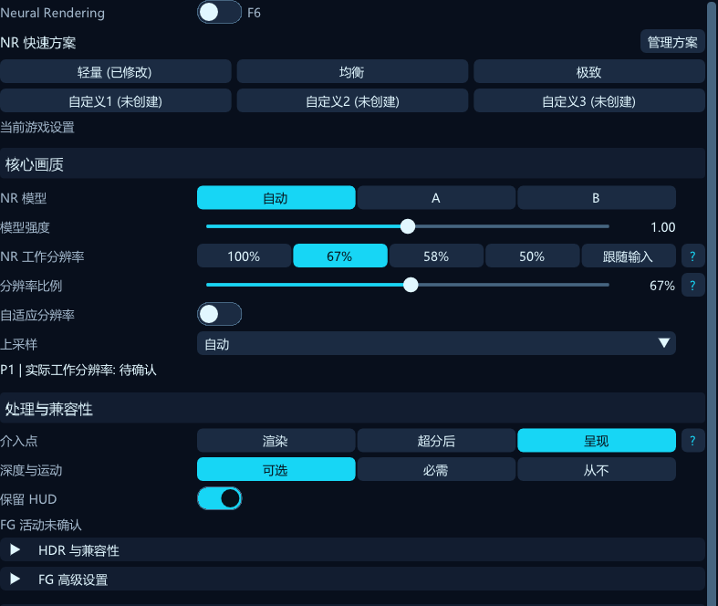
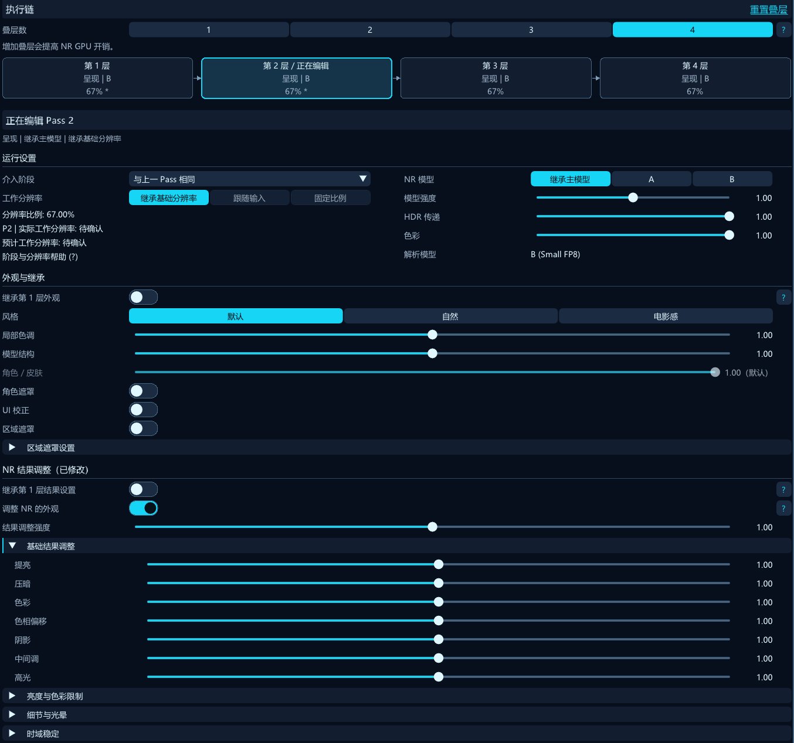
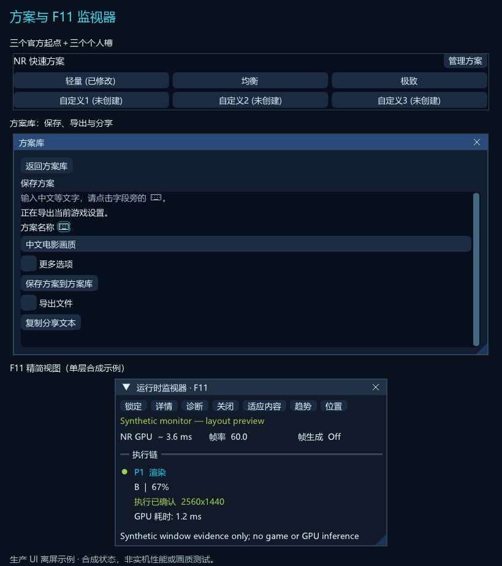
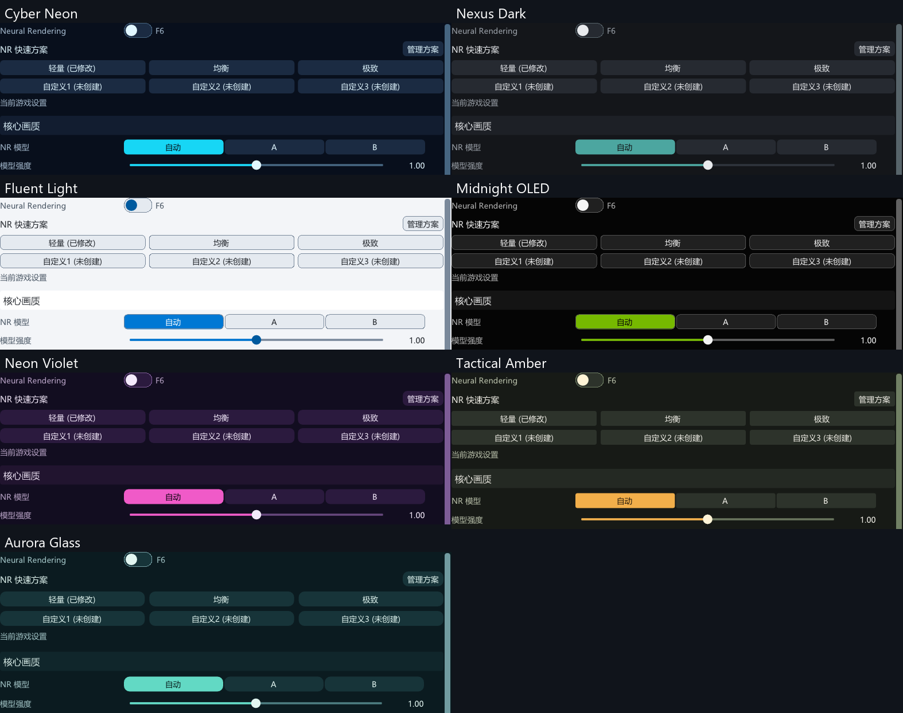
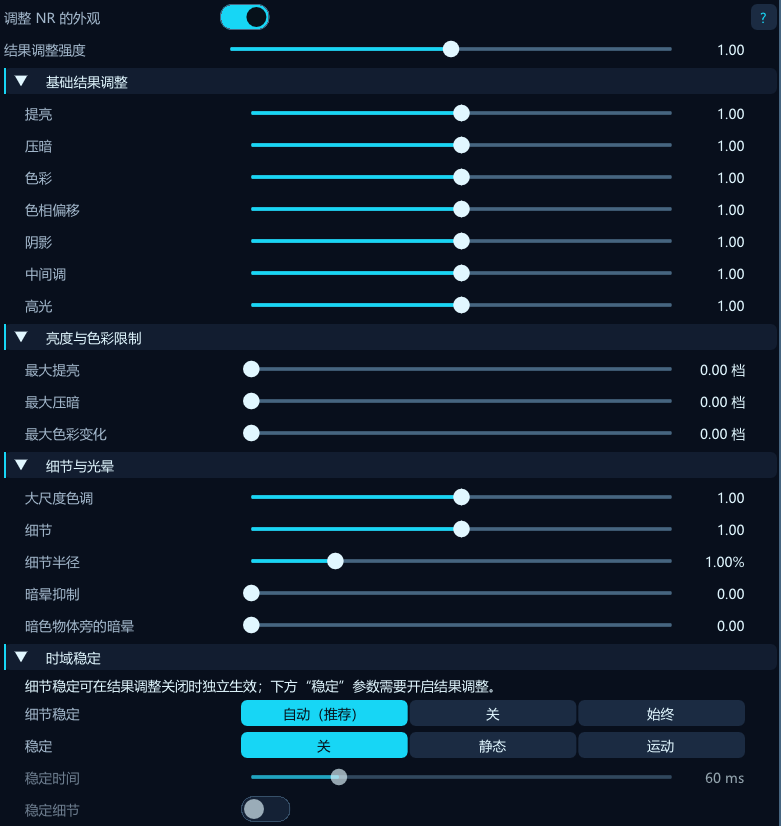
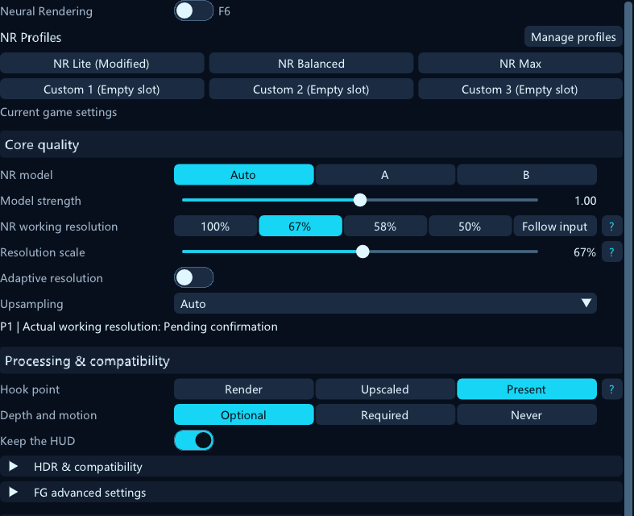
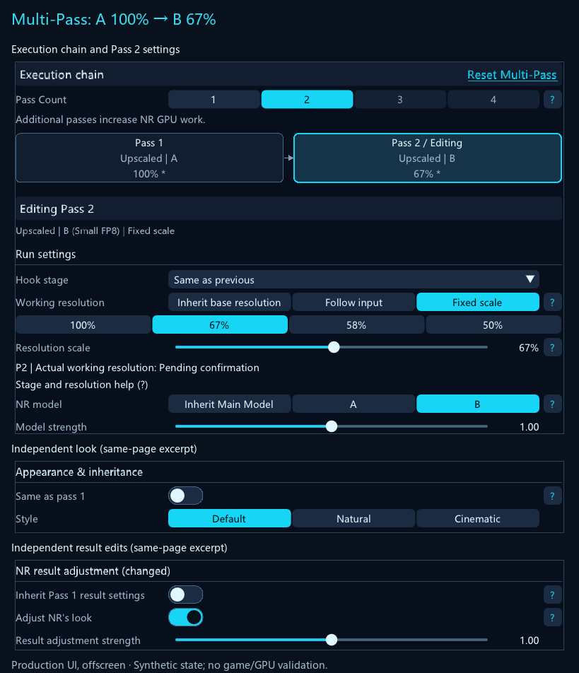
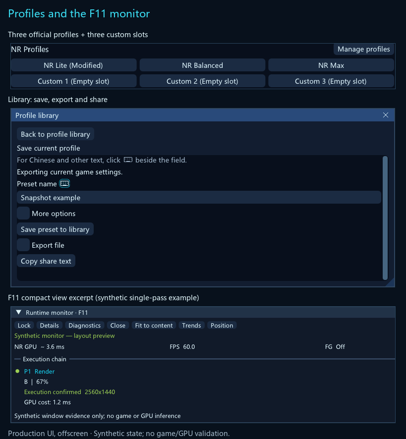
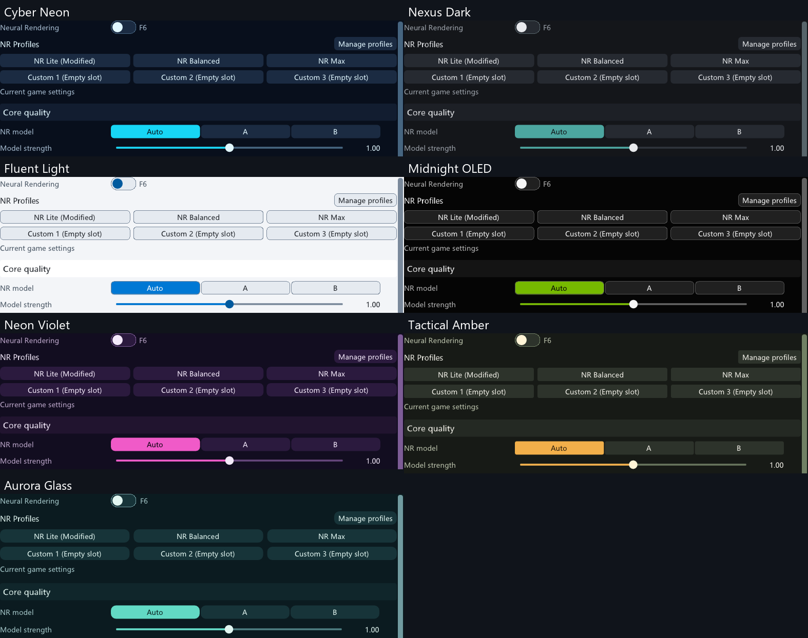
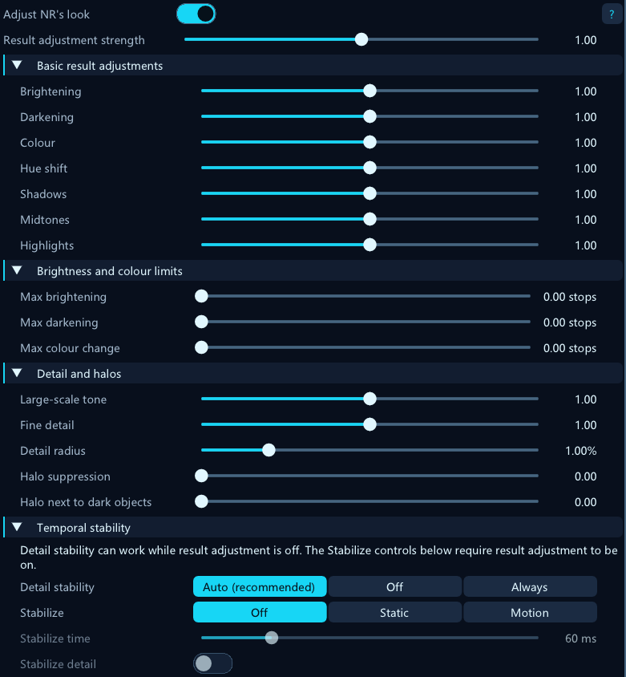

# NR Nexus — 玩家指南 / User Guide

[简体中文](#简体中文) · [English](#english) · [README](../README.md)

## 简体中文

本指南对应 **v0.2.1**：从安装、选方案和比较画面开始，再按需组合最多四层 NR、独立尺寸和结果编辑。**实验性**表示有特殊条件且默认关闭的试用路径，**暂不支持**表示不可用组合。下载及版本说明见 [v0.2.1](https://github.com/williamstosh/RenoDX-DLSSNR-Nexus/releases/tag/v0.2.1)。

配图沿用已审核的早前开发界面。0.2.0 的状态栏、分辨率区及方案入口已有调整，以文字步骤为准；图中状态和数字是界面示例。

### 目录

- [安装、升级与卸载](#zh-install) · [快速上手与常用场景](#zh-start)
- [画质](#zh-quality) · [叠层与两层实例](#zh-multipass) · [方案管理](#zh-presets) · [诊断与监视器](#zh-diagnostics) · [高级页](#zh-advanced)
- [参数参考](#zh-parameters)
- [常见问题与恢复默认](#zh-status)
- [高级诊断与特殊兼容性](#zh-compatibility)
- [English contents](#contents) · [返回 README](../README.md)

### 安装、升级与卸载

需要 Windows x64、[兼容的 NVIDIA RTX GPU／驱动](../README.md#zh-gpu)、支持完整 Add-on／API 18 的 ReShade，以及独立准备的 NVIDIA NR Runtime。**NR Nexus** 是 `renodx-dlss5.addon64`，**Runtime** 是 `nvngx_dlssnr.dll`，两者都要有；插件包不含厂商 Runtime、模型或 SDK。仅用于允许修改的单机环境，完整 Add-on、注入与 DLL 替换可能触发反作弊，勿用于受保护的联机游戏。

#### 用 RHI 准备 ReShade 和 Runtime

1. 关闭游戏，备份现有插件、ReShade 配置和将替换的 DLL。在 [v0.2.1 版本页面](https://github.com/williamstosh/RenoDX-DLSSNR-Nexus/releases/tag/v0.2.1)下载 Windows x64 ZIP 与对应的 `.zip.sha256` 并校验；从 [RHI 最新版](https://github.com/RankFTW/RHI/releases/latest) 下载 RHI。
2. 在 RHI 选中游戏；未找到时点 **+（Manually add a game）**，选择实际游戏 `.exe` 后点 **Add Game**，或把 `.exe` 拖入窗口。选游戏进程使用的程序，不选启动器；例如实际程序可能在 `Binaries/Win64`。
3. 在 **Game Overrides → ReShade Channel → Stable** 选择支持完整 Add-on 的渠道，在 **Components → ReShade** 安装；**No Addons 不能加载本插件**。已有 ReShade 时先核对其 Add-on 支持及 API 版本，避免重复安装。
4. 在 **DLSS / Streamline → Neural Rendering** 列选 **310.9.16 (20/30/40/50)**，点 **Deploy DLL** 单独部署 NR Runtime，无需其他 NR Add-on。**RHI 2.8.8 还会尝试在游戏安装根目录部署最新 `nvngx_dlss.dll`（SR），已有文件先备份为 `.original`；希望保持 SR 版本时使用手动安装。**如果游戏原有 DLSS 但缺此栏，先用 **Settings → Tools & Maintenance → Full refresh**；无 DLSS 或刷新后仍无此栏，使用下方手动安装。
5. 解压 NR Nexus 的 `renodx-dlss5.addon64` 到 ReShade **实际加载的 Add-on 目录**，默认在游戏 EXE 旁；自定义 `AddonPath` 时按该路径放置，并保留许可文件。RHI 游戏标题旁或右键菜单的 **Browse** 打开 game folder，未必是实际 EXE 目录：核对 RHI 选中的 EXE 和 `ReShade.log`，同时确认 Runtime 的实际位置。插件先找自身目录的 DLL，再找游戏 EXE 目录；集中 Add-on 目录里的旧 DLL 会优先。
6. 启动游戏，按 ReShade 的覆盖层键（默认 **Home**），在 Add-ons 中确认 **NR Nexus** 已加载；打开插件的**版本与关于／诊断**，确认 Runtime 版本、NR 路径和状态，再按[快速上手](#zh-start)比较。

这里不使用 **Install Neural Rendering**：该按钮安装 ShortFuse、DLSS5 Tool、Bridge 或 Feeder 等其他独立 NR 插件，不能代替 NR Nexus。也不要将 RTX 30 的 OptiScaler／Magpie 整包作为本插件安装步骤。RHI 已有备份、恢复和自动更新功能；安装后检查实际文件位置、重复 Add-on 与自动更新设置，避免其他工具替换当前选择。详情见 [RHI 官方指南](https://github.com/RankFTW/RHI/blob/main/docs/DETAILED_GUIDE.md)。

#### 手动安装与后续维护

- **手动安装：** 从 [ReShade 官网](https://reshade.me/) 安装支持完整 Add-on／API 18 的版本，选择实际游戏 EXE 及其图形 API；再将 `renodx-dlss5.addon64` 放入实际 Add-on 目录。另行合法取得兼容的 `nvngx_dlssnr.dll`，放在插件旁或实际 EXE 旁；RHI 清单提供的 [310.9.16 Runtime ZIP](https://github.com/RankFTW/rhi-repo/releases/download/dlssnr-310.9.16/nvngx_dlssnr_310.9.16.zip) 与 NR Nexus 插件 ZIP 是不同文件。遵守 Runtime／模型各自许可；项目 MIT 许可不改变这些条件。
- **升级：** 关闭游戏并备份当前插件和设置，校验新包后只替换目标 `renodx-dlss5.addon64`，保留配置及所需许可。检查 EXE 旁、自定义 `AddonPath` 及其他工具管理目录，避免同时加载重复或其他独立 NR 插件。重启后核对实际插件／Runtime 版本。
- **卸载／恢复：** 关闭游戏，仅移除本次安装的 NR Nexus Add-on；独立的方案库与每游戏方案需自行备份或保留，见[存储位置](#zh-profile-details)。只有本次添加且无其他组件使用时才移除 Runtime；被替换文件用备份恢复，RHI 管理的文件优先通过对应恢复／卸载功能处理。需要回退时同时恢复匹配的插件与配置，不删除其他模组的文件。

### 快速上手

1. 打开 ReShade 覆盖层，选择 **NR Nexus → 画质**，开启 **Neural Rendering**。默认 **F6** 可比较 NR 关／开。
2. 全新且兼容的空配置会尝试采用**均衡 Balanced：Present、B、1 层、67%**；已有配置保留。先查看选中的方案和实际参数，直接比较画面。需要手动排查时，再保存当前方案并改用 **1 层、Auto 模型、Upscaled（超分后）**，保留外观和高级兼容默认值；这条排查路径需要游戏开启兼容的 DLSS SR 或 DLAA。
3. 回到正常游玩画面，查看顶部状态；若提示等待、缺少运行时或资源，点击状态进入**诊断**，按提示处理。
4. 比较同一场景的静止和移动画面。想改变生成风格，调整**模型风格**；想控制生成后的亮暗、颜色和细节，开启**调整 NR 的外观**。
5. 将喜欢的配置存入**自定义方案**；按 **F11** 边玩边看 NR GPU 开销。

菜单有**画质、叠层、诊断、高级**四个主标签；**管理方案**从画质页打开独立窗口。各页右上角的全部展开／收起仅作用于本页或当前 Pass 的高级分组，常用设置保持可见；窄窗口使用 +／− 按钮。一般参数会自动保存；更换模型、层数、位置或尺寸后，等画面稳定再比较。

#### 从你的目标开始

| 想做什么 | 从哪里开始 |
| --- | --- |
| 混搭两种独立外观 | 按[两层实例](#zh-two-pass-example)分别设置模型、外观和结果。 |
| 降低 NR 开销 | 先减少层数，再比较[工作分辨率](#zh-resolution)；使用 [GPU A/B](#zh-gpu-ab)。 |
| 保留并切换喜欢的设置 | 创建[自定义方案](#zh-presets)，需要分享时导出文件或复制分享文本。 |
| 配合帧生成使用 | 保留游戏原有 FG 设置，在[诊断](#zh-diagnostics)看 NR 路径和 FG 状态。 |
| 画面过暗、过艳或有光晕 | 调[结果编辑](#zh-results)的压暗、颜色、限制或光晕抑制。 |
| 调乱后重新开始 | 使用[恢复默认](#zh-reset)，再逐项启用需要的效果。 |

### 日常操作

#### 画质：模型、位置与外观

用 **Neural Rendering／F6** 比较关／开。**Auto** 是未应用方案时的基础模型默认值；兼容的 **310.9.16.0** 运行时支持 **A（Legacy）／B（Small FP8）**，可比较两者外观和成本。

0.2.0 保留顶部 F6 开关与六个快速方案，画质页分为三个常开区：**核心画质**按模型、强度、工作分辨率／比例与上采样排列，并显示第 1 层当前尺寸证据；**处理与兼容性**包含**介入点（Hook point，即处理位置）**，Present 下显示深度／运动与 HUD 选项，低频 HDR 与 FG 选项折叠；**外观与结果**常显模型风格等常用控件，结果的四个高级分组继续按需展开。

按用途选择位置：**Upscaled** 在游戏 DLSS 输出后处理，适合先比较 NR 外观。**Render** 在 DLSS 放大前处理，可比较较小输入的成本；**Present** 处理游戏完成后、ReShade 效果前的画面。Ray Reconstruction 开启时，Render 使用兼容的 Upscaled 路径。Present 默认保留 HUD，仍受影响时可比较 UI 修正或改用 Upscaled。

**风格、局部色调、模型结构、人物／皮肤**决定模型生成的外观；**调整 NR 的外观**塑造它生成的结果，两组控件可配合使用。各项默认值见[参数参考](#zh-parameters)。

#### 叠层：组合最多四层

叠层数 **1–4** 包含第 1 层，后一层处理前一层的结果：

输入 → 第 1 层模型＋结果编辑 → 第 2 层模型＋结果编辑 → … → 输出

点击节点选择要编辑的层。第 1 层与画质页共用设置；第 2–4 层的模型可继承主模型，外观和结果则分别独立选择继承第 1 层，均不是继承上一层。工作分辨率可继承基础分辨率；只有 Stage 的“与上一层相同”跟随上一 Pass。可以同模型不同外观，也可以不同模型共享结果编辑。增加层数会增加 GPU 工作并叠加颜色和光晕变化，建议从两层开始。

叠层页分为**执行链**总览和醒目的**正在编辑 Pass N**，编辑区按**运行设置、外观与继承、结果**分组。节点显示配置阶段、解析模型和工作分辨率比例；各层实际工作尺寸紧邻参数，没有当前有效数据时显示“待确认”。**全部展开／全部收起**作用于本页或当前 Pass 的高级分组，常用设置始终可见；切换 Pass 会保留各层的折叠选择。细节稳定可在结果调整关闭时独立生效，完整规则可悬停**时域稳定**折叠头或展开该组查看。

##### 实例：自然底层＋电影感第二层

1. 先保存当前方案。开启游戏兼容的 DLSS SR／DLAA，将画质页位置设为 **Upscaled**，基础尺寸设为 **100%**，在叠层页将层数设为 **2**；第 2 层阶段选“与上一层相同”、尺寸继承基础。
2. 选择**第 1 层**，模型选 **A**，风格选**自然**。开启本层**调整 NR 的外观**，按喜好调整高光。
3. 选择**第 2 层**，模型选 **B**，关闭**继承第 1 层外观**和**继承第 1 层结果设置**。
4. 为第 2 层选**电影感**，开启本层**调整 NR 的外观**，再调细节或光晕抑制。两层现在各有自己的生成风格和输出编辑。
5. 想共享一部分时，只重新开启对应继承。例如共享外观，保留第 2 层独立结果；**继承主模型**则只控制模型。
6. 等画面稳定，比较 F6 关／开及一层／两层，检查脸部、植被、亮边和运动，满意后保存自定义方案。

A/B 示例需要 310.9.16.0，其他兼容运行时也可使用同模型两层组合。关闭继承显示该层**已保存的独立值**，不会自动复制第 1 层编辑；重新继承或减少层数会保留独立值，之后可继续使用。

##### 逐层处理位置

想在超分前后分别处理，可在支持的 DX11 Bridge／DX12 路径尝试 **Render A → 游戏 DLSS SR／DLAA → Upscaled B**：

1. 开启游戏兼容的 DLSS SR／DLAA，将画质页处理位置设为 **Render**，叠层数设为 **2**。
2. 第 1 层选 A；第 2 层阶段选 **Upscaled**、模型选 B，按需分别设置外观与结果。
3. 若变更会连带调整其他层，检查整链预览后确认；取消保留原链，应用后可使用提供的撤销。
4. 回到游戏，确认诊断中的实际阶段、尺寸和运行状态，再用 F6 比较。该受支持链可与原生 DLSS FG／MFG 或 XeFG 协同，仍需满足当前资源和路径条件。

第 2–4 层可选**与上一层相同／Render／Upscaled／Present**。阶段只能向后排列；顺序合法仍须满足[兼容性表](#zh-paths)，不能据此任意组合三阶段。

##### 独立工作分辨率

用较小尺寸运行某一层，再重建到输出尺寸，可在细节与成本间取舍，游戏 DLSS 分辨率保持不变。

1. 在**画质**或**第 1 层**设基础分辨率：100／67／58／50%，或用 **33–100%** 滑条微调。
2. 选择第 2–4 层，在**工作分辨率**中选择**固定比例**及所需比例；也可选**跟随输入**。Present 双层也可直接点击第 2 层的同尺寸比例按钮，一次设置固定模式和比例。
3. 比如比较 **第 1 层 100% → 第 2 层 67%** 与两层 100%，保持其余模型、外观和结果相同。
4. 查看尺寸区的预计／实际尺寸及诊断 GPU 开销，检查边缘、细节和移动画面。

“继承基础”取画质页／第 1 层，**不是上一层比例**。“跟随输入”使用可用引导尺寸，缺少引导时用保存比例；上采样全链共享。要在 Present + FG 使用两层 67%，将基础比例设为 67%，第 2 层设为继承基础。若旧设置的第 2 层固定为 100%，选择基础比例或两层后，在确认框中点击“让其他层继承基础分辨率”，即可统一应用；取消不会更改设置，撤销／重做作用于整次操作。也可先手动将第 2 层设为继承基础，再更改基础比例；独立比例的保存值会保留。

DX11／DX12 支持跨 Render／Upscaled 阶段独立尺寸，以及同一 Render 或 Upscaled 阶段的两层不同尺寸。普通 Present 两层实际尺寸相同时（例如均固定为 50%）可配合 FG；尺寸不同时需插件明确确认 FG 已关闭，未知或开启时会拒绝。同阶段三层以上要求实际工作尺寸一致。Pre-FG 两层不同尺寸与 Vulkan 独立尺寸**暂不支持**，详见[兼容性表](#zh-paths)。

#### 方案管理：保存、切换与分享

画质页提供每游戏六个 **Profile／Slot（快速方案／槽位）**：三个官方槽和三个自定义槽，以及共享**方案库**。槽位按游戏保存，用于随手切换；方案库在本机的不同游戏间共享，可保存一套或多套精调配置，换游戏后导入并一键应用复用，也能备份和分享。

| 想做什么 | 操作 |
| --- | --- |
| 使用已有方案 | 左键点击有内容的槽位，应用它管理的 NR 设置。 |
| 保存当前设置 | 左键空自定义槽，选“将当前设置保存为此方案”；之后编辑选中方案会自动保存，留意保存状态。 |
| 从官方方案开始 | 选择轻量／均衡／极致，或创建自定义方案时选“从官方方案复制”。 |
| 命名或更换自定义内容 | 右键自定义槽，选重命名、从官方复制、导入或清空；也可进入“管理方案”。 |
| 恢复官方设置 | 右键官方槽，确认“恢复官方默认”；各官方槽分别保存个人修改。 |
| 撤销 | 使用可用的“撤销方案操作”；导入还有独立的“撤销上次导入”。 |
| 管理更多文件 | 点“管理方案”，搜索并选中文件，再查看、重命名、复制或删除。 |

官方起点为**轻量：Render、B、1 层、75%；均衡：Present、B、1 层、67%；极致：Present A → Present B、2 层，均为 100%**。极致第 1 层使用**电影感**、第 2 层使用默认风格；两层分别启用角色遮罩，角色／皮肤为 **0.80／0.50**。名称便于选择，可继续调整；兼容的新建空配置可自动采用均衡，已有设置保留。

**保存／导出：** 在方案库点“保存方案”，输入名称；默认范围“画质＋叠层”。点“保存方案到方案库”写入本地，或“复制分享文本”。另存时展开“导出文件”，选路径后再点“导出方案文件”；覆盖须确认。槽位直接导出使用其已保存内容，包括官方槽的个人修改。

**导入／应用：** 换游戏后在方案库选中已保存配置，点“预览所选方案”，检查差异后点“确认并应用方案”。外部方案用“导入方案”选择 JSON 文件或粘贴分享文本；也可先存入自定义槽，再选择该槽应用。覆盖已有内容及导入完整备份需确认。

*方案保存与 F11 监视器的生产 UI 离屏示例。填写名称后可保存、导出文件或复制分享文本；监视器数值为合成数据。*

槽位编辑自动保存，独立库文件需主动保存。窗口可拖缩，X 或窗口有焦点且未编辑文字时按 Esc 关闭；会话草稿保留，关闭不会自动保存或应用导入。

中文输入异常时，点字段标题旁**键盘按钮**，或右键文字框选**辅助输入…**，在 Windows 编辑窗输入后点“应用”，再按原流程保存。区域提示中的键盘图形仅作说明。文件范围、保存异常及缺字处理见[高级参考](#zh-profile-details)和[常见问题](#zh-status)。

#### 诊断与运行监视器

诊断集中显示 NR 状态、原因、工作尺寸、GPU 开销和反馈入口。先解决状态问题，再比较性能；需要细节时展开**详细诊断**。

##### F11 常驻性能 HUD

- **F11** 显示／隐藏，在**高级 → 快捷键与截图**可改绑定，监视器标题显示实际按键。首次默认隐藏；之后按本游戏记住最近的显示选择，下次启动自动恢复。关闭主菜单后是否常驻由**高级 → 运行时监视器**控制。
- **F8** 默认循环精简、详细、精简＋趋势、详细＋趋势四种模式；可改绑或取消。F8 与宿主快捷键冲突时会提示，不会屏蔽游戏或 Steam 输入。
- 游戏中不接收鼠标或键盘输入；按 **Home** 打开 ReShade 主菜单后可拖动、缩放、锁定位置与尺寸。拖动后记忆自定义位置。
- **精简／详细（Compact／Details）**显示 NR 状态、GPU 开销、帧率和 FG 状态；详细视图增加逐层开销与异常。切换视图或趋势时自动适应一次，手动缩放后保留尺寸偏好；也可主动点击**适应内容**。逐层链显示渲染、超分后、呈现等位置、模型配置和实际尺寸。两种视图均可选开**趋势（Trends）**，查看最近 **10／30／60 秒**，并选择帧率、帧间隔（ms）、NR GPU 或各 Pass GPU 曲线。
- 顶部、监视器和帧率曲线使用同一采样口径，优先读取当前运行时的 **Present 回调节奏**，无有效数据时回退到 **ImGui 更新节奏**并标明来源；切换来源时重新开始相应曲线。该帧率不是 FG 后最终输出帧率。GPU 曲线使用已完成的原始计时样本，以 **50 ms** 分桶并保留峰值，缺测时留空。
- 切换介入点、Pass 数量、模型或工作比例时，趋势会记录新的配置代次并保留前一段有效历史；无效区间显示为空缺，不把旧 GPU 样本当作当前配置。
- **高级 → 运行时监视器**可设置 **0–100% 背景不透明度，默认 80%**；仅背景变淡，文字和曲线保持清晰。监视器内的**位置**菜单与高级页共用九宫格、自定义、适应内容和重置操作；高级页还可用水平／垂直偏移微调（UI 像素）。拖动会切回自定义位置。

跨阶段的 NR GPU 仅在所有阶段组都有近期有效样本，且配置、设备、来源、显示条件与队列一致时显示 **~ 参考合计**。每个阶段组的总耗时只计一次，包含组内共用开销；它是近期成本参考，并非同一帧的端到端延迟。条件不足时查看独立 Pass 数据；缺测与未运行分别显示。

F6 立即提示开关操作，随后状态更新为正在检查、正常运行、已提交至 FG 或具体原因。等待／暂无时让游戏正常运行片刻，持续存在再查看原因。FG 倍率未知时，分别看 FG 活动和 NR 路径。

##### GPU A/B：比较一层分辨率的成本

1. 固定场景、视角、模型、层数、FG 与游戏设置，等画面稳定。
2. 在诊断的**手动 GPU 对比**区点**采集基线**，等待完成。
3. 只改一层尺寸，例如第 2 层 100% → 67%，等画面稳定。
4. 点**采集对照**，采集期间保持场景和设置不变。
5. 查看该层及阶段的耗时变化，同时检查画面。重来可点**清除对比**。

**B−A 为负更省 GPU 时间，为正更费**，百分比相对基线。波动大或差异小时会提示缺少明确结论。降低尺寸后的细节、运动效果和整体帧率仍需在游戏中比较。工具只显示比较，不自动改尺寸、保存方案或上传。

每次采集有短暂稳定期，最多 **10 秒**；超时先检查 NR 活动。原始计时说明集中在[高级 GPU 诊断](#zh-gpu-details)。

##### 反馈与隐私

点**我遇到了问题…**填类型和复现步骤，可仅反馈文字，也可生成诊断、预览文件并保存本地 ZIP。截图默认不含。文本预览最多 **64 KiB**，完整内容可打开暂存文件。导出会脱敏，分享前仍请检查个人信息和图片内容。

本地保存、向界面列出的临时托管方上传、附公开摘要／链接及准备 Issue 分别选择。**准备 GitHub Issue**打开浏览器草稿，由你检查提交，插件不保存 GitHub Token。持有上传链接者可下载附件，主动保存的 ZIP 会保留。浏览器预填失败可复制 Markdown 到空白 Issue。

#### 高级页：界面、按键与截图

在这里选 **15 种语言**和七套主题：**Cyber Neon、Nexus Dark、Fluent Light、Midnight OLED、Neon Violet、Tactical Amber、Aurora Glass**，修改按键和截图设置。主题只影响插件界面。

设置分为**快捷键与截图、运行时监视器、界面与通知、游戏修正与兼容性、开发与维护**。常驻显示与监视器定位在运行时监视器中；提示定位与预览在界面与通知中。

*配图展示基础主题示意；当前可用主题以界面中的主题选择器为准。*

默认 **F5** 截取 NR 关／开对比，通常存入 ReShade 基础目录 **DLSS5 Screenshots**。跨阶段链暂不支持同帧最终画面对比，使用 F6 比较或模型缓冲捕获。完整选项见[截图参考](#zh-capture)。

已有明确 NR OFF／ON 截图时，可用独立的[实机画面对比工具](GAME_COMPARISONS.md#简体中文)生成带标签的静态图与本地拖动预览。此工具不改变游戏或截图功能，候选须人工审核后才可公开。

普通调色保留高级兼容默认值；有具体 HDR、深度、运动或 Present 问题时再查[高级兼容性](#zh-compatibility)。

### 参数参考

下表为单项默认值；首次采用 Balanced 时将模型、位置与比例覆盖为 **B／Present／67%**，其他方案和已有配置也可覆盖单项默认。模型风格改变生成过程并重置历史；结果编辑实时塑造生成的变化。

#### NR 强度与模型

| 控件 | 默认／选项 | 用途与条件 |
| --- | --- | --- |
| Neural Rendering | **开**；关／开 | 开关 NR，默认快捷键 **F6**。比较 NR 开关请用此项；强度归零是另一种操作。 |
| 模型强度 | **1.00**，**0–2** | 在结果调整之前传给模型；改动重置 NR 历史。大于 1 的效果随模型／运行时变化，请比较实际画面。 |

| 选项 | 请求如何解析 |
| --- | --- |
| **Auto／自动**（默认） | 精确识别为 **DLSS NR 310.9.16.0** 时解析为 **B**；其他运行时保留兼容的自动／运行时默认行为，不能一概认为 Auto=A。 |
| **A — Legacy** | 请求预设 1，细节、结构和颜色可能与 B 不同。 |
| **B — Small FP8** | 请求预设 2，仅对已识别的 310.9.16.0 启用；与 A 比较外观及实测 GPU 开销，按喜欢的效果选择。 |

运行时未识别时模型选择不可用。不兼容的已保存 B 会回退 A 并保留选择。旧预设 3 仅作“自定义”兼容项，在双模型运行时解析为 A。

#### 区域遮罩（ControlMask）

区域遮罩可以分别调节 NR 的应用量、色调和结构，也可以让 NR 在远处逐渐减弱，保留原画面。它与用于识别人物的“角色遮罩”分别设置。入口在**画质 → 外观与结果 → 模型风格 → 区域遮罩**；叠层页的每一层也都有同一组设置，位于模型外观之后、结果调整之前。开关作用于全部层，Pass 1 与画质页共用设置，后续层可继承或独立调整。开关和参数即时生效，无需重启游戏；关闭遮罩后仍继续运行 NR。需要兼容的 NR 运行时和处理路径。

当前版本会忽略旧诊断配置 `NRControlMaskUseCoreContext=1`，并修复已有处理历史在切回 Upscaled 或逐层处理时阻止 NR 继续运行的问题。无需手动删除此键；更新插件并重启游戏后生效。

**开发版新增：运动衰减**（尚未包含在 v0.3.0 安装包中）。在区域遮罩设置中开启后，运动越快的区域使用越少的 NR，包含转动相机产生的画面运动。默认关闭，运动淡出起点／终点为 **2／16 像素／帧**，按当前层的输入分辨率计量：低于起点保留 R，达到终点时 R 降至 0。提高起点可让轻微运动继续保留 NR，提高终点可让过渡更缓。工作分辨率或帧率改变后，可按画面重新调节。

运动衰减可以和深度衰减同时使用，重叠区域采用较强的衰减，G、B、角色遮罩和混合模式保持各自设置。每层可继承 Pass 1，或独立设置运动开关与范围。关闭运动衰减便恢复该层原有区域设置；缺少有效运动或深度输入时，只跳过对应自动规则。它按运动矢量选取区域，不区分相机运动与移动物体。

| 控件 | 默认／选项 | 用途 |
| --- | --- | --- |
| 遮罩模式 | **全画面自定义** | 统一使用 RGB 设置；“全画面标准遮罩”固定三个通道为 1；“按深度衰减”只在远处逐渐减弱红色通道，G／B 仍可独立调整。 |
| 混合模式 | **替换**／平均／取较小值／取较大值 | 替换（0）使用区域遮罩代替自动角色遮罩；其余三项（1／2／3）将蓝色结构值与角色遮罩按平均／最小／最大组合。角色遮罩关闭时，后三项通常没有区别；它们不改变红色强度或绿色色调的组合方式。 |
| R／G／B | **1／1／1**，各 **0–1** | R 为红色通道，控制 NR 结果应用量；G 为绿色通道，缩放局部色调输入；B 为蓝色通道，缩放结构输入。G 降到 0 仍可能保留风格调色，B 的效果还取决于角色遮罩与混合模式。 |
| 淡出起点／淡出终点 | 精确深度 **0.999900／0.999950** | 起点之前保留选定的 NR 强度，起点到终点之间平滑减弱，终点之后保留原画面。两个控件采用固定的 0–100 范围刻度，让接近 1 的深度更容易调节；刻度不是距离百分比或米数。 |

调节时先选**远景起步**：若近处地面也失去 NR，将“淡出起点”向右移；再把“淡出终点”向右移可扩大柔和过渡。修改一个端点不会推动另一个，起点始终小于终点。调乱后再次点击“远景起步”，即可只恢复深度范围，保留 RGB 和混合选择。**仅远平面**使用 `0.999990／1.000000`，只在非常接近游戏远深度极限处淡出；它按深度选择区域，不识别语义天空。

展开**精确深度值**可查看六位小数，并按住 **Ctrl 单击数值**输入归一化游戏深度。“近景深度／远景深度”与“淡出起点／淡出终点”编辑的是同一对端点。四行数值修改后均可用右侧恢复按钮重置该项；若另一端限制了单项恢复，可点“远景起步”恢复整个范围。

新默认值只用于初始化及迁移精确旧默认 `0.7／0.9`；启动、应用方案或导入时均采用同一迁移规则，其他有效自定义范围保留。若已保存的自定义值让 NR 过早淡出，请主动选择“远景起步”。不同游戏的深度分布不同，起步值仍需按画面调整。矩形测试图案已从玩家菜单移除。

#### 模型风格

| 控件 | 默认／范围或选项 | 含义与依赖 |
| --- | --- | --- |
| 风格（Style） | **Default**／Natural／Cinematic | Default 由运行时选择；其他两项显式请求对应风格。名称不是画质等级。 |
| 局部色调（Local tone） | **1**，**0–2** | 模型重塑局部亮度与对比度的强度。 |
| 模型结构 | **1**，**0–2** | 模型合成的结构。人物遮罩与独立皮肤同时开启时，实际传入值上限为 **1**，保存值保留。 |
| 人物／皮肤（Character / skin） | **stock／原始值**；独立皮肤时显示 **1**，可调 **0–1** | 仅人物遮罩开启时有效。0 表示最少皮肤重塑，不是中性中点。 |
| 人物遮罩（Character mask） | **关** | 让运行时识别人，使皮肤参数作用于相关区域；也可能影响其他画面部分。 |
| 独立皮肤（Independent skin） | **开**，全链共用 | 配合人物遮罩，将 stock 皮肤传为 1、实际结构封顶 1。关闭时 stock 皮肤跟随结构；即使开启，结构低于 1 仍可能通过模型本身影响脸部。 |
| UI 修正（UI correction） | **关** | 运行时模型 UI 修正；HUD 被影响时可比较。与 Present 默认开启的“保留 HUD”分开。 |

#### 处理位置与 Present

| 选项 | 输入与适用性 |
| --- | --- |
| **Render** | 在 DLSS 放大之前处理游戏颜色，使用渲染尺寸的深度和运动矢量，可能降低成本。使用 Ray Reconstruction 时，因重建前输入仍有噪声，保持兼容的 Upscaled 路径。 |
| **Upscaled**（默认） | 在游戏 DLSS 输出之后、后续游戏处理与 HUD 之前运行。依赖可用的被截获 DLSS 资源。 |
| **Present** | 请求处理游戏后处理与 HUD 完成后的呈现帧，位于 ReShade 效果与覆盖层之前。兼容的 Pre-FG 路径可改为在帧生成前服务 NR；实际路径看诊断。 |

Present 显示以下选项。兼容的 Pre-FG 先增强游戏帧再交给 FG；普通 Present “每帧”会处理生成帧并增加成本，“游戏帧”减少工作但生成帧外观可能有差异。

| 控件 | 默认／选项或范围 | 用途 |
| --- | --- | --- |
| 深度与运动 | **Optional／可选**；Required／必需；Never／从不 | 可选优先匹配真实资源，缺失用中性数据；必需缺失则跳过；从不忽略捕获资源、始终用中性数据，适合不可靠资源，但可能损失运动稳定性。 |
| 保留 HUD | **开** | 请求模型修正已经包含 HUD 的呈现帧，HUD 仍有变化时可改用 Upscaled。 |
| 帧编码 | **Auto**／SDR／HDR10／scRGB | Auto 根据交换链色彩空间证据判断，只有错误声明时才覆盖。 |
| HDR 纸白 | **0**，**0–1000 nits** | 0 跟随已加载且进行色调映射的 RenoDX HDR Mod 的游戏亮度，否则用 Windows SDR 内容亮度；正数覆盖。 |
| FG 帧处理策略 | **Every frame／每帧**；Game frames／游戏帧 | 普通 Present 下选择处理含生成帧的每次呈现，或仅游戏帧；不会开启 FG。成功的 Pre-FG 优先，回退使用对应路径。 |
| 帧生成检测 | **Auto**；Stable timing／稳定时序；Legacy timing／旧版时序 | Auto 优先读取声明倍率，缺失则稳定时序估计；稳定时序忽略声明；旧版时序用于兼容。 |

#### 基础分辨率与上采样

| 预设 | 单轴比例 | 含义 |
| --- | --- | --- |
| **100%**（默认） | **100%** | 完整比例基准尺寸，不会选择 DLAA 或更改游戏 DLSS 设置。 |
| 67% | **67%** | 降低 NR 工作分辨率。 |
| 58% | **58%** | 进一步降低尺寸。 |
| 50% | **50%** | 宽高各半，约为基准像素数四分之一，GPU 成本另看测量。 |
| Follow input／跟随输入 | 有效 Guide 与参考尺寸逐轴取较小值 | 缺少有效 Guide 时使用先前保存的比例；选择跟随不会改写该比例，也不会更改游戏 DLSS 模式。 |

比例作用于宽高，50% 约四分之一像素。Render 基准为可用渲染区域，Upscaled 为 DLSS 输出区域，Present 为呈现帧。跟随输入时禁用比例滑条，保留其保存值。当前设置区可看预计／实际尺寸，历史在诊断页。

| 上采样选项 | NR 低于输出尺寸时的行为 |
| --- | --- |
| **Auto**（默认） | 自动按边缘重建 NR 改变量，保留下层全分辨率细节。 |
| Edge-aware／边缘感知 | 沿图像边缘重建 NR 改变量。 |
| Classic／经典 | 更直接显示 NR 的低分辨率像素，可能块状。 |
| Edge-aware (area input)／边缘感知（区域输入） | NR 前对输入像素平均，之后重建改变量；可能改变模型外观，进入或离开此模式重置 NR 历史。 |

上采样全链共享，NR 尺寸低于输出时用于重建。降低比例后检查细节和稳定性。

#### 结果编辑与时序稳定

**调整 NR 的外观**默认关闭；开启后控制模型带来的亮暗、颜色和细节变化。它编辑的是**模型改变量**，不是全局游戏亮度／饱和度。通常 1 保留分量、0 去掉分量；亮度／颜色“限制”的 0 则表示不限。

*基础调整、限制、细节与光晕、时域稳定。*

| 分组／控件 | 默认 | 范围 | 含义 |
| --- | --- | --- | --- |
| 结果调整强度 | **1** | **0–2** | 在限制之前缩放 NR 改变量；0 去除改变量，1 保留尺度，2 加倍尺度。 |
| 基础：提亮 | **1** | **0–2** | 保留多少模型提亮。 |
| 基础：压暗 | **1** | **0–2** | 保留多少模型压暗，也包括不需要的暗晕。 |
| 基础：颜色（Colour） | **1** | **0–2** | 模型饱和度改变量；0 保留游戏饱和度。 |
| 基础：色相偏移 | **1** | **0–2** | 模型色调改变量；0 保留游戏色相。 |
| 基础：阴影／中间调／高光 | **各 1** | **各 0–2** | 按送入模型的图像明暗区域缩放改变量。 |
| 限制：最大提亮／最大压暗 | **各 0** | **各 0–4 档** | 亮度变化的柔性上／下限；**0 表示不限**，不是没有效果。 |
| 限制：最大颜色变化 | **0** | **0–2 档** | 柔性颜色变化限制，**0 表示不限**。 |
| 细节：大范围色调／精细细节 | **各 1** | **各 0–2** | 分别缩放宽广照明与小尺度变化。精细细节重塑输出，模型结构改变模型合成。 |
| 细节半径 | **1%** | **0.25–4%** | 大范围与精细变化的分界，以图像高度为基准；增大可触及更宽光晕。 |
| 光晕抑制 | **0** | **0–1** | 减少亮物体旁的暗晕，保留大范围表面压暗与预期阴影。 |
| 暗物体旁的光晕 | **0** | **0–1** | 减少暗物体较亮一侧的暗裙边，该问题可能随叠层累积。 |

想减少暗部的 NR 效果，可开启**调整 NR 的外观**，先将**阴影设为 0.5**，中间调与高光保持 1，再按画面需要降至 0。阴影参数同时缩减该区域的亮暗和颜色变化；极暗处仍可能保留模型变化，设为 0 也不等于在暗部完全关闭 NR。模型仍照常运行。

| 时序控件 | 默认／范围或选项 | 依赖与用途 |
| --- | --- | --- |
| 细节稳定（Detail stability） | **Auto／自动（推荐）**；Off／关；Always／始终 | 独立于结果调整。Auto 在兼容的放大后路径、有可用游戏运动矢量时过滤；Always 还请求在放大前过滤。仍受资源与兼容检查限制，用于细节爬动、沸腾。 |
| 稳定（Stabilize） | **Off**；Static／静态；Motion／运动 | 要求结果调整开启。时序平均宽广变化，静态适合静止视角，运动需要可用游戏运动矢量来跟随运动；可能延迟照明变化。开启后替代自动细节稳定过滤。 |
| 稳定时间 | **60 ms**，**10–250 ms** | 仅稳定模式启用时可调；越长越稳，响应越慢。 |
| 稳定细节 | **关** | 仅稳定模式启用时可调，也平滑小尺度变化。 |

关闭结果调整会保留值；**细节稳定和共享上采样仍独立生效**，查看未过滤输出时也要检查它们。

#### 逐层继承与历史

| 第 2–4 层控件 | 默认 | 继承内容 |
| --- | --- | --- |
| 阶段 | **与上一层相同** | 上一层请求的阶段；与模型、外观和结果独立。 |
| 工作分辨率 | **继承基础分辨率**；独立比例 **100%** | 继承基础值（非上一层）／Follow input／固定比例；固定比例 **33–100%**，不受 Stage、模型、外观或结果继承控制。 |
| NR 模型：继承主模型／A／B | **继承主模型** | 主模型选择，包括自动解析与回退；与另外两种继承独立。 |
| 遮罩设置继承（Use Pass 1 mask settings） | **开** | 默认使用 Pass 1 的遮罩模式、混合模式、RGB 和深度阈值。关闭后可为此 Pass 分别设置这些值。 |
| 继承第 1 层外观（Same as pass 1） | **开** | 仅模型风格参数：风格、局部色调、模型结构、人物／皮肤、人物遮罩、UI 修正。不继承模型选择、模型强度、HDR 传递、Color 或结果。独立皮肤仍是全链设置。 |
| 继承第 1 层结果设置 | **开** | 结果开关、强度、基础／限制／细节／光晕、稳定设置与细节稳定。关闭后可编辑本层结果；上采样仍全链共用。 |

即使继承外观，第 2–4 层仍有各自模型强度（1，0–2）、HDR 传递（1，0–1）、Color 强度（1，0–1）；HDR 项受来源限制，独立皮肤全链共用。链式历史默认开；关闭让额外层每帧重置，可能闪烁，仅供诊断。

#### 界面与通用设置

| 设置 | 默认／选项 | 作用范围 |
| --- | --- | --- |
| 界面主题 | 全新安装 **Cyber Neon**；另有 Nexus Dark／Fluent Light／Midnight OLED／Neon Violet／Tactical Amber／Aurora Glass | 只改变 NR Nexus 界面颜色，按游戏保存，不改变游戏调色或 NR 画质。已有配置缺少主题项时保留 Nexus Dark。 |
| 恢复默认主题 | Cyber Neon | 仅恢复主题；高级页恢复与全量恢复也将主题恢复为 Cyber Neon，画质／叠层页恢复不改主题。 |
| 语言 | **Auto** 或 15 种语言 | 英、德、法、西、意、葡萄牙语（巴西）、俄、保加利亚、斯洛文尼亚、土耳其、泰、日、韩、简中、繁中。Auto 跟随 ReShade 的语言，后者未手动选择时跟随 Windows；未匹配的语言回退英文。选择名称保留英文便于找回。ReShade 为自身语言加载字体；插件检测到缺字会保持英文并在 `ReShade.log` 警告，需同时在 ReShade 选择对应语言，并检查自定义字体覆盖。 |
| 通知 | **开** | 控制游戏内启用／失败／健康提示；关闭仍可看覆盖层状态和诊断。 |
| 屏幕通知位置 | 九宫格、水平／垂直偏移、预览与重置 | 在**界面与通知**中调整。旧配置的百分比自定义位置原样保留；选择九宫格后使用像素偏移。 |
| 开发者视图 | **关**，默认现代视图 | 切换经典平铺布局，含英文技术／原始控件，共用同一配置，同一按钮可返回。 |
| 恢复全部默认 | 确认恢复／取消 | 恢复本游戏受管理的 NR、兼容性、快捷键、界面及诊断设置；弹窗可选恢复全部官方方案或清空全部自定义方案，两个选项默认关闭。 |
| 版本与关于 | 只读 | 显示插件版本、已加载 NR 运行时版本、游戏可执行文件名；插件与运行时版本独立。 |

#### 快捷键与截图

| 控件 | 默认／选项或范围 | 用途 |
| --- | --- | --- |
| NR 开关／截图 | **F6／F5** | 点击后按键重新绑定，Esc 或再次点击取消；两项不能重键，不接受鼠标／手柄键。 |
| 官方方案轮换 | **推荐 F9；默认关闭** | 独立开关；在 Lite、Balanced、Max 间轮换。与 NR Nexus 内部其他已启用动作重复绑定时停用，重新绑定后恢复。 |
| 自定义方案轮换 | **推荐 F10；默认关闭** | 独立开关；轮换已保存且可用的自定义 Slot，跳过空槽或不可用槽。NR Nexus 内部重复绑定时停用，重新绑定后恢复。 |
| 捕获来源 | **Auto**／Final presentation／Evaluated model buffers | Auto 默认捕获最终呈现，除非明确识别独立辅助窗口。模型缓冲捕获最后求值层的输入／输出，位于结果、传递、游戏色调映射和 UI **之前**，不是显示帧。 |
| 文件格式 | **PNG**／JPEG／PNG + JPEG | PNG 无损，JPEG 适合分享；HDR 保留 HDR，需合适查看器。 |
| 比较布局 | **Pair／成对**；Pair + side by side／另加并排 | 并排额外文件为左关、右开。 |
| JPEG 质量 | **95**，**80–100** | 仅 JPEG 输出显示；为适配体积可能降低质量，不缩分辨率。 |
| JPEG 体积上限 | **10 MB**，**0–50 MB** | 仅 JPEG 输出显示；0 不限，过大时检查导出状态。 |
| 立即截图 | 操作与状态 | 与快捷键同一请求，等待完成状态。 |

另有 **F11** 监视器显示／隐藏键和 **F8** 模式循环键。F9／F10 独立且默认关闭。游戏、ReShade、Steam 和其他插件的重键需自行调整。

最终呈现捕获同一帧 Present NR 前后画面，不含 ReShade 效果／覆盖层，之后恢复处理位置；**跨阶段链暂不支持**。模型缓冲是最后求值层在结果编辑、游戏色调映射和 UI 前的输入／输出，适合排查模型；动态效果还需实际移动视角比较。

### 常见问题与恢复

| 问题 | 操作 |
| --- | --- |
| Add-ons 中没有 NR Nexus | 按[安装步骤](#zh-install)确认 ReShade 支持完整 Add-on／API 18，再核对实际 EXE、`AddonPath` 和 `ReShade.log`；移出生效目录内的旧版或重复 NR Add-on。 |
| 开启后看不出变化 | 先用 F6 在同一游玩场景比较，检查状态是否正在运行、模型强度或已开启的结果调整强度是否为 0；Render／Upscaled 还需兼容 DLSS SR／DLAA。先按[快速上手](#zh-start)排查单层设置，再恢复自己的组合。 |
| NR 关闭 | 开启 Neural Rendering 或按 F6。 |
| 启动／等待 DLSS | 回到游玩画面稍候，Render／Upscaled 需兼容 DLSS SR／DLAA；持续等待看诊断原因。 |
| 缺运行时／不支持 GPU | 按[安装步骤](#zh-install)检查 DLL 搜索位置、Runtime 和[显卡兼容性](../README.md#zh-gpu)。 |
| 部分运行／跳过／失败 | 展开原因，处理后用“重置 NR Feature 并清除失败锁存”重建运行状态。 |
| B 不可选 | 检查是否加载 310.9.16.0；其他兼容版本用 Auto／A。 |
| 结果滑块灰色 | 开启结果调整，额外层关闭结果继承，或查看不可用原因。 |
| 皮肤／结构受限 | 开启人物遮罩；独立皮肤会限制传入模型的结构值，见参数表。 |
| 尺寸组合不可用 | 按兼容性表改层数／位置，或恢复基础分辨率继承。 |
| GPU 时间暂无／过期 | 检查 NR 活动和计时开关，等待新读数；暂无是缺少当前测量。 |
| FG 倍率未知／回退 | 分开看 FG 活动与 NR 路径，检查资源和回退原因。 |
| 方案保存失败 | 解决权限／存储错误后重试，保存成功前不会继续切换；冲突时停止并发编辑，正常退出重载。 |
| 中文乱码／方框 | 乱码用辅助输入；方框同时检查 ReShade 语言及自定义字体。 |
| 截图繁忙／失败 | 等完成，检查状态、路径和日志；跨阶段链用 F6 或模型缓冲。 |
| XeFG 高亮瞬闪 | 归类为 XeFG 侧问题，不列为 NR Nexus 插件缺陷；可比较关闭 XeFG 的表现，并向 XeFG 提供方反馈复现步骤。 |

#### 恢复安全默认值

先保存喜欢的方案，需要时导出备份。只想重调一页用该页**恢复默认**；全面重来用**高级 → 恢复全部默认**并确认。

画质页恢复基础 NR／第 1 层设置；叠层页恢复层数与第 2–4 层；高级页恢复兼容、按键与界面。恢复操作解除当前槽关联。确认弹窗中的“恢复全部官方方案”和“清空全部自定义方案”每次默认均不勾选；只有勾选后才分别恢复三套最新版官方配方或删除三个自定义槽的保存内容。全部恢复将主题改回 Cyber Neon，保留独立库和其他游戏。保留的支持例外见[高级说明](#zh-reset-details)。

“重置 NR Feature”重建运行状态；“恢复默认”重置保存设置；“恢复官方默认”只恢复所选官方方案。

### 高级诊断与特殊兼容性

遇到具体问题时查本节。修改前记录旧值，一次对比一项；显示不适用时按原因处理。

#### 可用组合

| 组合 | 当前范围 |
| --- | --- |
| DX11／DX12 Render → Upscaled | 支持逐层模型／外观／结果，可与原生 DLSS FG／MFG 或 XeFG 并用；需兼容 DLSS SR／DLAA，跨阶段交接有额外同步成本。 |
| 独立尺寸 | 0.2.0 支持跨 Render／Upscaled，以及同一 Render 或 Upscaled 的两层；同阶段三层以上实际尺寸一致。 |
| 普通 Present 两层不同尺寸 | 0.2.0 需确认 FG 关闭，排除 Pre-FG、混合 Present 和未知／开启的 FG；DX11 增加同步成本。 |
| 原生 Pre-FG 两层不同尺寸 | **暂不支持**，使用同尺寸或已支持的 Render／Upscaled 链。 |
| Upscaled → Present | **实验性**，默认关闭；仅原生 DX12、DLSS SR／DLAA、两层 Upscaled → Present，关闭 RR 与 FG。还需当前帧来源、提交和队列证明；排除 Pre-FG、XeFG 和自动 FG 回退。常规使用优先上方组合。 |
| Upscaled → Pre-FG、Render → Present、三阶段链 | **暂不支持**，DX11 跨 Present 混合链也不支持。 |
| Ray Reconstruction | Render 自动使用兼容的 Upscaled 路径。 |
| Vulkan | 仅旧 Upscaled 完整输出尺寸路径，Present、混合阶段与独立尺寸暂不支持。 |

原生 Pre-FG 两层不同尺寸保持 **BLOCKED／NO-GO**，不可用于玩家配置，保留默认关闭；它与已支持的 Render → Upscaled 配合 FG 是不同组合。

双模型、两层不同尺寸和混合阶段已有定向 GPU／自动化覆盖，巫师3 DX12 HDR 的 Render → Upscaled 有短时 A/B 组合实测。0.2.0 新布局／监视器已做离屏界面检查，真实游戏输入、长期稳定性和画质需按游戏确认。

#### Present 深度、运动与 FG

普通 Present **Optional**优先真实深度／运动，缺少时用中性数据；**Required**缺少匹配资源跳过；**Never**在捕获资源不可靠时用中性数据。中性数据减少运动信息，比较移动画面后选择。旧 DLSS-G Pre-FG 始终使用 FG 提供的资源。

兼容普通 Present 的 Optional／Never 也可用于未开启 DLSS 的场景，仍需运行时、API 和格式兼容。诊断可看实际路径与回退原因。帧生成需在游戏或 FG 工具配置。

#### XeFG：单层 Backbuffer 与双链选择

v0.2.1 默认开启**画质 → 处理与兼容性 → Present → FG 高级设置 → XeFG 单颜色处理**。在 **XeFG + Present、UI Mode 为 AUTO、UI Composition 关闭**时，仅对包含 HUD 的 Backbuffer 执行 NR；1 Pass 执行一次模型调用，2 Pass 执行两次，模型、工作分辨率及所选 Pass 数不变。相比同时处理 HUDLess 和 Backbuffer 的双链，减少一条完整 NR 链的开销，实际 FPS 仍随游戏和设置变化。

升级时会一次性将旧配置的此项切到开启，其他画质参数保持原值。若单颜色模式在某游戏出现新增的 HUD 或帧生成兼容问题，关闭此项并**重启游戏**，恢复可用 HUDLess 与 Backbuffer 的原双链处理；之后的手动选择会保存。仅切换 NR 开关无需重启。

启用 UI Composition 或使用其他 UI Mode 时沿用既有兼容路由，不强制省略 HUDLess。OptiScaler 开启 UI Composition 且 XeFG 实际消费 HUDLess 时会使用双链，让两路场景颜色都经过 NR；UI 合成仍由 XeFG 完成。插件不自动修改 `OptiScaler.ini`，路由依据 SDK 实际启用状态。若优先使用单层性能，可自行在游戏或 OptiScaler 的 XeFG 设置中关闭 UI Composition，并重启游戏。此设置不改变 Render／Upscaled 或原生 DLSS FG 的策略。单层 Backbuffer 仍处理 HUD，并非单次 NR 后重组 UI 的功能。

**确认实际路径：** 游戏目录的 `ReShade.log` 中，`DLSS5 FG interval` 日志的 `last_nr_route` 表示该条记录最后一帧实际处理：`single_backbuffer` 为单层，`dual_chain` 为双链。`last_nr_route_reason=ui_composition` 表示 UI Composition 需要该兼容路径，`manual_dual` 表示手动保留双链，`ui_mode` 表示当前 UI Mode 路由；`single_color_default` 表示默认单层策略生效。`not_processed` 表示该帧未处理，应结合原因查看；`single_hudless_composed` 是既有 HUDLess 处理后合成路径。`nr_service` 中的 HUDLess／Backbuffer 和模型调用数则是整个日志区间的累计值，链数与 Pass 数分别计量。

#### 深入查看 GPU 成本

**NR 开销计量**默认开，**GPU 分阶段计时**默认关，可在详细诊断开启。DX12／DX11 Bridge 支持查看各层位置、模型配置、工作／输出尺寸和 GPU 耗时，及 Encode、模型求值（NGX）、Resolve、阶段总耗时。

GPU 时间描述 NR 工作；监视器帧率采用已标明来源的呈现回调或界面更新节奏。跨阶段的 **~ 参考合计**与独立 Pass 数据见上方[性能 HUD](#zh-diagnostics)说明。FG、CPU 瓶颈和限帧影响整体 FPS，整体流畅度在游戏中比较；目前不显示缺少可靠瓶颈依据的“无 NR FPS”估算。Look 已含于 Resolve，NGX 含边界操作；读数须新鲜、已完成且匹配当前配置。模型标签是兼容规则解析后的配置，运行时内部网络不提供回读。

GPU A/B 每组收集 16 有效样本，开始／重建后 1 秒稳定期、10 秒超时；显示中位数、波动和 B−A，只接受一层实际尺寸变化。场景、位置、模型、FG、HDR 和其他设置保持相同；采集中改设置或换场景需重新采集。

比较配置开销使用上方的 **GPU A/B 实测**。旧固定像素模型的 Faster 预测入口已撤下。**NR edit trace**默认关，仅 D3D12，以日志／CSV 记录改变量供排查。

#### 方案文件与文字输入

- 共享库默认 `%LOCALAPPDATA%\NR Nexus\Presets\`；槽位按游戏存于 `%LOCALAPPDATA%\NR Nexus\Profiles\<32hex-id>\slots.json`。备份／迁移前正常退出。
- **画质**含基础模型、外观、结果、第 1 层位置／尺寸及上采样；**画质＋叠层**加启用层；**完整备份**含停用层与允许的兼容／通用字段。Slot 管理范围还包括深度与运动（`NRPresentGuides`）：它是官方 recipe 的明确字段，恢复官方方案时设为 Optional；旧 Custom 快照缺少该字段时保留当前值。跨游戏优先分享画质范围；完整备份需检查兼容值，启动期 Hook 策略改后需重启。
- 只导出允许设置及元数据，不含日志、截图、存档、报告上传设置或其他 Add-on 配置。文件在本机验证和应用；用普通本地目录，网络路径、重解析点和硬链接会被拒绝。
- 清空槽位保留当前运行配置和库文件；删除库文件须确认。损坏、只读或未来格式数据受保护，先备份并解决提示问题。
- 名称／作者／来源游戏各限 128 UTF-8 字节，描述 2048 字节，中文较早到上限。辅助输入点“应用”返回表单再保存；单行窗 Enter 不应用，Esc 优先取消输入法组合。

格式工具参考 [PRESET_FORMAT](PRESET_FORMAT.md)。

#### SDR／HDR、深度与运动参数

来源编码错误、HDR 亮度异常或运动方向有误时才改对应项。通常保持 **HDR／编码 Auto、深度用游戏标志、运动 X/Y=1、链式历史开**；可先恢复高级页默认排除自定义值，再逐项测试。

| 控件 | 默认；选项／范围 | 生效条件与用途 |
| --- | --- | --- |
| HDR 模式 | **Auto**；Classic（手动）、Anchored（手动）、Display（固定） | HDR 输入准备及传回流程，通常从 Auto 开始。 |
| 代理锚点 | **4 nits**；**0.5–32** | Anchored／Display 显示，用于绝对校准 HDR；相对 HDR 用对应来源缩放路径。 |
| 来源编码 | **Auto（格式证据）**；SDR／相对、Linear、PQ／10000 nits | 覆盖错误格式声明。 |
| 线性单位 | **0**；**0–10000 nits** | 线性值 1.0 对应 nits；0 保持相对单位，正值声明绝对校准单位。 |
| 原色 | **Auto**；BT.709、BT.2020、AP1（ACEScg） | 仅提示标签，不执行色域转换。 |
| PQ 校准 | **1**；**0.005–16** | PQ 来源增益，旧迁移配置可能保留不同值。 |
| 纸白 | **203 nits**；**80–1000** | PQ HDR 桥接锚点，SDR 忽略。 |
| 场景白色比例 | **2.5375**；**0.005–16** | 浮点 HDR／经典来源缩放，PQ 使用纸白／校准。 |
| 暗部底值去除 | **Auto**；Always、Smooth Auto | 浮点 HDR：Auto 避免对相对亮度来源去除，Always 强制，Smooth Auto 平滑自动边界。 |
| HDR 传递 | **1**；**0–1** | 浮点 HDR 的暗部底值去除量，或其他 HDR 路径的传递量。SDR 或相对 HDR 自动策略无可去除量时禁用，原因见提示。 |
| 颜色强度（Color） | **1**；**0–1** | 浮点 HDR 的神经改变量比例，与结果 Colour 控件不同。 |
| 色度限制 | **1 档**；**0.25–2** | 限制亮度增益两侧的色度传递。 |
| 神经传递 | **Bounded ratio**；Consistent（曲线感知） | Display 编解码 HDR 传递；模型输入相同，Consistent 补偿代理曲线。 |
| 风格高光保护 | **0**；**0–2 档** | 限制 Natural／Cinematic 压暗高光；0 保留旧计算，2 取消额外限制。 |
| 近黑颜色保护 | **开** | 除数类 HDR 传递，防止近黑模型色噪被放大。 |
| 亮度来源 | **Auto**；v1（帧计量）、v2（游戏曝光） | 仅相对 HDR，Auto 有可用证据时用游戏曝光，否则帧计量。 |
| 归一化 | **Stable／稳定**；Off（逐帧原值）、Slew | 相对自动缩放来源；绝对校准来源用固定单位。 |
| 提亮／压暗速度 | **4／0.5 档/秒**；**0.1–64／0.05–16** | Stable 模式，快速响应变亮、缓慢放松。 |
| 黑场保持／切镜重新初始化 | **开** | 仅 Stable，黑场／加载时保持缩放，有可用切镜证据时重置基准。 |
| Slew 步长 | **0.020 档/帧**；**0–0.5** | 仅 Slew 显示，0 相当于 Off。 |
| 深度 | **使用游戏 NGX 标志**；强制正向／反向 | 仅覆盖错误声明。 |
| 运动比例 X／Y | **各 1**；**各 −2 到 2** | 缩放游戏运动矢量，负值翻转轴。 |
| 链式历史 | **开** | 每层保留独立历史；关则额外层每帧重置，仅供诊断。 |

#### Present 专用诊断

P0 Present diagnostics 用于复现具体缺陷。日常保留 **SDR 恢复 Off、HDR 底值 Off、绕过关、模型 UI／引导继承、额外捕获关**；暗带／文本框问题先恢复 SDR 恢复 Off。

| 控件 | 选项／通常初值 | 边界 |
| --- | --- | --- |
| Present 恢复范围 | 确认全新配置为**最终 Present 与 pre-FG**；或仅最终 Present | 已有配置缺少范围键时可能显示继承：保持已有 SDR 行为、HDR 仅最终 Present；owner／service 说明有效域。未来版本／只读配置禁止编辑。 |
| Present SDR 恢复 | 新配置／正常迁移为 **Off（推荐）**；Legacy（继承）、Legacy Auto、Legacy Every block、Legacy Smooth | 仅策略有效且可写的 SDR Present；已有显式诊断选择可保留。Off 避免旧逐块扣除引起暗带／文本框。 |
| Present HDR 底值 | **Off（推荐）**；Legacy、Legacy Smooth | 仅 HDR 策略及域有效时，查看原因和只读状态。 |
| 绕过 HDR 底值 | **关**，仅会话 | 保留测量与历史，只跳过应用，不保存。 |
| 绕过 SDR 恢复／宿主外观 | **关** | 分离恢复或宿主重塑／细节稳定问题，绕过宿主外观仍保留模型输入采样。 |
| Present 模型 UI | **Inherit／继承**；强制关／开 | 覆盖 Present 各层最终模型 UI 标志，改动重置历史。 |
| Present 诊断引导 | **Inherit／继承**；要求真实／中性 | 要求真实时，缺少匹配资源即拒绝。 |
| 捕获阶段平面 | **关** | 截图额外保存同帧诊断数据，含原始浮点平面。 |
| HDR 捕获模式 | **CommitCore**；ModelTrace（ROI） | 原始诊断捕获，不是普通截图；默认 ROI x/y 为 **0/0**，宽高 **256/128**。 |

ROI、单次 HDR、120 次 HDR Present 和 P0 捕获生成额外数据，可能掉帧，按需使用。坐标非负、尺寸正，HDR 捕获需活动 HDR 路径；等状态完成，可取消 HDR 序列。

全部恢复保留启动支持策略 EnableHooks／DX11Source／ForeignNr、兼容例外 NRSdrBlackRestore 和未识别键，需按具体故障单独检查。分享报告前按[隐私说明](#zh-diagnostics)复查。

[中文目录](#zh-contents) · [English contents](#contents) · [返回 README](../README.md)

## English

This guide covers **v0.2.1**. Start with installation, profiles and picture comparisons, then combine up to four NR passes, independent sizes and result edits as needed. **Experimental** marks trial paths with special conditions that are off by default; **Not supported yet** marks unavailable combinations. Downloads and release details: [v0.2.1](https://github.com/williamstosh/RenoDX-DLSSNR-Nexus/releases/tag/v0.2.1).

Images retain reviewed earlier development interfaces. 0.2.0 changes the status bar, resolution area and profile entry points; follow the written steps. States and numbers shown are interface examples.

### Contents

- [Install, upgrade and uninstall](#en-install) · [Quick start and common goals](#en-start)
- [Quality](#en-quality) · [Multi-Pass and two-pass example](#en-multipass) · [Profiles](#en-presets) · [Diagnostics and monitor](#en-diagnostics) · [Advanced page](#en-advanced)
- [Parameter reference](#en-parameters)
- [Troubleshooting and reset](#en-status)
- [Advanced diagnostics and special compatibility](#en-compatibility)
- [中文目录](#zh-contents) · [Back to README](../README.md)

### Install, upgrade and uninstall

You need Windows x64, a [compatible NVIDIA RTX GPU/driver](../README.md#en-gpu), ReShade with full Add-on/API 18 support and a separately supplied NVIDIA NR runtime. **NR Nexus** is `renodx-dlss5.addon64`; the **runtime** is `nvngx_dlssnr.dll`. Both are needed; the add-on package contains no vendor runtime, models or SDK. Use only in single-player environments that permit modifications. Full Add-on support, injection and DLL replacement can trigger anti-cheat; avoid protected online games.

#### Prepare ReShade and the runtime with RHI

1. Close the game and back up existing add-ons, ReShade configuration and DLLs you will replace. Download the Windows x64 ZIP and matching `.zip.sha256` from the [v0.2.1 release page](https://github.com/williamstosh/RenoDX-DLSSNR-Nexus/releases/tag/v0.2.1), then verify the archive. Download [the latest RHI](https://github.com/RankFTW/RHI/releases/latest).
2. Select the game in RHI. If missing, click **+ (Manually add a game)**, select the actual game `.exe` and click **Add Game**, or drag the `.exe` onto the window. Select the executable used by the game process rather than its launcher; it may be under `Binaries/Win64`.
3. Select **Game Overrides → ReShade Channel → Stable** for full Add-on support, then install under **Components → ReShade**. **No Addons cannot load NR Nexus.** For existing ReShade installations, check Add-on support and the API version before installing again.
4. In the **DLSS / Streamline → Neural Rendering** column, choose **310.9.16 (20/30/40/50)** and click **Deploy DLL** to deploy the NR runtime separately, without another NR Add-on. **RHI 2.8.8 also attempts to deploy the newest `nvngx_dlss.dll` (SR) in the game installation root, backing up an existing file as `.original`. Use manual installation to keep your SR version.** If the game already has DLSS but this column is missing, use **Settings → Tools & Maintenance → Full refresh**. Without game DLSS, or if the column remains missing, follow manual installation below.
5. Extract NR Nexus's `renodx-dlss5.addon64` into the Add-on directory **actually loaded by ReShade**, normally beside the game EXE; use the configured `AddonPath` when customized. Retain license files. **Browse** beside the game title or in its context menu opens the game folder, which may differ from the EXE directory. Check RHI's selected EXE, `ReShade.log` and the deployed runtime's actual location. NR Nexus searches beside its own Add-on first, then beside the game EXE; an older DLL in a central Add-on directory takes priority.
6. Start the game, open ReShade with its overlay key (default **Home**) and confirm **NR Nexus** is loaded under Add-ons. Check **Version & about/Diagnostics** for the runtime version, NR route and status, then follow [Quick start](#en-start).

Do not use **Install Neural Rendering** for this procedure: it installs separate NR add-ons such as ShortFuse, DLSS5 Tool, Bridge or Feeder, which do not replace NR Nexus. Do not apply an RTX 30 OptiScaler/Magpie bundle as NR Nexus installation instructions. RHI already provides backups, restoration and automatic updates; check actual file locations, duplicate add-ons and update settings so another tool does not replace your selection. See the [official RHI guide](https://github.com/RankFTW/RHI/blob/main/docs/DETAILED_GUIDE.md).

#### Manual installation and maintenance

- **Manual installation:** Install ReShade with full Add-on/API 18 support from [the official site](https://reshade.me/), selecting the actual game EXE and its graphics API. Put `renodx-dlss5.addon64` in the actual Add-on directory. Legally obtain a compatible `nvngx_dlssnr.dll` separately and place it beside the Add-on or actual game EXE. The [310.9.16 runtime ZIP](https://github.com/RankFTW/rhi-repo/releases/download/dlssnr-310.9.16/nvngx_dlssnr_310.9.16.zip) listed by RHI is separate from the NR Nexus ZIP. Follow the runtime/model licenses; this project's MIT license does not change their terms.
- **Upgrade:** Close the game and back up the current Add-on and settings. Verify the new archive, then replace only the intended `renodx-dlss5.addon64`, retaining configuration and required licenses. Check beside the EXE, in custom `AddonPath` locations and in other tools' managed folders for duplicate or separate NR add-ons. Restart and verify the loaded Add-on/runtime versions.
- **Uninstall/restore:** Close the game and remove only the NR Nexus Add-on you installed. Back up or retain the independent library and per-game profiles; see [storage locations](#en-profile-details). Remove the runtime only if you added it and no other component needs it. Restore replaced files from backup; use the corresponding restore/uninstall controls for RHI-managed files. For rollback, restore matching Add-on and configuration backups, leaving other mods' files intact.

### Quick start

1. Open ReShade, select **NR Nexus → Quality** and enable **Neural Rendering**. **F6** toggles NR for comparison.
2. A compatible fresh empty configuration attempts to start with **Balanced: Present, B, one pass at 67%**; existing settings are retained. Check the selected profile and actual parameters, then compare the picture. For manual troubleshooting, save your current setup and use **one pass, Auto and Upscaled**, keeping look and advanced compatibility defaults. This troubleshooting route requires compatible game DLSS SR or DLAA.
3. Return to gameplay and read the top status. If waiting, runtime or resource issues appear, click through to **Diagnostics** and follow the reason.
4. Compare the same scene stationary and moving. **Model styling** changes generation; **Adjust NR's look** controls its resulting light, colour and detail.
5. Save favourite settings to a **custom profile**; use **F11** for watching NR GPU cost while playing.

There are four main tabs: **Quality, Multi-Pass, Diagnostics and Advanced**. **Manage profiles** opens a separate window from Quality. Expand all/Collapse all at the top right affects only advanced groups on the page or current pass; common settings stay visible. Narrow windows use +/− buttons. Ordinary edits save automatically. Let the picture settle after changing models, pass count, location or size.

#### Start with your goal

| Goal | Where to start |
| --- | --- |
| Combine independent looks | Follow the [two-pass example](#en-two-pass-example) for models, looks and results. |
| Reduce NR cost | Reduce passes, then compare [working resolution](#en-resolution); use [GPU A/B](#en-gpu-ab). |
| Keep and switch favourites | Create a [custom profile](#en-presets), then export files or copy share text. |
| Use frame generation | Keep game FG settings; read NR route and FG activity in [Diagnostics](#en-diagnostics). |
| Fix darkening, colour or halos | Tune Darken, Colour, limits or halo suppression in [result edits](#en-results). |
| Start again | [Restore defaults](#en-reset), then enable the effects you want individually. |

### Everyday controls

#### Quality: model, location and look

Compare off/on with **Neural Rendering/F6**. **Auto** is the base model default before applying a profile. Compatible runtime **310.9.16.0** supports **A (Legacy)/B (Small FP8)** for comparing appearance and cost.

Version 0.2.0 keeps the F6 toggle and six quick profiles at the top, followed by three always-visible sections. **Core quality** orders model, strength, working resolution/scale and upsampling, with current Pass 1 size evidence. **Processing & compatibility** contains **Hook point** (processing location), depth/motion and HUD options for Present, and collapsed low-frequency HDR and FG options. **Appearance & result** keeps common model styling controls visible, with the four advanced result groups available to expand as needed.

Choose a location for your goal: **Upscaled**, after game DLSS output, is useful for initial look comparisons. **Render** runs before DLSS upscaling to compare smaller inputs; **Present** processes the finished game frame before ReShade effects. With Ray Reconstruction, Render uses the compatible Upscaled route. Present defaults to Keep the HUD; compare UI correction or Upscaled if HUD elements still change.

**Style, Local tone, Model structure and Character/skin** shape generation; **Adjust NR's look** shapes its result. Use both together. See [parameter reference](#en-parameters) for defaults.

#### Multi-Pass: combine up to four passes

The **1–4** pass count includes Pass 1; each result feeds the next:

Input → Pass 1 model + result edits → Pass 2 model + result edits → … → Output

Click a node to edit it. Pass 1 shares Quality settings. Passes 2–4 can inherit the main model, while look and result settings independently inherit Pass 1, rather than the previous pass. Working resolution can inherit the base resolution; only Stage's **Same as previous** follows the previous pass. Use the same model with different looks, or different models with shared result edits. More passes add GPU work and accumulate colour/halo changes; start with two.

The Multi-Pass page separates the **Execution chain** overview from a prominent **Editing Pass N** heading, with **Run settings**, **Appearance & inheritance** and result groups. Nodes show the configured stage, resolved model and working-resolution scale. Actual working dimensions appear beside each pass's controls, or show Pending confirmation when current data is unavailable. **Expand all / Collapse all** affects advanced groups on the page or current pass; common settings stay visible, and each pass retains its own disclosure choices. Detail stability can work independently while result adjustment is off. Hover over **Temporal stability**, or expand the group, for the full rules.

##### Example: Natural base plus Cinematic second pass

1. Save your current setup. Enable compatible game DLSS SR/DLAA, set Quality to **Upscaled** at **100%**, then use **two passes**. Set Pass 2 to **Same as previous** stage and inherit base resolution.
2. Select **Pass 1**, model **A**, **Natural**. Enable its **Adjust NR's look** and tune Highlights.
3. Select **Pass 2**, model **B**; disable **Same as pass 1** look and **inherit Pass 1 result settings**.
4. Choose **Cinematic**, enable this pass's **Adjust NR's look**, then tune detail or halo suppression. Both passes now have their own generated style and output edits.
5. Enable only the inheritance you want. For example, share the look while retaining Pass 2 result edits; **Inherit main model** controls the model separately.
6. Let the image settle. Compare F6 off/on and one/two passes, inspecting faces, foliage, bright edges and movement, then save a custom profile.

A/B requires 310.9.16.0; other compatible runtimes can use two passes of one model. Disabling inheritance reveals that pass's **saved independent values**, without copying current Pass 1 edits. Re-enabling inheritance or reducing passes retains those values.

##### Per-pass location

To process before and after upscaling, try **Render A → game DLSS SR/DLAA → Upscaled B** on supported DX11 Bridge/DX12 paths:

1. Enable compatible game DLSS SR/DLAA, set Quality's location to **Render** and use **two passes**.
2. Choose A for Pass 1, then **Upscaled** stage and model B for Pass 2. Set their looks and results as desired.
3. If other passes must change with your selection, review the full-chain preview before confirming. Cancel keeps the old chain; use the offered Undo after applying if needed.
4. Return to gameplay and confirm actual stages, sizes and status in Diagnostics before comparing with F6. This supported chain can work with native DLSS FG/MFG or XeFG, subject to current resources and routing.

Passes 2–4 offer **Same as previous/Render/Upscaled/Present**. Stages can only move forward; an ordered chain must still meet the [compatibility table](#en-paths), so it does not permit arbitrary three-stage combinations.

##### Independent working resolution

Run a pass at a smaller size and reconstruct to output to trade detail against cost, keeping game DLSS resolution unchanged.

1. In **Quality** or **Pass 1**, set the base to 100/67/58/50%, or fine-tune with **33–100%**.
2. Select Pass 2–4 and choose **Fixed scale** and the desired scale under **Working resolution**; **Follow input** is also available. A Present pair also lets you click a matching scale button on Pass 2 to set fixed mode and scale together.
3. Compare **Pass 1 100% → Pass 2 67%** with both at 100%, holding models, looks and results constant.
4. Read estimated/actual size and diagnostic GPU cost; inspect edges, detail and motion.

Inherit base uses Quality/Pass 1, **not the previous pass's scale**. Follow input uses available guides, falling back to saved scale without them. Upsampling is shared. For two Present + FG passes at 67%, set the base scale to 67% and Pass 2 to inherit the base. If an older setup has Pass 2 fixed at 100%, after choosing the base scale or two passes, click **Let other passes inherit base resolution** in the confirmation dialog to apply the changes together. Cancel leaves settings unchanged; Undo/Redo reverses or reapplies the whole action. Alternatively, first set Pass 2 to inherit the base and then change the base scale; the saved independent scale is retained.

DX11/DX12 support separate sizes across Render/Upscaled and two different-sized passes within Render or Upscaled. Ordinary Present pairs with matching actual sizes (for example, both fixed at 50%) can be used with FG; different sizes require an explicit confirmed FG Off declaration, and unknown or enabled FG is rejected. Three or more in one stage require equal actual sizes. Pre-FG pairs with different sizes and Vulkan independent sizes are **not supported yet**; see [compatibility](#en-paths).

#### Profiles: save, switch and share

Quality provides six per-game **Profile Slots**: three official and three custom, plus a shared **profile library**. Slots are saved per game for quick switching. The library is shared across games on this PC: save one or several carefully tuned configurations, then import and apply with one click in another game. It also supports backups and sharing.

| Goal | Action |
| --- | --- |
| Use a profile | Left-click a populated Slot to apply its managed NR settings. |
| Save current settings | Left-click an empty custom Slot and save current settings; later edits to that selected profile autosave. Watch save status. |
| Use official starting points | Choose Lite/Balanced/Max or copy an official profile while creating a custom Slot. |
| Name or replace custom content | Right-click to rename, copy an official template, import or clear; also available in Manage profiles. |
| Restore official settings | Right-click and confirm Restore official defaults; each official Slot stores separate personal changes. |
| Undo | Use the offered Undo profile operation; imports have separate Undo last import. |
| Manage more files | Open Manage profiles, search/select a file, then view, rename, copy or delete. |

Official starting points are **Lite: Render, B, one pass at 75%; Balanced: Present, B, one pass at 67%; Max: Present A → Present B, two passes at 100%**. Max uses **Cinematic** style on Pass 1 and the default style on Pass 2, with character masking enabled on both passes and skin values **0.80 / 0.50**. Tune them further to taste. Compatible new empty configurations can start with Balanced automatically; existing settings are retained.

**Save/export:** Select Save profile and enter a name; the default scope is Quality + Multi-Pass. Save profile to library writes locally; Copy share text copies it. For another file, expand Export file, choose a path and select Export profile file. Replacement requires confirmation. Direct Slot export uses its saved content, including official-Slot personal changes.

**Import/apply:** In another game, select a saved library configuration, click Preview selected preset, review the differences and click Confirm and apply preset. For external profiles, use Import profile to choose JSON or paste share text. Alternatively store in a custom Slot and select it later. Confirm replacements and full-backup scope.

*Offscreen production UI examples of profile saving and the F11 monitor. Enter a name to save, export or copy share text; monitor values are synthetic.*

Slot edits autosave; independent library files need explicit saving. Drag/resize the window; X or Esc while focused and not editing closes it. Session drafts remain; closing does not save or apply an import.

For garbled Chinese, use the **keyboard button** by the field title or right-click **Assisted input…**. Apply in the Windows editor, then save normally. The keyboard graphic in area instructions is illustrative. See [advanced reference](#en-profile-details) and [troubleshooting](#en-status) for file scope, save errors and missing glyphs.

#### Diagnostics and runtime monitor

Read NR status, reasons, dimensions, GPU cost and reporting here. Address status issues first, then compare performance; expand **Detailed diagnostics** for more.

##### F11 persistent performance HUD

- **F11** toggles it; rebind under **Advanced → Hotkeys & screenshots**. The monitor title shows the actual binding. It starts hidden on first use, then remembers this game's latest visibility choice across launches. **Advanced → Runtime monitor** controls whether it remains visible after closing the main menu.
- **F8** cycles Compact, Details, Compact + Trends and Details + Trends; it can also be rebound or unbound. Conflicts are reported without suppressing game or Steam input.
- It accepts no gameplay mouse/keyboard input. Press **Home** to open ReShade, then move, resize or lock position/size. Dragging saves a custom position.
- **Compact/Details** show NR state, GPU cost, FPS and FG status; Details adds pass costs and issues. Changing the view or trends fits content once. Manual resizing retains your size preference; **Fit to content** recalculates it on demand. The pass chain shows stage, configured model and actual size. Either view can show optional **Trends** for the last **10/30/60 seconds**; select FPS, frame interval (ms), NR GPU or individual pass GPU curves.
- Changing hook point, pass count, model or working ratio starts a new trend segment while retaining earlier valid history. Gaps remain empty and old GPU samples are never presented as current for the new configuration.
- The top summary, monitor and FPS curve share one measurement source: the current runtime's **Present callback cadence**, with a labelled **ImGui update cadence** fallback when valid Present data is unavailable. Source changes restart the corresponding curves. This is not final frame-generated output FPS. GPU curves use raw completed timing samples, grouped into **50 ms** buckets that preserve peaks and leave missing data empty.
- Under **Advanced → Runtime monitor**, set **background opacity from 0–100%, default 80%**. Only backgrounds fade; text and graphs stay clear. The monitor's **Position** menu shares nine anchors, custom placement, Fit to content and reset with Advanced; Advanced also offers horizontal/vertical offsets in UI pixels. Dragging switches back to a custom position.

Across stages, NR GPU shows an **~ reference sum** only when every stage group has recent valid samples with matching configuration, device, source, display conditions and queue. Each stage group's total span is counted once, including its shared work. This describes recent cost rather than same-frame end-to-end latency. Otherwise, read individual pass data; missing measurements and passes that did not run are shown separately.

F6 confirms the switch immediately; status then updates to checking, running, submitted to FG or a specific reason. Let gameplay run briefly for waiting/no-data states, then inspect the reason if persistent. With an unknown FG multiplier, read FG activity and NR route separately.

##### GPU A/B: compare one pass's resolution cost

1. Keep scene, camera, models, passes, FG and game settings constant; let the picture settle.
2. Select **Capture baseline** in Diagnostics' **Manual GPU comparison** section and wait.
3. Change only one pass's size, such as Pass 2 100% → 67%, then let it settle.
4. Select **Capture comparison**, holding scene and settings constant.
5. Inspect that pass's and stage's cost change alongside picture quality. **Clear comparison** starts again.

**Negative B−A costs less GPU time; positive costs more.** Percentages are relative to baseline. Large variation or small differences yield no clear recommendation. Check detail, motion and overall FPS in gameplay. The tool displays comparisons without changing sizes, saving profiles or uploading.

Each collection has a short settling period and **10-second** limit. Check NR activity after a timeout. Raw timing details are in [advanced GPU diagnostics](#en-gpu-details).

##### Reports and privacy

Select **I encountered an issue…**, type and reproduction steps. Continue with text alone or generate diagnostics, preview files and save a local ZIP. Screenshots are excluded by default. Text preview shows **64 KiB**; open the staged file for full review. Exports are redacted; check personal information and image content before sharing.

Local saving, uploading to displayed temporary hosts, including public summary/link and preparing an Issue are separate choices. **Prepare GitHub Issue** opens a browser draft for your review/submission; no GitHub Token is stored. Anyone holding an upload link can download attachments. Deliberately saved ZIPs remain. Copy Markdown to a blank Issue if browser prefill fails.

#### Advanced: interface, keys and capture

Choose **15 languages** and seven themes—**Cyber Neon, Nexus Dark, Fluent Light, Midnight OLED, Neon Violet, Tactical Amber and Aurora Glass**—as well as keys and capture settings here. Themes affect the add-on interface only.

Settings are grouped into **Hotkeys & screenshots, Runtime monitor, Interface & notifications, Game fixes & compatibility, and Development & maintenance**. Monitor visibility and placement are under Runtime monitor; notification placement and preview are under Interface & notifications.

*The image shows the base theme examples; use the in-app theme selector for the current theme list.*

**F5** captures NR off/on, normally under **DLSS5 Screenshots** in ReShade's base directory. Mixed-stage chains do not yet support same-frame final-image comparisons; use F6 or model buffers. See [capture reference](#en-capture).

With explicitly identified NR OFF/ON screenshots, the separate [in-game comparison tool](GAME_COMPARISONS.md#english) creates a labeled static image and a local interactive preview. It does not change the game or capture feature. Candidates require human review before publication.

Keep compatibility defaults for normal picture tuning. For specific HDR, depth, motion or Present issues, read [advanced compatibility](#en-compatibility).

### Parameter reference

The tables list individual setting defaults. Initial Balanced setup overrides model, location and scale with **B/Present/67%**; other profiles and existing settings may also override individual defaults. Model styling changes generation and resets history; result edits shape generated changes in real time.

#### NR strength and models

| Control | Default / options | What it does and when to use it |
| --- | --- | --- |
| Neural Rendering | On; Off / On | Turns NR on or off. Default toggle key: **F6**. Use this for an NR-off comparison; setting a strength to zero is a different operation. |
| Model strength | **1.00**, range **0–2** | Sent to the model before result adjustment. Changes reset NR history. For values above 1, compare the picture; response varies by model/runtime. |

| Choice | Resolution of the request |
| --- | --- |
| **Auto** (default) | On the exactly identified **DLSS NR 310.9.16.0** runtime, resolves to **B**. Other runtimes retain their compatible automatic/runtime default; Auto does not always mean A. |
| **A — Legacy** | Requests preset 1. Its detail, structure and colour may differ from B. |
| **B — Small FP8** | Requests preset 2, enabled only for the identified 310.9.16.0 runtime. Compare its appearance and measured GPU cost with A; neither model is best for all scenes. |

Selection is unavailable before runtime identification. Incompatible saved B falls back to A while retaining the choice. Legacy preset 3 is a Custom compatibility entry and resolves to A on the dual-model runtime.

#### Region mask

Region mask lets you tune NR intensity, tone and structure separately, or gradually reduce NR in the distance to keep the original picture there. It is separate from Character mask, which identifies people. Find it at **Quality → Appearance & result → Model styling → Region mask**. Every pass on Multi-Pass has the same controls, after model appearance and before result adjustment. The switch applies to all passes; Pass 1 shares Quality's settings, while later passes can inherit or use independent values. Changes apply live without restarting the game; NR keeps running when the mask is off. A compatible NR runtime and processing path are required.

Current builds ignore the old diagnostic setting `NRControlMaskUseCoreContext=1` and fix existing processing history blocking NR when switching back to Upscaled or using stages per pass. There is no need to delete the key; update the addon and restart the game.

**New in development builds: Motion attenuation** (not included in the v0.3.0 download). Enable it in Region mask settings to use less NR in faster moving areas, including movement caused by turning the camera. It is off by default, with Motion fade start / end at **2 / 16 pixels per frame**, measured at the current pass's input resolution. Below the start, R is kept; at the end, R reaches 0. Raise the start to keep NR during small movements, or raise the end for a gentler transition. Adjust to the picture after changing working resolution or frame rate.

Motion and depth fades can run together; overlapping areas use the stronger fade. G, B, Character mask and Blend mode keep their own settings. Each pass can inherit Pass 1 or set its own motion switch and range. Turning motion attenuation off restores that pass's other region settings. If motion or depth input is unavailable, only that automatic rule is skipped. Selection follows motion vectors and includes both camera and object movement.

| Control | Default / options | What it does |
| --- | --- | --- |
| Mask mode | **Uniform control** | Uses the RGB settings across the picture. Full-frame mask fixes all three channels at 1. Depth fade gradually reduces red in the distance; G and B remain independently adjustable. |
| Blend mode | **Replace** / Average / Minimum / Maximum | Replace (0) uses the control mask instead of the automatic Character mask. Modes 1 / 2 / 3 combine the blue structure value with the Character mask by average / minimum / maximum. With Character mask off, these three modes usually look the same. Red intensity and green tone remain separate. |
| R / G / B | **1 / 1 / 1**, each **0–1** | R is red: how much of the NR result is used. G is green: scales the local tone input. B is blue: scales the structure input. G at 0 can retain style colour grading; B also depends on Character mask and blend mode. |
| Fade start / Fade end | Exact depth **0.999900 / 0.999950** | Keeps the selected NR intensity before the start, fades smoothly between start and end, and keeps the original picture beyond the end. A fixed 0–100 range scale makes depths close to 1 easier to adjust; this is not a distance percentage or metres. |

Start with **Far scenery**. If nearby ground loses NR, move Fade start right. Move Fade end right to widen the soft transition. Editing one endpoint never moves the other, and start remains below end. Click Far scenery again to restore only the depth range while keeping RGB and blend choices. **Sky / far plane** uses `0.999990 / 1.000000` to fade only near the game's far depth limit; this selects depth rather than detecting semantic sky.

Expand **Exact depth values** to see six decimal places, and **Ctrl-click a number** to enter normalized game depth. Near / Far depth edit the same two endpoints as Fade start / Fade end. All four changed rows have a reset button on the right that restores that endpoint. If the other endpoint prevents an individual reset, use Far scenery to restore the pair.

New defaults initialize missing values and migrate the exact old `0.7 / 0.9` defaults. Startup, profile selection and imports use the same migration rule; other valid custom ranges are preserved. If a saved custom range fades NR too early, select Far scenery explicitly. Games have different depth distributions, so adjust the starting point to the picture. Rectangle test patterns have been removed from the player menu.

#### Model styling

| Control | Default / range or choices | Meaning and dependency |
| --- | --- | --- |
| Style | **Default** / Natural / Cinematic | Default leaves the style choice to the runtime. Natural and Cinematic explicitly request those looks. Names are not quality rankings. |
| Local tone | **1**, **0–2** | How strongly the model changes local brightness and contrast. |
| Model structure | **1**, **0–2** | Structure synthesized by the model. With Character mask and Independent skin both on, the value actually sent is capped at **1**, while the stored value remains unchanged. |
| Character / skin | **stock**, displayed as **1** with Independent skin; editable **0–1** | Only effective with Character mask on. Zero requests the least skin reworking; it is not a neutral midpoint. |
| Character mask | **Off** | Asks the runtime to identify people so skin steering can apply. It can also affect other parts of the image. |
| Independent skin | **On**, global | With Character mask, sends stock skin as 1 and caps sent structure at 1 in all passes. With it off, stock skin follows Structure. Even with it on, reducing Structure can still affect faces through the model itself. |
| UI correction | **Off** | Runtime model UI correction. Try it when HUD elements are affected. Present's Keep the HUD is a separate, default-on setting. |

#### Location and Present

| Choice | Input / applicability |
| --- | --- |
| **Render** | NR processes the game colour before DLSS upscales it, using game depth and motion at render resolution. Can reduce cost. With Ray Reconstruction, NR stays on the compatible Upscaled path because the pre-RR input is still noisy. |
| **Upscaled** (default) | NR processes the game's DLSS output, before later game processing and HUD. Requires usable intercepted DLSS resources. |
| **Present** | Requests processing of the finished presented frame, after game post-processing and HUD, before ReShade effects and overlay. A compatible Pre-FG route can instead serve NR before FG. Check the observed route in Diagnostics. |

Present offers the following. Compatible Pre-FG enhances game frames before FG. Ordinary Present Every frame also processes generated frames and adds cost; Game frames reduces work but can leave generated-frame appearance different.

| Control | Default / options or range | Use |
| --- | --- | --- |
| Depth and motion | **Optional** / Required / Never | Optional prefers matching game guides and uses neutral data when unavailable. Required skips without matching guides. Never ignores captured guides and always uses neutral ones; useful when guides are unreliable, but motion stability may suffer. |
| Keep the HUD | **On** | Uses model UI correction for the presented frame. If HUD elements still change, compare Upscaled instead. |
| Frame encoding | **Auto** / SDR / HDR10 / scRGB | Auto uses swapchain colour-space evidence. Override only for incorrect declarations. |
| HDR paper white | **0**, **0–1000 nits** | Zero follows a loaded, tone-mapping RenoDX HDR mod's game brightness, otherwise Windows SDR content brightness. A positive value overrides it. |
| FG frame processing policy | **Every frame** / Game frames | For ordinary Present, selects every presented frame, including generated frames, or game frames only. Does not enable FG. Successful Pre-FG takes precedence; fallback uses its applicable route. |
| Frame generation detection | **Auto** / Stable timing / Legacy timing | Auto uses the declared multiplier when available, otherwise stable cadence. Stable timing ignores declarations. Legacy timing is a compatibility fallback. |

#### Base resolution and upsampling

| Preset | Per-axis scale | Meaning |
| --- | --- | --- |
| **100%** (default) | **100%** | Uses the full reference size. Does not enable DLAA or change the game's DLSS setting. |
| 67% | **67%** | Reduced NR working size. |
| 58% | **58%** | Further reduced NR working size. |
| 50% | **50%** | Half width and height: roughly one quarter of the reference pixel count. Read GPU cost separately. |
| Follow input | Per-axis minimum of valid guides and reference size | Without valid guides, uses the saved scale. Selecting Follow input preserves that scale and does not change the game's DLSS mode. |

Scale applies to width and height; 50% is about one quarter of the pixels. Render uses the available render region, Upscaled the DLSS output region and Present the presented frame. Follow input disables the slider while retaining its value. Read current estimated/actual size in settings and history in Diagnostics.

| Upsampling choice | Behaviour below output size |
| --- | --- |
| **Auto** (default) | Automatic edge-aware reconstruction of NR's change, preserving full-resolution detail underneath. |
| Edge-aware | Reconstructs the NR edit along image edges. |
| Classic | Shows the lower-resolution NR pixels more directly; they may look blocky. |
| Edge-aware (area input) | Averages input pixels before NR and reconstructs the edit afterward. Can change the model's look; entering or leaving this mode resets NR history. |

Upsampling is shared, reconstructing NR below output size. Inspect detail and stability after lowering scale.

#### Result edits and temporal stability

**Adjust NR's look** defaults off. Enable it to control the model's light, colour and detail changes. It edits **model-introduced changes**, rather than global game brightness/saturation. Usually 1 retains a component and 0 removes it; 0 in brightness/colour limits instead means unlimited.

*Basic adjustments, limits, detail/halos and temporal stability.*

| Group / control | Default | Range | Meaning |
| --- | --- | --- | --- |
| Result adjustment strength | **1** | **0–2** | Overall scale of the NR edit before limits; 0 removes that edit, 1 keeps its scale, 2 doubles its scale. |
| Basic: Brightening | **1** | **0–2** | Amount of the model's brightening retained. |
| Basic: Darkening | **1** | **0–2** | Amount of darkening retained, including unwanted dark halos. |
| Basic: Colour | **1** | **0–2** | Scale of the model's saturation change; 0 keeps game saturation. |
| Basic: Hue shift | **1** | **0–2** | Scale of the model's tint change; 0 keeps game hues. |
| Basic: Shadows / Midtones / Highlights | **1 each** | **0–2 each** | Scale of the change in each tonal range of the image fed to the model. |
| Limits: Max brightening / Max darkening | **0 each** | **0–4 stops each** | Soft ceiling/floor on brightness changes. **0 means no limit**, not no effect. |
| Limits: Max colour change | **0** | **0–2 stops** | Soft colour-change limit; **0 means no limit**. |
| Detail: Large-scale tone / Fine detail | **1 each** | **0–2 each** | Scale broad lighting changes or small-scale changes separately. Fine detail reshapes output; Model structure changes synthesis. |
| Detail radius | **1%** | **0.25–4%** | Boundary between broad and fine change, relative to image height. A larger radius can reach wider halos. |
| Halo suppression | **0** | **0–1** | Reduces dark halos next to bright objects while retaining broad surface darkening and intended shadows. |
| Halo next to dark objects | **0** | **0–1** | Reduces the dark skirt on the brighter side of dark objects, which can accumulate with extra passes. |

To reduce NR's effect in dark areas, enable **Adjust NR's look**, start with **Shadows at 0.5**, and leave Midtones and Highlights at 1. Lower Shadows toward 0 as needed. It reduces both brightness and colour changes in that range; very dark areas can retain model changes even at 0, so this does not fully disable NR there. The model still runs as usual.

| Temporal control | Default / range or options | Dependency and use |
| --- | --- | --- |
| Detail stability | **Auto (recommended)** / Off / Always | Independent of Adjust NR's look. Auto filters on the compatible post-upscale path with usable game motion; Always also requests it before upscaling. Resources and compatibility checks still apply. Helps crawling or boiling fine detail. |
| Stabilize | **Off** / Static / Motion | Requires Adjust NR's look. Averages broad changes over time; Static suits still views, Motion needs usable game motion vectors to follow motion. Can delay lighting changes. When active it replaces the automatic detail-stability filter. |
| Stabilize time | **60 ms**, **10–250 ms** | Enabled only with Stabilize active. Longer is steadier and slower to respond. |
| Stabilize detail | **Off** | Enabled only with Stabilize active; also smooths the small-scale change. |

Turning result edits off keeps values; **Detail stability and shared upsampling remain independently active**. Check both when viewing unfiltered output.

#### Inheritance and history

| Passes 2–4 control | Default | What is inherited |
| --- | --- | --- |
| Stage | **Same as previous** | The preceding pass's requested stage; independent of model, styling and results. |
| Working resolution | **Inherit base resolution**; local scale **100%** | Base values (not the preceding pass) / Follow input / fixed scale **33–100%**. Independent of Stage, model, styling and result inheritance. |
| NR model: Inherit Main Model / A / B | **Inherit Main Model** | The main model selection, including Auto resolution and fallback. Independent of the other inheritance switches. |
| Use Pass 1 mask settings | **On** | Uses Pass 1's mask mode, blend mode, RGB and depth thresholds by default. Turn it off to tune these values for this pass. |
| Same as pass 1 | **On** | Model steering only: Style, Local tone, Model structure, Character / skin, Character mask, UI correction. It does not inherit model choice, model strength, HDR transfer, Color or result settings. Independent skin remains a chain-wide setting. |
| Inherit Pass 1 result settings | **On** | Result enable, strength, all shaping/limit/detail/halo settings, Stabilize settings and Detail stability. Turn off to edit this pass's own result controls. Shared upsampling remains shared. |

Passes 2–4 retain model strength (1, 0–2), HDR transfer (1, 0–1) and Color strength (1, 0–1), even with look inheritance. HDR controls depend on source; Independent skin is shared. Chained history defaults on; off resets extra passes every frame and can flicker, for diagnosis only.

#### Interface and general settings

| Setting | Default / options | Scope |
| --- | --- | --- |
| Interface theme | Fresh installation: **Cyber Neon**; also Nexus Dark / Fluent Light / Midnight OLED / Neon Violet / Tactical Amber / Aurora Glass | Changes NR Nexus interface colours only, saved for this game. Does not grade the game image or change NR quality. Existing configurations without a theme retain Nexus Dark. |
| Restore default theme | Cyber Neon | Restores only the theme. Advanced and full resets also restore Cyber Neon; Quality and Multi-Pass page resets keep the theme. |
| Language | **Auto**, or one of 15 languages | English, German, French, Spanish, Italian, Portuguese (Brazil), Russian, Bulgarian, Slovenian, Turkish, Thai, Japanese, Korean, Chinese (Simplified), Chinese (Traditional). Auto follows ReShade's language, which follows Windows unless selected there; an unmatched language falls back to English. Choices remain readable in English. ReShade loads fonts for its own language; if the add-on detects missing glyphs, it stays in English and warns in `ReShade.log`. Select the corresponding language in ReShade too, and check any custom font override. |
| Notifications | **On** | Controls gameplay activation/failure/health notices. Turning it off retains the overlay status and Diagnostics. |
| On-screen notification position | Nine anchors, horizontal/vertical offsets, preview and reset | Adjust under **Interface & notifications**. Existing percentage-based custom placement is preserved; choosing an anchor enables pixel offsets. |
| Developer view | **Off** (modern view) | Switches to the classic flat layout, with technical/raw English controls. Same underlying settings. Use the same button to return. |
| Restore all defaults | Confirm restore / Cancel | Restores this game's managed NR, compatibility, hotkey, interface and diagnostic settings. The confirmation dialog can also restore all official profiles or clear all custom profiles; both options start off. |
| Version & about | Readout | Shows the add-on version, loaded NR runtime version and game executable name. Runtime and add-on versions are independent. |

#### Keys and capture

| Control | Default / choices or range | Use |
| --- | --- | --- |
| Toggle NR / Screenshot | **F6 / F5** | Click to rebind, then press a keyboard key. Esc or another click cancels. The two actions cannot use the same key; mouse/gamepad bindings are not accepted. |
| Cycle official profiles | **F9 recommended; off by default** | Separate switch for cycling Lite, Balanced and Max. If the key duplicates another enabled NR Nexus action, profile cycling is disabled until rebound. |
| Cycle custom profiles | **F10 recommended; off by default** | Separate switch for cycling saved, available custom Slots; empty or unavailable Slots are skipped. Duplicate NR Nexus bindings disable cycling until rebound. |
| Capture source | **Auto** / Final presentation / Evaluated model buffers | Auto captures final presentation unless a separate helper window is explicitly identified. Model buffers show the last evaluated pass's input/output **before** result shaping, transfer, game tone mapping and UI; they are not the displayed game frame. |
| File format | **PNG** / JPEG / PNG + JPEG | PNG is lossless; JPEG is sized for sharing. HDR captures retain HDR and need an appropriate viewer. |
| Comparison layout | **Pair** / Pair + side by side | Optional extra side-by-side file: off left, on right. |
| JPEG quality | **95**, **80–100** | Only shown for JPEG output. The size-fitting process may reduce quality; it does not reduce resolution. |
| JPEG size limit | **10 MB**, **0–50 MB** | Only shown for JPEG output. Zero disables the limit; check export status for oversized images. |
| Take a screenshot now | Action + status | Same capture request as the screenshot key; wait for completion/status. |

Use **F11** for monitor visibility and **F8** for mode cycling. F9/F10 are independent and off by default. Resolve conflicts with games, ReShade, Steam and other add-ons.

Final presentation captures the same frame before/after Present NR without ReShade effects/overlay, then restores location; **mixed-stage chains do not yet support it**. Model buffers show the last evaluated pass before result edits, game tone mapping and UI, useful for model inspection. Compare motion by moving in gameplay.

### Troubleshooting and recovery

| Problem | Action |
| --- | --- |
| NR Nexus missing from Add-ons | Follow [installation](#en-install) to confirm full Add-on/API 18 support, then check the actual EXE, `AddonPath` and `ReShade.log`. Move old or duplicate NR Add-ons out of active directories. |
| No visible change after enabling | Compare the same gameplay scene with F6. Check that NR is running and model strength and any enabled result-adjustment strength are not zero; Render/Upscaled also need compatible DLSS SR/DLAA. Follow [Quick start](#en-start) to check a single pass before restoring your combination. |
| NR off | Enable Neural Rendering or press F6. |
| Starting/waiting for DLSS | Return to gameplay briefly. Render/Upscaled need compatible DLSS SR/DLAA; read persistent reasons. |
| Missing runtime/unsupported GPU | Check DLL search locations and runtime in [installation](#en-install), then [GPU compatibility](../README.md#en-gpu). |
| Partly active/skipping/failure | Expand the reason; after fixing it, Reset NR feature and clear failure latch rebuilds runtime state. |
| B unavailable | Check for loaded 310.9.16.0; use Auto/A with other compatible versions. |
| Grey result sliders | Enable result edits, disable extra-pass result inheritance or read the unavailable reason. |
| Skin/structure limited | Enable Character mask; Independent skin limits the Structure value sent. See reference. |
| Size combination unavailable | Use compatible pass count/location or restore base-size inheritance. |
| No/expired GPU time | Check NR activity and timer controls, then wait. Missing means no current measurement. |
| Unknown FG multiplier/fallback | Read FG activity and NR route separately; check resources/fallback reasons. |
| Profile save failure | Resolve permissions/storage and retry; switching waits for saving. Stop concurrent editing and exit/reload for conflicts. |
| Garbled Chinese/boxes | Use assisted input for garbling; check ReShade language/custom font for boxes. |
| Capture busy/failed | Wait, then read status, path and log; mixed-stage chains use F6 or buffers. |
| XeFG highlight flicker | Classified as a XeFG-side issue, not an NR Nexus add-on defect. Compare with XeFG off and report reproduction steps to the XeFG provider. |

#### Restoring safe defaults

Save favourites and export a backup if needed. Use a page's **Restore defaults** to retune it, or confirm **Advanced → Restore all defaults** for a fresh start.

Quality restores base NR/Pass 1, Multi-Pass restores count/Passes 2–4 and Advanced restores compatibility, keys and interface. Resets detach the current Slot. “Restore all official profiles” and “Clear all custom profiles” start unchecked each time: select them to restore the three latest official recipes or delete the saved contents of all three custom slots. Full reset restores Cyber Neon while preserving library files and other games. See [retained support exceptions](#en-reset-details).

Reset NR feature rebuilds runtime state; Restore defaults resets saved settings; Restore official defaults affects the selected official profile.

### Advanced diagnostics and special compatibility

Use this for specific issues. Record old values and compare one change at a time; follow unavailable reasons.

#### Compatible combinations

| Combination | Current scope |
| --- | --- |
| DX11/DX12 Render → Upscaled | Supports per-pass model/look/results with native DLSS FG/MFG or XeFG; requires compatible DLSS SR/DLAA. Stage hand-offs add synchronisation cost. |
| Independent sizes | 0.2.0 supports across Render/Upscaled and two passes within Render or Upscaled; three or more in one stage need equal actual sizes. |
| Ordinary Present different-sized pair | 0.2.0 requires confirmed FG off; excludes Pre-FG, mixed Present and unknown/enabled FG. DX11 adds synchronisation cost. |
| Native Pre-FG different-sized pair | **Not supported yet.** Use equal sizes or supported Render/Upscaled chains. |
| Upscaled → Present | **Experimental**, off by default: native DX12 with DLSS SR/DLAA, exactly two Upscaled → Present passes, RR and FG off. Requires current-frame source, submission and queue proof; excludes Pre-FG, XeFG and automatic FG fallback. Prefer supported combinations for normal use. |
| Upscaled → Pre-FG, Render → Present, three-stage chain | **Not supported yet.** DX11 mixed Present chains are unavailable too. |
| Ray Reconstruction | Render automatically uses compatible Upscaled routing. |
| Vulkan | Legacy Upscaled at full output size only. Present, mixed stages and independent sizes are unavailable. |

Native Pre-FG different-sized pairs remain **BLOCKED / NO-GO**, unavailable for player setups; keep the experiment off. This is separate from supported Render → Upscaled with FG.

Dual models, different-sized pairs and mixed stages have targeted GPU/automated coverage; Witcher 3 DX12 HDR has short Render → Upscaled A/B-combination gameplay checks. 0.2.0 layout/monitor have offscreen interface checks; game input, long-term stability and quality need checking per game.

#### Present depth, motion and FG

Ordinary Present **Optional** prefers real depth/motion and falls back to neutral data. **Required** skips without matching resources. **Never** uses neutral data when captured resources are unreliable. Neutral guides carry less motion information; compare movement before choosing. Legacy DLSS-G Pre-FG always uses FG resources.

Compatible ordinary Present Optional/Never can also work without game DLSS, subject to runtime, API and format compatibility. Diagnostics shows actual route/fallback. Configure FG in the game or FG tool.

#### XeFG: single backbuffer and dual-chain selection

v0.2.1 enables **Quality → Processing & compatibility → Present → FG advanced settings → XeFG single-color processing** by default. With **XeFG + Present, AUTO UI Mode and UI Composition off**, NR processes only the backbuffer including its HUD: 1 Pass makes one model call and 2 Pass makes two. The model, working resolution and selected pass count stay unchanged. This avoids one full NR chain compared with processing both HUD-less and backbuffer colors; actual FPS depends on the game and settings.

The upgrade switches this option on once for existing configurations, retaining other quality settings. If single-color processing introduces a HUD or frame-generation compatibility issue in a game, disable it and **restart the game** to restore the previous dual-chain processing of available HUD-less and backbuffer inputs. Your later manual selection is saved. Toggling NR itself needs no restart.

UI Composition and other UI Modes retain their existing compatibility routes without forced HUD-less omission. Enabling UI Composition in OptiScaler uses the dual chain when XeFG actually consumes HUD-less input, supplying two NR-processed scene colors; XeFG still performs UI composition. The add-on does not automatically edit `OptiScaler.ini`, and routing follows the state actually enabled in the SDK. To prioritize single-backbuffer performance, you can disable UI Composition in the game or OptiScaler XeFG settings and restart the game. Render/Upscaled and native DLSS FG policies are unchanged. Single-backbuffer NR still processes the HUD; it does not reconstruct UI after a single NR evaluation.

**Check the actual route:** In the game directory’s `ReShade.log`, `last_nr_route` in a `DLSS5 FG interval` entry describes the last frame actually processed: `single_backbuffer` means one color chain; `dual_chain` means two. `last_nr_route_reason=ui_composition` identifies the UI Composition compatibility route, `manual_dual` a manual dual-chain selection, `ui_mode` the current UI Mode route, and `single_color_default` the default single-color policy. `not_processed` means that frame was not processed; check its reason. `single_hudless_composed` is the existing HUD-less processing and composition route. The HUD-less/backbuffer and model-call counters under `nr_service` total the whole log interval; color-chain and Pass counts are separate.

#### Deeper GPU cost readings

**NR cost meter** defaults on; **GPU stage profiling** defaults off in Detailed diagnostics. DX12/DX11 Bridge show per-pass location, configured model, working/output size and GPU cost, plus Encode, model evaluation (NGX), Resolve and stage total.

GPU time describes NR work; monitor FPS uses the labelled Present callback or UI update cadence. See the [performance HUD](#en-diagnostics) above for the cross-stage **~ reference sum** and individual pass data. FG, CPU limits and caps affect overall FPS; compare smoothness in gameplay. Without reliable bottleneck evidence, a without-NR FPS estimate stays hidden. Look is included in Resolve, and NGX includes boundary operations. Readings must be fresh, completed and match settings. Model labels reflect compatibility-resolved configuration; internal runtime networks offer no readback.

GPU A/B collects 16 valid samples, with a 1-second settling period at start/rebuild and 10-second timeout. It shows median, variation and B−A, accepting one pass's actual size change. Keep scene, location, models, FG, HDR and other settings constant; recapture after changes during collection or a scene change.

Use the **measured GPU A/B comparison** above to compare configuration cost. The old fixed-pixel Faster predictor has been removed. **NR edit trace** defaults off, D3D12-only, logging changes to logs/CSV for diagnosis.

#### Profile files and text input

- Shared library: `%LOCALAPPDATA%\NR Nexus\Presets\`; per-game Slots: `%LOCALAPPDATA%\NR Nexus\Profiles\<32hex-id>\slots.json`. Exit normally before backup/migration.
- **Quality** includes base model/look/results, Pass 1 location/size and upsampling. **Quality + Multi-Pass** adds enabled passes. **Full backup** adds disabled passes and allowed compatibility/general fields. Slot management also includes depth and motion (`NRPresentGuides`): it is an explicit official recipe field restored as Optional; older custom snapshots that lack it keep the current value. Prefer Quality for cross-game sharing; review full-backup compatibility and restart for startup hook changes.
- Only allowed settings/metadata are exported, excluding logs, screenshots, saves, report-upload settings and other add-ons. Files are validated/applied locally. Use ordinary local directories; network paths, reparse points and hard links are rejected.
- Clearing Slots keeps running settings and library files; library deletion requires confirmation. Damaged, read-only or future-format data is protected; back up and resolve reported issues.
- Name/author/source game each allow 128 UTF-8 bytes; description 2048. Chinese reaches limits sooner. Apply assisted text back to the form, then save; Enter in single-line editors does not apply, Esc first cancels composition.

Format tools: [PRESET_FORMAT](PRESET_FORMAT.md).

#### SDR/HDR, depth and motion reference

Change these for wrong encoding, HDR brightness or motion direction. Usually keep **HDR/encoding Auto, game depth flag, motion X/Y=1 and chained history on**. Reset Advanced defaults to rule out custom values, then test individually.

| Control | Default; choices / range | Applies to |
| --- | --- | --- |
| HDR mode | **Auto**; Classic (manual), Anchored (manual), Display (fixed) | Source preparation and transfer back to HDR. Auto is the normal starting point. |
| Proxy anchor | **4 nits**; **0.5–32** | Shown for Anchored/Display; calibrated absolute HDR. Relative HDR uses its source's scaling path. |
| Source encoding | **Auto (format evidence)**; SDR / relative, Linear, PQ / 10,000 nits | Override incorrectly declared source formats. |
| Linear unit | **0**; **0–10000 nits** | Nits per linear 1.0; zero keeps relative units, positive declares calibrated units. |
| Primaries | **Auto**; BT.709, BT.2020, AP1 (ACEScg) | Advisory label only; this setting does not perform gamut conversion. |
| PQ calibration | **1**; **0.005–16** | PQ source gain. Existing migrated configurations can retain a different value. |
| Paper white | **203 nits**; **80–1000** | PQ HDR bridge anchor; ignored by SDR. |
| Scene white scale | **2.5375**; **0.005–16** | Float-HDR/classic source scaling; PQ uses its paper white/calibration controls. |
| Dark pedestal removal | **Auto**; Always, Smooth Auto | Float HDR: Auto avoids removal on relative brightness sources; Always forces it; Smooth Auto tapers the Auto boundary. |
| HDR transfer | **1**; **0–1** | Float-HDR dark-pedestal removal amount, or transfer amount on other HDR paths. Disabled on SDR and when relative-HDR Auto leaves nothing to remove; the tooltip gives the reason. |
| Color | **1**; **0–1** | Fraction of the neural change on float HDR. Separate from the result Colour control. |
| Chroma clamp | **1 stop**; **0.25–2** | Bounds chroma transfer around the luma gain. |
| Neural transfer | **Bounded ratio**; Consistent (curve-aware) | Display-codec HDR transfer. Both feed the same model input; Consistent compensates for the proxy curve. |
| Style highlight guard | **0**; **0–2 stops** | Bounds Natural/Cinematic highlight darkening. Zero retains previous math; 2 disables the additional bound. |
| Near-black colour guard | **On** | Divisor-family HDR transfer; prevents near-black neural colour noise from being amplified. |
| Brightness source | **Auto**; v1 (frame meter), v2 (game exposure) | Relative HDR only. Auto uses game exposure when usable evidence exists, otherwise frame metering. |
| Normalization | **Stable**; Off (raw per-frame), Slew | Relative autoscaled sources; calibrated absolute sources use fixed units. |
| Brighten / Darken speed | **4 / 0.5 stops/s**; **0.1–64 / 0.05–16** | Stable normalization; faster attack, slower relaxation. |
| Hold through black, re-prime on cuts | **On** | Stable normalization only. Holds scaling through black/loading frames and re-primes on usable scene-cut evidence. |
| Slew | **0.020 stops/frame**; **0–0.5** | Shown for Slew mode; zero behaves as Off. |
| Depth | **Use game NGX flag**; Force normal, Force inverted | Override only incorrect depth convention declarations. |
| Motion scale X / Y | **1 each**; **−2 to 2 each** | Multiplies game motion vectors; negative flips an axis. |
| Chained history | **On** | Separate temporal history per pass. Off resets extra passes every frame; diagnostic use only. |

#### Specialist Present diagnostics

P0 Present diagnostics reproduces specific defects. Normally retain **SDR restore Off, HDR pedestal Off, bypasses off, model UI/guides Inherit and extra captures off**. For dark bands/text boxes, restore SDR restore Off first.

| Control | Options / normal starting value | Boundary |
| --- | --- | --- |
| Present restore scope | Confirmed fresh configuration: **Final Present and pre-FG**; or Final Present only | Existing configurations without scope keys can show inherited behaviour: existing SDR routing and HDR final Present only. The owner/service readout identifies the effective domain. Future/read-only configurations disable edits. |
| Present SDR restore | **Off (recommended)** for new/migrated normal configurations; Legacy (inherit), Legacy Auto, Legacy Every block, Legacy Smooth | SDR Present only, when its policy is active and writable. Explicit diagnostic selections can be retained. Off avoids legacy block subtraction that can produce dark bands/text boxes. |
| Present HDR pedestal | **Off (recommended)**; Legacy, Legacy Smooth | Only when the HDR policy and domain are active; observe the reason/read-only status. |
| Bypass HDR pedestal | **Off**, session only | Bypasses application while retaining measurement/history; not saved. |
| Bypass SDR restore / Bypass host look | **Off** | Isolate restoration or host shaping/detail stability. Host-look bypass retains model input sampling. |
| Present model UI | **Inherit**; Force off, Force on | Overrides final model UI flag in Present passes; changes reset history. |
| Present diagnostic guides | **Inherit**; Require real, Neutral | Require real declines without matching guides. |
| Capture stage planes | **Off** | Extra same-frame diagnostic data per capture, including raw float planes. |
| HDR capture mode | **CommitCore**; ModelTrace (ROI) | Raw diagnostic capture rather than a normal screenshot. Default ROI is x/y **0/0**, width/height **256/128**. |

ROI, single HDR, 120 HDR Present and P0 capture produce extra data and can drop frames; use when needed. Coordinates must be nonnegative and sizes positive; HDR needs an active HDR route. Wait for completion; HDR sequences can be cancelled.

Full reset retains support policies EnableHooks/DX11Source/ForeignNr, exception NRSdrBlackRestore and unknown keys; check these separately for a specific issue. Review [privacy](#en-diagnostics) before sharing reports.

[English contents](#contents) · [中文目录](#zh-contents) · [Back to README](../README.md)
