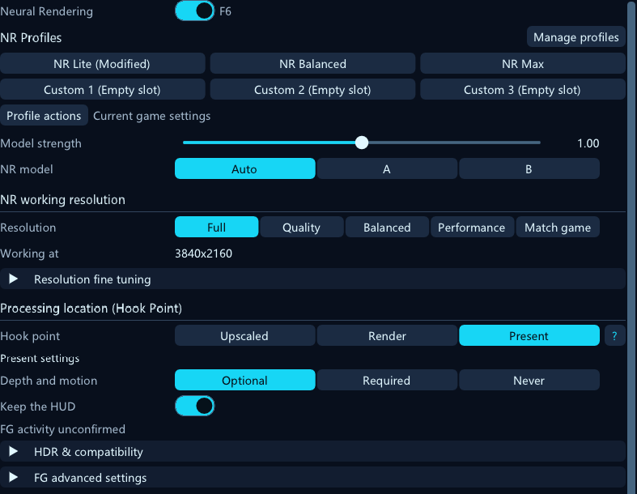
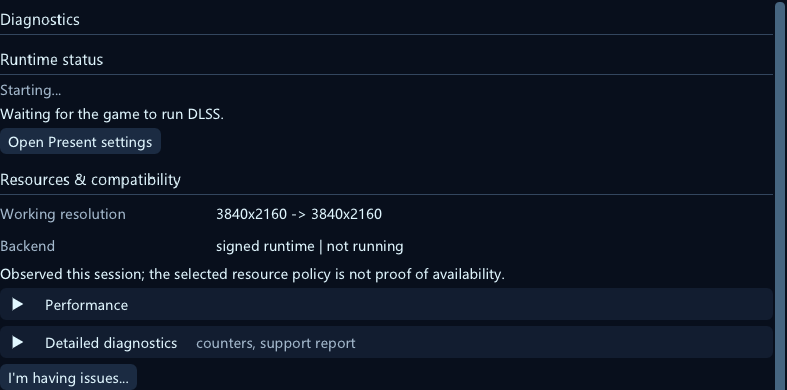
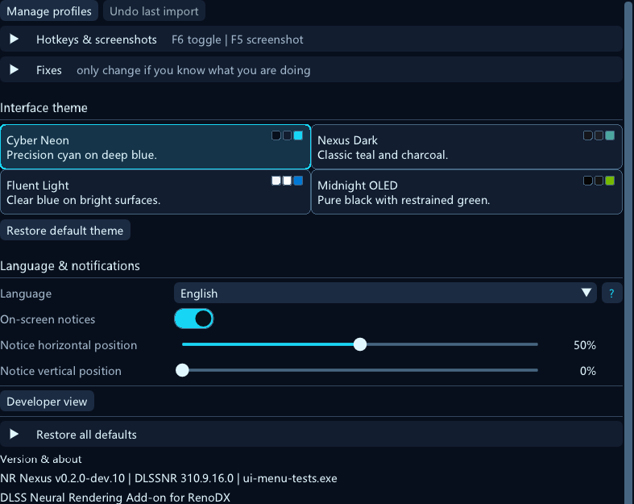

# NR Nexus — User Guide / 用户指南

[English](#english) · [简体中文](#简体中文) · [README](../README.md)

> **Version scope — checked 2026-10-25:** this guide describes the current `dev` interface at `1986c5b`. The latest published package is [v0.1.0-dev.3](https://github.com/williamstosh/RenoDX-DLSSNR-Nexus/releases/tag/v0.1.0-dev.3), which includes dual-model and per-pass model selection. The four-page menu, independent result settings for Passes 2–4, and four interface themes are later development changes and are **not in that published package**. Matching version text alone does not establish that a package contains these changes. Check the release notes and the build you installed.
>
> **版本范围——2026-10-25 核对：** 本指南描述 `dev` 的 `1986c5b` 界面。最新公开包为 [v0.1.0-dev.3](https://github.com/williamstosh/RenoDX-DLSSNR-Nexus/releases/tag/v0.1.0-dev.3)，已包含双模型及逐层模型选择；四页菜单、第 2–4 层独立结果设置、四套界面主题属于后续开发改动，**尚未包含于该公开包**。版本文本相同不代表包已包含这些改动，请核对发布说明与实际安装的构建。

## English

### Contents

- [Getting oriented](#en-start)
- [Quality: model, location and resolution](#en-quality)
- [Result adjustment and stability](#en-results)
- [Multi-Pass](#en-multipass)
- [Diagnostics and reports](#en-diagnostics)
- [Advanced, screenshots and themes](#en-advanced)
- [Seven practical scenarios](#en-scenarios)
- [Status → reason → action](#en-status)
- [中文目录](#zh-contents) · [Back to README](../README.md)

### Getting oriented

Open ReShade's overlay and select **NR Nexus**. Installation and runtime prerequisites are in the [README](../README.md). This guide starts with the add-on already installed. “Model” means the DLSS NR model; it does not select the game's DLSS Super Resolution preset or enable Frame Generation (FG).

The development interface has four pages: **Quality**, **Multi-Pass**, **Diagnostics**, and **Advanced**. The summary above them reports observed status; click it to open Diagnostics. A green state means NR activity was observed, not that every frame, every resource or the image quality has been validated. Expand all / Collapse all changes the current view's sections. A changed marker or reset arrow means stored values differ from defaults, not that processing succeeded.

Defaults below are for a fresh configuration. Existing saved choices and migrations can retain different values. Settings normally save as you edit them; changing a model, pass count, location or working size may recreate features and briefly rebuild temporal history. Wait for a stable scene after a change before comparing.

**Image note (applies to every image below, including the Chinese section):** these are state examples composed offscreen with the current production ImGui interface. They illustrate controls and layout, and do not represent in-game image quality, FPS, or measured runtime performance. Image captions are in English for both language sections; a separate Chinese Multi-Pass example is included.

### Quality: model, location and resolution

*Quality — NR enable, effect comparison, model, shared working resolution and processing location.*

#### Enable and compare

| Control | Default / options | What it does and when to use it |
| --- | --- | --- |
| Neural Rendering | On; Off / On | Turns NR on or off. Default toggle key: **F6**. Use this for an NR-off comparison; setting a strength to zero is a different operation. |
| Effect: Built-in effect / Mine | Mine during normal use | Built-in effect temporarily uses stock model strength, model styling, result and Multi-Pass values. Your saved values are retained; select Mine to restore and edit them. This is not a factory reset. |
| Model strength | **1.00**, range **0–2** | Sent to the model before result adjustment. Changes reset NR history. The response above 1 depends on the model/runtime and is unverified; 2 is not a promised “double quality” setting. |

Built-in effect preserves the game's working resolution, hook point, compatibility settings and hotkeys. Its comparison controls are disabled and settings are not saved while that view is active. NR enable remains available. Returning to Mine restores your previous appearance and pass configuration; switching to Developer view also ends this preview.

#### Model selection

| Choice | Resolution of the request |
| --- | --- |
| **Auto** (default) | On the exactly identified **DLSS NR 310.9.16.0** runtime, resolves to **B**. Other runtimes retain their compatible automatic/runtime default; Auto does not always mean A. |
| **A — Legacy** | Requests preset 1. Its detail, structure and colour may differ from B. |
| **B — Small FP8** | Requests preset 2, enabled only for the identified 310.9.16.0 runtime. Compare its appearance and measured GPU cost with A; neither model is best for all scenes. |

Selection is unavailable until the runtime is identified. Unsupported saved B requests resolve to A while retaining the saved request. A newer or unknown DLL is not automatically accepted as dual-model compatible. Old preset 3 may appear as **Custom** for configuration compatibility; it is not a fourth menu option, and resolves to A on the identified dual-model runtime.

Changing model recreates the chain's NR features and resets history. **Requested**, **Resolved**, and **Runtime network** are different: Resolved describes the compatibility rules applied to your request. Actual runtime network readback is unavailable in this build.

#### Model styling

These controls steer what the model creates. Changes restart temporal history. They are separate from the live result adjustments below.

| Control | Default / range or choices | Meaning and dependency |
| --- | --- | --- |
| Style | **Default** / Natural / Cinematic | Default leaves the style choice to the runtime. Natural and Cinematic explicitly request those looks. Names are not quality rankings. |
| Local tone | **1**, **0–2** | How strongly the model changes local brightness and contrast. |
| Model structure | **1**, **0–2** | Structure synthesized by the model. With Character mask and Independent skin both on, the value actually sent is capped at **1**, while the stored value remains unchanged. |
| Character / skin | **stock**, displayed as **1** with Independent skin; editable **0–1** | Only effective with Character mask on. Zero requests the least skin reworking; it is not a neutral midpoint. |
| Character mask | **Off** | Asks the runtime to identify people so skin steering can apply. It can also affect other parts of the image. |
| Independent skin | **On**, global | With Character mask, sends stock skin as 1 and caps sent structure at 1 in all passes. With it off, stock skin follows Structure. Even with it on, reducing Structure can still affect faces through the model itself. |
| UI correction | **Off** | Runtime model UI correction. Try it when HUD elements are affected. Present's Keep the HUD is a separate, default-on setting. |

#### Processing location (Hook Point)

| Choice | Input / applicability |
| --- | --- |
| **Upscaled** (default) | NR processes the game's DLSS output, before later game processing and HUD. Requires usable intercepted DLSS resources. |
| **Render** | NR processes the game colour before DLSS upscales it, using game depth and motion at render resolution. Can reduce cost. With Ray Reconstruction, NR stays on the compatible Upscaled path because the pre-RR input is still noisy. |
| **Present** | Requests processing of the finished presented frame, after game post-processing and HUD, before ReShade effects and overlay. A compatible Pre-FG route can instead serve NR before FG. Check the observed route in Diagnostics. |

**Present is not a switch that requires DLSS to be enabled in every case.** On ordinary Present, Optional or Never can use neutral guides when no matching DLSS capture exists, subject to runtime, device, frame and format checks. Required needs matching depth and motion and skips without them. Upscaled and Render depend on the game's DLSS evaluation path. Present is not supported by every API/integration; an unsupported Present route may fall back to Upscaled. Follow Diagnostics rather than treating the selected location as proof of execution.

#### Present controls

These appear when Present is selected. The guide policy below applies to ordinary Present and native FG/XeFG services. The legacy DLSS-G Pre-FG route still requires and uses FG depth and motion; Never does not guarantee neutral guides on that route.

| Control | Default / options or range | Use |
| --- | --- | --- |
| Depth and motion | **Optional** / Required / Never | Optional prefers matching game guides and uses neutral data when unavailable. Required skips without matching guides. Never ignores captured guides and always uses neutral ones; useful when guides are unreliable, but motion stability may suffer. This selects a policy, not a resource detector. |
| Keep the HUD | **On** | Requests model UI correction for the presented frame, which already contains HUD. It is not a guarantee that all HUD elements remain identical. |
| Frame encoding | **Auto** / SDR / HDR10 / scRGB | Auto uses swapchain colour-space evidence. Override only for incorrect declarations. |
| HDR paper white | **0**, **0–1000 nits** | Zero follows a loaded, tone-mapping RenoDX HDR mod's game brightness, otherwise Windows SDR content brightness. A positive value overrides it. |
| FG frame processing policy | **Every frame** / Game frames | For ordinary Present, selects every presented frame, including generated frames, or game frames only. Does not enable FG. Successful Pre-FG takes precedence; fallback uses its applicable route. |
| Frame generation detection | **Auto** / Stable timing / Legacy timing | Auto uses the declared multiplier when available, otherwise stable cadence. Stable timing ignores declarations. Legacy timing is a compatibility fallback. |

When NR runs on every present, FG can multiply the number of full NR chains. Game frames can reduce that work but may leave generated frames with a different appearance. Successful Pre-FG normally enhances the source game frame before interpolation, so generated frames do not each need a full chain; HUD handling can add work. There is no promise of one model evaluation per displayed frame.

#### Shared working resolution and upsampling

| Preset | Per-axis scale | Meaning |
| --- | --- | --- |
| **Full** (default) | **100%** | Uses the full reference size. Does not enable DLAA or change the game's DLSS setting. |
| Quality | **67%** | Reduced NR working size. |
| Balanced | **58%** | Further reduced NR working size. |
| Performance | **50%** | Half width and height: roughly one quarter of the reference pixel count, not a guaranteed quarter of GPU time. |
| Match game | Follows game render resolution | Follows valid guide dimensions, capped at the reference size; otherwise uses the previously saved scale. It does not select a fixed percentage. |

The reference is normally DLSS output size on Upscaled, the input colour size on Render, or the presented frame on Present. **Working at** reports the last observed NR dimensions. Fine tuning offers **33–100%** when not following the game; values between presets display as Custom. Preset changes apply on the next evaluation; continuous scale dragging can settle before a rebuild. Reference sizes and compatible resource contracts still govern the result.

| Upsampling choice | Behaviour below output size |
| --- | --- |
| **Auto** (default) | Automatic edge-aware reconstruction of NR's change, preserving full-resolution detail underneath. |
| Edge-aware | Reconstructs the NR edit along image edges. |
| Classic | Shows the lower-resolution NR pixels more directly; they may look blocky. |
| Edge-aware (area input) | Averages input pixels before NR and reconstructs the edit afterward. Can change the model's look; entering or leaving this mode resets NR history. |

Upsampling is independent of Adjust NR's look, and has no reconstruction effect at full output size. Location, working size and upsampling are shared by **the whole chain**; there are no per-pass resolution or cross-location scheduling controls. Lower resolution can reduce cost but change detail and stability. Judge actual motion and GPU measurements.

### Result adjustment and stability

*Result adjustment — live shaping, brightness/colour limits, detail, halos and temporal controls.*

**Adjust NR's look** defaults to **Off**. It reshapes the model's returned change rather than changing the model itself. Turning it off retains all saved values. The shaping sliders below require it to be on and the result stage to be available. Changes apply live without restarting NR model history; enabling processing can still require resources.

| Group / control | Default | Range | Meaning |
| --- | --- | --- | --- |
| Result adjustment strength | **1** | **0–2** | Overall scale of the NR edit before limits; 0 removes that edit, 1 keeps its scale, 2 doubles its scale. |
| Basic: Brightening | **1** | **0–2** | Amount of the model's brightening retained. |
| Basic: Darkening | **1** | **0–2** | Amount of darkening retained, including unwanted dark halos. |
| Basic: Colour | **1** | **0–2** | Scale of the model's saturation change; 0 keeps game saturation. |
| Basic: Hue shift | **1** | **0–2** | Scale of the model's tint change; 0 keeps game hues. |
| Basic: Shadows / Midtones / Highlights | **1 each** | **0–2 each** | Scale of the change in each tonal range of the original image. |
| Limits: Max brightening / Max darkening | **0 each** | **0–4 stops each** | Soft ceiling/floor on brightness changes. **0 means no limit**, not no effect. |
| Limits: Max colour change | **0** | **0–2 stops** | Soft colour-change limit; **0 means no limit**. |
| Detail: Large-scale tone / Fine detail | **1 each** | **0–2 each** | Scale broad lighting changes or small-scale changes separately. Fine detail reshapes output; Model structure changes synthesis. |
| Detail radius | **1%** | **0.25–4%** | Boundary between broad and fine change, relative to image height. A larger radius can reach wider halos. |
| Halo suppression | **0** | **0–1** | Reduces dark halos next to bright objects while retaining broad surface darkening and intended shadows. |
| Halo next to dark objects | **0** | **0–1** | Reduces the dark skirt on the brighter side of dark objects, which can accumulate with extra passes. |

These are controls on **the model's change**, not ordinary global brightness/saturation sliders. A value of 1 usually keeps that component's scale; it does not promise the game image is unchanged.

| Temporal control | Default / range or options | Dependency and use |
| --- | --- | --- |
| Detail stability | **Auto (recommended)** / Off / Always | Independent of Adjust NR's look. Auto filters on the compatible post-upscale path with usable game motion; Always also requests it before upscaling. Resources and compatibility checks still apply. Helps crawling or boiling fine detail. |
| Stabilize | **Off** / Static / Motion | Requires Adjust NR's look. Averages broad changes over time; Static suits still views, Motion needs usable game motion vectors to follow motion. Can delay lighting changes. When active it replaces the automatic detail-stability filter. |
| Stabilize time | **60 ms**, **10–250 ms** | Enabled only with Stabilize active. Longer is steadier and slower to respond. |
| Stabilize detail | **Off** | Enabled only with Stabilize active; also smooths the small-scale change. |

Turning Adjust NR's look off does **not** turn off Detail stability or shared upsampling. To compare the unfiltered model result, also set Detail stability Off and account for upsampling and HDR/SDR transfer settings. An unavailable result stage is reported in the panel and `ReShade.log`; a selected mode alone does not prove its filter ran.

### Multi-Pass

*Multi-Pass — configured sequential chain and the selected pass editor; nodes do not confirm runtime networks.*

**Pass Count** is **1–4**, default **1**, and **includes Pass 1**. The chain is sequential:

`Input → Pass 1 NR + result → Pass 2 NR + result → … → Output`

Each pass processes the preceding result. These are not parallel alternatives and the node selector only selects which pass you edit. The chain diagram shows configuration. The selected node says Editing; other nodes say Configured. An asterisk indicates settings changed from defaults, not per-pass timing or runtime network confirmation.

Pass 1 shares the base Quality controls, including its result settings. Editing either page changes the same settings. Passes 2–4 have independent model strength (**1**, **0–2**), HDR transfer (**1**, **0–1**) and Color (**1**, **0–1**) even while styling follows Pass 1. HDR transfer has the same source-dependent restrictions described under Advanced.

| Passes 2–4 control | Default | What is inherited |
| --- | --- | --- |
| NR model: Inherit Main Model / A / B | **Inherit Main Model** | The main model selection, including Auto resolution and fallback. Independent of the other inheritance switches. |
| Same as pass 1 | **On** | Model steering only: Style, Local tone, Model structure, Character / skin, Character mask, UI correction. It does not inherit model choice, model strength, HDR transfer, Color or result settings. Independent skin remains a chain-wide setting. |
| Inherit Pass 1 result settings | **On** | Result enable, strength, all shaping/limit/detail/halo settings, Stabilize settings and Detail stability. Turn off to edit this pass's own result controls. Shared upsampling remains shared. |

Turning either inheritance switch off exposes that pass's **stored independent values**, initially their defaults; it does not clone the current Pass 1 edits. Turning inheritance back on preserves those independent values for later reuse. Reducing Pass Count retains inactive passes' saved settings, but retires their active NR features; raising it starts the added passes with clean history. Toggling Adjust NR's look also preserves values.

The default **Chained history** is On: each pass keeps its own history. Off is a diagnostic mode where Passes 2–4 reset every frame and can flicker. Model choice and pass-count changes recreate features; strength and model steering changes reset history. Repeated switching can cause visible settling and creation cost. Live result edits do not restart the NR model history.

For controlled comparisons on the supported dual-model runtime, try **A**, **B**, **AA**, **AB**, **BA**, **BB**. Letters are model choices in execution order: AB means A first, B second. Explicitly set each model when comparing; Inherit Main Model can otherwise change the whole sequence. Start with the same location, size and strengths, let history settle, then inspect both still detail and movement. These are examples, **not recommended winners**; extra passes can compound colour, halos and temporal artifacts as well as strengthen the effect. Each adds GPU work. The whole chain shares location, resolution and upsampling.

### Diagnostics and reports

*Diagnostics — status reasons, observed resources, cost and detailed counters; displayed sample values are not runtime measurements.*

Read status and warnings first, then the resource and performance sections. They answer different questions:

| Readout | What it establishes / limits |
| --- | --- |
| Requested model | Saved selection: Auto, A, B or inheritance. |
| Resolved model | Configuration after compatibility resolution. Feature creation rows also describe requests, explicitly unconfirmed. |
| Runtime network: Readback unavailable | The actual executing network cannot be queried by this build. Successful evaluation is not network readback. |
| Working resolution, backend | Last observed dimensions and route: NGX core/signed runtime, D3D12, D3D11 bridge, Vulkan or a bridge-tool route. No dimensions means no observation yet. |
| Resources / real vs neutral guides | Selected policy and observed resource use are separate. Legacy Present guide counters do **not** include native FG/XeFG Pre-FG guide use and are not whole-chain resource totals. |
| Last frame | Latest NGX result; an error code points to a failed step, while “none yet” is not a completed measurement. |
| Model evaluations / bypassed / submissions before FG | Session counters for different events. They are not displayed-frame counts or FPS; a multi-pass chain can evaluate more than once per game frame. |
| Skipped because | The top three eligible skip reasons and counts. Use the stated reason to choose a change. |
| Present stability | Gaps, ring-slot waits/timeouts, history resets and FG changes. These describe the Present path, not a universal frame-time graph. |

**FG activity, multiplier and NR route are separate observations.** A declaration can say FG is enabled without proving ongoing submission. Recent counters across stable observation windows determine the displayed route. Native FG/XeFG can bypass Present cadence sampling, so “multiplier unknown” does not mean FG is off. Present cadence is an observation, not an FG verdict. A lifetime success count alone does not prove that NR is still running before FG now.

Route messages distinguish **Pre-FG confirmed**, **Pre-FG observed; multiplier unknown**, **every presented frame**, **game frames only**, **fallback to Present**, **fallback to Upscaled**, **mixed Pre-FG and fallback**, and **unconfirmed**. Mixed or fallback states require reading the detailed reason before judging cost or frame consistency. At Render/Upscaled, extra passes still cost work but are not inherently executed on every present.

#### GPU time and Faster options

The **NR cost meter** defaults On and times one chain every **250 ms**. It reports measured NR GPU cost and an estimate of frame-rate cost using frame intervals. These estimates assume the GPU limits frame rate; CPU limits or a frame cap reduce the expected benefit of disabling NR. The per-evaluation cost and the per-present contribution can differ with FG. Neither a chain node nor the screenshot supplies per-pass GPU timing.

**GPU stage timers (profiling)** default Off. Turn them on in detailed diagnostics when comparing model time with add-on overhead (encode, resolve, linearize/scale, commit, copies). Unsupported or unavailable timestamps leave no valid timing; do not read “none yet” as zero cost. **NR edit trace** defaults Off, is observe-only and D3D12-only, and writes change statistics to the log/CSV without changing the displayed image.

When enough measurements and a compatible path are available, **Faster** options offer Before upscaling, Resolution 50%, or Both, with estimated costs and Undo. They change hook point/working-size settings; the estimates are not benchmark promises. Check the resulting route, especially with Ray Reconstruction.

#### Reports

Detailed diagnostics offers **Copy support report**, **Open log folder**, raw counters and **Reset NR feature and clear failure latch**. The last action rebuilds NR state; use it after addressing the indicated failure. It is different from resetting saved settings.

The issue-report flow lets you select the issue type, add reproduction steps, generate local diagnostics or continue without them, and preview staged files. Screenshot comparisons are optional and excluded by default. Text preview is limited to **64 KiB**; open the staged file for a full review. Exports are redacted, but inspect attachments for personal information before sharing.

Saving a local ZIP, authorizing upload to the displayed temporary hosts, including a reviewed public summary, including a public report link, and preparing a GitHub Issue are separate actions. Preparing the Issue opens a **browser draft**; review and submit it yourself. It does not automatically submit an Issue or upload attachments. If the browser/prefill fails, copy the Markdown and open a blank Issue.

### Advanced, screenshots and themes

*Advanced — hotkeys/capture, compatibility controls, theme, language, notifications, reset and version information.*

#### Interface and general settings

| Setting | Default / options | Scope |
| --- | --- | --- |
| Interface theme | Fresh installation: **Cyber Neon**; Nexus Dark / Fluent Light / Midnight OLED also available | Changes NR Nexus interface colours only, saved for this game. Does not grade the game image or change NR quality. Existing configurations without a theme retain Nexus Dark. |
| Restore default theme | Cyber Neon | Separate action from restoring picture/settings defaults. Restore all does not reset the theme preference. |
| Language | **Auto**, or one of 15 languages | English, German, French, Spanish, Italian, Portuguese (Brazil), Russian, Bulgarian, Slovenian, Turkish, Thai, Japanese, Korean, Chinese (Simplified), Chinese (Traditional). Auto follows ReShade. Choices remain readable in English. If glyphs show as boxes, also choose the corresponding language in ReShade to load its font. |
| Notifications | **On** | Controls gameplay activation/failure/health notices. Turning it off retains the overlay status and Diagnostics. |
| HUD position X / Y | **50% / 0%**, **0–100%** each | Position of the add-on's notification HUD, not the game's HUD. |
| Developer view | **Off** (modern view) | Switches to the classic flat layout, with technical/raw English controls. Same underlying settings; switching ends Built-in effect preview. Use the same button to return. |
| Restore all defaults | Two-step Restore / Cancel | Resets the covered settings, including strengths, codec, resolution, passes, hotkeys, language, layout and notification position; recreates NR features. Theme has its own reset. Attach-time hook support configuration is not reset. |
| Version & about | Readout | Shows the add-on version, loaded NR runtime version and game executable name. Runtime and add-on versions are independent. |

*Themes — Cyber Neon, Nexus Dark, Fluent Light and Midnight OLED affect only the add-on interface.*

#### Hotkeys and screenshots

| Control | Default / choices or range | Use |
| --- | --- | --- |
| Toggle NR / Screenshot | **F6 / F5** | Click to rebind, then press a keyboard key. Esc or another click cancels. The two actions cannot use the same key; mouse/gamepad bindings are not accepted. |
| Capture source | **Auto** / Final presentation / Evaluated model buffers | Auto captures final presentation unless a separate helper window is explicitly identified. Model buffers show the last evaluated pass's input/output **before** result shaping, transfer, game tone mapping and UI; they are not the displayed game frame. |
| File format | **PNG** / JPEG / PNG + JPEG | PNG is lossless; JPEG is sized for sharing. HDR captures retain HDR and need an appropriate viewer. |
| Comparison layout | **Pair** / Pair + side by side | Optional extra side-by-side file: off left, on right. |
| JPEG quality | **95**, **80–100** | Only shown for JPEG output. The size-fitting process may reduce quality; it does not reduce resolution. |
| JPEG size limit | **10 MB**, **0–50 MB** | Only shown for JPEG output. Zero disables the limit; a limit is not a guarantee that every image can fit. |
| Take a screenshot now | Action + status | Same capture request as the screenshot key; wait for completion/status. |

Final presentation capture compares the same final game frame before/after NR at Present, excluding ReShade effects/overlay; the hook choice is restored automatically. Model-buffer capture preserves the chosen hook and has a different meaning. Captures normally save in **DLSS5 Screenshots** under ReShade's base directory; check capture status and the log for the actual output or an export failure. Use final presentation to assess a displayed-frame comparison and model buffers to inspect model input/output. A still pair does not establish motion quality or performance.

#### SDR/HDR and guide compatibility

Use these for a specific source/guide problem after reading Diagnostics. Keep defaults for ordinary tuning. Some controls only apply to the indicated codec or source; the UI can retain values while a setting is inactive.

| Control | Default; choices / range | Applies to |
| --- | --- | --- |
| HDR mode | **Auto**; Classic (manual), Anchored (manual), Display (fixed) | Source preparation and transfer back to HDR. Auto is the normal starting point. |
| Proxy anchor | **4 nits**; **0.5–32** | Shown for Anchored/Display; calibrated absolute HDR. Relative HDR uses its source's scaling path. |
| Source encoding | **Auto (format evidence)**; SDR / relative, Linear, PQ / 10,000 nits | Override incorrectly declared source formats. |
| Linear unit | **0**; **0–10000 nits** | Nits per linear 1.0; zero keeps relative units, positive declares calibrated units. |
| Primaries | **Auto**; BT.709, BT.2020, AP1 (ACEScg) | Advisory label only; this setting does not perform gamut conversion. |
| PQ calibration | **1**; **0.005–16** | PQ source gain. Existing migrated configurations can retain a different value. |
| Paper white | **203 nits**; **80–1000** | PQ HDR bridge anchor; ignored by SDR. |
| Scene white scale | **2.5375**; **0.005–16** | Float-HDR/classic source scaling; PQ uses its paper white/calibration controls. |
| Dark pedestal removal | **Auto**; Always, Smooth Auto | Float HDR: Auto avoids removal on relative brightness sources; Always forces it; Smooth Auto tapers the Auto boundary. |
| HDR transfer | **1**; **0–1** | Float-HDR dark-pedestal removal amount, or transfer amount on other HDR paths. Disabled on SDR and when relative-HDR Auto leaves nothing to remove; the tooltip gives the reason. |
| Color | **1**; **0–1** | Fraction of the neural change on float HDR. Separate from the result Colour control. |
| Chroma clamp | **1 stop**; **0.25–2** | Bounds chroma transfer around the luma gain. |
| Neural transfer | **Bounded ratio**; Consistent (curve-aware) | Display-codec HDR transfer. Both feed the same model input; Consistent compensates for the proxy curve. |
| Style highlight guard | **0**; **0–2 stops** | Bounds Natural/Cinematic highlight darkening. Zero retains previous math; 2 disables the additional bound. |
| Near-black colour guard | **On** | Divisor-family HDR transfer; prevents near-black neural colour noise from being amplified. |
| Brightness source | **Auto**; v1 (frame meter), v2 (game exposure) | Relative HDR only. Auto uses game exposure when usable evidence exists, otherwise frame metering. |
| Normalization | **Stable**; Off (raw per-frame), Slew | Relative autoscaled sources; calibrated absolute sources use fixed units. |
| Brighten / Darken speed | **4 / 0.5 stops/s**; **0.1–64 / 0.05–16** | Stable normalization; faster attack, slower relaxation. |
| Hold through black, re-prime on cuts | **On** | Stable normalization only. Holds scaling through black/loading frames and re-primes on usable scene-cut evidence. |
| Slew | **0.020 stops/frame**; **0–0.5** | Shown for Slew mode; zero behaves as Off. |
| Depth | **Use game NGX flag**; Force normal, Force inverted | Override only incorrect depth convention declarations. |
| Motion scale X / Y | **1 each**; **−2 to 2 each** | Multiplies game motion vectors; negative flips an axis. |
| Chained history | **On** | Separate temporal history per pass. Off resets extra passes every frame; diagnostic use only. |

#### Specialist Present diagnostics

Detailed/raw **P0 Present diagnostics** contains controls intended for reproducing a specific defect:

| Control | Options / normal starting value | Boundary |
| --- | --- | --- |
| Present restore scope | Confirmed fresh configuration: **Final Present and pre-FG**; or Final Present only | Existing configurations without scope keys can show inherited behaviour: existing SDR routing and HDR final Present only. The owner/service readout identifies the effective domain. Future/read-only configurations disable edits. |
| Present SDR restore | **Off (recommended)** for new/migrated normal configurations; Legacy (inherit), Legacy Auto, Legacy Every block, Legacy Smooth | SDR Present only, when its policy is active and writable. Explicit diagnostic selections can be retained. Off avoids legacy block subtraction that can produce dark bands/text boxes. |
| Present HDR pedestal | **Off (recommended)**; Legacy, Legacy Smooth | Only when the HDR policy and domain are active; observe the reason/read-only status. |
| Bypass HDR pedestal | **Off**, session only | Bypasses application while retaining measurement/history; not saved. |
| Bypass SDR restore / Bypass host look | **Off** | Isolate restoration or host shaping/detail stability. Host-look bypass retains model input sampling. |
| Present model UI | **Inherit**; Force off, Force on | Overrides final model UI flag in Present passes; changes reset history. |
| Present diagnostic guides | **Inherit**; Require real, Neutral | Require real declines without matching guides. |
| Capture stage planes | **Off** | Extra same-frame diagnostic data per capture, including raw float planes. |
| HDR capture mode | **CommitCore**; ModelTrace (ROI) | Raw diagnostic capture rather than a normal screenshot. Default ROI is x/y **0/0**, width/height **256/128**. |

Pre-FG service ROI, one HDR sample, 120 HDR Presents and one P0 sample are bounded diagnostic capture actions. Coordinates must be nonnegative and dimensions positive. HDR actions require an active compatible HDR path; capture status/busy checks apply. Cancel HDR sequence stops the sequence. Captures may drop frames; only complete, GPU-proven samples and consecutive valid segments support temporal analysis. Leave these tools at their defaults unless collecting a specific diagnostic sample.

### Seven practical scenarios

1. **First installation and activity check.** Follow the README prerequisites, DLL locations and installation steps. Open NR Nexus, use one pass and Auto, then check the loaded runtime and actual NR state in Diagnostics. Compare F6 Off/On in the same scene; compare Built-in effect/Mine separately, returning to Mine before editing.
2. **Choose a location in a DLSS game.** Start with Upscaled. Compare Render when its compatible DLSS input is available; Ray Reconstruction can keep it on Upscaled. Choose Present for the finished-frame look, then inspect the actual route and guide policy. Hold model, pass count and working size constant while comparing.
3. **Compare A/B and pass order.** On the recognized dual-model runtime, test A, B, AA, AB, BA and BB with matching location, size and strengths. Explicitly select each pass model and check both inheritance switches before editing. Allow history to settle, then inspect faces, foliage, highlights and movement; no sequence is guaranteed best.
4. **Confirm NR with FG.** Keep the game's intended native FG or XeFG setup. Read FG activity, observed multiplier and NR route separately. Look for recent Pre-FG submissions and a consistent route; an unknown multiplier is not FG Off. If Present/Upscaled fallback or mixed execution is reported, read its reason before assessing cost or generated-frame consistency.
5. **Set Present depth and motion policy.** Start with Optional and Keep the HUD On. Confirm whether real or neutral guides are actually used. Try Never only when captured guides are unreliable and neutral data is acceptable; use Required when real guides are essential and accept skips when missing. Neutral guides do not recreate true scene motion, and compatible Present operation without DLSS is not a universal game promise.
6. **Troubleshoot artifacts, flicker or cost.** Return to one pass and compare Off/On. Read skipped reasons and measured NR GPU time before changing controls. For excessive colour/darkening/halos, tune result edits and nonzero soft limits; Fine detail differs from Model structure. For motion instability, inspect guides and Detail stability/Stabilize dependencies. Reduce working size or compare models only after holding other settings fixed; Faster/Undo estimates need an actual check. The known XeFG flicker is not a promised fix from any preset.
7. **Restore defaults, then re-enable one feature at a time.** Back up the game's ReShade settings, open Advanced → Restore all defaults and confirm Restore. Theme has its own Restore default theme action and is not reset with picture settings. Recheck runtime and actual activity, then re-enable the intended location, model, additional passes, independent edits and FG setup one change at a time. Use diagnostics or a reviewed local report if the problem returns; do not infer a setting fix from a tool failure.

### Status → reason → action

| Status / symptom | Likely meaning supported by the UI | Action |
| --- | --- | --- |
| Neural Rendering is off | User switch is off | Turn it on or press its assigned key. |
| Starting / waiting for frame submission | Initialization or prepared work lacks observed submission | Let gameplay run briefly; inspect Diagnostics if it persists. Preparation is not GPU completion. |
| Waiting for DLSS / DLSS off | The selected evaluation path has no usable running DLSS calls | Enable game DLSS/DLAA where applicable; check chosen hook and API. Present Optional/Never has different guide requirements. |
| Only Frame Generation is on | FG activity alone did not supply the selected DLSS route | Enable upscaling for that route or inspect a compatible Present setup. Do not infer NR activity from FG alone. |
| Runtime not installed / could not be used | Missing or unusable DLSS NR DLL | Follow README runtime prerequisites; inspect the stated loader error and loaded version. |
| Runtime does not support this GPU | Runtime/GPU requirements do not match | Review the runtime requirement and GPU; changing picture sliders will not fix it. |
| Active with issues / partly active | Some work succeeds but warnings or skips remain | Open Diagnostics, inspect each issue and top skip counts; address their specific cause. |
| On but holding back / not running | Calls exist but resource/contract/feature conditions declined work | Read the skip reason and latest NGX result; reset the failure latch after addressing the cause. |
| B disabled / unsupported saved B | Runtime unidentified or not the verified dual-model build | Check loaded runtime version; use Auto/A or the compatible runtime. The saved B request is retained. |
| Render selected, Upscaled observed | Ray Reconstruction or a compatible fallback dictates execution | Read the route explanation; do not assume Render's lower cost applies. |
| Required guides, skipped frames | No matching usable depth/motion for those frames | Use Optional if neutral fallback is acceptable, or correct the resource/integration issue. |
| Pre-FG fallback / mixed route | Recent executions used more than one route | Inspect fallback reason and Present policy before comparing cost and frame consistency. |
| FG multiplier unknown | Reliable multiplier observation unavailable | Keep it unknown; inspect activity/submissions separately. Do not label FG off. |
| Result sliders greyed out | Result switch Off, inheritance On, Built-in effect active, or stage unavailable | Return to Mine, enable shaping/disable that pass's inheritance as appropriate, or inspect the unavailable reason. |
| Skin slider inactive / structure not increasing | Mask Off, or sent Structure capped by Independent skin | Check mask/independence and tooltip; stored values can differ from sent values. |
| HDR transfer inactive | SDR source or relative-HDR Auto has nothing to remove | Read the tooltip; use result adjustments for appearance rather than forcing a mismatched HDR path. |
| No GPU time / none yet | No valid measurement, disabled meter, or unsupported timestamps | Enable the relevant timer and observe compatible activity; do not substitute zero. |
| Capture busy / invalid / incomplete | Capture/GPU/export transaction not complete or ROI invalid | Check status, wait for pending work, correct ROI; do not treat a missing sample as a successful capture. |

[English contents](#contents) · [中文目录](#zh-contents) · [Back to README](../README.md)

## 简体中文

### 目录

- [开始使用](#zh-start)
- [画质：模型、介入点与尺寸](#zh-quality)
- [结果调整与稳定性](#zh-results)
- [叠层](#zh-multipass)
- [诊断与报告](#zh-diagnostics)
- [高级、截图与主题](#zh-advanced)
- [七个实用场景](#zh-scenarios)
- [状态→原因→操作](#zh-status)
- [English contents](#contents) · [返回 README](../README.md)

### 开始使用

打开 ReShade 覆盖层，选择 **NR Nexus**。安装与运行时前提见 [README](../README.md)，本指南从已经安装插件开始，不重复安装步骤。这里的“模型”指 DLSS NR 模型，不是游戏的 DLSS 超分辨率预设，也不会开启帧生成（FG）。

开发版包含**画质、叠层、诊断、高级**四页。顶部摘要反映观测状态，点击可进入诊断。绿色表示观测到了 NR 活动，不代表所有帧、资源或画质均已验证。“全部展开／全部收起”作用于当前视图；修改标记和重置箭头表示保存值偏离默认，不表示运行成功。

下文默认值针对全新配置；已有保存值或迁移配置可能不同。一般编辑会即时保存。更换模型、层数、介入点或工作尺寸可能重建 Feature，并短暂重建时序历史，比较前应等待场景和历史稳定。

**配图说明：** 所有配图均为当前生产 ImGui 界面离屏合成的状态示例，用来说明布局与控件，不代表实机画质、FPS 或运行时性能测量。英文图注供中英文共读；叠层另有中文示例。顶部版本范围同样适用于本节。

### 画质：模型、介入点与尺寸

*Quality — NR enable, effect comparison, model, shared working resolution and processing location.*

#### 开关与比较

| 控件 | 默认／选项 | 用途与条件 |
| --- | --- | --- |
| Neural Rendering | **开**；关／开 | 开关 NR，默认快捷键 **F6**。比较 NR 开关请用此项；强度归零是另一种操作。 |
| 效果：内置效果／我的 | 正常使用为**我的** | 内置效果临时使用原始模型强度、模型风格、结果与叠层值；保存值保留，选择“我的”恢复并继续编辑。不是恢复出厂设置。 |
| 模型强度 | **1.00**，**0–2** | 在结果调整之前传给模型；改动重置 NR 历史。大于 1 的响应依赖模型／运行时，尚未验证；2 不代表保证“双倍画质”。 |

“内置效果”保留适配游戏的工作尺寸、介入点、兼容性设置和快捷键。比较期间相关编辑控件禁用，设置不保存，但仍可开关 NR。返回“我的”恢复自己的外观与叠层配置；切换到开发者视图也会结束临时比较。

#### 模型选择

| 选项 | 请求如何解析 |
| --- | --- |
| **Auto／自动**（默认） | 精确识别为 **DLSS NR 310.9.16.0** 时解析为 **B**；其他运行时保留兼容的自动／运行时默认行为，不能一概认为 Auto=A。 |
| **A — Legacy** | 请求预设 1，细节、结构和颜色可能与 B 不同。 |
| **B — Small FP8** | 请求预设 2，仅对已识别的 310.9.16.0 启用；与 A 比较外观及实测 GPU 开销，两者均非所有场景的最佳模型。 |

运行时尚未识别时模型选择不可用。不受支持的已保存 B 请求会回退为 A，保存的请求不被覆盖；更新或未知 DLL 不自动获得双模型兼容资格。旧配置的预设 3 可显示“自定义”，仅为兼容保留，不是菜单中的第四选项；在已识别双模型运行时上解析为 A。

改模型会重建整链 NR Feature 并重置历史。**请求模型、解析模型、运行时网络**含义不同：解析模型只是请求经过兼容规则后的配置，本构建不能回读实际执行网络。

#### 模型风格

这些控件决定模型生成什么，修改会重启时序历史；与后文实时重塑输出的“结果调整”不同。

| 控件 | 默认／范围或选项 | 含义与依赖 |
| --- | --- | --- |
| 风格（Style） | **Default**／Natural／Cinematic | Default 由运行时选择；其他两项显式请求对应风格。名称不是画质等级。 |
| 局部色调（Local tone） | **1**，**0–2** | 模型重塑局部亮度与对比度的强度。 |
| 模型结构 | **1**，**0–2** | 模型合成的结构。人物遮罩与独立皮肤同时开启时，实际传入值上限为 **1**，保存值保留。 |
| 人物／皮肤（Character / skin） | **stock／原始值**；独立皮肤时显示 **1**，可调 **0–1** | 仅人物遮罩开启时有效。0 表示最少皮肤重塑，不是中性中点。 |
| 人物遮罩（Character mask） | **关** | 让运行时识别人，使皮肤参数作用于相关区域；也可能影响其他画面部分。 |
| 独立皮肤（Independent skin） | **开**，全链共用 | 配合人物遮罩，将 stock 皮肤传为 1、实际结构封顶 1。关闭时 stock 皮肤跟随结构；即使开启，结构低于 1 仍可能通过模型本身影响脸部。 |
| UI 修正（UI correction） | **关** | 运行时模型 UI 修正；HUD 被影响时可比较。与 Present 默认开启的“保留 HUD”分开。 |

#### 介入点（Hook Point）

| 选项 | 输入与适用性 |
| --- | --- |
| **Upscaled**（默认） | 在游戏 DLSS 输出之后、后续游戏处理与 HUD 之前运行。依赖可用的被截获 DLSS 资源。 |
| **Render** | 在 DLSS 放大之前处理游戏颜色，使用渲染尺寸的深度和运动矢量，可能降低成本。使用 Ray Reconstruction 时，因重建前输入仍有噪声，保持兼容的 Upscaled 路径。 |
| **Present** | 请求处理游戏后处理与 HUD 完成后的呈现帧，位于 ReShade 效果与覆盖层之前。兼容的 Pre-FG 路径可改为在帧生成前服务 NR；实际路径看诊断。 |

**Present 并非在所有情况下都要求游戏已开启 DLSS。** 普通 Present 的 Optional／Never 可在缺少匹配 DLSS 捕获时使用中性资源，但仍须满足运行时、设备、帧和格式检查。Required 需要匹配深度与运动，缺失即跳过。Upscaled／Render 依赖游戏 DLSS 求值链路。并非所有 API／集成都支持 Present，不支持时可能回退 Upscaled；选中某介入点不等于证明该路径已运行。

#### Present 设置

仅选择 Present 时显示。下述资源策略适用于普通 Present 和原生 FG／XeFG 服务；旧 DLSS-G Pre-FG 路径仍要求并使用 FG 提供的深度与运动，Never 不保证该路径使用中性资源。

| 控件 | 默认／选项或范围 | 用途 |
| --- | --- | --- |
| 深度与运动 | **Optional／可选**；Required／必需；Never／从不 | 可选优先匹配真实资源，缺失用中性数据；必需缺失则跳过；从不忽略捕获资源、始终用中性数据，适合不可靠资源，但可能损失运动稳定性。这是策略，不是可用性探测器。 |
| 保留 HUD | **开** | 请求模型修正已经包含 HUD 的呈现帧，不保证所有 HUD 完全不变。 |
| 帧编码 | **Auto**／SDR／HDR10／scRGB | Auto 根据交换链色彩空间证据判断，只有错误声明时才覆盖。 |
| HDR 纸白 | **0**，**0–1000 nits** | 0 跟随已加载且进行色调映射的 RenoDX HDR Mod 的游戏亮度，否则用 Windows SDR 内容亮度；正数覆盖。 |
| FG 帧处理策略 | **Every frame／每帧**；Game frames／游戏帧 | 普通 Present 下选择处理含生成帧的每次呈现，或仅游戏帧；不会开启 FG。成功的 Pre-FG 优先，回退使用对应路径。 |
| 帧生成检测 | **Auto**；Stable timing／稳定时序；Legacy timing／旧版时序 | Auto 优先读取声明倍率，缺失则稳定时序估计；稳定时序忽略声明；旧版时序用于兼容。 |

每次 Present 都处理时，FG 可能成倍增加整链 NR 次数。“游戏帧”可能减少工作，但生成帧外观可能不一致。成功 Pre-FG 通常先处理源游戏帧再插帧，无须每个生成帧都跑整链；HUD 处理仍可能增加工作。不能据此保证每个显示帧恰有一次模型求值。

#### 共用工作尺寸与上采样

| 预设 | 单轴比例 | 含义 |
| --- | --- | --- |
| **Full／完整**（默认） | **100%** | 完整参考尺寸，不会选择 DLAA 或更改游戏 DLSS 设置。 |
| Quality／质量 | **67%** | 降低 NR 工作尺寸。 |
| Balanced／平衡 | **58%** | 进一步降低尺寸。 |
| Performance／性能 | **50%** | 宽高各半，约为参考像素数四分之一，不保证 GPU 时间也降至四分之一。 |
| Match game／跟随游戏 | 跟随游戏渲染尺寸 | 仅在取得有效引导尺寸时跟随，且不超过参考尺寸；缺失时使用先前保存的比例，不是固定比例预设。 |

参考尺寸通常为 Upscaled 的 DLSS 输出、Render 的输入颜色、Present 的呈现帧。“实际工作尺寸”显示最近观测值。未跟随游戏时，精调范围为 **33–100%**，非预设值显示自定义。预设在下次求值应用，连续拖动可能稳定后才重建；实际尺寸仍受参考与兼容资源契约约束。

| 上采样选项 | NR 低于输出尺寸时的行为 |
| --- | --- |
| **Auto**（默认） | 自动按边缘重建 NR 改变量，保留下层全分辨率细节。 |
| Edge-aware／边缘感知 | 沿图像边缘重建 NR 改变量。 |
| Classic／经典 | 更直接显示 NR 的低分辨率像素，可能块状。 |
| Edge-aware (area input)／边缘感知（区域输入） | NR 前对输入像素平均，之后重建改变量；可能改变模型外观，进入或离开此模式重置 NR 历史。 |

上采样独立于结果调整，工作尺寸与输出一致时无尺寸重建作用。**介入点、工作尺寸、上采样全链共用**，没有逐层尺寸或跨介入点调度控件。降低尺寸可能降低成本，也可能改变细节和稳定性，应观察运动与实际 GPU 测量。

### 结果调整与稳定性

*Result adjustment — live shaping, brightness/colour limits, detail, halos and temporal controls.*

**调整 NR 外观（Adjust NR's look）默认关**，重塑模型已经返回的改变量，不改变模型本身。关闭保留参数；下列重塑滑块须开关开启且结果处理可用才生效。改动实时应用，不重启 NR 模型历史，但启用处理仍可能需要资源。

| 分组／控件 | 默认 | 范围 | 含义 |
| --- | --- | --- | --- |
| 结果调整强度 | **1** | **0–2** | 在限制之前缩放 NR 改变量；0 去除改变量，1 保留尺度，2 加倍尺度。 |
| 基础：提亮 | **1** | **0–2** | 保留多少模型提亮。 |
| 基础：压暗 | **1** | **0–2** | 保留多少模型压暗，也包括不需要的暗晕。 |
| 基础：颜色（Colour） | **1** | **0–2** | 模型饱和度改变量；0 保留游戏饱和度。 |
| 基础：色相偏移 | **1** | **0–2** | 模型色调改变量；0 保留游戏色相。 |
| 基础：阴影／中间调／高光 | **各 1** | **各 0–2** | 按原始图像的明暗区域缩放改变量。 |
| 限制：最大提亮／最大压暗 | **各 0** | **各 0–4 档** | 亮度变化的柔性上／下限；**0 表示不限**，不是没有效果。 |
| 限制：最大颜色变化 | **0** | **0–2 档** | 柔性颜色变化限制，**0 表示不限**。 |
| 细节：大范围色调／精细细节 | **各 1** | **各 0–2** | 分别缩放宽广照明与小尺度变化。精细细节重塑输出，模型结构改变模型合成。 |
| 细节半径 | **1%** | **0.25–4%** | 大范围与精细变化的分界，以图像高度为基准；增大可触及更宽光晕。 |
| 光晕抑制 | **0** | **0–1** | 减少亮物体旁的暗晕，保留大范围表面压暗与预期阴影。 |
| 暗物体旁的光晕 | **0** | **0–1** | 减少暗物体较亮一侧的暗裙边，该问题可能随叠层累积。 |

这些调整作用于**模型的变化**，不是普通全局亮度／饱和度调节。1 通常保留该分量尺度，不代表与原游戏图像一致。

| 时序控件 | 默认／范围或选项 | 依赖与用途 |
| --- | --- | --- |
| 细节稳定（Detail stability） | **Auto／自动（推荐）**；Off／关；Always／始终 | 独立于结果调整。Auto 在兼容的放大后路径、有可用游戏运动矢量时过滤；Always 还请求在放大前过滤。仍受资源与兼容检查限制，用于细节爬动、沸腾。 |
| 稳定（Stabilize） | **Off**；Static／静态；Motion／运动 | 要求结果调整开启。时序平均宽广变化，静态适合静止视角，运动需要可用游戏运动矢量来跟随运动；可能延迟照明变化。开启后替代自动细节稳定过滤。 |
| 稳定时间 | **60 ms**，**10–250 ms** | 仅稳定模式启用时可调；越长越稳，响应越慢。 |
| 稳定细节 | **关** | 仅稳定模式启用时可调，也平滑小尺度变化。 |

关闭结果调整**不会关闭细节稳定或共用上采样**。若比较未过滤模型结果，还须关闭细节稳定，并考虑上采样与 HDR／SDR 传递设置。处理不可用时查看界面与 `ReShade.log` 的原因；选中了模式不证明过滤已运行。

### 叠层

*Multi-Pass (Chinese) — sequential chain, selected pass, and separate model/style/result inheritance.*

**叠层数为 1–4，默认 1，包含第 1 层**，顺序如下：

`输入 → 第 1 层 NR + 结果 → 第 2 层 NR + 结果 → … → 输出`

后一层处理前一层结果，不是并行方案。点节点只选择编辑对象，处理链表示配置；当前节点显示编辑中，其他为已配置。星号表示偏离默认，不表示逐层耗时或运行时网络确认。

第 1 层与画质页的基础控件、结果设置是同一份值。第 2–4 层即使继承外观，也分别拥有模型强度（**1，0–2**）、HDR 传递（**1，0–1**）及 Color／颜色强度（**1，0–1**）；HDR 传递仍受高级页中的来源条件限制。

| 第 2–4 层控件 | 默认 | 继承内容 |
| --- | --- | --- |
| NR 模型：继承主模型／A／B | **继承主模型** | 主模型选择，包括自动解析与回退；与另外两种继承独立。 |
| 继承第 1 层外观（Same as pass 1） | **开** | 仅模型风格参数：风格、局部色调、模型结构、人物／皮肤、人物遮罩、UI 修正。不继承模型选择、模型强度、HDR 传递、Color 或结果。独立皮肤仍是全链设置。 |
| 继承第 1 层结果设置 | **开** | 结果开关、强度、基础／限制／细节／光晕、稳定设置与细节稳定。关闭后可编辑本层结果；上采样仍全链共用。 |

关闭继承会露出该层**已保存的独立值**，初始为默认，不会自动复制当前第 1 层改动。重新开启继承会保留独立值，之后关闭仍可恢复使用。减少层数保留未启用层的保存设置，但退休其活动 Feature；增加层数时新增层从干净历史开始。关闭结果调整也保留值。

**链式历史默认开**，每层保留各自历史。关闭是诊断模式，第 2–4 层每帧重置，可能闪烁。更换模型或层数重建 Feature；改强度或模型风格重置历史。频繁切换会有历史稳定过程及创建开销；实时结果修改不重启 NR 模型历史。

在支持的双模型运行时，可固定介入点、尺寸、强度，比较 **A、B、AA、AB、BA、BB**。字母按执行顺序排列，AB 即先 A 后 B。比较时明确设置每层模型，避免“继承主模型”随主模型一起改变序列。每次切换后等历史稳定，同时看静止细节和运动。以上仅为例子，**不保证哪组最佳**；加层可能增强效果，也会累积颜色、光晕、时序伪影并增加 GPU 工作。全链介入点、分辨率、上采样共用。

### 诊断与报告

*Diagnostics — status reasons, observed resources, cost and detailed counters; displayed sample values are not runtime measurements.*

先看状态与警告，再看资源和性能，避免混淆不同证据：

| 读数 | 含义与局限 |
| --- | --- |
| 请求模型 | 保存的 Auto、A、B 或继承选择。 |
| 解析模型 | 经过兼容规则后的配置；Feature 创建条目也是请求，明确未确认。 |
| 运行时网络：回读不可用 | 本构建不能查询实际执行网络；求值成功不等于网络回读。 |
| 工作尺寸、后端 | 最近观测的尺寸与路径，包括 NGX core／signed runtime、D3D12、D3D11 桥接、Vulkan 或桥接工具路径；暂无尺寸表示尚未观测。 |
| 资源／真实与中性引导 | 策略不等于实际资源。旧 Present 引导计数**不含**原生 FG／XeFG 的 Pre-FG 引导，不能作为全链总量。 |
| 最近一帧 | 最近 NGX 结果；错误码对应失败步骤，“暂无”不是有效测量。 |
| 模型求值／旁路／FG 前提交 | 不同事件的会话计数，不是显示帧数或 FPS；叠层可使每游戏帧多次求值。 |
| 跳过原因 | 前三项有效跳过原因及次数，据此选择操作。 |
| Present 稳定性 | 间隙、环形槽等待／超时、历史重置及 FG 变化，只描述相关路径，不是通用帧时间曲线。 |

**FG 活动、倍率、NR 路径分别观测。** 声明开启不证明持续提交；近期计数在稳定观察窗口中的变化决定显示路径。原生 FG／XeFG 可能绕过 Present 节奏采样，因此倍率未知不代表 FG 关闭。Present 节奏只是观测，不是 FG 判定；历史累计成功也不能证明此刻仍在 FG 前处理。

路径说明区分 **Pre-FG 已确认、Pre-FG 已观测但倍率未知、每个呈现帧、仅游戏帧、回退 Present、回退 Upscaled、Pre-FG 与回退混合、未确认**。混合或回退时，先查详细原因再判断成本与帧间一致性。Render／Upscaled 的额外层仍增加成本，但不等于每次 Present 都运行。

#### GPU 时间与加速选项

**NR 开销计量默认开**，每 **250 ms** 为一条链计时一次，根据测得 NR GPU 时间与帧间隔估计帧率成本。估计以前提“GPU 限制帧率”为基础，CPU 瓶颈或限帧时关闭 NR 的收益更小。FG 下单次求值成本与每 Present 成本可能不同；节点和示例截图均不提供逐层 GPU 测量。

**GPU 分阶段计时（profiling）默认关**，可在详细诊断中开启，比较模型与编码、解析、线性化／缩放、提交、复制等插件开销。不支持时间戳或暂无有效数据时，不能把“暂无”解释为零开销。**NR edit trace 默认关**，仅 D3D12 可用，只观测、不改变画面，将改变量统计写入日志／CSV。

测量及路径足够时，**Faster／加速**提供放大前运行、50% 尺寸或两者组合，并给出估计与撤销。这些操作改变介入点／工作尺寸，不是基准保证；特别是 Ray Reconstruction，应重新核对实际路径。

#### 问题报告

详细诊断提供**复制支持报告、打开日志目录**、原始计数，以及**重置 NR Feature 并清除失败锁存**。最后一项重建运行状态，应先处理显示的失败原因；它与清空保存设置不同。

报告流程可选类型、填复现步骤、生成本地诊断或不生成继续，然后预览暂存文件。截图比较可选，默认不含。文本预览只显示前 **64 KiB**，完整审查需打开暂存文件。导出经过脱敏，但分享前仍应检查附件中的个人信息。

本地保存 ZIP、授权上传到界面显示的临时托管方、加入已审查公开摘要、加入公开报告链接、准备 GitHub Issue 是独立操作。Issue 只打开**浏览器草稿**，由用户审查并提交，不自动提交或上传附件。浏览器／预填失败时，可复制 Markdown 后打开空白 Issue。

### 高级、截图与主题

*Advanced — hotkeys/capture, compatibility controls, theme, language, notifications, reset and version information.*

#### 界面与通用设置

| 设置 | 默认／选项 | 作用范围 |
| --- | --- | --- |
| 界面主题 | 全新安装 **Cyber Neon**；另有 Nexus Dark／Fluent Light／Midnight OLED | 只改变 NR Nexus 界面颜色，按游戏保存，不改变游戏调色或 NR 画质。已有配置缺少主题项时保留 Nexus Dark。 |
| 恢复默认主题 | Cyber Neon | 与恢复画质／设置分开；“恢复全部默认”不会重置主题偏好。 |
| 语言 | **Auto** 或 15 种语言 | 英、德、法、西、意、葡萄牙语（巴西）、俄、保加利亚、斯洛文尼亚、土耳其、泰、日、韩、简中、繁中。Auto 跟随 ReShade，选择名称保留英文便于找回。方框缺字时还需在 ReShade 选择对应语言以加载字体。 |
| 通知 | **开** | 控制游戏内启用／失败／健康提示；关闭仍可看覆盖层状态和诊断。 |
| 提示 HUD 位置 X／Y | **50%／0%**；各 **0–100%** | 插件通知位置，不是游戏 HUD 位置。 |
| 开发者视图 | **关**，默认现代视图 | 切换经典平铺布局，含英文技术／原始控件，共用同一配置；切换结束内置效果比较，同一按钮可返回。 |
| 恢复全部默认 | 两步恢复／取消 | 重置覆盖的强度、编解码、尺寸、叠层、快捷键、语言、布局、提示位置等并重建 Feature；主题另行恢复，加载时的 Hook 支持配置不重置。 |
| 版本与关于 | 只读 | 显示插件版本、已加载 NR 运行时版本、游戏可执行文件名；插件与运行时版本独立。 |

*Themes — Cyber Neon, Nexus Dark, Fluent Light and Midnight OLED affect only the add-on interface.*

#### 快捷键与截图

| 控件 | 默认／选项或范围 | 用途 |
| --- | --- | --- |
| NR 开关／截图 | **F6／F5** | 点击后按键重新绑定，Esc 或再次点击取消；两项不能重键，不接受鼠标／手柄键。 |
| 捕获来源 | **Auto**／Final presentation／Evaluated model buffers | Auto 默认捕获最终呈现，除非明确识别独立辅助窗口。模型缓冲捕获最后求值层的输入／输出，位于结果、传递、游戏色调映射和 UI **之前**，不是显示帧。 |
| 文件格式 | **PNG**／JPEG／PNG + JPEG | PNG 无损，JPEG 适合分享；HDR 保留 HDR，需合适查看器。 |
| 比较布局 | **Pair／成对**；Pair + side by side／另加并排 | 并排额外文件为左关、右开。 |
| JPEG 质量 | **95**，**80–100** | 仅 JPEG 输出显示；为适配体积可能降低质量，不缩分辨率。 |
| JPEG 体积上限 | **10 MB**，**0–50 MB** | 仅 JPEG 输出显示；0 不限，不保证任意图像都能压入限制。 |
| 立即截图 | 操作与状态 | 与快捷键同一请求，等待完成状态。 |

最终呈现比较捕获同一最终游戏帧在 Present 的 NR 前／后结果，不含 ReShade 效果与覆盖层，之后自动恢复介入点。模型缓冲保留原介入点，其含义不同。截图通常存入 ReShade 基础目录下的 **DLSS5 Screenshots**，实际输出或导出失败看捕获状态与日志。评估显示帧比较用最终呈现，排查模型输入／输出用模型缓冲。静态对比不证明运动质量或性能。

#### SDR／HDR 与引导兼容

这些选项用于诊断明确的来源／引导问题，普通调节保留默认。有些仅作用于指定编解码或来源；不生效时仍可能保留保存值。

| 控件 | 默认；选项／范围 | 生效条件与用途 |
| --- | --- | --- |
| HDR 模式 | **Auto**；Classic（手动）、Anchored（手动）、Display（固定） | HDR 输入准备及传回流程，通常从 Auto 开始。 |
| 代理锚点 | **4 nits**；**0.5–32** | Anchored／Display 显示，用于绝对校准 HDR；相对 HDR 用对应来源缩放路径。 |
| 来源编码 | **Auto（格式证据）**；SDR／相对、Linear、PQ／10000 nits | 覆盖错误格式声明。 |
| 线性单位 | **0**；**0–10000 nits** | 线性值 1.0 对应 nits；0 保持相对单位，正值声明绝对校准单位。 |
| 原色 | **Auto**；BT.709、BT.2020、AP1（ACEScg） | 仅提示标签，不执行色域转换。 |
| PQ 校准 | **1**；**0.005–16** | PQ 来源增益，旧迁移配置可能保留不同值。 |
| 纸白 | **203 nits**；**80–1000** | PQ HDR 桥接锚点，SDR 忽略。 |
| 场景白色比例 | **2.5375**；**0.005–16** | 浮点 HDR／经典来源缩放，PQ 使用纸白／校准。 |
| 暗部底值去除 | **Auto**；Always、Smooth Auto | 浮点 HDR：Auto 避免对相对亮度来源去除，Always 强制，Smooth Auto 平滑自动边界。 |
| HDR 传递 | **1**；**0–1** | 浮点 HDR 的暗部底值去除量，或其他 HDR 路径的传递量。SDR 或相对 HDR 自动策略无可去除量时禁用，原因见提示。 |
| 颜色强度（Color） | **1**；**0–1** | 浮点 HDR 的神经改变量比例，与结果 Colour 控件不同。 |
| 色度限制 | **1 档**；**0.25–2** | 限制亮度增益两侧的色度传递。 |
| 神经传递 | **Bounded ratio**；Consistent（曲线感知） | Display 编解码 HDR 传递；模型输入相同，Consistent 补偿代理曲线。 |
| 风格高光保护 | **0**；**0–2 档** | 限制 Natural／Cinematic 压暗高光；0 保留旧计算，2 取消额外限制。 |
| 近黑颜色保护 | **开** | 除数类 HDR 传递，防止近黑模型色噪被放大。 |
| 亮度来源 | **Auto**；v1（帧计量）、v2（游戏曝光） | 仅相对 HDR，Auto 有可用证据时用游戏曝光，否则帧计量。 |
| 归一化 | **Stable／稳定**；Off（逐帧原值）、Slew | 相对自动缩放来源；绝对校准来源用固定单位。 |
| 提亮／压暗速度 | **4／0.5 档/秒**；**0.1–64／0.05–16** | Stable 模式，快速响应变亮、缓慢放松。 |
| 黑场保持／切镜重新初始化 | **开** | 仅 Stable，黑场／加载时保持缩放，有可用切镜证据时重置基准。 |
| Slew 步长 | **0.020 档/帧**；**0–0.5** | 仅 Slew 显示，0 相当于 Off。 |
| 深度 | **使用游戏 NGX 标志**；强制正向／反向 | 仅覆盖错误声明。 |
| 运动比例 X／Y | **各 1**；**各 −2 到 2** | 缩放游戏运动矢量，负值翻转轴。 |
| 链式历史 | **开** | 每层保留独立历史；关则额外层每帧重置，仅供诊断。 |

#### 专业 Present 诊断

详细／原始诊断中的 **P0 Present diagnostics** 用于特定问题复现：

| 控件 | 选项／通常初值 | 边界 |
| --- | --- | --- |
| Present 恢复范围 | 确认全新配置为**最终 Present 与 pre-FG**；或仅最终 Present | 已有配置缺少范围键时可能显示继承：保持已有 SDR 行为、HDR 仅最终 Present；owner／service 说明有效域。未来版本／只读配置禁止编辑。 |
| Present SDR 恢复 | 新配置／正常迁移为 **Off（推荐）**；Legacy（继承）、Legacy Auto、Legacy Every block、Legacy Smooth | 仅策略有效且可写的 SDR Present；已有显式诊断选择可保留。Off 避免旧逐块扣除引起暗带／文本框。 |
| Present HDR 底值 | **Off（推荐）**；Legacy、Legacy Smooth | 仅 HDR 策略及域有效时，查看原因和只读状态。 |
| 绕过 HDR 底值 | **关**，仅会话 | 保留测量与历史，只跳过应用，不保存。 |
| 绕过 SDR 恢复／宿主外观 | **关** | 分离恢复或宿主重塑／细节稳定问题，绕过宿主外观仍保留模型输入采样。 |
| Present 模型 UI | **Inherit／继承**；强制关／开 | 覆盖 Present 各层最终模型 UI 标志，改动重置历史。 |
| Present 诊断引导 | **Inherit／继承**；要求真实／中性 | 要求真实时，缺少匹配资源即拒绝。 |
| 捕获阶段平面 | **关** | 截图额外保存同帧诊断数据，含原始浮点平面。 |
| HDR 捕获模式 | **CommitCore**；ModelTrace（ROI） | 原始诊断捕获，不是普通截图；默认 ROI x/y 为 **0/0**，宽高 **256/128**。 |

Pre-FG service ROI、单个 HDR 样本、120 次 HDR Present、单个 P0 样本均是有界诊断操作。坐标非负、尺寸须为正；HDR 操作要求兼容 HDR 路径有效，仍有忙碌与状态检查。可取消 HDR 序列。捕获可能掉帧，只有完整且 GPU 完成得到证明的样本、连续有效片段才支持时序分析；无明确采样需求时保留默认。

### 七个实用场景

1. **首次安装并确认活动。** 按 README 核对前提、DLL 位置和安装步骤，打开 NR Nexus，先用一层和 Auto；在诊断中确认加载的 Runtime 与 NR 实际状态。同场景 F6 比较 Off／On，再单独比较内置效果／我的，编辑前返回我的。
2. **在 DLSS 游戏中选择介入点。** 先从 Upscaled 开始，兼容 DLSS 输入可用时比较 Render；Ray Reconstruction 可能使它保留 Upscaled 路径。希望处理最终画面时选择 Present，再检查实际路径和资源策略。比较期间固定模型、层数和工作尺寸。
3. **比较 A/B 与叠层顺序。** 在已识别的双模型 Runtime 上，以相同介入点、尺寸和强度测试 A、B、AA、AB、BA、BB；明确指定各层模型，编辑前核对两项继承开关。每次等待历史稳定，再检查人脸、植被、高光及运动，不预设最佳组合。
4. **确认 NR 与 FG 协同。** 保持游戏预期的原生 FG 或 XeFG 配置，分别读取 FG 活动、实际倍率和 NR 路径，观察近期 Pre-FG 提交及稳定路径；倍率未知不等于 FG 关闭。若显示 Present／Upscaled 回退或混合执行，先查原因再判断成本和生成帧一致性。
5. **设置 Present 深度与运动策略。** 从可选资源和保留 HUD 开始，确认实际使用真实还是中性资源。仅在捕获资源不可靠且可接受中性数据时尝试从不；必须真实资源则用必需，并接受缺失时跳过。中性资源不会重建真实场景运动，部分兼容 Present 可不依赖 DLSS，不代表所有游戏都可如此运行。
6. **排查异常、闪烁或性能下降。** 退回一层并比较 Off／On，改参数前先看跳过原因和实测 NR GPU 时间。过度变色、压暗或光晕可调结果及非零柔性限制；精细细节不等于模型结构。运动不稳时核对资源与细节稳定／Stabilize 依赖。固定其他条件后再降低工作尺寸或比较模型，加速／撤销估计需实测；任何预设都不承诺修复已知 XeFG 闪烁。
7. **恢复默认，再逐项重启。** 备份该游戏 ReShade 设置，在高级→恢复全部默认中确认恢复；主题由单独的恢复默认主题控制，不随画质重置。重新确认 Runtime 和实际活动后，按需逐项启用介入点、模型、附加层、独立编辑及 FG 配置。问题复现时查看诊断或审查本地报告，不把自动化工具失败当作某项设置已修复或插件故障的证明。

### 状态→原因→操作

| 状态／现象 | 界面支持的解释 | 操作 |
| --- | --- | --- |
| Neural Rendering 已关闭 | 用户开关关 | 开启或按绑定键。 |
| 正在启动／等待帧提交 | 初始化或准备工作尚无提交观测 | 运行游戏片刻，持续则看诊断；准备不等于 GPU 完成。 |
| 等待 DLSS／DLSS 关闭 | 所选求值路径无可用运行中 DLSS | 按路径开启游戏 DLSS／DLAA，核对介入点／API；Present 可选／从不有不同资源要求。 |
| 仅帧生成开启 | 只有 FG 未提供所选 DLSS 路径 | 为该路径开启超分，或检查兼容 Present；不凭 FG 推断 NR 活动。 |
| 未安装／无法使用运行时 | 缺失或不可用 NR DLL | 按 README 核对前提，查看加载错误与已加载版本。 |
| 运行时不支持 GPU | GPU 与运行时要求不符 | 核对要求与显卡，画质滑块不能修复。 |
| 已活动但有问题／部分活动 | 有成功工作，但有警告或跳过 | 看具体问题与前三项跳过计数，处理对应原因。 |
| 已开但暂缓／未运行 | 有调用，但资源／契约／Feature 拒绝 | 看跳过原因与最近 NGX 结果，处理后再清失败锁存。 |
| B 禁用／保存 B 不受支持 | 未识别或非验证双模型构建 | 核对已加载版本，用 Auto／A 或兼容运行时；B 请求保留。 |
| 选 Render 实际 Upscaled | RR 或兼容回退决定执行路径 | 读路径说明，不能直接套用放大前低开销估计。 |
| 必需引导但跳过 | 当前帧无匹配可用深度／运动 | 可接受中性则改可选，否则修复资源／集成问题。 |
| Pre-FG 回退／混合 | 近期实际经过多个路径 | 先查回退原因和 Present 策略再比较成本／一致性。 |
| FG 倍率未知 | 暂无可靠倍率观测 | 保留未知，单独查看活动与提交，不标为 FG 关。 |
| 结果控件灰色 | 结果关、继承开、内置效果或处理不可用 | 返回我的、按需开结果／关本层继承，或查看不可用原因。 |
| 皮肤不可调／结构不再增加 | 遮罩关，或独立皮肤限制实际结构 | 看遮罩／独立开关与提示，保存值可能不同于传入值。 |
| HDR 传递禁用 | SDR 或相对 HDR Auto 无可去除量 | 查看提示；用结果调整外观，不强制不匹配 HDR 路径。 |
| 暂无 GPU 时间 | 未有效测量、计量关或时间戳不支持 | 开相关计时并观察兼容活动，不代填零。 |
| 捕获忙／无效／不完整 | 捕获／GPU／导出未完成或 ROI 错误 | 查状态、等待、修正 ROI；缺样本不算成功。 |

[中文目录](#zh-contents) · [English contents](#contents) · [返回 README](../README.md)
